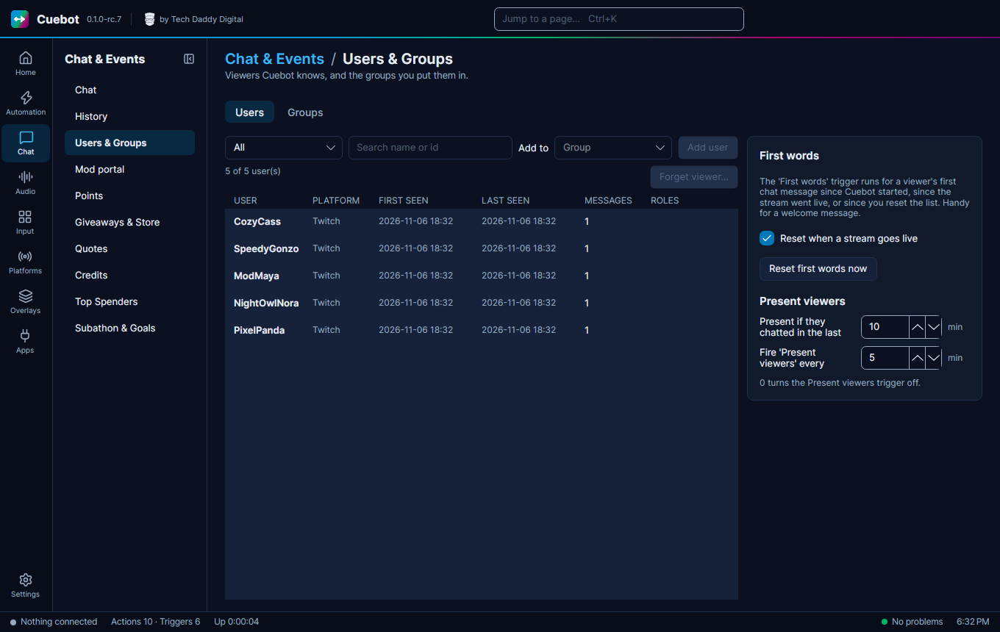

# Users and groups

Cuebot remembers the viewers it has seen. You can sort them into **groups**, like `Regulars` or `Friends`, and then
give a group special rights or more points.

**Chat > Users & Groups** lists the viewers Cuebot has seen. On the **Groups** tab you make groups: type a **New group
name** and click **Create**. Use groups to:

- let only that group use a command (see [Chat commands](commands.md#permissions));
- give that group a points multiplier (see [Points](points.md#how-viewers-earn-points)).

## Putting people in a group

On the **Users** tab, select a viewer, pick the group under **Add to** and click **Add user**. Or, on the **Groups**
tab, select the group and type the name under **Add a member**. **Clear members** empties a group; **Delete group**
removes it.

!!! note "Renaming a group"
    If you rename a group, commands that allow or deny it by name are not updated. Check them on the Commands page.

## First words

The **First words** trigger runs for a viewer's first chat message, handy for a "welcome in!". Tick **Reset when a
stream goes live** so everyone can be welcomed once per stream, or click **Reset first words now** to start over.

## Present viewers

The **Present viewers** trigger runs every few minutes with everyone who chatted recently, for example to give them
points for watching. Set how recently (**Present if they chatted in the last** … min) and how often (**Fire 'Present
viewers' every** … min; 0 turns it off).

## Forgetting a viewer

**Forget viewer…** deletes everything Cuebot saved about the selected viewer, for example when they ask you to delete
their data. Cuebot asks you to confirm first.
