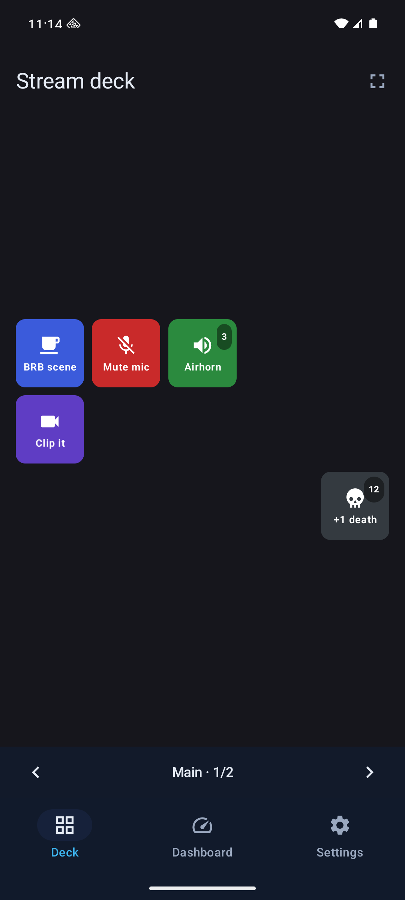
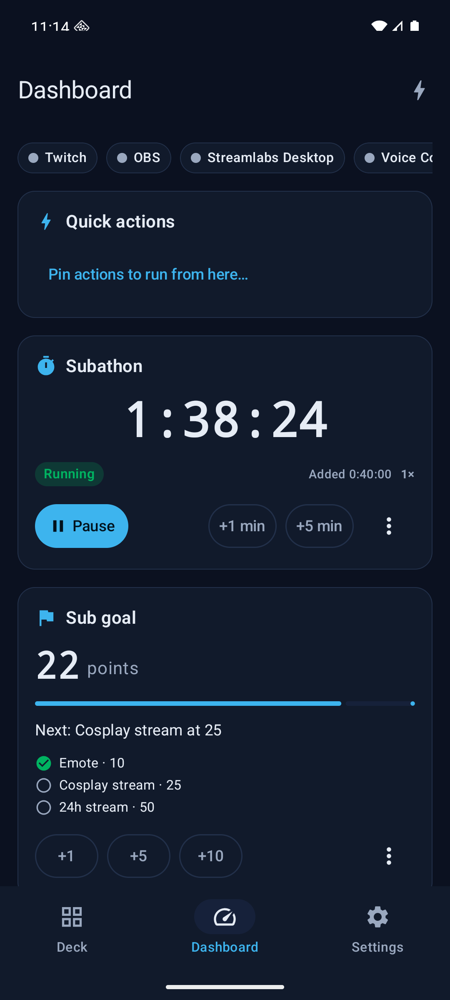
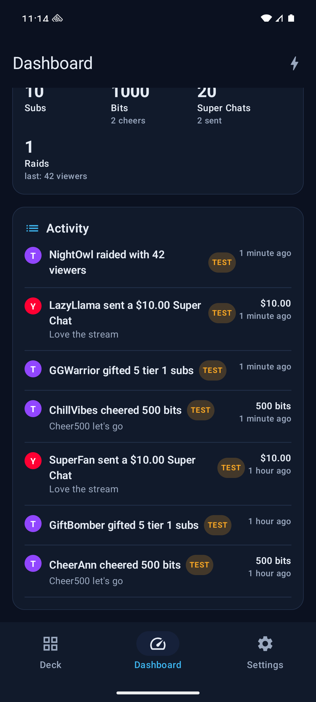
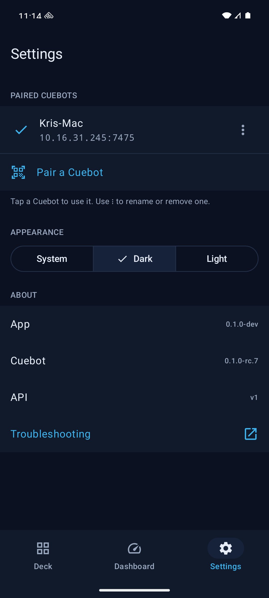
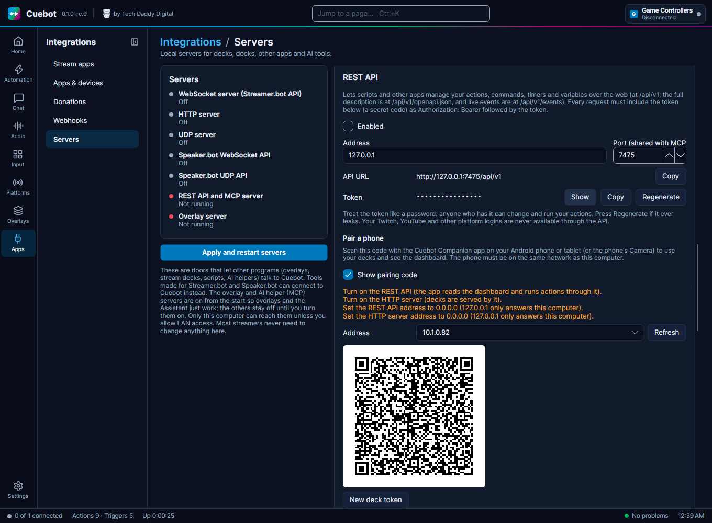

# The phone app (Cuebot Companion)

**Cuebot Companion** puts your Cuebot on your phone or tablet. Use it as a button board next to your keyboard, or
to keep an eye on your stream from the couch.

It has three tabs:

| Tab | What it is for |
| --- | --- |
| **Deck** | The buttons of your [decks](stream-apps-and-devices.md#decks-buttons-on-your-phone). Tap one and Cuebot runs it, just like a Stream Deck. **Choose deck** switches decks, and the arrows at the bottom switch pages. |
| **Dashboard** | What is connected, your **Quick actions**, your [subathon timers and goals](subathon-and-goals.md) with their buttons, **Top spenders** for **This stream** and more, totals, and the **Activity** list of follows, subs, tips and raids. |
| **Settings** | The Cuebots you paired, light or dark look, and **Troubleshooting**. |

## Get the app

| Phone | How to get it |
| --- | --- |
| **Android** 10 or newer | Download `Cuebot-Companion-<version>.apk` from the [releases page](https://github.com/TechDaddyKB/cuebot/releases), next to the computer downloads. |
| **iPhone and iPad** | Not available yet. It comes to the App Store (first through TestFlight) later. |

**Installing the APK on Android:** open the downloaded file on your phone. Android asks if your browser (or file app)
may install apps: tap **Settings**, switch on **Allow from this source**, go back and tap **Install**. You only do
this once. The app is signed by Cuebot, so later versions install over it and keep your settings.

## Pair it with your Cuebot

The phone and the computer must be on the **same network**: the same Wi-Fi at home, for example.

**On the computer:**

1. Go to **Integrations > Servers**.
2. Make sure the **REST API** and the **HTTP server** are on, and **Allow LAN connections** is ticked.
3. In the REST API card, find **Pair a phone** and tick **Show pairing code**.
4. Pick your home network under **Address** (it usually starts with `192.168`). A QR code appears.

If something stops the phone from connecting, the card lists what to change first.

**On the phone:**

1. Open Cuebot Companion and go to **Settings**.
2. Tap **Pair a Cuebot**.
3. Point the camera at the QR code. It connects straight away.
    - Or tap **Enter the details instead**. There you can type the address and token yourself, use **Choose an image
      of the code** (a screenshot or photo of it), or **Paste a pairing link**.

You can also scan the code with the phone's own **Camera** app. It opens Cuebot Companion, which asks you to check
that it is your Cuebot before it pairs.

!!! warning "The code is a key"
    The pairing code holds the password (token) to your Cuebot. Untick **Show pairing code** when you're done, and
    never show it on stream. If someone saw it anyway, click **Regenerate** next to the REST API token and
    **New deck token** under **Pair a phone**, then pair your phone again.

You can pair more than one Cuebot, like a gaming PC and a streaming PC. Tap one in **Settings** to use it.

## Using it on stream

- **Stream mode** (on the Deck tab) shows only the buttons, full screen, and keeps the screen from turning off. Handy
  for a phone on a stand next to your keyboard.
- **Subathon and goal buttons** on the Dashboard work like the ones in Cuebot: start or pause the timer, add a
  minute or five, add goal points, or **Set points…** by hand.
- **TEST** badges in the Activity list mark test events: the ones you start with **Test trigger…**, a service's test
  button or the assistant's emulator. They don't count towards top spenders, but they *do* move subathon timers and
  goals, so you can try those out.

## It doesn't connect?

Open **Settings > Troubleshooting** in the app. It goes through the usual causes one by one:

- Is the phone on the same Wi-Fi as the computer? (Not on mobile data, and not on a guest network.)
- On the computer: are the **REST API** and **HTTP server** on, with **Allow LAN connections** ticked, and listening
  on `0.0.0.0`? See [Cuebot's servers](servers.md).
- Is a firewall on the computer blocking Cuebot? On Windows, allow Cuebot on **private networks** when Windows asks.
- On Android 17 and newer, the app needs **local network access** (**Nearby devices** in the app's settings). It
  asks for it once you have paired.
- Did the computer get a new address? Pair again with a fresh code.

!!! note "New"
    The phone app is new. Tell us what works and what doesn't on the
    [issues page](https://github.com/TechDaddyKB/cuebot/issues). See also [What's experimental](experimental.md).
