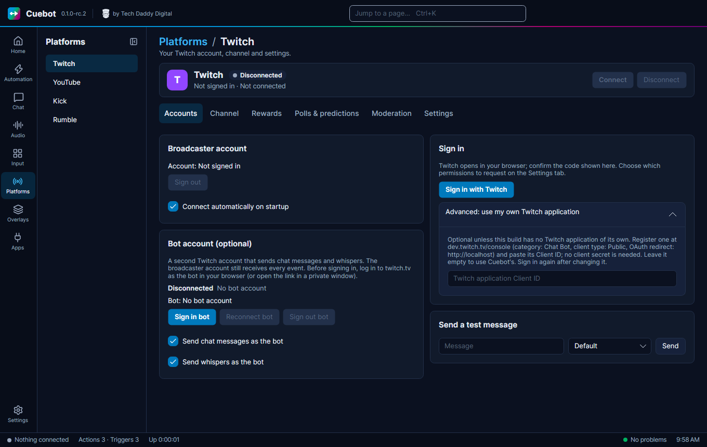

# Connecting your platforms

Cuebot needs to be signed in to the places you stream, so it can read chat, see follows and post messages. Each platform
has its own page under **Platforms** in the left rail: **Twitch**, **YouTube**, **Kick** and **Rumble**.

Every platform page has **Connect** and **Disconnect** buttons at the top. Tick **Connect automatically on startup**
(on Rumble: **Connect automatically**) and Cuebot reconnects each time it starts.

!!! note "Your sign-ins stay on your computer"
    Cuebot stores sign-ins in a locked (encrypted) form on your computer. They are never put in backups and never
    leave your computer, except to talk to the platform itself.

## Broadcaster account and bot account

- Your **broadcaster account** is the channel you stream on. Cuebot gets every event (follows, subs, raids) through
  it. You always need this one.
- A **bot account** is optional. It is a second account, for example "MyChannelBot", that writes Cuebot's chat messages.
  Viewers then see the bot talking, not you.

!!! tip "Signing in the bot"
    Your browser is probably logged in as you. Before you sign in the bot, log in as the bot in your browser, or open
    the sign-in link in a private window. Otherwise the platform signs in the wrong account.

## Twitch

1. Go to **Platforms > Twitch**, tab **Accounts**.
2. Under **Broadcaster account** click **Sign in with Twitch**.
3. Twitch opens in your browser and Cuebot shows a code. Confirm that code on Twitch.
4. Cuebot connects by itself.

**Bot account:** under **Bot account (optional)** click **Sign in bot**, then confirm the code while logged in as the
bot. Tick **Send chat messages as the bot** and, if you like, **Send whispers as the bot**. Use **Send a test message**
to check it.

**Permissions:** the **Settings** tab lists every permission Cuebot asks Twitch for, under **Permissions (scopes)**. You
can untick ones you do not want. Anything that needs a missing permission is skipped and a warning goes to the log.
Sign in again after you change the list.

The other tabs on the Twitch page: **Channel** (title, category and more), **Rewards** (channel point rewards),
**Polls & predictions** and **Moderation**.

## YouTube

1. Go to **Platforms > YouTube** and click **Sign in with the browser**. (No browser on this computer? Use **Sign in
   with a code**.)
2. Google asks which account to use. Pick the channel you stream on.
3. Allow Cuebot to manage your YouTube account.

!!! note "\"Google hasn't verified this app\""
    While Google is still checking Cuebot, you may see this warning. Click **Advanced**, then **Go to Cuebot**.

Cuebot finds your live stream by itself and reads its chat once you go live. A bot account is optional, with **Sign
in bot with the browser**.

**Quota (YouTube's daily limit).** YouTube gives every app a daily allowance of "units", and every request Cuebot
makes uses some. The **Polling and quota** part of the page shows how much Cuebot expects to use and how much it used
today. If you stream a lot and run out, open **Advanced: use my own Google Cloud project** and follow the steps
there. That gives you your own allowance.

## Kick

1. Go to **Platforms > Kick**. In your browser, log in to Kick as your streaming account first.
2. Click **Sign in broadcaster**.
3. Approve Cuebot in the browser window that opens.

Cuebot looks up your channel by itself. If kick.com blocks that, the page shows how to copy two numbers from kick.com
into the **Channel id** and **Chatroom id** boxes.

**Bot account:** click **Sign in bot account**. On the Kick page you can also set your stream title and category and
manage channel rewards.

## Rumble

Rumble works a little differently. Reading works with a "key link" from Rumble. Writing in chat needs a sign-in.

1. On rumble.com, open your account menu, then **Live Stream API**. Make a key and copy the **whole** web link.
2. In Cuebot go to **Platforms > Rumble** and paste the link into the box. It starts with
   `https://rumble.com/-livestream-api/get-data?key=`.
3. Click **Connect**. Cuebot now sees followers, subscribers, rants (paid chat messages), whether you are live, and your
   chat.
4. **To write in chat (optional):** under **Send chat (optional)**, type your Rumble username and password and click
   **Sign in**. Cuebot keeps only the login session, never your password.

!!! warning
    Rumble has no official way for apps to write in chat. Sending messages may stop working if Rumble changes its
    website.

## Using your own app (advanced)

Cuebot signs in with its own app on Twitch, YouTube and Kick. You do not need to do anything. If you want to use your
own developer app instead, open the **Advanced** part of that platform's page and follow the steps there. Leave it
empty to use Cuebot's.

## Signing out

Click **Sign out** on the platform page. Cuebot also asks the platform to cancel its access.

Next: [How actions work](actions-and-triggers.md).
