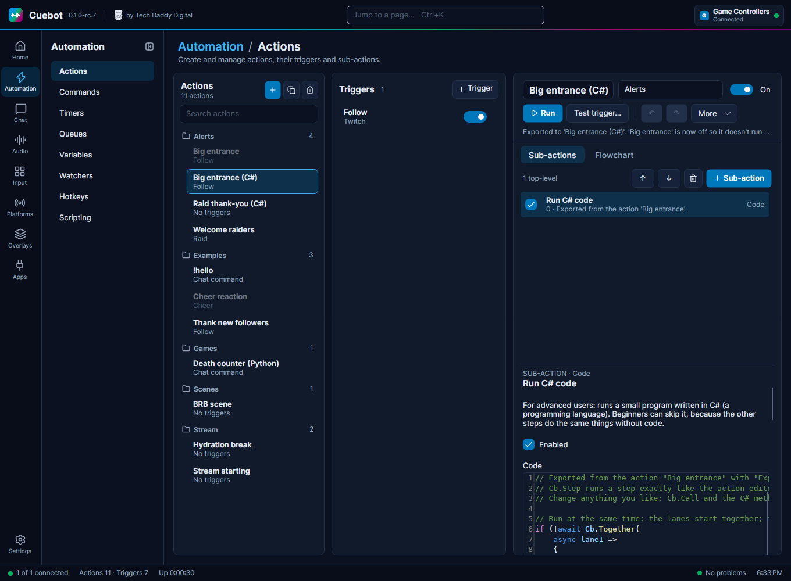

# Turn an action into code

Built an action with steps, and now you want to do more with it than the steps allow? You don't have to start
over. Cuebot can **write the code for you**: **Export to code** turns the whole action into one C# or Python script
that you can change as you like. New to code? Read [Writing code (C# and Python)](writing-code.md) first.

## Exporting an action

1. Right-click the action in the list, or open **More** in the action editor.
2. Pick **Export to code**, then **C#** or **Python**.
3. Cuebot makes a **copy** called, for example, "Big entrance (C#)". It has the same triggers, queue and options, but
   only **one step**: a code step with the whole action written as code.
4. The **original is switched off**, so a follow doesn't run both. It stays in the list as a backup. Switch it back on
   (and the copy off) to go back.

Think of it like a recipe card. The steps were the recipe written as pictures. The export writes the same recipe out
in words, so you can add your own notes and changes.

## What the code looks like

The flow of the action becomes real code you can change. Every other step becomes one line that runs that step
exactly like before:

| In the editor | In the code |
| --- | --- |
| A normal step | `cb.run_step("obs.setScene", {...})` in Python, `await Cb.Step("obs.setScene", new() { ... })` in C#. Its settings stay as they were, `%variables%` included, and Cuebot fills them in the same way. |
| **If** | `if cb.check("%bits%", "greater than", "499"):` in Python, `if (await Cb.Check(...))` in C#. Same comparisons as the If step. |
| **Switch** | An `if` / `elif` (or `else if`) for each case, and `else` for **Default**. |
| **While**, **Loop break**, **Loop continue** | A loop with `break` and `continue`. `%loopIteration%` still counts the rounds. |
| **Stop action** | `return False` (Python) or `return false;` (C#). |
| **Group** | Its steps, with a comment where the group starts and ends. A random group becomes `cb.pick(...)`. |
| **Run at the same time** | In C#: `Cb.Together(...)` with one piece of code per lane. In Python: see below. |
| A step that is switched off | Left out, with a comment where it was. |

Once it is code, change whatever you like. You can replace a `run_step` line with a named method
(`cb.twitch_send_message(...)`, see [Python in detail](python.md)), add your own checks, maths, lists, or anything
else Python or C# can do.

## Good to know

- **The code step has no time limit** (its **Timeout (seconds)** is 0), because waits that were steps now happen inside the
  code. Set one if you like.
- **Python does one thing at a time.** In Python, a **Run at the same time** step (and the action option
  **Concurrent sub-actions**) stays as steps that Cuebot runs together for you, with `cb.run_steps([...])`. The lanes
  still run at the same time; you just edit them as data instead of code. C# writes real lanes.
- **Notes at the top.** When something could not become code, or works a little differently now, the export writes
  a note at the top of the code (and says how many there are). For example: another action uses **Turn sub-action
  on/off** on a step of this action. The copy has no separate steps, so that does nothing any more.
- **It is one-way.** The code can't be turned back into steps. That's why the original stays as a backup.
- **History** shows the code as one step, instead of every step.
- **Faster?** A little, sometimes. Most of the time an action waits for OBS, Twitch or a Delay, and the code waits
  just as long. Code is faster when you do lots of work in between, like a big loop or working with text. The big win
  is that you can change anything.
