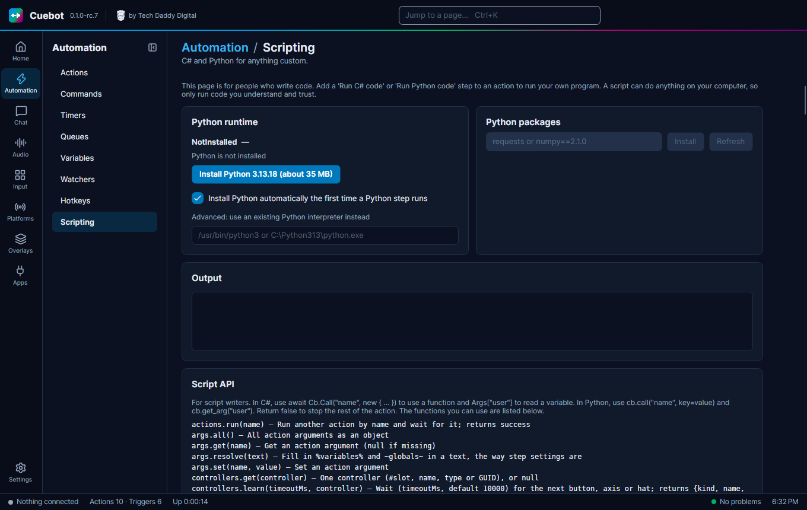

# Python in detail

This page is for when you want to write Python code inside your actions. If you have never written code, start with
[Writing code (C# and Python)](writing-code.md). It shows where the code goes and what a first script looks like.

You don't need code for most things! Every sub-action in the action editor works without it. Code is for the few
jobs that need a bit of maths, a loop or a decision that the normal steps can't make.


## The short version

- Add a **Run Python code** step to an action and type your code into the **Code** box.
- Your code gets a helper called `cb`. Everything Cuebot can do is a method on `cb`.
- Every Cuebot function has its own method: `cb.twitch_send_message("Hi!")`, `cb.obs_set_scene("Gameplay")`,
  `cb.vtubestudio_move_model(position_x=0.5)`. There are almost 500 of them.
- `print("text")` writes into the action's log. `return False` stops the action.

## The `cb` helper

`cb` is like a remote control for Cuebot. You don't have to set it up: it is already there when your code starts.

It has two kinds of buttons:

1. **A few everyday helpers**, for the things almost every script needs:

    | Helper | What it does |
    | --- | --- |
    | `cb.args` | All the action's variables when the code started, as a dictionary, like `{"user": "PixelPanda", "message": "hi"}`. |
    | `cb.get_arg("user", "friend")` | One variable. The second value is used when the variable isn't there. |
    | `cb.set_arg("score", 10)` | Sets a variable. Later steps can use it as `%score%`. |
    | `cb.get_global("deaths", 0)` | Reads a saved value (a [global variable](../actions/variables.md)). |
    | `cb.set_global("deaths", 7)` | Saves a value. It is still there after Cuebot restarts. |
    | `cb.log("text")` | Writes a line in Cuebot's log. |
    | `cb.run_action("BRB scene")` | Runs another action and waits for it. Gives back `True` when it worked. |
    | `cb.send_chat("Hi!")` | Says something in your Twitch chat. |
    | `cb.speak("Hello")` | Says it out loud with text-to-speech. |
    | `cb.obs("GetVersion")` | Sends one raw request to OBS. |
    | `cb.run_step("core.log", {"message": "Hi %user%"})` | Runs any step, exactly like the action editor does. Gives back the way it picked (like `"True"`), or `None`. |
    | `cb.check("%bits%", "greater than", "499")` | Checks something the way the **If** step does. Gives back `True` or `False`. |
    | `cb.resolve("Hi %user%")` | Fills in `%variables%` and `~globals~` in a text, like a step's settings. |
    | `cb.pick(1, 3)` | Picks a position at random by weight (0 = the first, here 1 in 4). |
    | `cb.run_steps([...])` | Runs a list of steps (with the steps inside them), the way they are saved. Gives back `"completed"` or `"stop"`. |

2. **One method for every Cuebot function**: chat, OBS, points, quotes, the subathon timer, VTube Studio, Stream
   Deck, music, and everything else. That's the next section.

## One method for every Cuebot function

Cuebot has a big list of [script functions](../../reference/script-functions/index.md). Each one has a name with a dot,
like `obs.setScene`. In Python, each one is also a method of `cb`, with the dot turned into `_` and the capital
letters turned into `_` plus a small letter:

| Function | Python method |
| --- | --- |
| `twitch.sendMessage` | `cb.twitch_send_message(...)` |
| `obs.setScene` | `cb.obs_set_scene(...)` |
| `vtubestudio.moveModel` | `cb.vtubestudio_move_model(...)` |
| `points.add` | `cb.points_add(...)` |

The values change the same way: `sceneName` becomes `scene_name`, `positionX` becomes `position_x`. Each function's
page in the reference shows both names, in the **Value** and **In Python** columns.

### Required and optional values

Some values are needed and some can be left out. The reference marks the ones you can leave out with **Optional**.

- **Needed values** can be typed in order, without their names:

    ```python
    cb.twitch_send_message("Thanks for the raid!")
    cb.obs_set_scene("Gameplay")
    ```

- **Optional values** always need their name:

    ```python
    cb.obs_set_scene("Gameplay", connection="Second PC")
    cb.speech_speak("Hello chat", alias="Robot")
    ```

- Leaving an optional value out, or giving `None`, means "use the normal one". So these two do the same thing:

    ```python
    cb.speech_speak("Hello")
    cb.speech_speak("Hello", alias=None)
    ```

If you forget a needed value, or misspell a name, Python tells you straight away with a `TypeError` that names
the problem. That's on purpose: it is much easier to fix than a step that quietly does the wrong thing.

### What you get back

Many methods give you something back:

```python
scene = cb.obs_get_current_scene()      # text, like "Gameplay"
balance = cb.points_get()               # a number: the points of the viewer who triggered the action
quote = cb.quotes_random()              # a dictionary, like {"id": 3, "text": "...", "user": "...", ...}
timer = cb.subathon_get()               # a dictionary with "remainingSeconds", "state" and more
```

The **Gives back** line on each function's page says what comes back. Lists come back as Python lists, objects as
dictionaries, and "nothing" as `None`.

### Seeing the help while you write

Every method knows its own help. `help(cb.points_add)` prints it into the log, with every value explained.

For help while you type, with the names popping up as you write, use a code editor. See
[Using your own code editor](code-editors.md).

### The old way still works

`cb.call("obs.setScene", sceneName="Gameplay")` does the same as `cb.obs_set_scene("Gameplay")`. Older scripts keep
working. New scripts are easier to read with the named methods.

## Examples

### Count deaths in a game

A `!death` command adds one and tells chat:

```python
deaths = int(cb.get_global("deaths", 0)) + 1
cb.set_global("deaths", deaths)
cb.twitch_send_message(f"Death number {deaths}. Chat, it was lag.")
```

### Only do something for big raids

The raid trigger gives you `%viewers%`. A raid of 10 or more gets the party scene:

```python
viewers = int(cb.get_arg("viewers", 0))
if viewers >= 10:
    cb.obs_set_scene("Raid Party")
    cb.twitch_send_message(f"RAID! Welcome {viewers} friends!")
else:
    cb.twitch_send_message("Thanks for the raid!")
```

You can build the same thing without code, with an **If** step. See [The flowchart editor](../actions/flowchart.md).

### Give points to the person who triggered the action

Leaving the user out means "the viewer who started this action":

```python
cb.points_add(50)
balance = cb.points_get()
cb.twitch_send_message(f"{cb.get_arg('user')} now has {balance} points!")
```

### Add time to the subathon timer

```python
cb.subathon_add_time(300)                 # five more minutes on the first timer
left = cb.subathon_get()["remainingSeconds"]
cb.twitch_send_message(f"{int(left // 60)} minutes left on the clock!")
```

### Make a VTube Studio model walk across the screen

`vtubestudio_move_model` moves the model. Many small moves in a row look like walking:

```python
import math, time

for step in range(61):
    x = -1.2 + 2.4 * step / 60                          # from the left edge to the right edge
    bounce = abs(math.sin(step / 60 * math.pi * 12)) * 0.05
    cb.vtubestudio_move_model(time=0, position_x=x, position_y=-0.5 + bounce)
    time.sleep(0.1)
```

## When something goes wrong

- **A Cuebot function failed** (OBS is not connected, the viewer doesn't exist…): Python raises `CuebotError`. The
  step fails and the log says why. To carry on anyway, catch it:

    ```python
    try:
        cb.obs_set_scene("Gameplay")
    except CuebotError as error:
        print(f"OBS said no: {error}")
    ```

- **Your code has a mistake**: the log shows the error and the line number, like
  `NameError at line 3: name 'dethz' is not defined`.
- **The code runs too long**: every Python step has a **Timeout (seconds)** setting, 30 seconds unless you change it.
  After that Cuebot stops the code. Set it to 0 for no limit, for a script that really needs it.
- **Stop the action on purpose**: `return False` stops the action there, so the next steps don't run. Anything
  else, or no `return` at all, carries on.

## Python packages

Python can do more with packages: small add-ons other people wrote, like `requests` for websites.
**Automation > Scripting** installs them for you:

1. Type the package name, like `requests`, into **Python packages**.
2. Click **Install**.
3. Use it in your code: `import requests`.



Cuebot uses its own Python (3.13). It downloads it the first time a Python step runs, or when you click the
**Install Python** button at the top of the page. If you already have a Python you like, **Advanced: use an existing Python interpreter instead**
uses that one.

## Steps inside Python

Any step you can pick in the action editor also works from Python, with `cb.run_step`. Give it the step's id and its
settings. The [sub-actions reference](../../reference/sub-actions/index.md) shows every step's id and settings.

```python
# Show the confetti source, wait 4 seconds, hide it again
cb.run_step("obs.setSourceVisibility", {"scene": "Live", "source": "Confetti", "state": "Visible"})
cb.run_step("core.delay", {"milliseconds": "4000"})
cb.run_step("obs.setSourceVisibility", {"scene": "Live", "source": "Confetti", "state": "Hidden"})

if cb.check("%user%", "equals", "PixelPanda"):
    cb.send_chat(cb.resolve("Welcome back, %user%!"))
```

- Settings are written as text, the same as in the editor, and `%variables%` in them are filled in for you.
- When a step stops the action (like a **Stop action** step), the code stops there too, as if it said
  `return False`.
- This is what [Export to code](export-to-code.md) writes for you.

## Good to know

- **Variables are text or numbers.** `cb.get_arg("viewers")` might be the text `"42"`. Use `int(...)` or `float(...)`
  before doing maths.
- **Each run starts fresh.** A normal Python variable is gone after the step finishes. Use `cb.set_global` to keep
  a value until next time.
- **One script at a time.** Python steps take turns. A step that runs another action with a Python step inside it
  (`cb.run_action(...)`) still works.
- **The full list** of methods is in [Script functions](../../reference/script-functions/index.md). C# can use them
  too, with `Cb.Call`.
