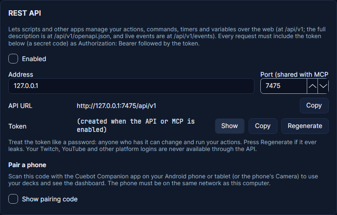
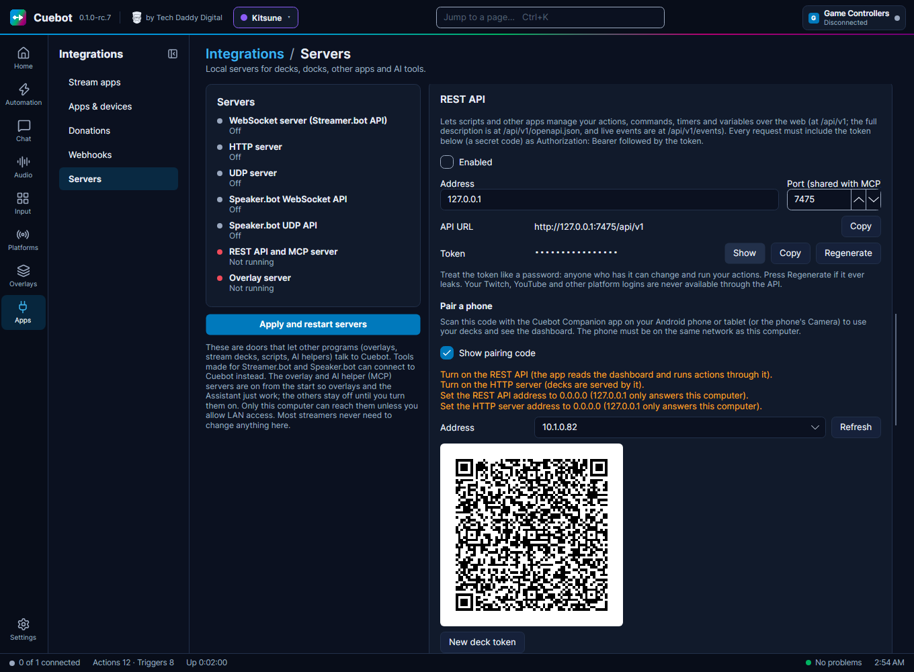

# REST API

The REST API is the biggest door into Cuebot. Other programs and scripts can use it to do nearly everything the app
can: actions, commands, timers, variables, chat, polls, giveaways, the store, media requests, speech, alerts, import
and export. The [Stream Deck plugin](../apps/stream-deck.md) and the [phone app](../mods/phone-app.md) use it too.

## Turning it on

It is off until you turn it on.

1. Go to **Apps > Servers** and find the **REST API** card.
2. Tick **Enabled** and click **Apply and restart servers**. (The [Stream Deck](../apps/stream-deck.md) page also has
   a **Turn on the REST API** button that does this for you.)
3. Click **Copy** next to **Token**. The token is a long secret password for programs. **Show** shows it on screen.

It listens on `http://127.0.0.1:7475/api/v1`. The MCP server for AI apps uses the same door number (port), but has
its own **Enabled** box. See [Cuebot's servers](servers.md) for letting other computers in.

!!! warning "Keep the token secret"
    Anyone with the token can control your Cuebot. Do not show it on stream. **Regenerate** makes a new one; the old
    one stops working at once, so update every script, AI app and other Cuebot that used it. Your platform sign-ins
    are never available through the API.

Every request needs the token in a header: `Authorization: Bearer YOUR_TOKEN`. Without it, Cuebot answers `401`.



## Your first request

Ask Cuebot how it is doing. Open a terminal (on Windows: **PowerShell**) and type:

=== "Windows (PowerShell)"

    ```powershell
    $headers = @{ Authorization = "Bearer YOUR_TOKEN" }
    Invoke-RestMethod -Uri "http://127.0.0.1:7475/api/v1/status" -Headers $headers
    ```

=== "curl (Linux, macOS, Windows)"

    ```bash
    curl -H "Authorization: Bearer YOUR_TOKEN" "http://127.0.0.1:7475/api/v1/status"
    ```

Cuebot answers with its version, which platforms are connected, and how many actions you have.

## Run an action

This runs the action called `Hello` and gives it the variable `%user%` = `Bob`:

=== "Windows (PowerShell)"

    ```powershell
    $headers = @{ Authorization = "Bearer YOUR_TOKEN" }
    $body = '{"args": {"user": "Bob"}}'
    Invoke-RestMethod -Method Post -Uri "http://127.0.0.1:7475/api/v1/actions/Hello/run" `
      -Headers $headers -ContentType "application/json" -Body $body
    ```

=== "curl"

    ```bash
    curl -X POST -H "Authorization: Bearer YOUR_TOKEN" -H "Content-Type: application/json" \
      -d '{"args": {"user": "Bob"}}' "http://127.0.0.1:7475/api/v1/actions/Hello/run"
    ```

=== "Python"

    ```python
    import requests

    answer = requests.post(
        "http://127.0.0.1:7475/api/v1/actions/Hello/run",
        headers={"Authorization": "Bearer YOUR_TOKEN"},
        json={"args": {"user": "Bob"}, "wait": True},
    )
    print(answer.json())
    ```

=== "JavaScript"

    ```js
    const answer = await fetch("http://127.0.0.1:7475/api/v1/actions/Hello/run", {
      method: "POST",
      headers: { Authorization: "Bearer YOUR_TOKEN", "Content-Type": "application/json" },
      body: JSON.stringify({ args: { user: "Bob" } }),
    });
    console.log(await answer.json());
    ```

- An action's name with a space goes in the address as `%20`: `actions/Thank%20followers/run`. The action's id
  works too.
- Without `"wait": true`, Cuebot starts the action and answers at once (`202`). With it, Cuebot answers when the action
  is done, and says whether it worked.

## What else it can do

Every address, with what to send and an example, is in the [REST API reference](../../reference/rest-api.md). The
short version:

| Address | What it is for |
| --- | --- |
| `/status`, `/openapi.json` | How Cuebot is doing; a full machine-readable description of the API |
| `/actions`, `/actions/{id}`, `/actions/{id}/run`, `/enable`, `/disable` | List, read, create, change, delete, run, switch on and off |
| `/triggers`, `/subactions`, `/scriptfunctions` | What triggers, sub-actions and script functions exist, with their settings |
| `/commands`, `/timers`, `/globals` | Chat commands, timers and global variables |
| `/history` | Recent runs, newest first |
| `/chat` | Read the combined chat, or send a message |
| `/speech`, `/alerts` | Pause, skip and mute text-to-speech and overlay alerts |
| `/polls`, `/predictions`, `/giveaway`, `/store`, `/media` | Cuebot's chat polls, points predictions, giveaways, points store and media requests |
| `/import/preview`, `/import/apply`, `/export` | Bring actions in (also from Streamer.bot), or pack them up to share |
| `/dashboard`, `/decks` | Everything the [phone app](../mods/phone-app.md) shows at once (connections, totals, subathon, top spenders, recent activity), and your decks |
| `/subathon/{timer}/{command}`, `/goals/{goal}/{command}` | Start, pause, add time to a subathon timer; add or set points on a goal |
| `/portal/changes` | Changes your mods made in the [mod portal](../mods/mod-portal.md) that wait for your OK (below) |
| `/events` | A live stream of everything that happens (below) |

When something is wrong, Cuebot answers with a number and a reason, like
`{"error": "Invalid request", "details": [{"path": "subActions[0].type", "message": "Unknown sub-action type"}]}`.
`400` means "check what you sent", `404` "not found", `409` "not right now" (for example, a poll is already running).

## Mod portal approvals

When a mod changes something in the [mod portal](../mods/mod-portal.md) that needs your OK, the change waits. Two
addresses let a program see and decide those changes (the phone app uses them for its approvals):

- `GET /api/v1/portal/changes` lists the waiting changes, the oldest first: who made it, what it changes, and when it
  runs out.
- `POST /api/v1/portal/changes/{id}/approve` applies a change; `POST /api/v1/portal/changes/{id}/reject` throws it
  away. When the thing changed since the mod asked, approving answers `conflict` and changes nothing; send
  `{"force": true}` to use the mod's version anyway.

The details are in the [REST API reference](../../reference/rest-api.md#mod-portal).

## Hearing about events

`/events` stays open and sends a message every time something happens: a follow, a chat message, an action that
finished. Programmers call this **Server-Sent Events**.

```bash
curl -N -H "Authorization: Bearer YOUR_TOKEN" "http://127.0.0.1:7475/api/v1/events?types=twitch.*"
```

Each event looks like this:

```text
event: twitch.follow
data: {"type":"twitch.follow","time":"2026-11-01T18:00:00+00:00","args":{"user":"Bob", ...}}
```

- `types` picks what you want, separated by commas: `twitch.follow,twitch.cheer`, or `twitch.*` for all of Twitch.
  Leave it out to get everything.
- `action.runCompleted` arrives every time an action finishes.
- A line `: ping` comes every 15 seconds so you know the line is still open.
- At most 16 programs can listen at the same time.

The event names are the trigger names Cuebot uses inside, like `twitch.follow` or `obs.sceneChanged`.
`GET /triggers` lists them all.

## Pair a phone



The [Cuebot Companion app](../mods/phone-app.md) for Android (and later iPhone and iPad) connects through the REST API
by scanning a code. The **Pair a phone** card is on **Apps > Servers**, with the REST API.

1. Tick **Show pairing code**.
2. Pick the **Address** of your home network (usually `192.168...`).
3. Scan the code with the app or the phone's Camera. The phone must be on the same network as this computer.

If something still stops the phone, the card lists what to change first: the REST API and
[HTTP server](http-server.md) on, **Allow LAN connections** ticked, and both servers listening on `0.0.0.0`. The code
holds your token, so keep it hidden while you stream. It also holds the [deck token](http-server.md#deck-token).
