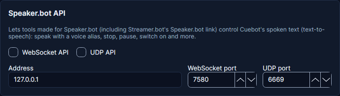

# Speaker.bot API

Tools and Streamer.bot setups made for Speaker.bot (a text-to-speech app) can make Cuebot speak instead. They can say
a message with a voice, stop, pause, and switch speech on and off.

## Turning it on

1. Go to **Apps > Servers** and find the **Speaker.bot API** card.
2. Tick **WebSocket API** (port 7580), **UDP API** (port 6669) or both.
3. Click **Apply and restart servers**.

Voices and aliases come from the [Text-to-speech](../sound/text-to-speech.md) page.



## WebSocket messages

They look like the [Streamer.bot ones](websocket-api.md):

```json
{ "request": "Speak", "id": "1", "voice": "Narrator", "message": "Thanks for the raid!" }
```

| Request | What it does |
| --- | --- |
| `Speak` | Says `message` with the voice alias `voice` (empty for your default). `badWordFilter: true` hides bad words; `wait: true` answers after it finished speaking; `silent: true` makes the sound file without playing it. Answers `success`, `duration` (milliseconds) and `speechFile`. |
| `Stop` / `Clear` | Stops what is speaking now / empties the waiting line. |
| `Enable` (`On`) / `Disable` (`Off`) | Switches speech on or off. |
| `Pause` / `Resume` | Holds the waiting line, or lets it go again. |
| `SetEnabled` / `SetPaused` | `state`: `enabled`, `disabled` or `toggle` / `paused`, `enabled` or `toggle`. |
| `Events` | `state`: `on`, `off` or `toggle`: speaking events (follows, cheers, …) on or off. |
| `Mode` | `mode`: `all` reads all chat, `command` only messages that use the speak command. |
| `ActivateVoiceGate` | Switches to another voice gate `profile`. |
| `GetAliases`, `GetVoices`, `GetState`, `GetInfo` | Lists your aliases or voices, or tells you whether speech is on and paused. |
| `Subscribe` / `UnSubscribe` | Sends you `SpeechStarted`, `SpeechFinished` and `StateChanged` events. |

## UDP messages

UDP messages use `command` instead of `request`, like `{"command": "speak", "voice": "Narrator", "message":
"Hi"}`. The commands are `speak`, `stop`, `enable` (`on`), `disable` (`off`), `pause`, `resume`, `clear`, `events`
(`state`), `profile` (`profile`), `reg` (`mode` add or del, `user`), and `set` with `method: "nickname"`
(`username`, `nickname`). Speaker.bot's `set sticky` and `assign last` are not supported, and are noted in the log.
