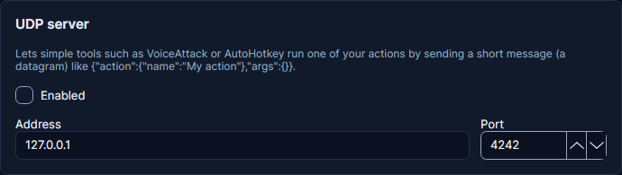

# UDP server

UDP sends one tiny message and does not wait for an answer. Some older tools and game mods use it to tell Cuebot
"run this action".

## Turning it on

1. Go to **Apps > Servers** and find the **UDP server** card.
2. Tick **Enabled** and click **Apply and restart servers**.

It listens on port 4242 on this computer. Other devices need [Allow LAN connections](servers.md#keeping-it-safe).



## Sending a message

Send this:

```json
{ "action": { "name": "Hello" }, "args": { "user": "Bob" } }
```

=== "Windows (PowerShell)"

    ```powershell
    $udp = New-Object System.Net.Sockets.UdpClient
    $bytes = [Text.Encoding]::UTF8.GetBytes('{"action": {"name": "Hello"}, "args": {"user": "Bob"}}')
    $udp.Send($bytes, $bytes.Length, "127.0.0.1", 4242) | Out-Null
    ```

=== "Python"

    ```python
    import json, socket

    message = json.dumps({"action": {"name": "Hello"}, "args": {"user": "Bob"}})
    socket.socket(socket.AF_INET, socket.SOCK_DGRAM).sendto(message.encode(), ("127.0.0.1", 4242))
    ```

Cuebot only understands "run this action". Anything else is ignored, and noted in the log.
