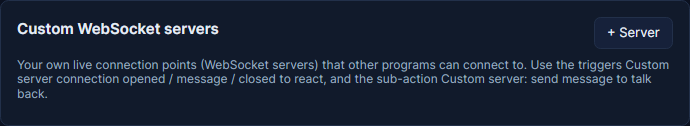
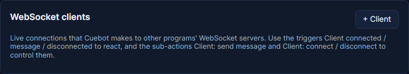

# Your own WebSocket servers and clients

A WebSocket is a live, two-way connection between two programs. Cuebot can run WebSocket servers of your own, and
connect to other programs' WebSocket servers, so your actions can talk to tools you build yourself. This is for
people who build their own tools. Most streamers can skip it.

Both live on **Apps > Servers**, and each one has its own start or connect button.

## Your own server

Other programs connect to it, and your actions answer.

1. On the **Custom WebSocket servers** card, click **+ Server**.
2. Give it a **Name** and a **Port**. Actions use the name to pick the server.
3. Tick **Start with Cuebot** to start it by itself, or click **Start / stop** to start it now.

The triggers **WebSocket › Custom server: message** (and connection opened / closed) run when a program talks to it.
The step **Custom server: send message** answers.

## Connecting to someone else's server

Cuebot connects to another program's WebSocket server, and your actions hear what it sends.

1. On the **WebSocket clients** card, click **+ Client**.
2. Type its address, like `ws://127.0.0.1:9000/`. It starts with `ws://` or `wss://`.
3. Click **Connect / disconnect**. Tick **Connect with Cuebot** to connect by itself next time, and **Reconnect** to
   keep trying when the connection drops.

The trigger **WebSocket › Client: message** runs when that server sends something. The step **Client: send message**
sends to it.

See the [WebSocket triggers](../../reference/triggers/websocket.md) and
[WebSocket sub-actions](../../reference/sub-actions/websocket.md).
