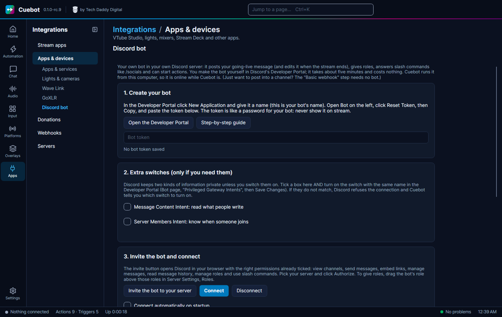

# Discord bot

Cuebot can run **your own Discord bot** in your own Discord server. The bot can:

- post your "I'm live!" message, with a nice coloured box (an **embed**), and change it to "Stream ended" later;
- give people a role, like **Live notifications**, or take it away;
- answer **slash commands** that people type in Discord, like `/socials`;
- start your actions when someone posts a message or joins the server.

You make the bot yourself. It is free and takes about five minutes. Cuebot runs the bot from your computer, so the bot is
online while Cuebot is open. There is no website or server to rent.

!!! warning "Experimental"
    The Discord bot is built and checked by Cuebot's own tests, with a pretend Discord. It has not been tried with a
    real bot token and a real Discord server yet, so parts of it may not work. If you try it, please tell us how it
    went: **Settings > Support**, **Send report**. See [What's experimental](experimental.md).

!!! tip "Only want to post a message?"
    For a simple post in one channel you do not need a bot: the **Discord > Basic webhook** step is enough (see the
    [Discord sub-actions](../reference/sub-actions/discord.md#basic-webhook)). Make a bot when you want to edit posts,
    give roles or use slash commands.

## 1. Make the bot in the Developer Portal

1. Open [discord.com/developers/applications](https://discord.com/developers/applications) and sign in with your
   normal Discord account. (In Cuebot, **Apps > Apps & devices**, tab **Discord bot**, the button **Open the Developer
   Portal** opens the same page.)
2. Click **New Application** (top right). Type a name, for example `MyStream Bot`. This is the name people will see.
   Tick the box to accept Discord's terms and click **Create**.
3. On the left, click **Bot**.
4. Click **Reset Token**, then **Yes, do it!**. Discord may ask for your password or a code from your phone.
5. Click **Copy**. The **token** is now copied. It is like a password for your bot.
6. In Cuebot, paste the token into the **Bot token** box on the **Discord bot** tab. Cuebot hides it and stores it
   encrypted.

!!! warning "Keep the token secret"
    Anyone with the token can control your bot. Never show it on stream and never send it to anyone. If it leaks, go back
    to the **Bot** page and click **Reset Token** again: the old one stops working, and you paste the new one into Cuebot.

## 2. Turn on the extra switches (only if you need them)

Discord keeps two things private unless you switch them on. You only need them for some triggers:

| Switch | What it unlocks in Cuebot |
| --- | --- |
| **Message Content Intent** | The **Message posted in a channel** trigger can read what people write. |
| **Server Members Intent** | The **Member joined the server** trigger (welcome messages, starter roles). |

Slash commands, posting messages and giving roles work **without** these switches.

To turn one on:

1. In the Developer Portal, on the **Bot** page, scroll down to **Privileged Gateway Intents**.
2. Turn on the switch (for example **Message Content Intent**) and click **Save Changes** at the bottom.
3. In Cuebot, tick the box with the same name on the **Discord bot** tab.

Both places must match. If you tick a box in Cuebot but not in the portal, Discord refuses the bot, and Cuebot tells you
which switch to turn on. For a bot in your own server these are simple switches: Discord only reviews them for apps that
reach 10,000 users.

## 3. Invite the bot to your server

1. In Cuebot, click **Invite the bot to your server**. Your browser opens a Discord page.
2. Pick your server under **Add to server** and click **Continue**.
3. The permissions are already ticked: View Channels, Send Messages, Embed Links, Manage Messages, Read Message History,
   Manage Roles and Use Application Commands. Click **Authorize**.
4. Back in Cuebot, click **Connect**. The status turns to **Connected**, and **Your bot's servers** lists your server,
   its channels and roles. Tick **Connect automatically on startup** so the bot is always there.

!!! note "Giving roles: the bot's role must be higher"
    Discord only lets a bot give roles that are **below** its own role. In Discord open **Server Settings > Roles** and
    drag the bot's role (it has the bot's name) **above** the roles it should give, like *Live notifications*.

## 4. Slash commands

1. On the **Discord bot** tab, under **Slash commands**, click **Add command**.
2. Type the name without the slash, like `socials`, and a short description, like `Shows my socials`.
3. Optional: a **Text box**, for something people type after the command (for example `song`). Your action gets what
   they typed as `%option%`.
4. Click **Register**. The commands appear in your server straight away: type `/` in Discord to see them.
5. Make an action with the trigger **Discord > Slash command used** and type the command name in **Command**.
6. Add the step **Discord > Reply to slash command** to answer.

Discord shows "*Bot is thinking…*" until the answer comes. If your action has no reply step, the bot answers with the
**Default reply** (normally `Done ✅`) when the action is done, so it never keeps thinking forever. Tick **Only they see
the answer** for answers just for the person who asked.

## Examples

### Going-live post that changes when the stream ends

1. Make an action **Going live** with the trigger **Twitch > Stream online** (or YouTube, Kick…).
2. Add **Discord > Send message (bot)**:
    - **Channel**: pick `#announcements` from the list.
    - **Text**: `@everyone I'm live! Come say hi` (to ping a role instead, see *Troubleshooting*).
    - **Embed title**: `I'm live!`, **Embed link**: your channel link, **Embed colour**: `twitch`,
      **Embed image URL**: a picture of you or your game.
    - **Remember it as**: `live post`.
3. Make an action **Stream ended** with the trigger **Twitch > Stream offline**.
4. Add **Discord > Edit message (bot)**: **Message** `live post`, **New text** `Stream ended. Thanks for watching!`,
   **Embed colour** `#808080`.

Pinging `@everyone` only works when the bot is allowed to **Mention @everyone, @here and All Roles** in that channel.

### A "Live notifications" role with /notify

1. Make a role **Live notifications** in Discord (Server Settings > Roles) and drag the bot's role above it.
2. In Cuebot add a slash command `notify` with the description `Get pinged when I go live`, and click **Register**.
3. Make an action with the trigger **Slash command used**, command `notify`, and add:
    - **Discord > Give a role**: **Member** `%userId%`, **Role** `Live notifications`.
    - **Discord > Reply to slash command**: `You will now be pinged when I go live, %user%!`
4. In your going-live post write `<@&ROLE_ID>` to ping that role. (Get the role ID in Discord: turn on **User Settings >
   Advanced > Developer Mode**, then right-click the role in Server Settings > Roles and choose **Copy Role ID**.)
   For the ping to work, open the role in Server Settings > Roles and turn on **Allow anyone to @mention this role**.

Want an "unsubscribe" command too? Make `/unnotify` the same way with **Take away a role**.

### /socials

1. Add a slash command `socials` (description `My socials`) and click **Register**.
2. Make an action with the trigger **Slash command used**, command `socials`, and the step **Reply to slash command**
   with the text `Twitch: twitch.tv/yourname · YouTube: youtube.com/@yourname · TikTok: tiktok.com/@yourname`.

## Troubleshooting

| What you see | What to do |
| --- | --- |
| "Discord did not accept the bot token" | The token is wrong or was reset. In the portal open **Bot**, click **Reset Token**, **Copy**, and paste it into Cuebot again. |
| "Discord refused the bot's switches" | A box is ticked in Cuebot but the switch is off in the portal. Turn it on under **Bot > Privileged Gateway Intents** and click **Save Changes**, or untick it in Cuebot. Then click **Connect**. |
| "The bot is missing a permission: it needs …" | Give the bot's role that permission in **Server Settings > Roles**, or in the channel's settings under **Permissions**. Or invite the bot again with Cuebot's button. |
| Giving a role fails with "Manage Roles" | Drag the bot's role **above** the role it gives (Server Settings > Roles). Discord does not let bots give roles higher than their own. |
| "The bot cannot see that channel" | Open the channel's settings, **Permissions**, add the bot's role and allow **View Channel** and **Send Messages**. |
| Slash commands do not show up | Click **Register** again while the bot is in your server. If Discord says "Use Application Commands", invite the bot again with Cuebot's button (it adds the slash command permission). |
| "Message posted" runs but `%message%` is empty | Turn on **Message Content Intent** in the portal and tick it in Cuebot, then click **Connect**. |
| "Member joined" never runs | Turn on **Server Members Intent** in the portal and tick it in Cuebot, then click **Connect**. |
| The bot shows "thinking…" and then fails | Discord allows 15 minutes to answer a slash command. Keep slow steps (long waits) out of slash command actions. |

The Discord steps are listed in the [sub-action reference](../reference/sub-actions/discord.md) and the triggers in
the [trigger reference](../reference/triggers/discord.md).
