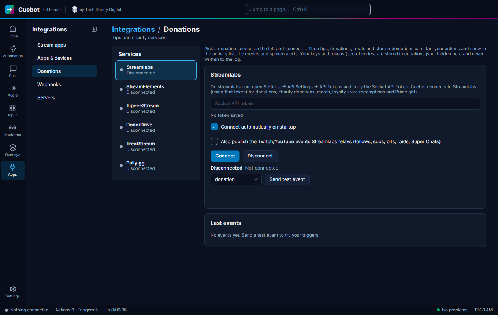
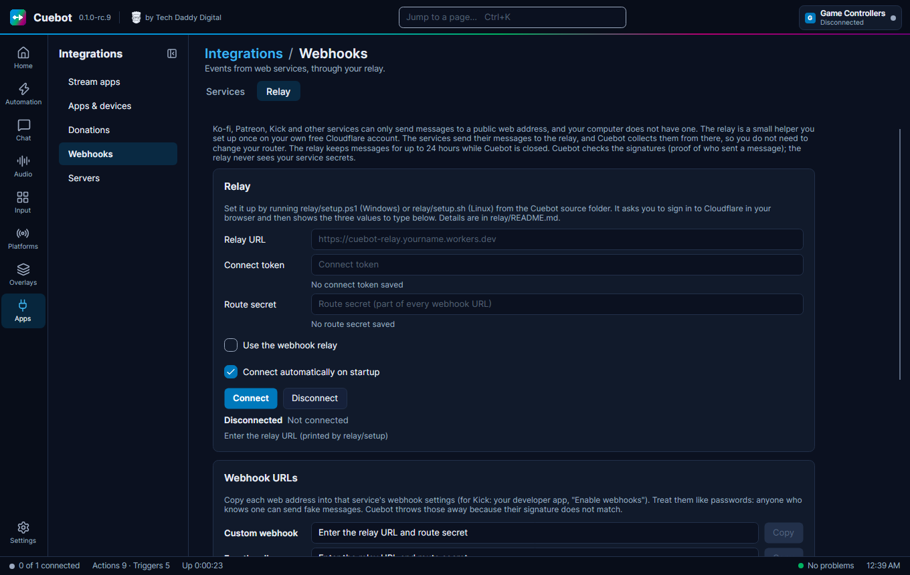
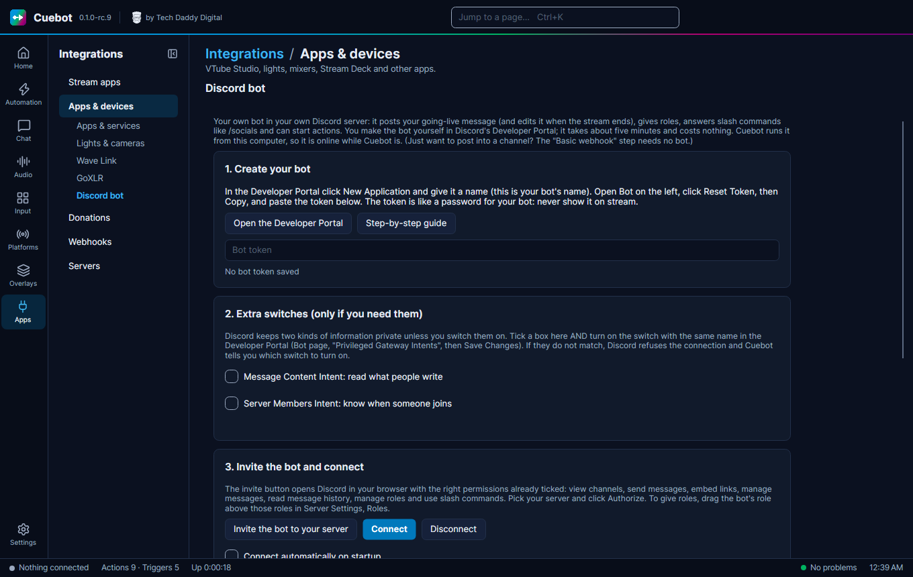

# Donations and integrations

Cuebot can hear about tips, donations and purchases, and turn each one into a trigger. Example: someone tips $5 on
Ko-fi, and Cuebot thanks them in chat and shows an alert.

Everything here is under **Apps** in the left rail. Keys and tokens you type in are hidden on screen, stored locked
(encrypted) on your computer, and never written to the log.

## Tip and donation services

Go to **Apps > Donations**. Pick a service on the left.

| Service | What to paste |
| --- | --- |
| **Streamlabs** | On streamlabs.com open **Settings > API Settings > API Tokens** and copy the **Socket API Token**. |
| **StreamElements** | On streamelements.com open your account, then **Channels**, choose **Show secrets** and copy the **JWT Token**. |
| **TipeeeStream** | The **API key** from your TipeeeStream account's API page. |
| **Pally.gg** | On pally.gg open **Dashboard > Settings > API Keys** and make a key for Cuebot. |
| **DonorDrive (Extra Life and other charities)** | No key: the charity site's address and your **Participant or team id** (the number in your fundraising page's address). |
| **TreatStream** | Nothing to paste: click **Sign in with TreatStream** and allow Cuebot in your browser. |

Then:

1. Click **Connect**.
2. Tick **Connect automatically on startup**.
3. Click **Send test event** to check that your actions react.

Each tip then starts triggers (look in the [trigger reference](../reference/triggers/index.md) under the service's
name), and shows up in your alerts, credits and spoken events.

!!! warning "Partly checked"
    Streamlabs and StreamElements connected for real, and DonorDrive read a real Extra Life team. But no real tip or
    donation has come in through Cuebot yet. Use **Send test event** to check your actions, and please tell us if a
    real tip does not show up. See [What's experimental](experimental.md).

## Webhooks: Ko-fi, Patreon, Throne and more

Some services do not "call" Cuebot directly. Instead they send a **webhook**: a small message to a web address. Your
computer has no public web address, so these services need a helper in between, called the **relay**.

**Apps > Webhooks** has two tabs:

- **Services**: **Ko-fi**, **Patreon**, **Throne**, **Fourthwall**, **Shopify**, and **Custom webhooks** for anything
  else (IFTTT, Zapier, your own scripts).
- **Relay**: connects Cuebot to your relay.

### Setting up the relay (once)

The relay is a tiny program that runs on **your own free Cloudflare account**. The services send their messages to the
relay. Cuebot picks them up from there. While Cuebot is closed, the relay keeps them (up to 500 messages, for at most
24 hours) and hands them over when Cuebot comes back.

!!! note "This part is a bit technical"
    You need the Cuebot source folder from GitHub and a free Cloudflare account. If that sounds like too much, you can
    skip webhooks; everything else in Cuebot works without them.

1. Run `relay/setup.ps1` (Windows) or `relay/setup.sh` (Linux) from the Cuebot source folder. It asks you to sign in
   to Cloudflare in your browser.
2. At the end it shows three values. Type them into the **Relay** tab: **Relay URL**, **Connect token** and **Route
   secret**.
3. Tick **Use the webhook relay** and click **Connect**.
4. Under **Webhook URLs**, click **Copy** next to each service and paste the address into that service's webhook
   settings.

The full steps are in the
[relay instructions](https://github.com/TechDaddyKB/cuebot/blob/main/relay/README.md).

!!! warning "Treat webhook addresses like passwords"
    Anyone who knows one could send fake messages. Cuebot checks every message with the service's secret and throws
    fakes away, but keep the addresses private anyway.

### Turning on a service

On the **Services** tab, tick **Enabled** for the service, enter the secret or token it gives you (or use **Generate
token** where there is one), and click **Send test event**.

!!! warning "Partly checked"
    The relay was tried for real: a message sent to it reached Cuebot. Each service's own example messages were
    checked too. But no real message from Ko-fi, Patreon, Throne, Fourthwall or Shopify has come in yet. See
    [What's experimental](experimental.md).

**Custom webhooks:** type a name, like `doorbell`, and click **Add hook**. Another program then calls the address
ending in `/custom/doorbell`, and the **Custom Webhook** trigger runs.

## Discord

There are two ways to post in your Discord server:

- **Basic webhook** (no bot): the **Discord > Basic webhook** step posts a message in one channel through a webhook
  address. Good for a simple "I'm live" post. See the [Discord sub-actions](../reference/sub-actions/discord.md#basic-webhook).
- **Your own Discord bot**: posts and edits messages, gives roles, answers slash commands like `/socials`, and starts
  actions when someone joins or writes. See the [Discord bot guide](discord-bot.md).

The **IFTTT > Notification** steps send an event to IFTTT's "Webhooks" service, so IFTTT can do something else, like
send a phone notification. See the [IFTTT sub-actions](../reference/sub-actions/ifttt.md).

!!! warning "Experimental"
    The Discord bot, the basic webhook and the IFTTT steps are checked by Cuebot's own tests, but not yet with the real
    services. See [What's experimental](experimental.md).

## Other apps

VTube Studio, Voicemod, heart-rate monitors (Pulsoid, HypeRate), StreamLoots and Crowd Control are on
**Apps > Apps & devices**, tab **Apps & services**. See [Stream apps and devices](stream-apps-and-devices.md).

Now playing (the song you play) and Spotify song requests are on **Audio > Music**. See
[Music and now playing](music-and-now-playing.md).

## Cuebot's own servers

**Apps > Servers** lets other programs talk to Cuebot. Most people never need it. The full guide is
[Cuebot's servers](servers.md). The main ones:

| Server | Used for |
| --- | --- |
| **Overlay server** | Your [overlays](overlays.md) in OBS. On from the start. |
| **HTTP server** | [Decks](stream-apps-and-devices.md#decks-buttons-on-your-phone) and simple web requests. |
| **WebSocket server (Streamer.bot API)** | Overlays and tools made for Streamer.bot. |
| **REST API** and **MCP server** | The [Stream Deck plugin](stream-deck.md) and [AI tools](assistant.md). |
| **UDP server**, **Speaker.bot API** | Older tools that use these. |

Every server only listens on this computer, unless you tick **Allow LAN connections**. After a change, click **Apply
and restart servers**.
