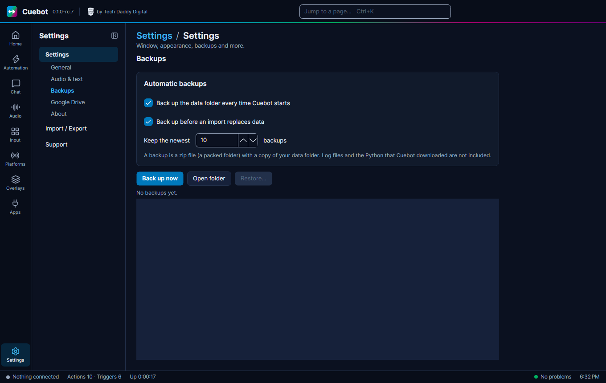

# Backups

A backup is a copy of everything Cuebot knows, so you can go back if something breaks or you change your mind. This
page shows how Cuebot makes backups by itself, and how to get one back.

## Making backups

A **backup** is a zip copy of your [data folder](your-data.md). Log files and the Python that Cuebot downloaded are
not included. Go to **Settings**, tab **Backups**.

- **Back up the data folder every time Cuebot starts**: ticked, Cuebot makes a backup each time it starts. It is
  ticked from the start.
- **Back up before an import replaces data**: ticked, Cuebot makes a backup before an
  [import](../start/moving-from-streamer-bot.md) changes anything. Also ticked from the start.
- Cuebot keeps the newest **10** backups and deletes older ones. You can change the number.
- **Back up now** makes one right away. Good before a big change.
- **Open folder** shows the backups (they are in `backups` inside the data folder).

## Getting a backup back

1. Click **Restore...** and pick a backup.
2. Choose **Restore and restart** (right away) or **On next start**.
3. Cuebot first makes a safety backup of what you have now, then puts the old backup back in place before it loads
   anything.

Changed your mind before the restart? Click **Cancel restore**.

Sign-ins and keys are never put in backups (see [Your data and privacy](your-data.md#your-sign-ins-are-locked)). Want
a copy that survives if your computer breaks? See [Backups on Google Drive](google-drive-backups.md).
