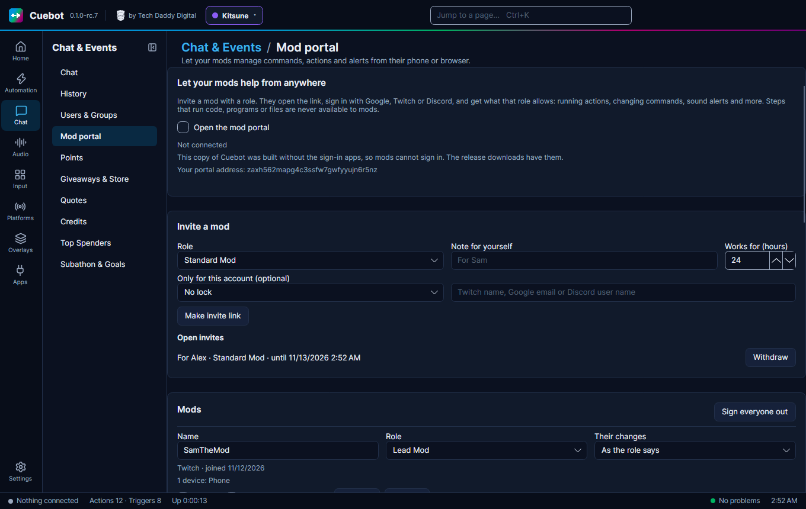
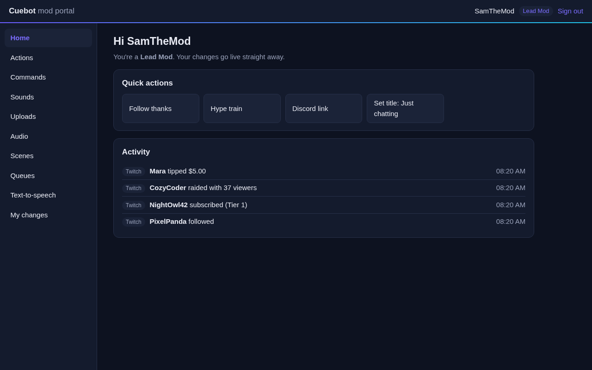
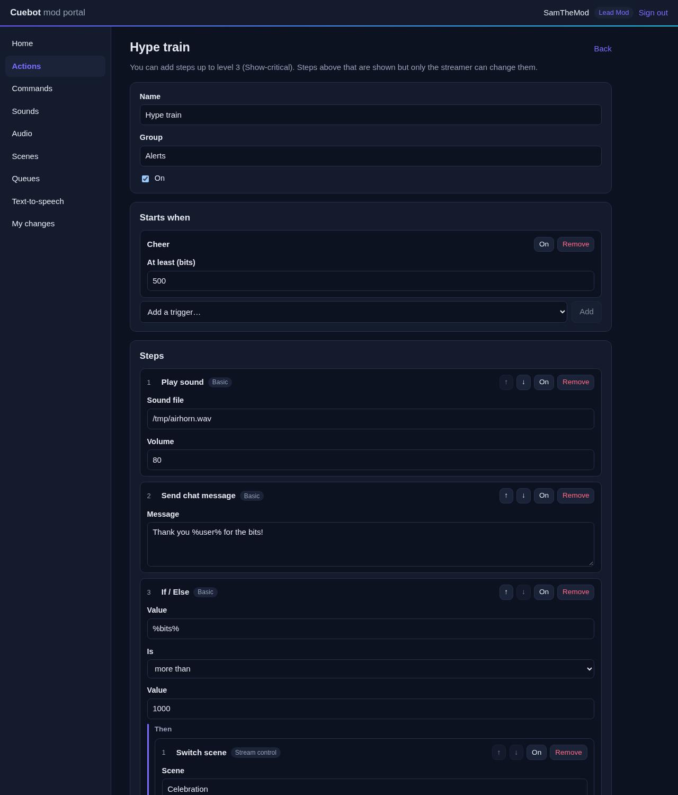
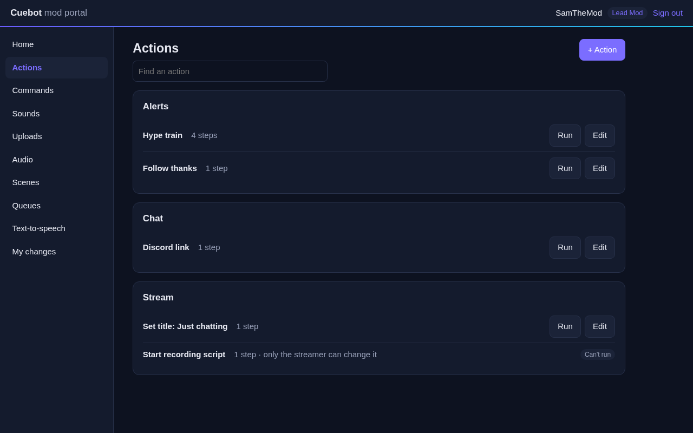
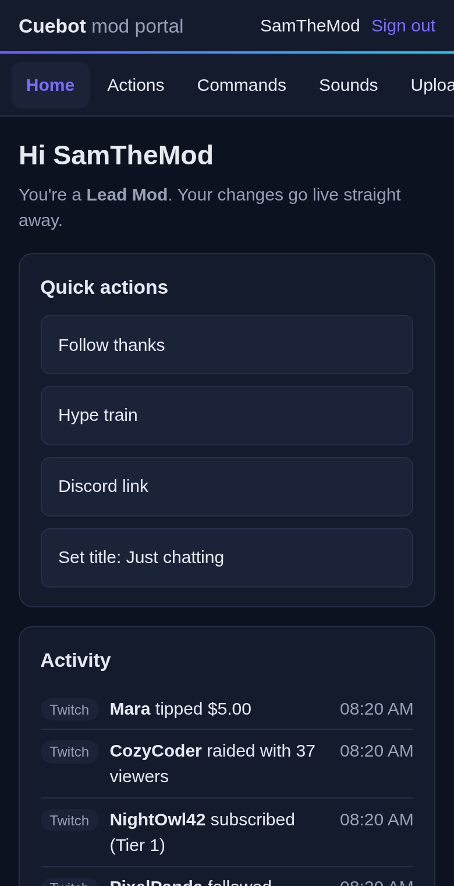
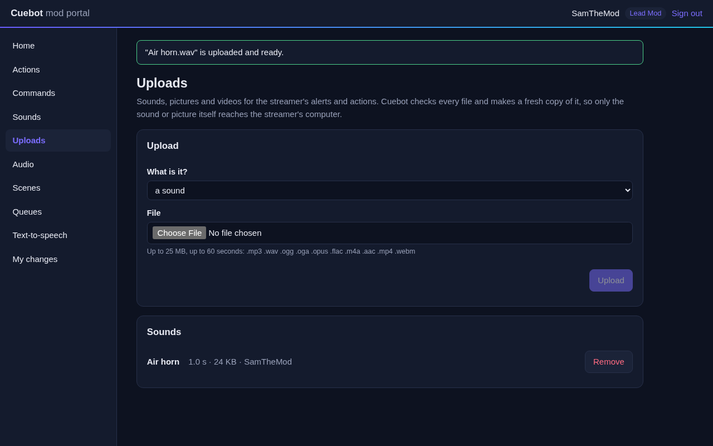
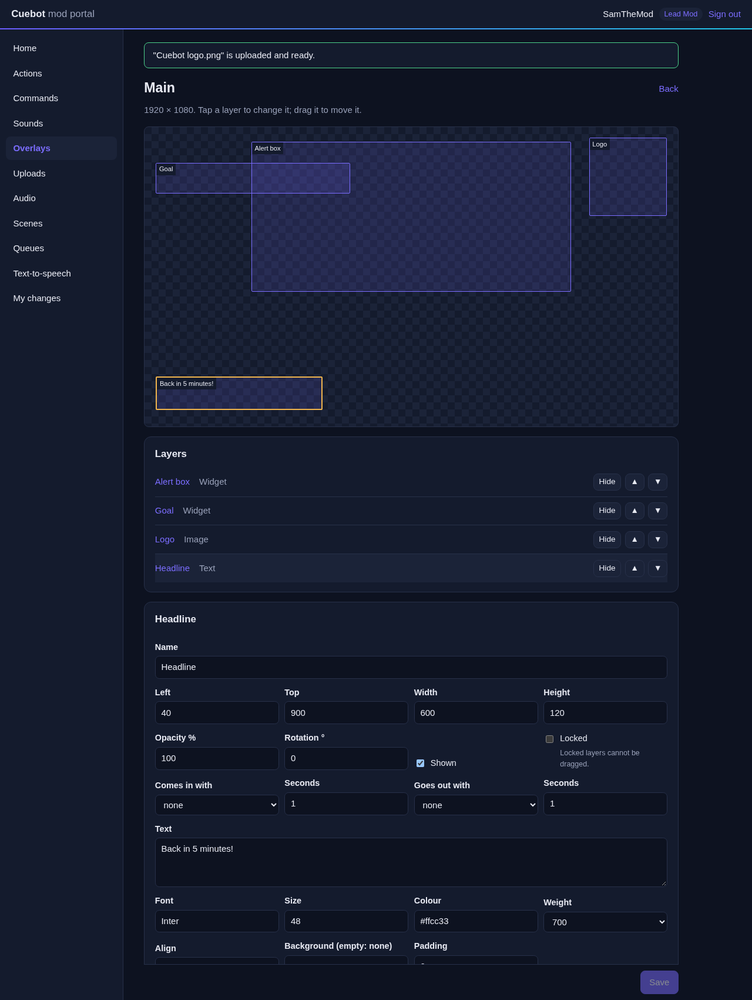

# The mod portal

The mod portal lets your moderators help with your stream from anywhere: from their phone or their browser, without
being at your computer. You decide what each mod may do. They might run actions, change chat commands, set up sound
alerts, or more.

## How it works

1. You tick **Open the mod portal**. Cuebot stays connected to the portal relay while it runs.
2. You make an **invite** on **Chat & Events > Mod portal** and choose a **role** for it.
3. You send the link to your mod privately.
4. The mod opens it and signs in with Google, Twitch or Discord. They get the role you chose.
5. The link is used up. Their browser remembers them, so next time they just open
   `portal.techdaddydigital.com`. Every 30 days, or on a new device, they sign in again with the same account.

You can change a mod's role, pause them or remove them at any time. A change applies at once.

## What your mods see

Mods open `portal.techdaddydigital.com` on their phone or computer, or use the [Cuebot phone app](companion-app.md#for-mods)
on Android. They only see the pages their role allows:

| Page | What it does | Who (default roles) |
|---|---|---|
| **Home** | Quick buttons for the actions they may run, and live activity (follows, subs, raids, tips) | Everyone |
| **Actions** | Run actions, and change or add them, with the steps their level allows | Everyone runs; Lead Mod and Tech Lead change |
| **Commands** | Add and change chat commands | Everyone |
| **Sounds** | Play the sounds your actions use, on stream | Everyone |
| **Overlays** | Move, restyle, show and hide overlay layers, change widget settings and alert designs (see [Overlays](#overlays)) | Lead Mod changes; Tech Lead also adds and removes layers and overlays |
| **Uploads** | Upload sounds, pictures, GIFs and videos for your actions (see [Uploads](#uploads)) | Everyone uploads sounds; Lead Mod and Tech Lead also pictures and video |
| **Audio** | Volume and mute for your OBS audio sources | Everyone |
| **Scenes** | Switch your OBS scene | Lead Mod, Tech Lead |
| **Queues** | Pause, resume or clear action queues | Lead Mod, Tech Lead |
| **Text-to-speech** | Say something with your default voice and word filters; pause, skip or turn it off | Everyone says; Lead Mod and Tech Lead control |
| **My changes** | Their own changes, with Undo | Everyone |

In the action editor, steps above the mod's level are shown but locked, and the step list only offers the steps they
may add. Before running an action that can change the stream itself (end it, ban someone, change the title), the
portal asks the mod to confirm.

Everything a mod does is written to Cuebot's log with their name: scene switches, volume changes, sounds played,
text-to-speech. Each mod can press at most 30 such controls a minute.

!!! note "Good to know"
    - Scenes and audio work with OBS (not yet with Streamlabs Desktop or Meld Studio).
    - **Sounds** lists the sound files your **Play sound** steps use. Mods cannot play any other file.
    - To **run** an action, a mod needs the level of its riskiest step, the same as for changing it. A Standard Mod
      can run an action that only sends chat messages, but not one that changes the title. Actions with code,
      program or file steps never run from the portal. The portal marks the actions a mod can't run. To keep an
      action away from a role altogether, put it in a group the role cannot use (**Groups** on the role).

## Uploads

Mods can upload files for your alerts and actions on the **Uploads** page, and then pick them in a step.

| Kind | Mods can send | Cuebot keeps | Limits |
|---|---|---|---|
| Sound | MP3, WAV, Ogg (Vorbis or Opus), FLAC, AAC/M4A, or the sound of an MP4 or WebM | MP3 | 25 MB, 60 seconds |
| Picture | PNG, JPEG, WebP | PNG (up to 4096 pixels a side) | 15 MB |
| GIF | GIF | Animated WebP (up to 1280 pixels a side) | 15 MB, 30 seconds |
| Video | MP4 or MOV (H.264, HEVC), WebM (VP8, VP9; transparency is kept) | WebM (VP9, Opus sound), up to 1920×1080 and 60 frames a second | 200 MB, 2 minutes |

**Nothing a mod uploads reaches your computer as it was sent.** Cuebot looks at the file's first bytes (never its
name) and refuses anything it does not recognise: SVG, web pages, scripts, archives, programs. Then it decodes the
file completely and makes a new one from the pictures and sound alone, with no names, tags or other data from the
original. A file with something hidden in it comes out as a plain sound or picture, or not at all. The checks run
one file at a time in a separate program with time and memory limits, at low priority so your stream does not
notice.

- Uploads follow the mod's change setting. A Standard Mod's upload waits under **Waiting for your approval**: press
  **Open** to see or hear the cleaned file first, then **Approve** or **Reject**.
- In the action editor, the steps **Play sound**, **Play sound from folder**, **Set image source file** and
  **Set media source file** offer the uploads as a list. Mods cannot point these steps at any other file on your
  computer. Steps you set up keep your own files until a mod picks something else.
- Each mod can keep up to 100 uploads and 1 GB. They can remove their own; Lead Mods and Tech Leads can remove anyone's.
- Uploads are stored in the `portal-media` folder of Cuebot's data folder, with random file names.

!!! note "Where uploads work"
    Cuebot checks uploads with its own small build of [FFmpeg](https://ffmpeg.org) that comes with the Windows, macOS
    and Linux downloads (see [Third-party notices](https://github.com/TechDaddyKB/cuebot/blob/main/THIRD-PARTY-NOTICES.md)).
    The AUR package `cuebot` uses your system's `ffmpeg` (an optional dependency). The Flatpak has no FFmpeg yet, so
    uploads are off there; the portal says so.

## Overlays

On the **Overlays** page, mods see your overlays drawn to scale. They tap a layer to change it, or drag it to move it.
What they save shows in OBS straight away (or after your approval, by their change setting), and **Undo** puts it back.

- **Layers:** name, position, size, opacity, rotation, shown or hidden, the order of the layers, and the animations
  they come in and go out with.
- **Text, image, video and slideshow layers:** the text and its look; pictures and videos are picked from the uploads.
- **Widgets:** the settings in the widget's own settings form (the same ones the widget editor shows). A widget used
  on several overlays changes on all of them; the portal says so.
- **Alert box:** each alert's text, picture or video, sound, look and text-to-speech, and turning alerts and their
  variations on or off. Adding or removing variations, and when one is used, stay with you.
- With **Create overlays** (Tech Lead), mods can also add layers (text, image, video, slideshow, Cuebot's widgets and
  widgets already in your library), remove layers, change an overlay's size, and create and delete overlays.

**Widget code stays yours.** Mods never see or change a widget's HTML, CSS or JavaScript, your CSS overrides or its
hidden settings, and they cannot add widgets from code or a zip. Because widgets paste their settings into their code,
text from the portal cannot contain `< > \ { }`, a `&` straight before a letter, or a script address, and straight
quotes become curly ones (`'` → `’`). A setting the widget's code uses in a place where no text is safe (bare in its
script, or in an HTML attribute without quotes) is shown but only you can change it.

**Files are uploads.** Pictures, videos and sounds in overlays can only be uploads (or files your overlays already
use), never other files on your computer or addresses on the internet. Overlay links (with their keys) are never sent
to the portal.

## Roles

Cuebot starts with three roles. You can rename them, change them, or add your own with **+ Role**.

| | Standard Mod | Lead Mod | Tech Lead |
|---|---|---|---|
| Highest level | 1 | 3 | 4 |
| Commands | Create, change | Create, change, delete | Create, change, delete |
| Actions | Run | Create, change, delete | Create, change, delete |
| Overlays | No | Change | Change, add, delete |
| Their changes | Need your approval | Live, and you get a notice | Live |

The **level** decides which steps a mod may add or change:

| Level | Steps |
|---|---|
| 1 Basic | Chat messages, sounds, alerts, text-to-speech, delays, If and other logic |
| 2 Stream control | Scenes and sources, audio levels, raids, ads, polls, timeouts |
| 3 Show-critical | Going live or ending the stream, bans, title and category |
| 4 Trusted tech | Variables, web requests, decks, MIDI, devices and other apps |

**Never, for anyone:** steps that run code (C# or Python), run programs, or read and write files. Mods cannot
add them, or run an action that has one. They also cannot change such an action, or a command that starts one. And whatever a mod
changes can never reach those steps, not even through a variable: such a step refuses to run with what a mod set.

A role can also be limited to some **groups** of actions and commands, like "Mod tools".

## Approving and undoing changes

- **Live**: the change applies at once.
- **Live and tell me**: it applies at once, and you get a notice.
- **Needs approval**: it waits under **Waiting for your approval** until you approve or reject it. A change nobody
  answers expires after 7 days.

Every role has one of these. You can set a different one for a single mod under **Their changes**.

You can also approve from your phone: the [Cuebot phone app](companion-app.md#approving-from-your-phone), paired
with this Cuebot, lists the changes waiting for you on its **Mods** tab.

Under **Recent changes by mods**, **Undo** puts back what was there before. If it changed again since, Cuebot asks
you to press Undo once more to be sure.

## Invites

- An invite works **once**, for the hours you choose (24 by default, at most 30 days).
- **Only for this account** locks it to one Twitch name, Google email or Discord user name, so a leaked link is
  useless to anyone else.
- **Withdraw** stops an open invite at once.
- A mod who lost their account: remove them and send a new invite.
- Your Cuebot has to be running with **Open the mod portal** ticked when the mod opens the link. Otherwise they see
  "The streamer's Cuebot is not online right now".

## Privacy

The connection between your mods and your Cuebot is encrypted end to end. The portal service in between only
passes it along and stores nothing about you or your mods. Your mods' details stay on your computer, in
`portal.json`.

Signing in only tells your Cuebot who the mod is: the account's permanent ID and name (and, for Google, the email
address, used only for **Only for this account**). Cuebot cancels its access to the mod's account right after
reading that. It never posts, reads messages or keeps a login for their account.
