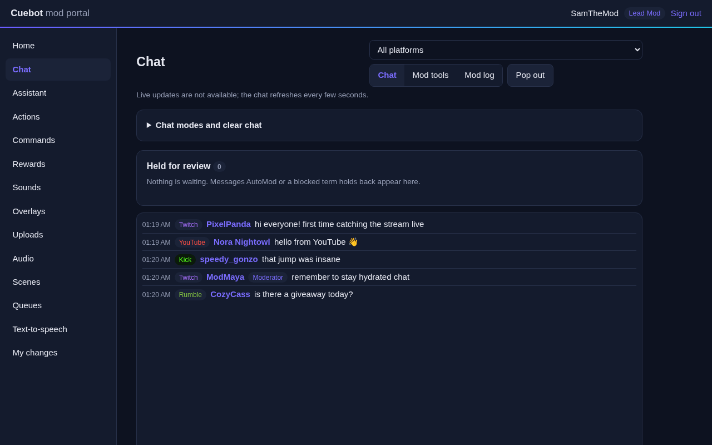
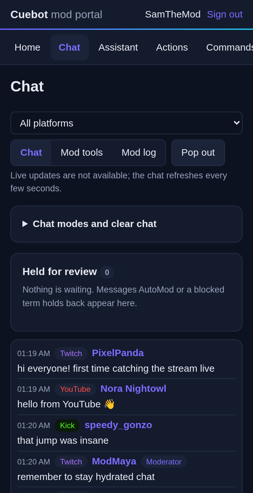
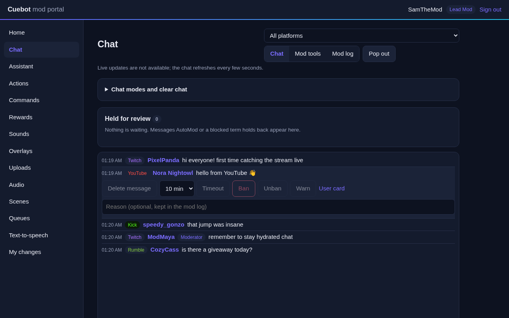

# Chat for mods

**In short:** the **Chat** page of the [mod portal](mod-portal.md) shows your Twitch, YouTube, Kick and Rumble chat
in one list. Your mods can delete messages, time people out, ban and unban from there, in their browser or on their
phone. Cuebot does it for them with your accounts, and writes down who did what.

**Example:** Sam mods for you from a phone. Someone spams links on Kick. Sam taps the line, picks **Timeout**, types
"spam" as the reason, and Cuebot times the person out on Kick. Your mod log now says Sam did it.

## What your mods see

- **One list for every platform.** Each line shows the time, the platform and the person's name. **All platforms**
  at the top switches to one platform.
- **Click a line** to get the tools for it: **Delete message**, **Timeout** (pick how long), **Ban**, **Unban** and
  **Warn**, and a box for a reason.
- **Click a name** for the person's **user card**: their platform, their user id, their recent messages here, what
  mods did to them before, and the same tools.
- **Mod log** (next to **Chat**) lists every moderation action, newest first: by you, by mods in the portal, by
  Cuebot's own rules, and by mods on the platform's website.
- **Pop out** opens the chat on its own in a tall window, without the menu. Put it on a second screen.

New messages, deletions and log rows appear by themselves. If a mod's browser cannot get live updates, the page
refreshes every few seconds instead.

### On a phone

The Chat page works in a phone's browser, and in the [phone app](phone-app.md#for-mods) under **Mods**.

- The portal's menu becomes a row across the top. Swipe it sideways to see every page.
- Tap a line for its tools. Tap a name, and the user card slides up over the lower part of the screen.

{ width="320" }

!!! tip "Look at the user id, not the name"
    Anyone can copy a display name, with lookalike letters too. The user card shows the platform and the account's
    user id, which nobody can copy. Check it before a ban.

## Each tool says what it will do

The platforms do not all allow the same things. Before a mod clicks, each button says what will happen on that
platform. Hover over it to see:

| Button looks | What it means | Example |
|---|---|---|
| Normal | It works. | Ban on Twitch |
| Normal, with a note | It does the closest thing, and the note says how it differs. | Kick counts timeouts in whole minutes: 9 min 30 s becomes 10 min |
| **(website)** | There is no way to do it from Cuebot. The button opens the platform's own page. | Clear chat on Kick |
| Greyed out | Not possible on this platform, or not part of the mod's role. The note says which. | Warn on Rumble |

The timeout list shows what a platform really applies. On Kick it says **14 days (applies 7 days)**, because Kick's
longest timeout is 7 days.

On YouTube each action uses some of your daily YouTube allowance (quota): a deletion, a timeout or a ban costs 50
units. The tool notes say how much. See [YouTube quota](../chat/moderation.md#youtube-quota).

**Chat modes and clear chat** (slow mode, followers-only, subscribers-only, emote-only, and Shield Mode on Twitch)
are in a fold-out bar above the chat, one row per platform, for roles that have them.

Mods cannot send chat messages as you or your bot from the portal.

## Twitch's moderation queues

Twitch holds some messages back, and keeps lists that the other platforms do not have. The portal shows them for
Twitch only. (The streamer's side is explained in
[Moderating your chat](../chat/moderation.md#twitch-held-messages-shield-mode-and-more).)

- **Held for review**, above the chat, lists the messages AutoMod or one of your blocked terms held back, with the
  number waiting. **Allow** lets a message into chat; **Deny** keeps it out. Messages decided a moment ago (by any
  mod, here or on Twitch) are under **Recently decided**. Twitch drops a held message nobody decides in time.
- **Mod tools** (next to **Chat**) has, for each platform that offers them:
    - **Shield Mode**: whether it is on and who turned it on, and a button to turn it on or off. Shield Mode uses
      the strict settings you chose for it on Twitch.
    - **Unban requests**: what each banned viewer wrote, a box for an answer they will see, and **Approve (unban)**
      or **Deny**. Approving lifts the ban.
    - **Blocked terms**: the words and phrases Twitch keeps out of your chat. Type one and click **Block**, or
      **Remove** one.
- **The user card** of a Twitch viewer says whether Twitch or a mod marked them suspicious, with **Monitor** (their
  messages are flagged for mods), **Restrict** (only mods see their messages) and **Not suspicious**.

Held messages, Shield Mode and new unban requests appear by themselves. Like every other tool, these are written to
the mod log with the mod's name.

## Who may do what

Moderation is not a "change": it never waits for your approval. It happens at once and goes into the mod log.

What a mod may do comes from their role (**Chat > Mod portal > Roles**):

| Right | Standard Mod | Lead Mod | Tech Lead |
|---|---|---|---|
| See the combined chat | Yes | Yes | Yes |
| Delete messages, time out, warn | Yes | Yes | Yes |
| Ban and unban | Yes | Yes | Yes |
| Chat modes, clear chat, Shield Mode | No | Yes | Yes |
| Blocked terms (see and change) | No | Yes | Yes |
| See the mod log (every mod's actions) | Yes | Yes | Yes |

Twitch's queues use the same rights:

| Tool | Needs the right |
|---|---|
| See held messages, **Allow** and **Deny** | Delete messages, time out, warn |
| See whether a viewer is suspicious, **Monitor** | Delete messages, time out, warn |
| **Restrict** and **Not suspicious** | Ban and unban |
| See unban requests, **Approve** and **Deny** them | Ban and unban |
| Turn Shield Mode on or off | Chat modes, clear chat, Shield Mode |
| See and change blocked terms | Blocked terms |

Everyone who can see the chat sees whether Shield Mode is on.

Notes and linked accounts have their own rights; see [Linked accounts in the portal](#linked-accounts-in-the-portal).

**Bans by your mods are made with your account.** So the platform's own log shows you, not the mod. To help:

- On Twitch and Kick the reason starts with the mod's name, like `[mod: Sam] spam`.
- Cuebot's mod log always names the mod.

!!! note "Portals set up before the Chat page"
    Standard Mod, Lead Mod and Tech Lead get the rights in the table above when Cuebot starts. Roles you made yourself
    get **See the combined chat** and **See the mod log** only, or every chat right if the role could already end the
    stream and ban (**End stream, ban, title and category**). Tick more under **Roles** if you want.

## Safety limits

Cuebot checks every click from a mod before it reaches the platform:

- **Limits per mod.** A mod can make 10 bans and 30 timeouts in 10 minutes. After that the portal says
  *"Sam has made 10 bans in the last 10 min. Wait a little, or ask the streamer."* Other mods are not held up.
- **Protected people.** Mods cannot act against you, your bot accounts, platform moderators and VIPs, or anyone who
  is a member of your mod portal. Only you can, from Cuebot.
- **Paused and removed mods** can do nothing, at once. With **Must stay a Twitch mod** ticked, a mod you remove on
  Twitch is paused here too.

A refused click is written to the mod log as **Not sent**, with the reason.

## Linked accounts in the portal

!!! warning "Pending review: off by default"
    Linked accounts are **off** until you turn on **Identity links** in Cuebot (**Chat > Options > Moderation**). The
    privacy position, the wording for viewers and how long links and notes are kept are still being checked by a
    reviewer. Read [Linked accounts and linked bans](../chat/identity-links.md) before you turn it on. While it is off,
    your mods see nothing about links or notes in the portal, and Cuebot refuses every link request from them.

With identity links on, your mods get the same link tools in the portal as you have in Cuebot. (Not sure what a link
is? Read [How sure is a link?](../chat/identity-links.md#how-sure-is-a-link) first.)

- **The user card** has a **Linked accounts** section: the person's other accounts, how sure each link is
  (**suggested, not confirmed**, **confirmed by Kris and Sam**, **verified**), and the evidence stored with it.
  Same names on other platforms show as a hint only; they never link anything.
- **Same person as...** lets a mod pick the other account from the recent chat (or a same-name hint), tick the
  messages that show it (for example the viewer saying "I'm rowdyguy on Kick"), and add a note. It is a
  **suggestion** until someone else confirms it: you, or a mod whose role may confirm links. Nobody can confirm their
  own suggestion. If the other account already belongs to someone, the portal asks whether to merge the two people or
  move just that account.
- **Verify with !link** shows the mod a one-time code with a 10-minute countdown. The mod sends it to the viewer
  privately; the viewer types `!link CODE` from their other account. That link is **verified**.
- **Confirm**, **Wrong** and **Unlink** are next to each account. **Unlink** lists the bans and timeouts that were made
  through the link and are still in force, and offers to lift them (ticked when the link was wrong).
- **Notes** about a viewer follow their linked accounts. The portal reminds mods not to write down health, religion,
  politics or similar personal details.

**Ban** and **Timeout** on a linked account open a preview first. Nothing is sent yet. It has one row per account,
with:

- the link, and how sure it is;
- what will happen there: the timeout each platform really applies, or the YouTube quota a ban costs;
- whether the row is ticked.

Confirmed and verified links start ticked. Suggestions start unticked, and a mod cannot ban through a suggestion at
all. Platforms without a moderation API (Rumble) show **By hand**, with a link to the website. A reason is required. A
permanent ban on more than one platform asks a second time ("Ban 3 accounts on 3 platforms?").

The result shows each platform:

- **done**;
- **failed**, with **Retry**. A failure on one platform does not undo the others;
- **by hand**: open the website, do it there, then click **I did it**.

**Undo incident** lifts every ban and timeout of that decision that is still in force. It is in the dialog, and next to
the incident in the **Mod log**, where the rows of one decision are grouped. Lifting needs the ban and unban right.
Deleted messages cannot be restored, and bans done by hand are lifted by hand.

When an account is newly linked to someone banned elsewhere, a **Banned elsewhere** strip above the chat asks
"... is linked to a person banned on Twitch. Apply here too?". **Ban here too** needs a reason; **Dismiss** leaves it.

You are told about every linked ban or timeout a mod makes, and can undo it. Undoing everything one mod did in the
last hour stays with you, in Cuebot; mods do not have it.

| Right | Standard Mod | Lead Mod | Tech Lead | What it allows |
|---|---|---|---|---|
| Notes: read | Yes | Yes | Yes | See notes on the user card; see linked accounts |
| Notes: add | Yes | Yes | Yes | Write notes, and change or delete their own |
| Notes: delete | No | Yes | Yes | Change or delete other mods' notes |
| Propose links | Yes | Yes | Yes | **Same person as...**, **Verify with !link**; see linked accounts |
| Confirm links | No | Yes | Yes | **Confirm**, **Wrong** and **Unlink** (a mod can always withdraw their own suggestion) |
| Linked timeouts | Yes | Yes | Yes | Time out through linked accounts (also needs the timeout right) |
| Linked bans | Yes | Yes | Yes | Ban through linked accounts, **Ban here too** (also needs the ban right) |

A mod whose role lacks the linked right still gets the plain tools for the account they clicked. Rows of the mod log
about links (who linked or unlinked whom) are shown only to roles that may see linked accounts. Mods may make 5 linked
bans an hour.

Cuebot reads the accounts, names and the messages attached as evidence from its own chat, never from the mod's
browser, and checks every request again.

## Tell your mods (and viewers)

**The mod log records what each mod does**: who deleted, timed out, warned or banned whom, when, the reason, and the
text of deleted messages. It also keeps held messages a mod allowed or denied, the text of unban requests and the
answer sent, and the terms blocked or removed. Tell your mods before you invite them. The invite page says so too.

The log stays on your computer, in Cuebot's data folder (it is part of your backups). Nothing about your chat is kept
on the portal relay. Old details are blanked after a while:

- deleted message text after 60 days;
- timeouts after 180 days;
- a ban 24 months after it was lifted.

Change these in `moderation.json` if you want them shorter.

It is a good idea to say in your channel rules that you moderate every platform you stream on together, and how
viewers can ask about a ban.
