# The phone app (Cuebot Companion)

**Cuebot Companion** puts your Cuebot on your phone or tablet. Use it as a button board next to your keyboard,
to keep an eye on your stream from the couch, or to approve your mods' changes. Mods can use it to help with
someone else's stream.

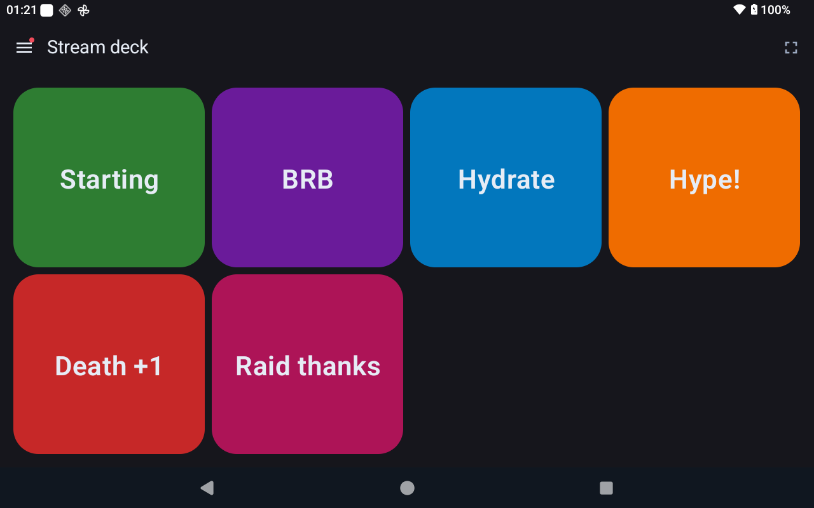

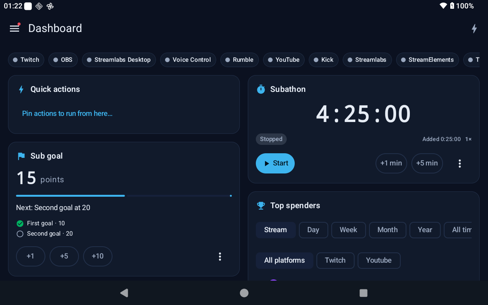

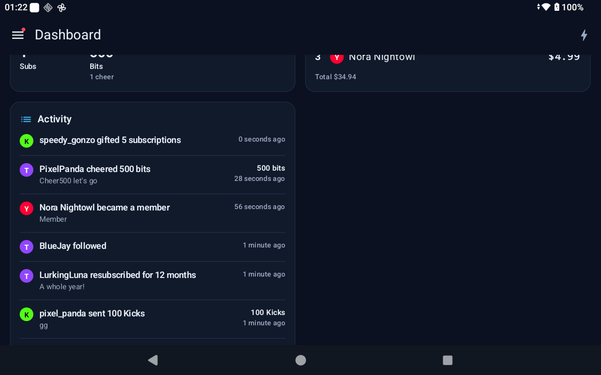

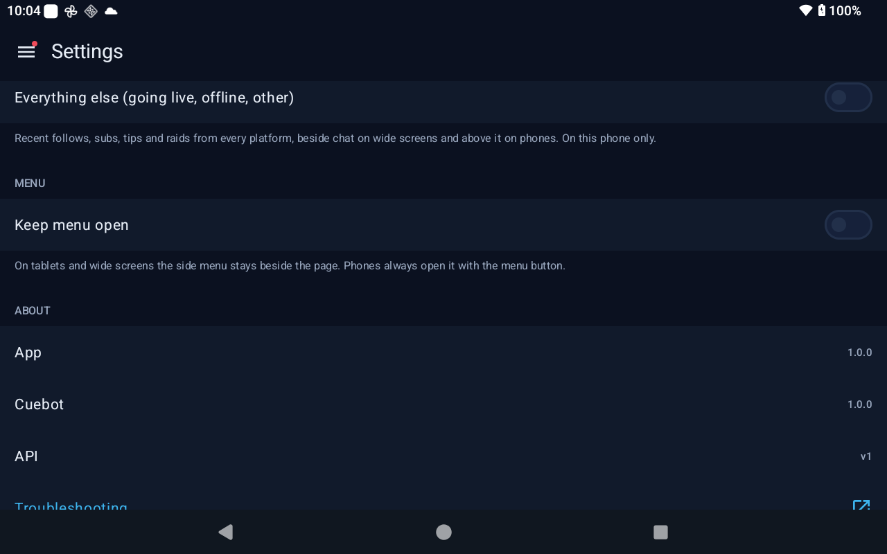

It has five sections. Tap the menu button (☰, top left) to open the side menu and pick one; the menu closes again so
the page gets the whole screen. On a tablet you can keep the menu open beside the page: see [The menu](#the-menu).

| Section | What it is for |
| --- | --- |
| **Deck** | The buttons of your [decks](../apps/decks.md). Tap one and Cuebot runs it, just like a Stream Deck. **Choose deck** switches decks, and the arrows at the bottom switch pages. |
| **Dashboard** | What is connected, your **Quick actions**, your [subathon timers](../services/subathon-timers.md) and [goals](../services/goals.md) with their buttons, **Top spenders** for **This stream** and more, totals, and the **Activity** list of follows, subs, tips and raids. |
| **Chat** | Chat from every connected platform in one list, with the latest stream events next to it. Write as yourself or as your bot, and delete, time out, ban, unban or warn. See [Chat on your phone](#chat-on-your-phone). |
| **Mods** | Your mods' changes that wait for your OK, and, if you are a mod for someone, their [mod portal](mod-portal.md). A number next to **Mods** in the menu shows how many changes wait. |
| **Settings** | The Cuebots you paired, light or dark look, the events card on the Chat page, the menu, and **Troubleshooting**. |

### The menu

The menu button (☰) sits at the top left of every section. Tap it, and the menu slides in from the left. Tap a
section, and the menu closes again. When changes from your mods are waiting, Android puts a dot on the menu button.

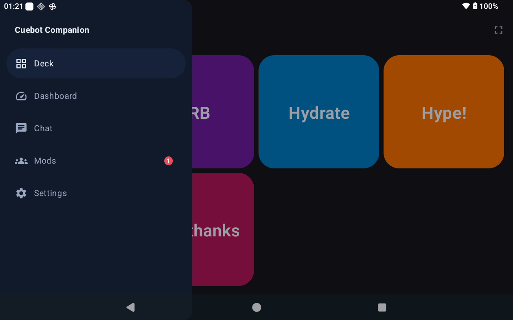

On a tablet (or an iPad), go to **Settings** and switch on **Keep menu open** under **Menu**: the menu then stays
beside the page and the menu button goes away. Phones always use the menu button, even with this switched on.
**Stream mode** on the Deck hides the menu too.

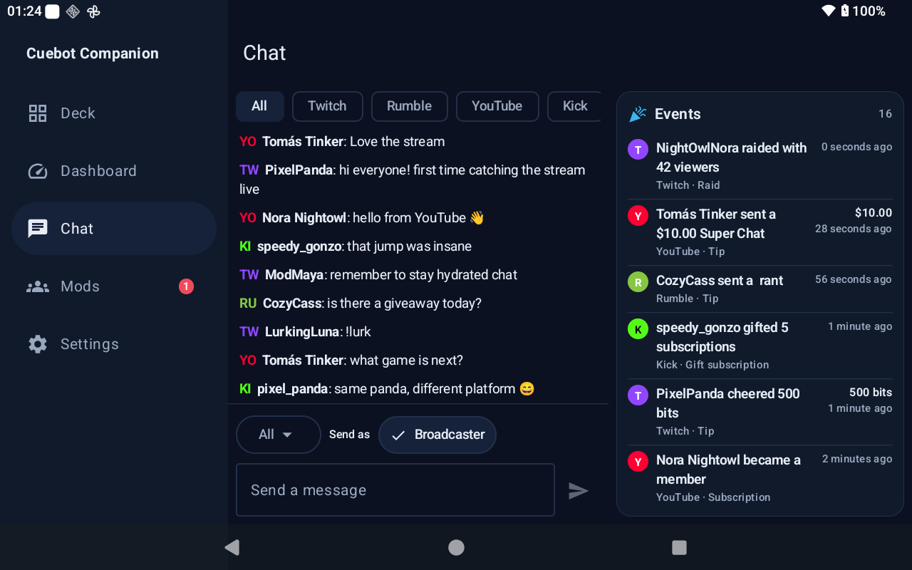

## Get the app

| Phone | How to get it |
| --- | --- |
| **Android** 10 or newer | Download `Cuebot-Companion-<version>.apk` from the [releases page](https://github.com/TechDaddyKB/cuebot/releases), next to the computer downloads. |
| **iPhone and iPad** | Not available yet. It comes to the App Store (first through TestFlight) later. |

**Installing the APK on Android:** open the downloaded file on your phone. Android asks if your browser (or file app)
may install apps: tap **Settings**, switch on **Allow from this source**, go back and tap **Install**. You only do
this once. The app is signed by Cuebot, so later versions install over it and keep your settings.

## Pair it with your Cuebot

The phone and the computer must be on the **same network**: the same Wi-Fi at home, for example.

**On the computer:**

1. Go to **Apps > Servers**.
2. Make sure the **REST API** and the **HTTP server** are on, and **Allow LAN connections** is ticked.
3. In the REST API card, find **Pair a phone** and tick **Show pairing code**.
4. Pick your home network under **Address** (it usually starts with `192.168`). A QR code appears.

If something stops the phone from connecting, the card lists what to change first.

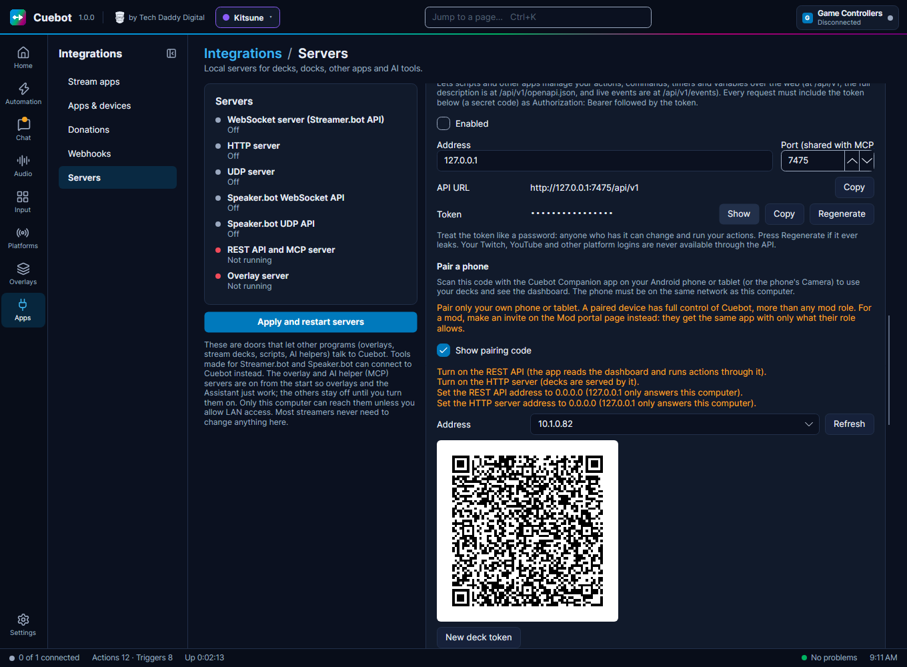

**On the phone:**

1. Open Cuebot Companion and go to **Settings**.
2. Tap **Pair a Cuebot**.
3. Point the camera at the QR code. It connects straight away.
    - Or tap **Enter the details instead**. There you can type the address and token yourself, use **Choose an image
      of the code** (a screenshot or photo of it), or **Paste a pairing link**.

You can also scan the code with the phone's own **Camera** app. It opens Cuebot Companion, which asks you to check
that it is your Cuebot before it pairs.

!!! warning "The code is a key"
    The pairing code holds the password (token) to your Cuebot. Untick **Show pairing code** when you're done, and
    never show it on stream. If someone saw it anyway, click **Regenerate** next to the REST API token and
    **New deck token** under **Pair a phone**, then pair your phone again.

You can pair more than one Cuebot, like a gaming PC and a streaming PC. Tap one in **Settings** to use it.

## Using it on stream

- **Stream mode** (on the Deck) shows only the buttons, full screen, and keeps the screen from turning off. Handy
  for a phone on a stand next to your keyboard.
- **Subathon and goal buttons** on the Dashboard work like the ones in Cuebot: **Start**, **Pause** or **Resume** the
  timer, add a minute or five (**+1 min**, **+5 min**), and under ⋮ add or take away any number of minutes or change
  the multiplier. For goals: add points, or **Set points…** by hand. A timer that ran out shows **Ended**; **Start**
  starts it over from its starting length, like in Cuebot.
- **TEST** badges in the Activity list mark test events: a service's test button (like **Send test event**) or the
  sample events the assistant sends. They don't count towards top spenders. The assistant's sample events *do* move
  subathon timers and goals, so you can try those out; a service's test button doesn't.

## Chat on your phone

**In short:** read your chat from every platform, write in it, and moderate it, from your phone or tablet.

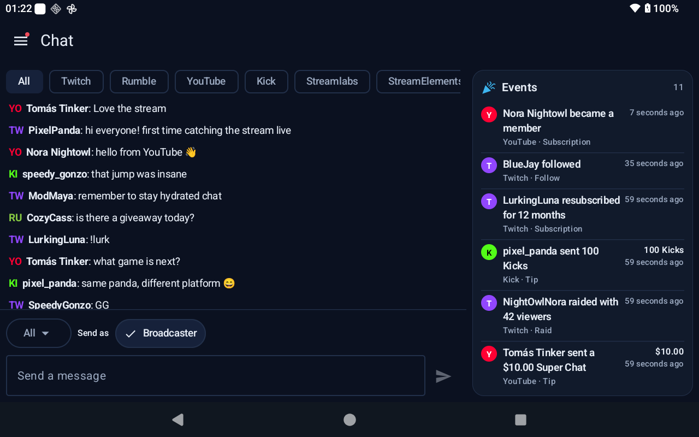

The **Chat** tab shows chat from every platform Cuebot is connected to, newest at the bottom, as plain text.

- Each line starts with the platform: **TW** for Twitch, **YO** for YouTube, **KI** for Kick, **RU** for Rumble.
- A deleted message stays in the list, crossed out and marked *(deleted)*.
- Bans and timeouts show up as grey lines, whoever made them: you, a mod in the [mod portal](mod-portal.md), or
  someone on the platform's own website.

With more than one platform connected, the buttons at the top show **All** or only one platform.

**Writing in chat:**

1. Pick where it goes with the button on the left: **All** or one platform.
2. Under **Send as**, pick **Broadcaster** (you) or **Bot** (your bot account). **Bot** only shows where a bot account
   is signed in in Cuebot.
3. Type the message and tap the send button.

**Moderating:** tap a message (or press and hold it). A list of tools opens for that message and the person who wrote it:

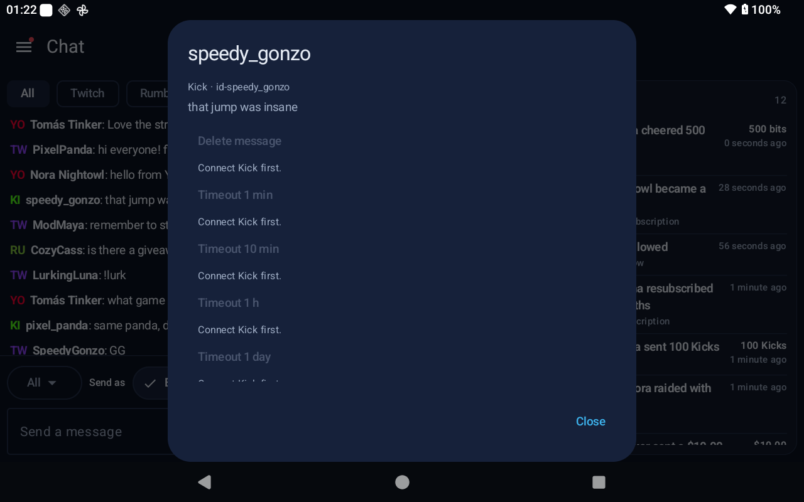

A tool that is grey says why under it. In the picture above Kick is not connected, so every tool says
**Connect Kick first.** Once the platform is connected (and your account may moderate there), the tools light up.

| Tool | What it does |
| --- | --- |
| **Delete message** | Removes this message from chat. |
| **Timeout 1 min** … **1 week** | Stops the person chatting for that long. When a platform can't do that exact length, the line under it says what it does instead (Kick, for example, rounds up to whole minutes). |
| **Ban** | Stops the person chatting for good. The app asks first. |
| **Unban** | Lifts a ban or a timeout. |
| **Warn** | Sends a warning. You type it first. |

A tool a platform can't do is greyed out, with the reason under it. Where a platform only does something on its own
website, **On the website** opens that page in your browser. After each action, a line above the message box says
what happened.

Everything you do here is done as you, the streamer, and goes in Cuebot's mod log, like on the Chat page in Cuebot.

### Events next to chat

The **Events** card on the Chat tab shows the latest stream events from every platform, newest first: follows, subs
and memberships, bits, Kicks, Super Chats, rants, tips and raids. Each line has the platform, who it was, what kind of
event it was and the amount. It is the same list as **Activity** on the Dashboard, and it updates live.

- When there's room for both, as on a tablet turned sideways, the card sits **beside** chat.
- Otherwise (a phone, or a smaller tablet held upright) it is a strip **above** chat that shows the newest event. Tap the strip to open the list,
  and tap it again to close it.

In **Settings**, under **Chat page**:

| Setting | What it does |
| --- | --- |
| **Show the events card** | Switch it off to hide the card and use the whole page for chat. |
| **Follows**, **Subs and memberships**, **Tips, bits, Kicks, Super Chats and rants**, **Raids** | Which events the card shows. All on at the start. |
| **Channel point redemptions**, **Everything else** | Off at the start. Switch them on to see redemptions, or going live and offline, too. |

These settings are kept on each phone or tablet separately.

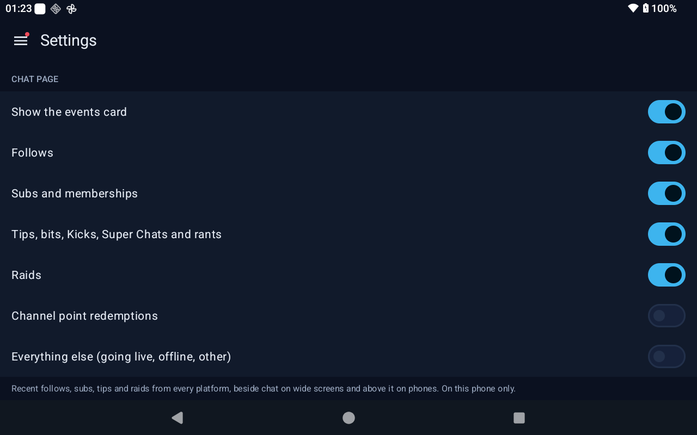

!!! note "Mods use the mod portal"
    The Chat tab is for your own paired phone. Your mods moderate from the [mod portal](mod-portal.md) (in the
    browser, or in this app under **Mods**), with only what their role allows.

The Chat tab needs an up-to-date Cuebot. An older one shows **Update Cuebot** here; the other tabs still work.

## Switching persona

Stream as more than one persona, with [profiles](../platforms/profiles.md)? The **Dashboard** then starts with a
**Profile** card that shows the open one, with its colour.

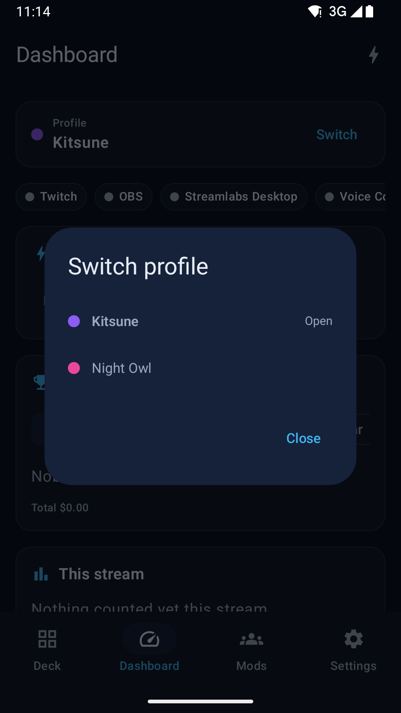{ width="320" }

1. Tap **Switch** on the **Profile** card.
2. Pick the profile.
3. Tap **Switch** to confirm.

Cuebot restarts on that profile. The card says **Switching to …** for a few seconds, and then the Dashboard shows the
other persona's timers, goals and feed. You don't need to pair again: every profile shares the pairing.

While you are live, the app asks first: tap **Switch anyway** only if you mean it. The card only shows when there are
two or more profiles.

## Approving from your phone

Your mods can change things through the [mod portal](mod-portal.md). If their changes need your OK (see
[Approving and undoing changes](mod-portal.md#approving-and-undoing-changes)), you can answer from the phone:

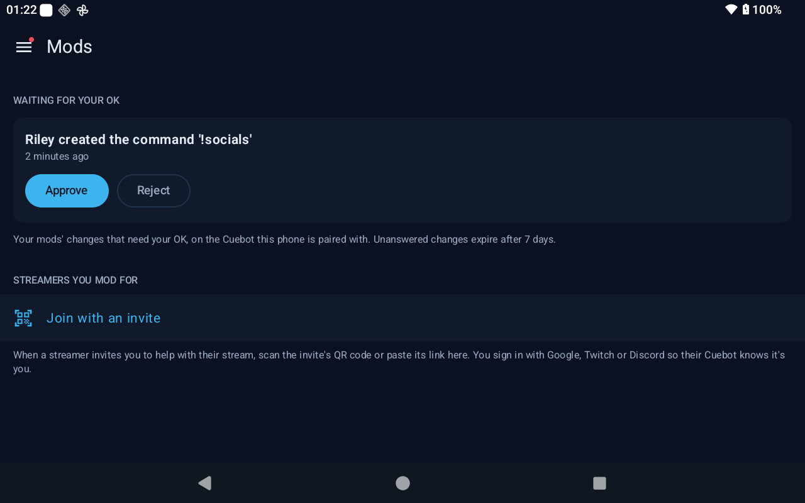

1. Open **Mods** from the menu. A number next to **Mods** in the menu shows how many changes are waiting.
2. Under **Waiting for your OK**, each change says what the mod wants to change and when they asked.
3. Tap **Approve** to make a change live, or **Reject** to drop it.

If you changed the same thing yourself since the mod asked, the app says so: tap **Approve anyway** to use the mod's
version. A change nobody answers expires after 7 days. The list only shows up while something is waiting. An older
Cuebot shows nothing here: update it first.

Cuebot's own questions show up in the same list, from **Cuebot**: for example *Switch the stream category to
Helldivers 2?* when you start a game (see [Game categories](../platforms/game-categories.md)). **Approve** does it,
**Reject** leaves everything as it is.

**Notifications.** Something new waiting for a yes also shows as a notification, so you see it while the Deck fills the
screen. Tapping it opens the Mods tab. On Android 13 and newer, the app asks once whether it may show notifications.
The app only checks while it is open (or was just put aside); it doesn't run in the background.

!!! warning "Pair only your own phone or tablet"
    A paired phone has full control of your Cuebot, more than any mod role. Never pair a mod's phone. Send them an
    [invite](#for-mods) instead: they get the same app, with only what their role allows.

## For mods

A streamer can make you a mod in their Cuebot with an invite (a link or a QR code). Everything the
[mod portal](mod-portal.md) has is in the app, too: it shows the streamer's own portal pages, with only what your role
allows. It works from anywhere, not only on the streamer's network.

**Streamer:** on the **Mod portal** page, choose the role and click **Make invite link**. Cuebot shows the link and a
QR code, with a **Get the Companion app** button for the download. Send the link privately, or let your mod scan the
code.

**Mod**, in the app:

1. Open the **Mods** tab and tap **Join with an invite**.
2. Scan the invite's QR code, choose a picture of it, or copy the link and tap **Paste the invite link**.
3. Tap **Sign in with** Google, Twitch or Discord. The sign-in opens in your browser and comes back to the app when
   it is done. Your account is only used to recognise you.
4. The streamer's mod portal opens, with the same pages as in a browser.

The app remembers each streamer you mod for, under **Streamers you mod for**: tap one on the **Mods** tab to open
their portal again without signing in. **Rename** gives it the streamer's name, and **Forget on this phone** removes
it (⋮ on Android, swipe on iPhone). **Sign out on this phone** (⋮ in the portal) removes you from this phone.

You don't need to pair the app with a Cuebot of your own for this; the portal goes through the streamer's Cuebot over the internet, encrypted end to end.

If the connection drops (switching between Wi-Fi and mobile data, the phone waking up), the portal stays on screen
with **Reconnecting to the streamer's Cuebot…** at the top and picks up where you were by itself. Only if the
streamer's Cuebot can't be reached for about a minute does the app say the connection was lost, with **Try again**.

While the portal is open, the app also tells you when Cuebot asks for a yes that your role may give, like switching
the stream category to the game being played. Answer on the portal's **Home** page, under **Needs a yes**.

The iPhone app has the same **Mods** tab, for approving and for modding. It comes with the iPhone app (not available
yet, see [Get the app](#get-the-app)).

## It doesn't connect?

Open **Settings > Troubleshooting** in the app. It goes through the usual causes one by one:

- Is the phone on the same Wi-Fi as the computer? (Not on mobile data, and not on a guest network.)
- On the computer: are the **REST API** and **HTTP server** on, with **Allow LAN connections** ticked, and listening
  on `0.0.0.0`? See [Cuebot's servers](../developers/servers.md).
- Is a firewall on the computer blocking Cuebot? The phone needs the **REST API** and **HTTP server** ports (7475 and
  7474 at the start). On Windows, allow Cuebot on **private networks** when Windows asks. On Linux with ufw, allow them
  from your home network, for example `sudo ufw allow from 192.168.1.0/24 to any port 7474:7475 proto tcp` (use your
  own network's range); with firewalld, `sudo firewall-cmd --permanent --add-port=7474-7475/tcp`, then
  `sudo firewall-cmd --reload`.
- On Android 17 and newer, the app needs **local network access** (**Nearby devices** in the app's settings). It
  asks for it once you have paired.
- Did the computer get a new address? Pair again with a fresh code.

!!! note "New"
    The phone app is new. Tell us what works and what doesn't on the
    [issues page](https://github.com/TechDaddyKB/cuebot/issues). See also [What's experimental](../help/experimental.md).
