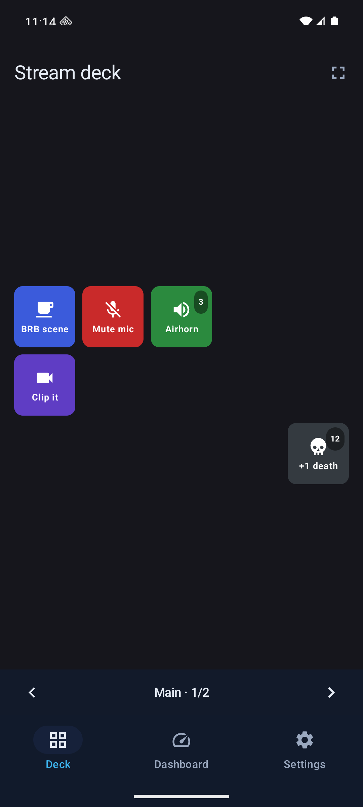
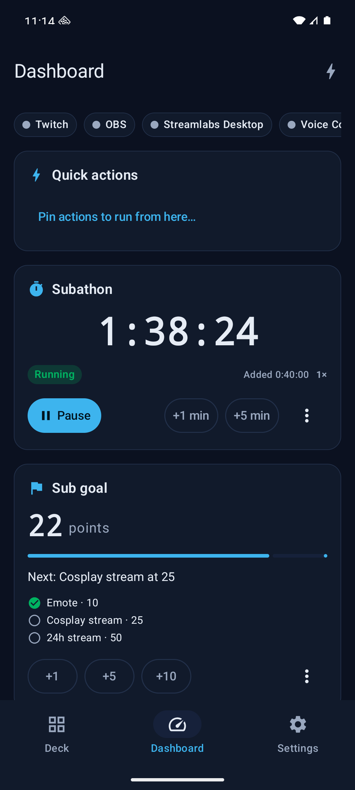
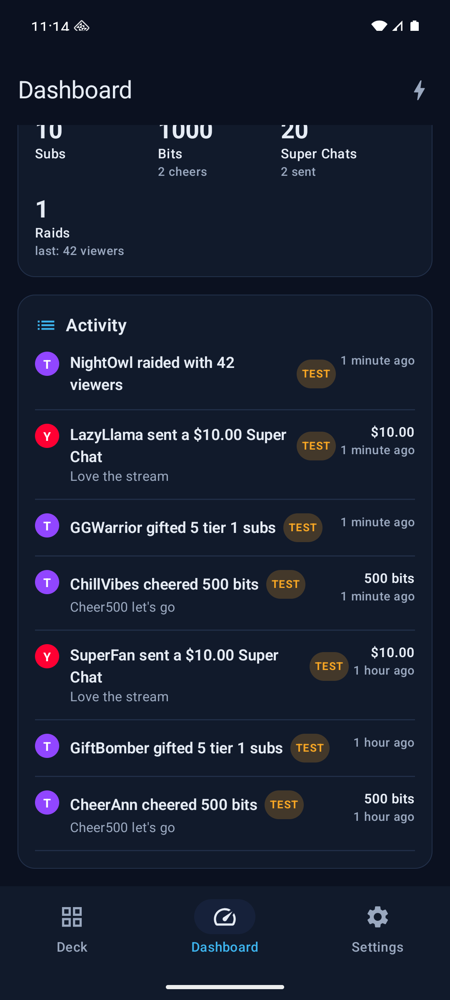
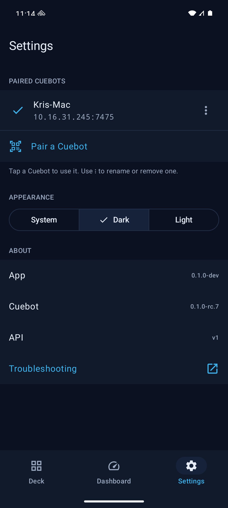
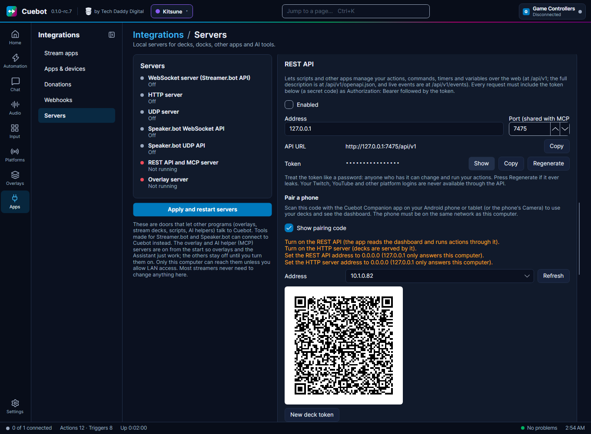
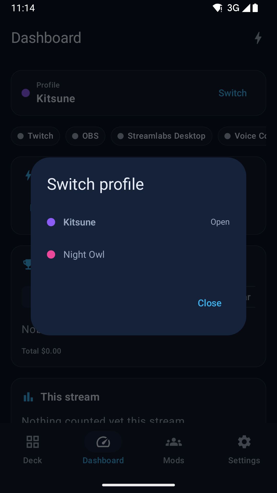
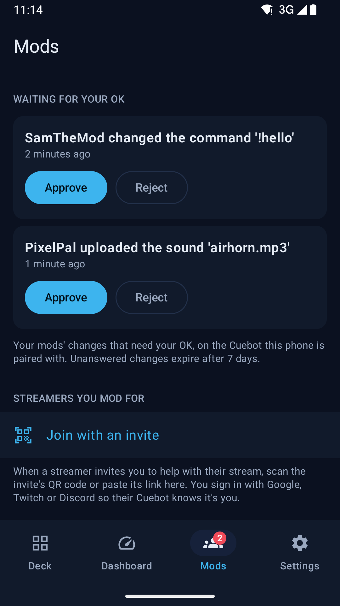

# The phone app (Cuebot Companion)

**Cuebot Companion** puts your Cuebot on your phone or tablet. Use it as a button board next to your keyboard,
to keep an eye on your stream from the couch, or to approve your mods' changes. Mods can use it to help with
someone else's stream.

It has four tabs:

| Tab | What it is for |
| --- | --- |
| **Deck** | The buttons of your [decks](../apps/decks.md). Tap one and Cuebot runs it, just like a Stream Deck. **Choose deck** switches decks, and the arrows at the bottom switch pages. |
| **Dashboard** | What is connected, your **Quick actions**, your [subathon timers](../services/subathon-timers.md) and [goals](../services/goals.md) with their buttons, **Top spenders** for **This stream** and more, totals, and the **Activity** list of follows, subs, tips and raids. |
| **Mods** | Your mods' changes that wait for your OK, and, if you are a mod for someone, their [mod portal](mod-portal.md). A number on the tab (Android) shows how many changes wait. |
| **Settings** | The Cuebots you paired, light or dark look, and **Troubleshooting**. |

## Get the app

| Phone | How to get it |
| --- | --- |
| **Android** 10 or newer | Download `Cuebot-Companion-<version>.apk` from the [releases page](https://github.com/TechDaddyKB/cuebot/releases), next to the computer downloads. |
| **iPhone and iPad** | Not available yet. It comes to the App Store (first through TestFlight) later. |

**Installing the APK on Android:** open the downloaded file on your phone. Android asks if your browser (or file app)
may install apps: tap **Settings**, switch on **Allow from this source**, go back and tap **Install**. You only do
this once. The app is signed by Cuebot, so later versions install over it and keep your settings.

## Pair it with your Cuebot

The phone and the computer must be on the **same network**: the same Wi-Fi at home, for example.

**On the computer:**

1. Go to **Apps > Servers**.
2. Make sure the **REST API** and the **HTTP server** are on, and **Allow LAN connections** is ticked.
3. In the REST API card, find **Pair a phone** and tick **Show pairing code**.
4. Pick your home network under **Address** (it usually starts with `192.168`). A QR code appears.

If something stops the phone from connecting, the card lists what to change first.

**On the phone:**

1. Open Cuebot Companion and go to **Settings**.
2. Tap **Pair a Cuebot**.
3. Point the camera at the QR code. It connects straight away.
    - Or tap **Enter the details instead**. There you can type the address and token yourself, use **Choose an image
      of the code** (a screenshot or photo of it), or **Paste a pairing link**.

You can also scan the code with the phone's own **Camera** app. It opens Cuebot Companion, which asks you to check
that it is your Cuebot before it pairs.

!!! warning "The code is a key"
    The pairing code holds the password (token) to your Cuebot. Untick **Show pairing code** when you're done, and
    never show it on stream. If someone saw it anyway, click **Regenerate** next to the REST API token and
    **New deck token** under **Pair a phone**, then pair your phone again.

You can pair more than one Cuebot, like a gaming PC and a streaming PC. Tap one in **Settings** to use it.

## Using it on stream

- **Stream mode** (on the Deck tab) shows only the buttons, full screen, and keeps the screen from turning off. Handy
  for a phone on a stand next to your keyboard.
- **Subathon and goal buttons** on the Dashboard work like the ones in Cuebot: **Start**, **Pause** or **Resume** the
  timer, add a minute or five (**+1 min**, **+5 min**), and under ⋮ add or take away any number of minutes or change
  the multiplier. For goals: add points, or **Set points…** by hand. A timer that ran out shows **Ended**; **Start**
  starts it over from its starting length, like in Cuebot.
- **TEST** badges in the Activity list mark test events: a service's test button (like **Send test event**) or the
  sample events the assistant sends. They don't count towards top spenders. The assistant's sample events *do* move
  subathon timers and goals, so you can try those out; a service's test button doesn't.

## Switching persona

Stream as more than one persona, with [profiles](../platforms/profiles.md)? The **Dashboard** then starts with a
**Profile** card that shows the open one, with its colour.

{ width="320" }

1. Tap **Switch** on the **Profile** card.
2. Pick the profile.
3. Tap **Switch** to confirm.

Cuebot restarts on that profile. The card says **Switching to …** for a few seconds, and then the Dashboard shows the
other persona's timers, goals and feed. You don't need to pair again: every profile shares the pairing.

While you are live, the app asks first: tap **Switch anyway** only if you mean it. The card only shows when there are
two or more profiles.

## Approving from your phone

Your mods can change things through the [mod portal](mod-portal.md). If their changes need your OK (see
[Approving and undoing changes](mod-portal.md#approving-and-undoing-changes)), you can answer from the phone:

1. Open the **Mods** tab. On Android, a number on the tab shows how many changes are waiting.
2. Under **Waiting for your OK**, each change says what the mod wants to change and when they asked.
3. Tap **Approve** to make a change live, or **Reject** to drop it.

If you changed the same thing yourself since the mod asked, the app says so: tap **Approve anyway** to use the mod's
version. A change nobody answers expires after 7 days. The list only shows up while something is waiting. An older
Cuebot shows nothing here: update it first.

## For mods

A streamer can make you a mod in their Cuebot with an invite (a link or a QR code). In the app:

1. Open the **Mods** tab and tap **Join with an invite**.
2. Scan the invite's QR code, choose a picture of it, or copy the link and tap **Paste the invite link**.
3. Tap **Sign in with** Google, Twitch or Discord. The sign-in opens in your browser and comes back to the app when
   it is done. Your account is only used to recognise you.
4. The streamer's mod portal opens, with the same pages as in a browser.

The app remembers each streamer you mod for, under **Streamers you mod for**: tap one on the **Mods** tab to open
their portal again without signing in. **Rename** gives it the streamer's name, and **Forget on this phone** removes
it (⋮ on Android, swipe on iPhone). **Sign out on this phone** (⋮ in the portal) removes you from this phone.

You don't need to pair the app with a Cuebot of your own for this; the portal goes through the streamer's Cuebot over the internet, encrypted end to end.

The iPhone app has the same **Mods** tab, for approving and for modding. It comes with the iPhone app (not available
yet, see [Get the app](#get-the-app)).

## It doesn't connect?

Open **Settings > Troubleshooting** in the app. It goes through the usual causes one by one:

- Is the phone on the same Wi-Fi as the computer? (Not on mobile data, and not on a guest network.)
- On the computer: are the **REST API** and **HTTP server** on, with **Allow LAN connections** ticked, and listening
  on `0.0.0.0`? See [Cuebot's servers](../developers/servers.md).
- Is a firewall on the computer blocking Cuebot? The phone needs the **REST API** and **HTTP server** ports (7475 and
  7474 at the start). On Windows, allow Cuebot on **private networks** when Windows asks. On Linux with ufw, allow them
  from your home network, for example `sudo ufw allow from 192.168.1.0/24 to any port 7474:7475 proto tcp` (use your
  own network's range); with firewalld, `sudo firewall-cmd --permanent --add-port=7474-7475/tcp`, then
  `sudo firewall-cmd --reload`.
- On Android 17 and newer, the app needs **local network access** (**Nearby devices** in the app's settings). It
  asks for it once you have paired.
- Did the computer get a new address? Pair again with a fresh code.

!!! note "New"
    The phone app is new. Tell us what works and what doesn't on the
    [issues page](https://github.com/TechDaddyKB/cuebot/issues). See also [What's experimental](../help/experimental.md).
