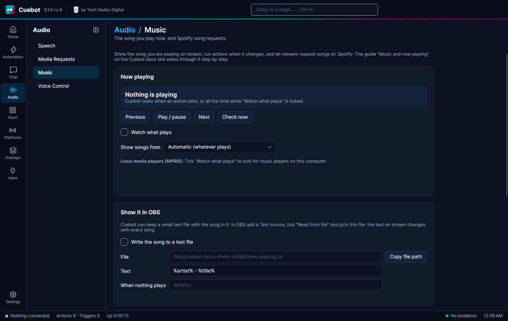
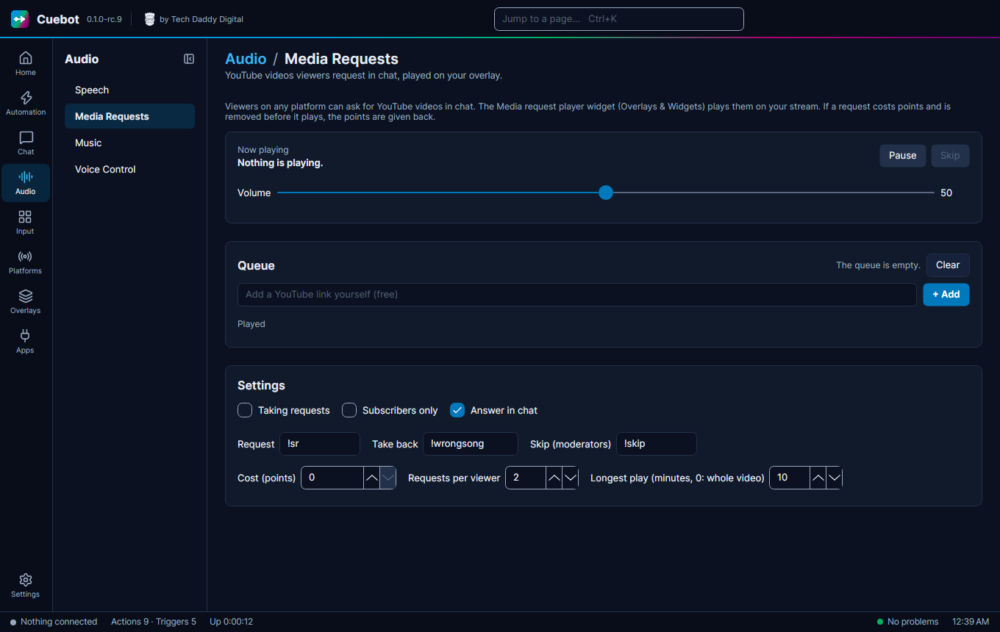

# Music and now playing

Cuebot can see which song you are playing and show it on stream. It can also run an action when the song changes, and
let your viewers put songs in your Spotify queue with a `!sr` command. Everything is on the **Audio > Music** page.

There are two ways Cuebot finds your music:

| Way | Works with | Needs |
| --- | --- | --- |
| **Players on this computer** | Spotify, VLC, foobar2000, Firefox, Chrome, YouTube Music and most other players, on **Windows** and **Linux** | Nothing. No account, no password. |
| **Your Spotify account** | Spotify on any device: a PC, a Mac, a phone or a speaker | A free "Spotify app" you make once (about two minutes, see below). Song requests and skipping need **Spotify Premium**. |

!!! note "Mac"
    On a Mac, Cuebot cannot see the players on your computer yet. Sign in to your Spotify account to show the songs
    you play in Spotify.

!!! warning "Experimental"
    **Spotify** (showing the song and song requests) and **now playing on Windows** are built and tested by Cuebot's own
    tests, but not yet with a real Spotify account or on a real Windows computer. Now playing on **Linux** was tried with
    real players (mpv and VLC). See [What's experimental](experimental.md).

Want viewers to request **YouTube videos** instead of songs? See
[YouTube video requests](#youtube-video-requests-media-requests) below.

## Show the song you are playing



1. Open **Audio > Music**.
2. Tick **Watch what plays**.
3. Start a song in your music player. Its name, artist and player show up at the top of the page within a second or
   two.
4. Leave **Show songs from** on **Automatic**. If you have several players open (say Spotify and a YouTube tab) and
   Cuebot shows the wrong one, pick **One player on this computer** and type part of its name, like `spotify`. The
   names Cuebot sees are listed under **Open players**.

The **Previous**, **Play / pause** and **Next** buttons press the media keys of the player that plays now. Handy to
test.

### Put it on stream (OBS)

1. On the Music page, tick **Write the song to a text file**.
2. Click **Copy file path**.
3. In OBS, click **+** under **Sources**, choose **Text** (on Linux: **Text (FreeType 2)**) and click **OK**.
4. Tick **Read from file**, click **Browse** and paste the path you copied. Click **OK**.

That is it: the text in OBS changes with every song. To change what it says, edit **Text**, for example
`Now playing: %title% by %artist%`. You can use `%title%`, `%artist%`, `%album%`, `%player%` and `%duration%`.
While the music is paused the file shows **When nothing plays** (empty by default, so the text disappears).

## A !song command

Viewers type `!song` and Cuebot answers with the song.

1. Go to **Automation > Commands**, click **+**, name it `song` and type `!song` under **Commands**.
2. Go to **Automation > Actions** and make an action called `Song`.
3. On **Triggers**, click **+ Trigger**, pick **Commands › Command triggered** and choose `song`.
4. On **Sub-actions**, click **+ Sub-action** and pick **Now playing › Get now playing**.
5. Add **Chat (all platforms) › Send chat message (any platform)** with this message:

    ```text
    Now playing: %nowPlaying.title% by %nowPlaying.artist%
    ```

    Tick **Reply on the platform the trigger came from**.

You do not even need **Watch what plays** for this: **Get now playing** looks when it runs.

## Say every new song in chat

1. Tick **Watch what plays** on the Music page.
2. Make an action with the trigger **Now playing › Song changed**.
3. Add **Send chat message (any platform)** with `🎵 %title% by %artist%`.

The trigger gives you `%title%`, `%artist%`, `%album%`, `%player%`, `%durationText%` (like `3:45`), `%artUrl%` (the cover
picture, when the player has one) and `%link%` (Spotify songs only). It runs once per song, not when you pause and play
again.

## Set up Spotify

Spotify asks every streamer to make their own small "app" on Spotify's developer site. It is free, it is only for you,
and you do it once. You need to log in with the Spotify account you stream with.

!!! info "Why your own app?"
    Since 2026 a Spotify app that is "in development mode" may only be used by 5 people, and the person who made it
    needs Spotify Premium. One shared Cuebot app would stop working after five streamers, so each streamer makes their
    own. You do not need to send it to Spotify for review.

### 1. Make the Spotify app

1. In Cuebot, open **Audio > Music** and click **Open Spotify for Developers** (or go to
   [developer.spotify.com/dashboard](https://developer.spotify.com/dashboard)).
2. Log in with your Spotify account. The first time, Spotify asks you to accept the developer terms: tick the box and
   click **Accept the terms**. (If Spotify asks you to verify your email address, do that first.)
3. Click **Create app**.
4. Fill in the form:
    - **App name**: anything, like `Cuebot for <your name>`.
    - **App description**: anything, like `Song requests for my stream`.
    - **Website**: leave it empty.
    - **Redirect URIs**: in Cuebot click **Copy redirect address**, paste it here and click **Add**. It looks like
      `http://127.0.0.1:43117/callback`.
    - **Which API/SDKs are you planning to use?**: tick **Web API**.
5. Tick that you agree with the terms and click **Save**.

!!! warning "127.0.0.1, not localhost"
    Spotify only accepts the address with `127.0.0.1`. If you type `localhost` yourself, sign-in fails with
    "INVALID_CLIENT: Invalid redirect URI". Copy the address from Cuebot and it is right.

### 2. Copy the Client ID into Cuebot

1. Your new app opens on Spotify's site. Click **Settings**.
2. Under **Basic Information** you see **Client ID**: 32 letters and numbers. Copy it.
3. In Cuebot, paste it into **Client ID**.

You do **not** need the **Client secret**. Leave it alone and never paste it anywhere.

### 3. Sign in

1. In Cuebot click **Sign in**. Your browser opens Spotify.
2. Spotify shows what Cuebot may do (see what you play, control your player). Click **Agree**.
3. The browser says "Cuebot is signed in to Spotify. You can close this tab." Close it.

The Music page now says **Signed in**. To test: open Spotify, start any song, type a song name into **Try it** and click
**Add a song**. It should show up in Spotify's queue.

## A !sr song request command

!!! warning "Media Requests can also listen for `!sr`"
    Cuebot's **Media Requests** page (YouTube videos) also uses `!sr` once you tick **Taking requests** there. It starts
    switched off. If you turn it on and also use `!sr` for Spotify, change one of the two words, for example Media
    Requests' **Request** word to `!video`. Otherwise one `!sr` does both.

Viewers type `!sr never gonna give you up` (or paste a Spotify song link), and the song goes into your queue.

1. Go to **Automation > Commands**, click **+**, name it `sr` and type `!sr` under **Commands**. Set a cooldown so one
   viewer cannot fill your queue, for example a **Per user** cooldown of 120 seconds.
2. Go to **Automation > Actions**, make an action called `Song request` and add the trigger
   **Commands › Command triggered** with the command `sr`.
3. Click **+ Sub-action** and pick **Spotify › Add song to Spotify queue**. Leave **Song** on `%rawInput%` (what the
   viewer typed after `!sr`).
4. This step has two lists: **Added** and **Not added**. Select **Added** (the word **BRANCH** shows up) and add
   **Send chat message (any platform)** with:

    ```text
    @%user% added %spotify.title% by %spotify.artist% 🎶
    ```

5. Select **Not added** and add another **Send chat message (any platform)** with:

    ```text
    @%user% sorry, that did not work: %spotify.error%
    ```

Tick **Reply on the platform the trigger came from** in both messages.

Viewers can send:

- a song name: `!sr bohemian rhapsody queen`. Cuebot takes Spotify's first search result, like typing it into
  Spotify's search box. Adding the artist helps.
- a Spotify song link: `!sr https://open.spotify.com/track/4cOdK2wGLETKBW3PvgPWqT`. Album and playlist links do not
  work, only songs.

### Other Spotify steps

| Step | What it does |
| --- | --- |
| **Spotify › Skip song** | Next song. Good for a `!skip` command for moderators, or a Stream Deck button. |
| **Spotify › Previous song** | Back one song. |
| **Spotify › Pause / resume** | Pause, play, or switch between the two. |
| **Spotify › Set volume** | Volume from 0 to 100, like `!volume 30` with `%input0%`. Some devices (many phones) do not allow it. |
| **Now playing › Media control** | Play/pause, next, previous on any player, including players on this computer. |

## YouTube video requests (Media Requests)



**Audio > Media Requests** lets viewers ask for YouTube videos in chat. The videos play on your stream, one after
another, in an overlay.

1. Go to **Overlays > Overlays & Widgets**, open your overlay (or make one) and add the **Media request player**
   widget. See [Overlays and alerts](overlays.md). The overlay must be in OBS as a browser source.
2. Go to **Audio > Media Requests**. Under **Settings**, tick **Taking requests**. It starts switched off, so chat
   can't fill a queue before your player is set up.
3. Viewers type `!sr` and a YouTube link, like `!sr https://youtu.be/dQw4w9WgXcQ` (or just the 11-letter video id at
   the end of it). The video goes into the **Queue**. Searching by name doesn't work here: anything that isn't a
   YouTube link gets the answer "that is not a YouTube link".

The commands, which you can change under **Settings**:

| Viewers type | What happens |
| --- | --- |
| `!sr` and a YouTube link (the **Request** word) | Adds a video to the queue. |
| `!wrongsong` (the **Take back** word) | Takes back their latest request. |
| `!skip` (the **Skip (moderators)** word) | Skips the video that plays. Only you and your moderators. |

More settings:

- **Cost (points)**: what a request costs in [points](community.md#points). `0` means free. Viewers get their points
  back when a request is removed.
- **Requests per viewer**: how many videos one viewer may have waiting.
- **Longest play (minutes, 0: whole video)**: longer videos are cut off.
- **Subscribers only** and **Answer in chat** (Cuebot says where the request is in the queue, or why it was turned
  down).

On the page you can also **Pause** and **Skip**, set the **Volume**, move videos up and down, **Remove** one, **Clear**
the queue, and paste a YouTube link yourself (free) with **+ Add**. Actions can do the same with the
[Media requests sub-actions](../reference/sub-actions/media-requests.md).

## Troubleshooting

| What you see | What to do |
| --- | --- |
| **"Open Spotify on a device first and play a song"** | Spotify only takes commands while it is open somewhere. Open Spotify (PC, phone or web player), play any song, then try again. |
| **"Spotify needs Premium to change songs"** | Adding to the queue, skipping, pausing and volume need Spotify Premium on the account you signed in with. Showing the song works without it. |
| **"Your Spotify account is not allowed in your Spotify app yet"** | Sign in with the same Spotify account that made the app. To use another account, open your app on developer.spotify.com, go to **User Management** and add that account's name and email. |
| **"INVALID_CLIENT: Invalid redirect URI"** in the browser | The redirect address in your Spotify app does not match. In Cuebot click **Copy redirect address**, then on developer.spotify.com open your app, **Settings > Edit**, remove the old address, paste the new one, click **Add** and **Save**. |
| **"Another program already uses port …"** | Pick another **Port** on the Music page (any number from 1024 to 65535), copy the redirect address again and change it in your Spotify app too. |
| **"Spotify sign-in ran out"** / **Needs attention** | Spotify ends sign-ins after a while (about six months), or you removed Cuebot under Manage apps. Click **Sign in** again. |
| **"Spotify found no song for …"** | Spotify's search found nothing. Try other words, add the artist, or send a song link. |
| **"Spotify is busy. Try again in … seconds."** | Spotify asks apps to slow down sometimes. Wait the few seconds. A command cooldown helps. |
| **Nothing is playing**, but music plays | Tick **Watch what plays** and click **Check now**. Cuebot sees players that show up in the Windows volume pop-up (Windows) or in your desktop's media controls (Linux). Some players do not share what they play: on Linux, mpv needs the `mpv-mpris` plug-in; older VLC versions on Windows do not share it at all. Browser tabs show up while they play. |
| **The wrong player shows** | Pick **One player on this computer** and type part of its name. |
| **Windows says it cannot read music players** | Cuebot needs Windows 10 (October 2018 update) or newer for this. Sign in to Spotify instead. |

To disconnect Spotify completely, click **Sign out** in Cuebot, then on [spotify.com](https://www.spotify.com/account/)
open **Account > Manage apps** and remove your app.

## How it works (for the curious)

- On **Linux**, Cuebot reads players through MPRIS, the shared "media player" language of the Linux desktop (the same
  thing your desktop's media controls use).
- On **Windows**, Cuebot reads the same list as the volume pop-up (the Windows media controls). It starts a small
  helper for this, `powershell.exe`, which closes when Cuebot closes.
- **Spotify** is asked every 5 seconds what plays, while you are signed in. Your Spotify sign-in is stored encrypted on
  your computer, like your other sign-ins.
