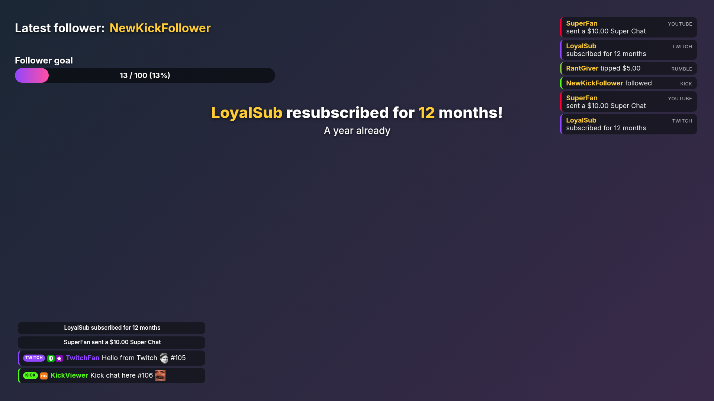
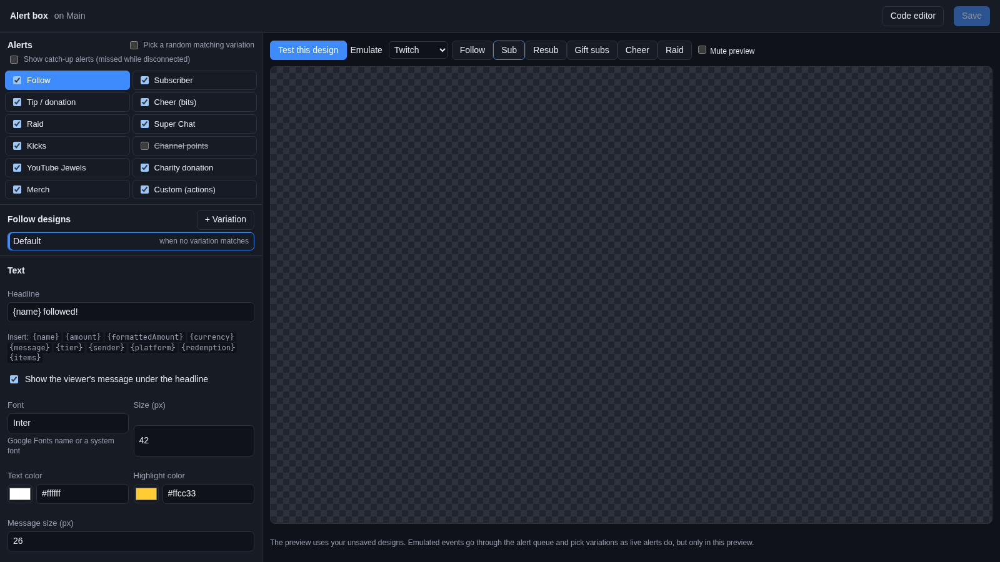
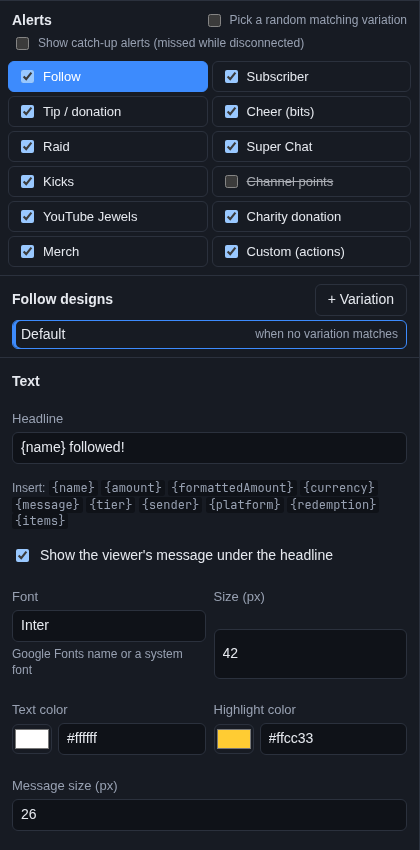
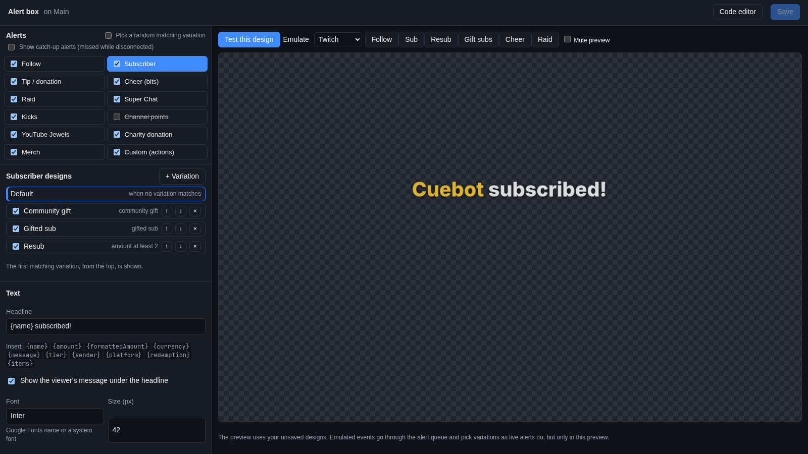
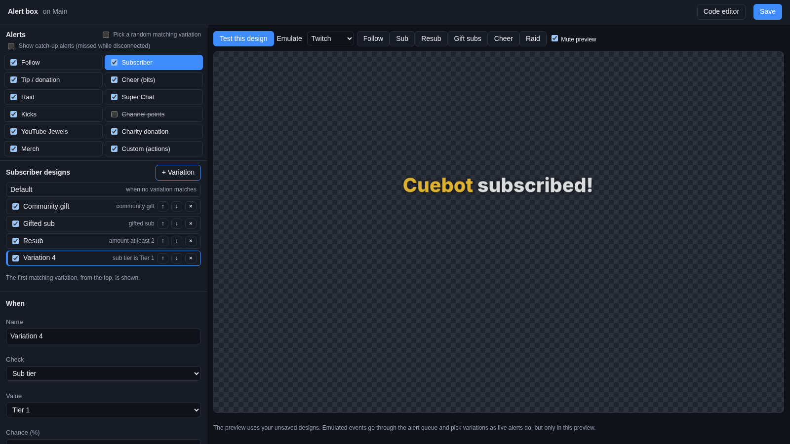
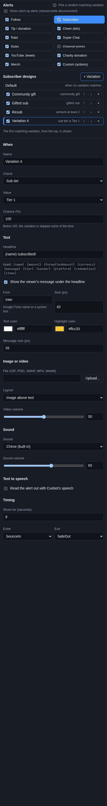
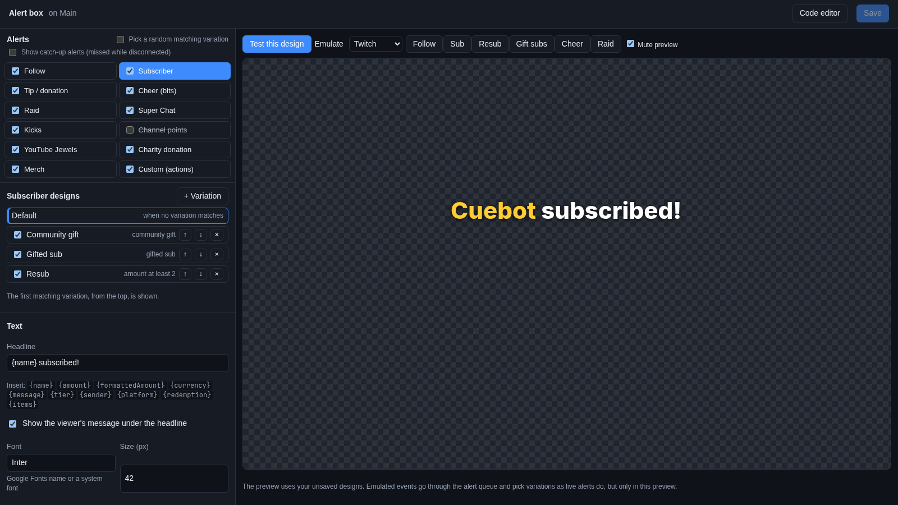
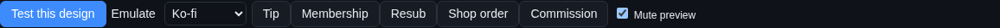
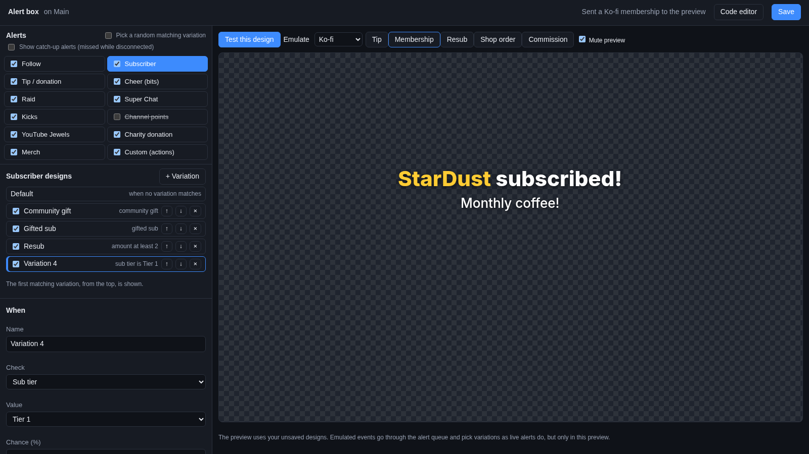

# Alerts

An **alert** is the pop-up on stream when someone follows, subs, cheers, raids or tips: a line of text, maybe a
picture or video, a sound, and if you like a voice reading it out. In Cuebot, alerts come from the **Alert box**
widget on one of your [overlays](overlays.md). You design them in the **alert designer**.

## The Alert box

The **Alert box** widget shows alerts by itself. You do not need an action for that. Add it to an overlay with
**Add Cuebot widget > Alert box** on **Overlays > Overlays & Widgets** (see [Add widgets](overlays.md#add-widgets)), or
with **+ Add > Alert box** in the [designer](overlay-designer.md). It lands at the top in the middle of the canvas,
60% as wide as the canvas and half as tall. Move and resize it like any layer.

Alerts come from every platform and service Cuebot is connected to: Twitch, Kick, Rumble, YouTube, StreamElements,
Streamlabs and the other donation services, Ko-fi (tips, memberships, shop orders, commissions), Patreon (a free member
joining is a **Follow**, a new or upgraded pledge a **Subscriber** alert with the tier and monthly price; a downgrade
is no alert), Fourthwall (donations, orders, stream gifts) and Shopify (paid orders).

## Open the alert designer

On the Overlays page, click **Edit…** on the alert box's row. (In the designer: select the alert box and click **Edit
widget…**.) The **alert designer** opens in your web browser.

It has two halves:

- **Left**: the list of alert types, the designs of the type you picked, and the form for the design you picked.
- **Right**: **Test this design**, the **Emulate** buttons, **Mute preview**, and a preview the size of the alert box.

At the top right are **Code editor** and **Save**.

## Alert types

The alert designer lists twelve alert types:

| Type | Shown for |
| --- | --- |
| **Follow** | A new follower on any platform, and a free Patreon member |
| **Subscriber** | Subs, resubs and gifted subs; also paid memberships such as a new Patreon pledge |
| **Tip / donation** | Tips and donations from any donation service |
| **Cheer (bits)** | Twitch bits |
| **Raid** | A raid, with the number of viewers |
| **Super Chat** | YouTube Super Chats |
| **Kicks** | Kick's Kicks |
| **Channel points** | Channel point reward redemptions. **Off** at first, because many rewards would flood the screen. |
| **YouTube Jewels** | YouTube Jewels gifts |
| **Charity donation** | Donations to a charity campaign |
| **Merch** | Merch and shop orders |
| **Custom (actions)** | Alerts your own actions send with the [Show alert](#alerts-from-your-own-actions) sub-action |

- Click a type's name to see and change its designs.
- The tick box in front of each type turns that alert on or off. An unticked type is struck through and never pops up.

Two options sit above the list:

- **Pick a random matching variation**: see [Which variation plays](#which-variation-plays).
- **Show catch-up alerts (missed while disconnected)**: see [Missed alerts (catch-up)](#missed-alerts-catch-up).

## Designs and variations

Each alert type has a **Default** design, and can have **variations**: other designs for special cases. For example a
bigger alert with fireworks for a tip of 50 or more, or a different sound for Tier 3 subs.

Under "… designs" you see:

- **Default**, "when no variation matches". Click it to change the default design.
- Each variation, with a tick box (use it or not), its name, its rule in short (like "amount at least 2"), and three
  buttons: **↑** (check earlier), **↓** (check later) and **✕** (delete, after asking).

The **Subscriber** type starts with three variations: **Community gift** (someone gifts several subs at once),
**Gifted sub** (one viewer got a gifted sub: "{sender} gifted {name} a sub!") and **Resub** (amount at least 2: a resub
of two months or more).

### Add a variation

1. Pick the alert type, for example **Tip / donation**.
2. Click **+ Variation**. A new variation appears, already selected. It starts as a **copy** of the Default design, so
   you only change what should be different.
3. Under **When**, give it a **Name** and set its rule (see below).
4. Change its design in the form below, for example a bigger **Size** and another sound.
5. Click **Test this design** to see it, then **Save**.

A variation's design is its own full copy. Changing the Default design later does not change the variation.

### The rule (When)

| Setting | What it means |
| --- | --- |
| **Name** | A name for the list, like `Big tip`. |
| **Check** | What to look at (see the table below). |
| **Is** / **Value** / **Contains** | What it must be. |
| **Chance (%)** | 100 means every time it matches. Below 100, the variation is skipped some of the time, for example 10 for a rare surprise alert. |

What **Check** can look at:

| Check | Choices | Example |
| --- | --- | --- |
| **Amount (months, bits, viewers, money…)** | **at least**, **exactly** or **between** two numbers | Tips at least 50; cheers between 100 and 499 |
| **Sub tier** | **Tier 1**, **Tier 2**, **Tier 3** or **Prime** | A gold design for Tier 3 |
| **Platform** | **Twitch**, **Kick**, **Rumble**, **YouTube**, **StreamElements**, **Donations**, **Ko-fi**, **Patreon**, **Fourthwall** or **Shopify** | A green follow alert for Kick |
| **User name** | A name, or several separated by commas | A special alert for your best friend |
| **Gifted sub** | **Yes** or **No** | Someone got a sub as a gift |
| **Community gift** | **Yes** or **No** | Someone gave several gift subs at once |
| **Currency** | A currency code like `EUR` | Tips in euros |
| **Message** | **Contains** some words | A tip whose message says "hydrate" |

"Amount" means different things for each type: months for a resub, the number of gifts for a community gift, bits for
a cheer, viewers for a raid, or the money for a tip. Names, currencies and messages are matched without caring about
upper and lower case.

### Which variation plays

When an alert comes in, the alert box:

1. looks at the variations that are ticked and whose rule matches;
2. without **Pick a random matching variation**: takes the **first** of them, from the top of the list, that passes its
   chance. The list says "The first matching variation, from the top, is shown." So put the most special case first:
   "Tip at least 100" above "Tip at least 10";
3. with **Pick a random matching variation**: takes one of them **at random** (each after its chance). The list says "A
   random matching variation is shown (each after its chance)." Use it for several looks that take turns;
4. if none is left, uses the **Default** design.

## The design form

Under the designs is the form for the design you selected (Default or a variation). It has five parts.

### Text

| Setting | What it does |
| --- | --- |
| **Headline** | The main line, like `{name} followed!`. Words in `{ }` are filled in (see below). |
| **Insert** | Click one of the `{…}` words to put it into the headline where your cursor is. |
| **Show the viewer's message under the headline** | Ticked: a tip's or sub's message shows under the headline, in smaller letters. |
| **Font** | A Google Fonts name (the list suggests some, like `Poppins`, `Bebas Neue` or `Press Start 2P`) or a font on your computer. |
| **Size (px)** | The headline's letter size, from 8 to 300. |
| **Text color** | The headline's colour. |
| **Highlight color** | The colour of the filled-in words, so `{name}` stands out. Yellow at first. |
| **Message size (px)** | The letter size of the viewer's message, from 8 to 200. |

The words you can put in the headline:

| Word | Becomes |
| --- | --- |
| `{name}` | Who it is about: the follower, subscriber, tipper or raider |
| `{amount}` | The number: months, gifts, bits, viewers or money |
| `{formattedAmount}` | Money written properly, like `$5.00` |
| `{currency}` | The currency code, like `USD` |
| `{message}` | The viewer's message |
| `{tier}` | The sub tier: `Tier 1`, `Tier 2`, `Tier 3` or `Prime` |
| `{sender}` | Who gave a gifted sub |
| `{platform}` | The platform, like `Twitch` |
| `{redemption}` | The channel point reward's name |
| `{items}` | What was bought, for a merch alert |

### Image or video

| Setting | What it does |
| --- | --- |
| **File (GIF, PNG, WebP, MP4, WebM)** | A picture or video for the alert: a web address, or **Upload…** a file from your computer. |
| **Layout** | **Image above text**, **Image beside text** or **Text over image**. |
| **Video volume** | How loud a video's own sound is, 0 to 100. |

### Sound

| Setting | What it does |
| --- | --- |
| **Sound** | **Chime (built in)**, **No sound**, or **A sound file…** |
| **Sound file (MP3, OGG, WAV)** | Shows with **A sound file…**: a web address, or **Upload…** a sound. |
| **Sound volume** | How loud, 0 to 100. |

### Text to speech

| Setting | What it does |
| --- | --- |
| **Read the alert out with Cuebot's speech** | Ticked: Cuebot's [text-to-speech](../sound/text-to-speech.md) reads the alert out. |
| **Text to read** | What is read. Same `{…}` words as the headline, like `{name} says {message}`. Starts as `{message}`. |
| **Voice alias** | Which of your voice aliases reads it. Empty: the default voice. Your bad-word and link filters apply. |

Spoken alerts join Cuebot's speech queue, so pausing speech or **Speak next** works on them too. **Mute alerts**
silences them as well.

### Timing

| Setting | What it does |
| --- | --- |
| **Show for (seconds)** | How long the alert stays on screen, from 1 to 120. |
| **Enter** | How it comes in, like **bounceIn** (the default), **fadeIn** or **slideInDown**. |
| **Exit** | How it goes out, like **fadeOut** (the default) or **zoomOut**. **none** makes it disappear at once. |

## Try your alerts

Nothing you try here reaches your live overlays.

- The preview shows the selected design by itself, a moment after every change, with a sample name like "Cuebot". It
  does not speak.
- **Test this design** shows the selected design (Default or a variation) in the preview, and **does** speak if text to
  speech is on.

### Emulate

**Emulate** sends a pretend event, like a real one, from a platform or service. Unlike **Test this design**, it goes
through the alert queue and picks the variation exactly as a live alert would, so it is the way to check your rules.

1. Pick a platform or service in the **Emulate** list: **Twitch**, **Kick**, **Rumble**, **YouTube**, **Donations**,
   **Ko-fi**, **Patreon**, **Fourthwall** or **Shopify**.
2. Click one of its buttons, like **Follow**, **Sub**, **Gift subs**, **Cheer** or **Tip** (the same buttons as in
   the [widget editor](widget-editor.md#emulate), without **Chat**).
3. The status says, for example, "Sent a Ko-fi membership to the preview", and the alert plays.

Click several buttons quickly to see alerts wait their turn. Your unsaved designs are used.

**Mute preview** silences sounds and videos in the preview, handy while you try things late at night.

## Save

When you change anything, **Save** lights up. Click it (or press **Ctrl+S**). The status says "Saved. Overlays using
this alert box reload now." If you try to leave with unsaved changes, your browser asks first.

**Code editor** (next to **Save**) opens the alert box in the [widget editor](widget-editor.md) in a new tab: its HTML,
CSS, JavaScript, fields and **My CSS**. Use it if you want to restyle the alert box with your own CSS. Your designs are
kept in its **Data**.

## Missed alerts (catch-up)

When Cuebot was disconnected or closed, it catches up afterwards: Streamlabs and StreamElements donations it fetches
after a reconnect, Ko-fi payments your relay kept, orders and donations Fourthwall or Shopify catch-up finds, and
Patreon's backlog after a paused webhook. These still count in event lists, goals, stream totals and top spenders, but
the alert box does **not** pop them up, so twenty old alerts never play in a row. To show them anyway, tick **Show
catch-up alerts (missed while disconnected)** at the top of the alert designer.

Pretend events from **Emulate** and **Test this design** are never treated as catch-up.

A Pally.gg **Replay Alert** always plays: that is you asking to see it again.

## Pause, skip and mute

Alerts play one after another: a new alert waits in line until the one on screen is done.

The **Alerts** card on **Overlays > Overlays & Widgets** controls that line on every overlay at once:

| Button | What it does |
| --- | --- |
| **Pause alerts** | Pressed: new alerts wait in line. The alert on screen finishes. Press again to let them play. |
| **Skip alert** | Ends the alert on screen right now; the next one follows (unless paused). |
| **Mute alerts** | Pressed: alert sounds, videos and spoken alerts are silent. Press again to hear them. |

Pause and mute are not kept when Cuebot closes: Cuebot always starts with alerts playing and sound on.

From an action, use the **Pause, skip or mute overlay alerts** sub-action. Its **Mode** is **Pause**, **Resume**,
**Toggle pause**, **Skip current alert**, **Mute**, **Unmute** or **Toggle mute**. Afterwards `%alertsPaused%` and
`%alertsMuted%` say whether alerts are paused or muted now. For example: pause alerts when you switch to your "BRB"
scene, and resume them when you come back. See the [Overlays sub-actions](../../reference/sub-actions/overlays.md).

## Alerts from your own actions

Want an alert for something Cuebot has no alert for, like a `!hype` command or a channel point reward? Add the **Show
alert** sub-action to an action (see [How actions work](../actions/how-actions-work.md)):

| Setting | What to put in |
| --- | --- |
| **Design** | Which alert type's designs to use, for example `custom` (the **Custom (actions)** type) or `tip`. |
| **Name** | Who it is about. Starts as `%user%`, whoever started the action. |
| **Message** | The text. The **Custom (actions)** headline is just `{message}`, so this is what it shows. |
| **Amount** | A number, like 5. Variations can check it. |
| **Currency** | For money, the currency code, like `USD`. Empty is fine otherwise. |
| **Platform** | `twitch`, `kick`, `rumble` or `youtube`. Starts as `%platform%`. Variations can check it. |

Your alert waits its turn behind other alerts, just like a real one, and picks variations the same way. The type you
pick must be ticked in the alert designer, or nothing shows.

### Example: a `!hype` alert

1. In the alert designer, click **Custom (actions)**. Set **Headline** to `{message}`, upload a GIF under **Image or
   video**, pick a sound, and **Save**.
2. Make an action called `Hype alert` with a command trigger for `!hype` (see
   [Your first action](../actions/your-first-action.md)).
3. Add the sub-action **Show alert**: **Design** `custom`, **Message** `%user% wants HYPE!`.
4. Type `!hype` in chat. The alert plays on every overlay with an alert box.

## Mods and alert designs

With the [mod portal](../mods/mod-portal.md), you can let mods change each alert's text, picture or video, sound, look
and text-to-speech, and turn alerts and their variations on or off. Which variation plays when (the rules) stays with
you.

## Troubleshooting

| What you see | What to do |
| --- | --- |
| No alerts at all | Is there an alert box on an overlay that is in OBS? Is **Pause alerts** pressed? Is the type ticked in the alert designer? |
| An alert has no sound | Is **Mute alerts** pressed? Is **Sound** set to **No sound**? With **Control audio via OBS** ticked on the browser source, check its slider in OBS. |
| Old donations did not pop up after a reconnect | That is on purpose: see [Missed alerts (catch-up)](#missed-alerts-catch-up). |
| The wrong variation plays | Variations are checked from the top. Move the special one up with **↑**, or check its **Chance (%)**. Try it with **Emulate**, not **Test this design**. |
| Channel point redemptions show no alert | **Channel points** is off at first. Tick it. |
| "Could not load the alert box: …" or "Preview failed: …" | The overlay server stopped. Check **Apps > Servers** and reload the page. |
