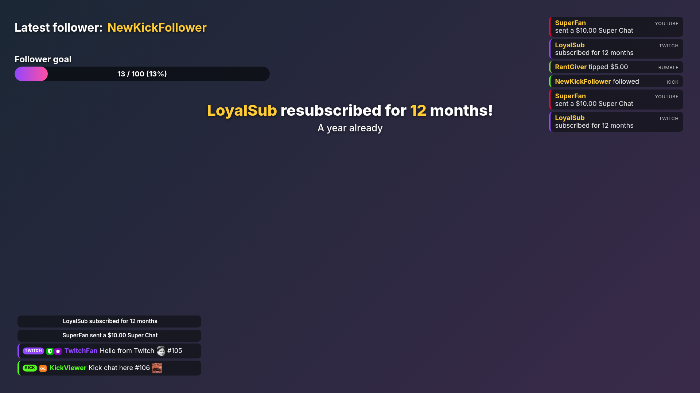

# Overlays and alerts

Overlays put things on your stream: your chat, alerts, goal bars, timers, titles, pictures and more. Cuebot makes each
overlay as a little web page on your computer, and OBS shows it with a browser source. This part shows how to make
one, put it in OBS, arrange it, design your alerts, and even write your own widgets.

## Start here

1. [Overlays](overlays.md): what an overlay is, the **Overlays & Widgets** page, putting an overlay in OBS, adding
   widgets, and sharing overlays.
2. [The overlay designer](overlay-designer.md): drag, resize and line up everything with the mouse; add text,
   pictures, videos and slideshows; layers, groups and the library. With a worked "Starting soon" example.
3. [The widget editor](widget-editor.md): change a widget's settings, try it with pretend events, and save.
4. [Alerts](alerts.md): the alert box and the alert designer, with designs, variations, sounds and text-to-speech,
   and alerts from your own actions.

## The widgets

[Widgets](widgets/index.md) lists every widget that comes with Cuebot, each with its own page:

- Chat and events: [Chat box](widgets/chat-box.md), [Label](widgets/label.md), [Event list](widgets/event-list.md),
  [Credits roll](widgets/credits-roll.md), [Top spenders](widgets/top-spenders.md)
- Goals and timers: [Goal bar](widgets/goal-bar.md), [Goal ladder](widgets/goal-ladder.md),
  [Subathon timer](widgets/subathon-timer.md), [Countdown](widgets/countdown.md)
- Fun: [Emote rain](widgets/emote-rain.md), [Hype cup](widgets/hype-cup.md), [Hype boss](widgets/hype-boss.md),
  [Seasonal effects](widgets/seasonal-effects.md)
- Interaction: [Poll and prediction](widgets/poll.md), [Giveaway](widgets/giveaway.md),
  [Media request player](widgets/media-player.md)
- Support and merch: [Charity campaign](widgets/charity.md), [Product showcase](widgets/product-showcase.md)

The alert box has its own page: [Alerts](alerts.md).

## For widget makers

- [Writing your own overlay widgets](widget-code.md): make a widget with a little HTML, CSS and JavaScript. Widgets made
  for StreamElements usually work without changes.
- [Streamlabs widgets](streamlabs-widgets.md): how Cuebot runs widget code made for Streamlabs.

## Quick answers

| I want to… | Go to |
| --- | --- |
| Show my chat on stream | [Add widgets](overlays.md#add-widgets), then [Chat box](widgets/chat-box.md) |
| Get follower and tip pop-ups | [Alerts](alerts.md) |
| Move a widget into a corner | [The overlay designer](overlay-designer.md#move-layers), or the **X** and **Y** boxes on the [widget row](overlays.md#the-widget-rows) |
| Put my logo or a title on screen | [Add things](overlay-designer.md#add-things) |
| Change a widget's colours | [The widget editor](widget-editor.md#settings) |
| Use a widget I bought for StreamElements | [Widgets from files](overlays.md#widgets-from-files) |
| Give my overlay to a friend | [Sharing overlays](overlays.md#sharing-overlays) |
| Let my mods change overlays | [Letting your mods change overlays](overlays.md#letting-your-mods-change-overlays) |
