# The overlay designer

The **designer** is where you lay out an overlay with the mouse: drag the chat box into a corner, put a title above
your camera, add a picture or a looping video, and line it all up. It opens in your web browser and shows your real
overlay, live, exactly as OBS shows it. Every change saves on its own, and OBS updates a moment later.

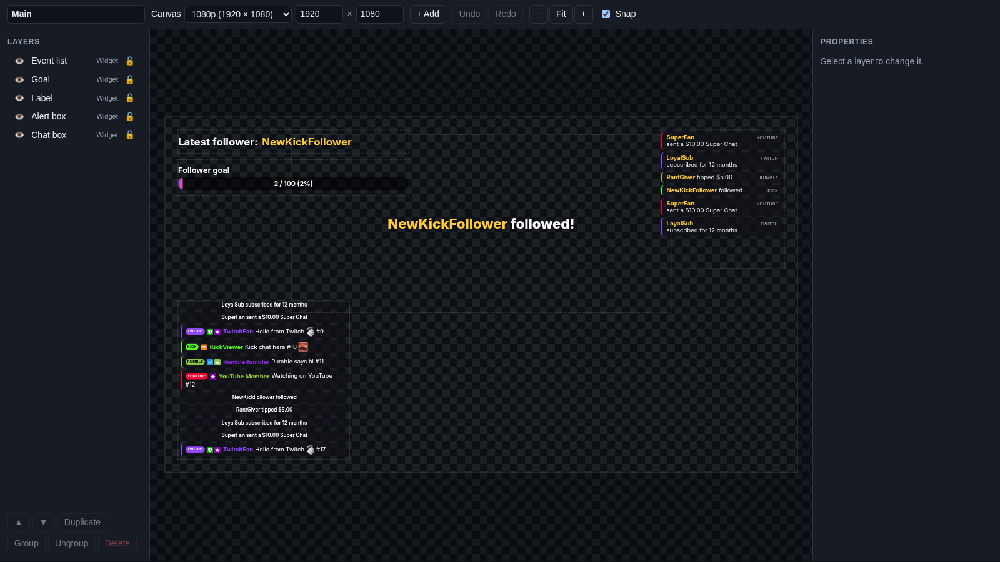

New to overlays? Read [Overlays](overlays.md) first: it shows how to make an overlay and put it in OBS.

## Open the designer

1. Go to **Overlays > Overlays & Widgets**.
2. On your overlay's row, click **Design…**.

Your web browser opens the designer for that overlay. Cuebot's status line says "Opened the designer in your browser.
Changes there save on their own."

The designer runs on the [overlay server](overlays.md#the-overlay-server). If the server is off, Cuebot says "The
designer runs on the overlay server, which is not running" instead: turn it on and try again.

!!! warning "The designer link is a key"
    The designer's address has its own secret at the end (`editor=…`). Anyone with it can change all your overlays and
    widgets. It is a different secret from your OBS links, so someone who sees an OBS link cannot open the designer.
    Do not share the designer's address or show it on stream.

## The parts of the designer

The designer has four parts:

| Part | Where | What it is for |
| --- | --- | --- |
| **Toolbar** | Along the top | The overlay's name and canvas size, **+ Add**, undo and redo, zoom, snapping and the save status |
| **Layers** | On the left | Everything on the overlay, front first; show, hide, lock, reorder, group, duplicate and delete |
| **Canvas** | In the middle | The live overlay with a box around each layer, to select, drag and resize |
| **Properties** | On the right | The settings of the layer you selected: name, position, size, look and animations |

A **layer** is one thing on the overlay: a widget, a text, an image, a video or a slideshow. Layers sit on top of each
other like sheets of paper: the one at the top of the **Layers** list is in front of all the others.

## The toolbar

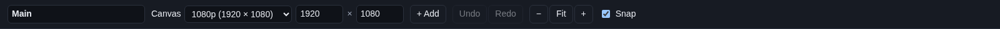

From left to right:

| Control | What it does |
| --- | --- |
| Name box | The overlay's name, as on the Overlays page. Type a new name and press Enter (or click somewhere else). |
| **Canvas** list | The canvas size: **1080p (1920 × 1080)**, **1440p (2560 × 1440)**, **4K (3840 × 2160)**, **Vertical (1080 × 1920)** or **Custom size**. |
| Width × height | The canvas size in pixels, from 16 to 7680. Type a number to make a custom size. |
| **+ Add** | A menu to add layers and widgets (see [Add things](#add-things)). |
| **Undo** | Takes back your last change (**Ctrl+Z**). |
| **Redo** | Puts back what you undid (**Ctrl+Y** or **Ctrl+Shift+Z**). |
| **−** | Zooms out. |
| **Fit** | Zooms so the whole canvas fits the window again, and keeps fitting when you resize the window. |
| **+** | Zooms in, up to four times the real size. Handy for lining up small things. |
| **Snap** | Ticked (the default): layers jump into line with the canvas edges, its centre and other layers while you drag (see [Snapping](#snapping)). |
| Status | On the far right: what just happened, like **Saving…**, **Saved**, **Added** or an error. |

!!! note "Changing the canvas size"
    When you change the canvas size, the status says "Canvas changed: set your OBS browser source to …". Do that: open
    the browser source in OBS and type the new **Width** and **Height**, or the overlay is squashed or cut off. Layers
    keep their pixel positions, so you may need to move some of them afterwards.

## Add things

Click **+ Add** to open the menu. Click outside it to close it again.

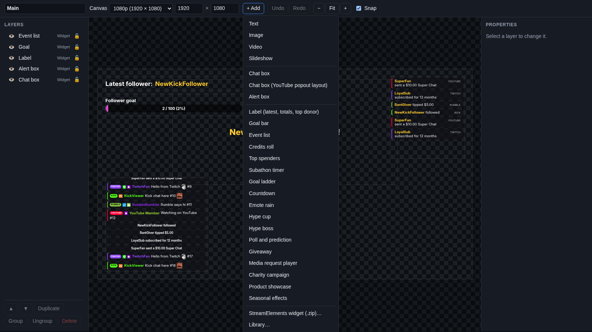

The menu has five parts.

**Simple layers** (drawn by the overlay itself; you set them up in **Properties**):

| Item | What you get |
| --- | --- |
| **Text** | A line or block of text, "Your text here" in white, 600 × 120 pixels, in the middle of the canvas |
| **Image** | A picture (PNG, JPG, GIF, WebP and more), 400 × 300, in the middle |
| **Video** | A video that plays by itself, looping and muted at first, 640 × 360, in the middle |
| **Slideshow** | Several pictures or videos shown one after another, 640 × 360, in the middle |

**Chat and alerts:**

| Item | What you get |
| --- | --- |
| **Chat box** | Cuebot's [chat box](widgets/chat-box.md), in the lower left |
| **Chat box (YouTube popout layout)** | The same chat box, laid out like YouTube's popout chat, so YouTube chat CSS themes work with it |
| **Alert box** | The [alert box](alerts.md), at the top in the middle |

**Cuebot widgets:** **Label (latest, totals, top donor)**, **Goal bar**, **Event list**, **Credits roll**, **Top
spenders**, **Subathon timer**, **Goal ladder**, **Countdown**, **Emote rain**, **Hype cup**, **Hype boss**, **Poll
and prediction**, **Giveaway**, **Media request player**, **Charity campaign**, **Product showcase** and **Seasonal
effects**. Each one is explained in [Widgets](widgets/index.md). Cuebot places each in a sensible spot for its kind,
scaled to the canvas.

**From elsewhere:**

| Item | What it does |
| --- | --- |
| **StreamElements widget (.zip)…** | Pick a StreamElements (or Streamlabs) custom widget `.zip` from your computer. It becomes a new widget covering the whole canvas. |
| **Library…** | Opens the [library](#the-library): widgets you already have and templates you saved. |

Whatever you add is selected straight away, so you can move it or change it in **Properties**.

Each widget you add from this menu is a **new** widget with its own settings. To show a widget you already have (with
the same settings) on this overlay too, use **Library…**.

## The canvas

The canvas in the middle is your real overlay. Widgets show real chat and real events, alerts pop up when they happen,
and a checkered pattern marks the see-through parts. On top of it, each layer has a thin box with its name, so you can
grab it.

### Select layers

- **Click** a layer to select it. Its box turns blue, with small square **handles** on its corners and sides, and its
  settings show in **Properties**.
- **Shift+click** another layer to add it to the selection, or Shift+click a selected one to take it out again.
- Click an empty part of the canvas (or the grey around it) to select nothing.
- Clicking a layer that is in a [group](#group-and-ungroup) selects the whole group.

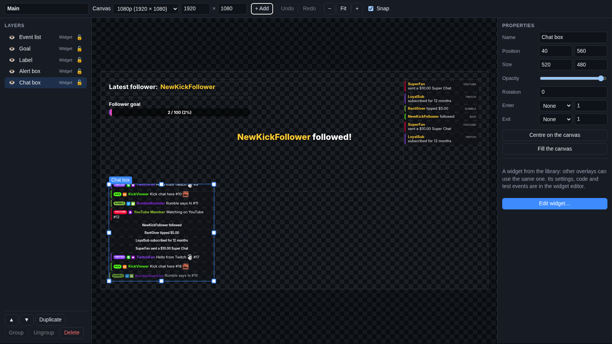

You can also select layers by clicking them in the **Layers** list. That is handy when a big layer (like **Seasonal
effects**, which covers the whole canvas) lies on top of a small one.

### Move layers

- **Drag** a selected layer to move it. With several layers selected, they all move together.
- Use the **arrow keys** to move the selection by 1 pixel, or **Shift + arrow keys** for 10 pixels.
- To type an exact spot, use **Position** in [Properties](#common-properties).

A layer can go partly off the canvas; the part outside does not show on stream.

### Resize layers

When exactly one layer is selected, drag one of its eight handles:

- A **corner** handle changes the width and the height.
- A **side** handle changes only that side.
- Hold **Shift** while you drag a handle to keep the layer's shape (its width-to-height ratio), for example so a
  picture is not squashed.

To type an exact size, use **Size** in Properties. Resizing a widget gives it more or less room; how its content fills
that room (font size and so on) is set in the widget's own settings.

### Snapping

With **Snap** ticked, a layer you drag jumps into line when it gets close (within a few screen pixels) to:

- the left edge, the centre or the right edge of the canvas,
- the top edge, the middle or the bottom edge of the canvas,
- the edges and centres of the other layers you can see.

A thin pink **guide line** shows what it lined up with. When you resize, the edge you drag snaps in the same way.

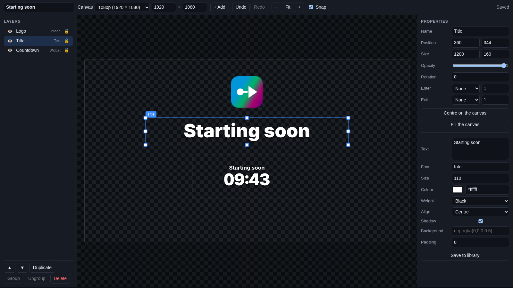

To place something freely just once, hold **Alt** while you drag. To turn snapping off, untick **Snap**. Hidden layers
are not used for snapping.

### Rotate layers

There is no rotate handle on the canvas. Type an angle in **Rotation** in Properties instead, for example `-5` to tilt
a title a little to the left. The layer's box on the canvas turns with it.

### Locked and hidden layers

- A **locked** layer cannot be dragged, resized or moved with the arrow keys, and shows no handles. You can still
  select it and change it in Properties. Lock your background or frame so you do not move it by accident.
- A **hidden** layer is **not shown on stream at all**. In the designer its box is dotted and faded, so you can still
  find it. Hide things you only need sometimes, like a "Starting soon" title.

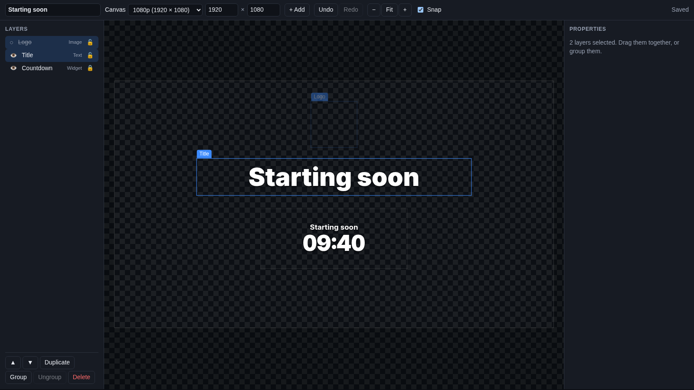

Lock and hide layers in the [Layers list](#the-layers-list).

## The Layers list

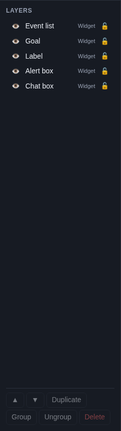

The **Layers** list on the left shows every layer on the overlay, **front first**: the top row is in front of
everything else. Each row has:

| Part | What it does |
| --- | --- |
| Eye | Click to hide the layer (the eye turns into a dotted circle and the name is struck through). Click again to show it. |
| Name | Click to select the layer. **Shift+click** (or **Ctrl+click**, **Cmd+click** on a Mac) adds it to the selection. |
| **group** tag | Shows when the layer is in a group. |
| Kind | **Widget**, **Text**, **Image**, **Video** or **Slideshow**. |
| Lock | Click to lock the layer (closed padlock) or unlock it (open padlock). |

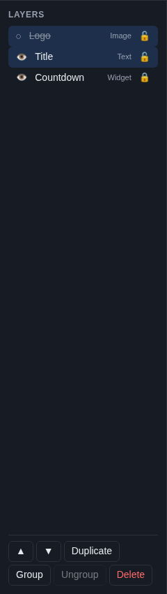

The buttons under the list work on the selected layers:

| Button | What it does |
| --- | --- |
| **▲** | **Bring forward**: one step towards the front (up the list). |
| **▼** | **Send backward**: one step towards the back (down the list). |
| **Duplicate** | Makes a copy of the selected layers, 20 pixels to the right and down, named "… copy" (**Ctrl+D**). |
| **Group** | Joins two or more selected layers into a group (**Ctrl+G**). |
| **Ungroup** | Splits the selected layers out of their group (**Ctrl+Shift+G**). |
| **Delete** | Takes the selected layers off this overlay (**Delete** or **Backspace**). **Undo** brings them back. |

Buttons that cannot do anything right now are greyed out, for example **Group** with only one layer selected.

!!! note "Duplicating a widget"
    A copy of a **widget** layer is the same widget shown twice: both copies share one set of settings and code, so
    changing one changes the other. For a separate widget with its own settings, open **+ Add > Library…** and click
    **Duplicate** on the widget there, then **Add** the copy. Copies of text, image, video and slideshow layers are
    separate.

!!! note "Deleting a widget"
    Deleting a widget layer only takes it off this overlay. The widget itself (its settings and code) stays in the
    [library](#the-library), so you can add it again.

### Group and ungroup

A **group** is a set of layers that stick together. Clicking any of them selects the whole group, so you drag them
as one. For example, group a name text with the frame picture behind it.

1. Select two or more layers (Shift+click them on the canvas or in the list).
2. Click **Group**. Each of them gets a **group** tag in the list.

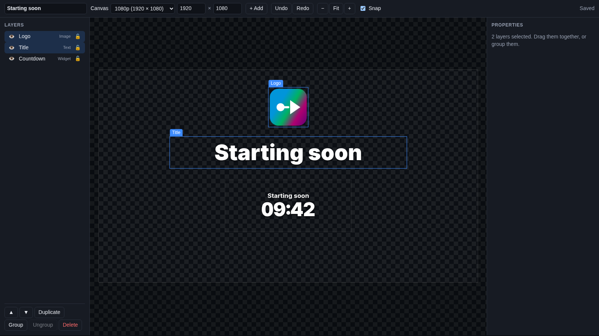

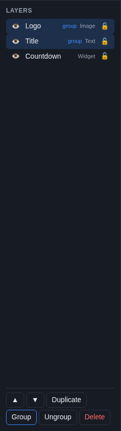

To split them again, select the group and click **Ungroup**. A group needs at least two layers: if you delete all but
one, the last one is simply no longer grouped.

## Properties

Select one layer and the **Properties** panel on the right shows its settings. With several layers selected, it says
how many are selected instead ("Drag them together, or group them."). Each change applies when you leave the box (or
press Enter), and can be undone.

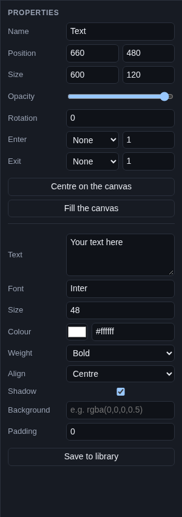

### Common properties

Every layer has these:

| Property | What it means |
| --- | --- |
| **Name** | The layer's name in the list and on the canvas. For a widget it is also the name on the Overlays page. |
| **Position** | X (pixels from the left edge of the canvas) and Y (pixels from the top edge) of the layer's top-left corner. |
| **Size** | Width and height in pixels. |
| **Opacity** | How see-through the layer is. All the way right: solid. All the way left: invisible. |
| **Rotation** | How far the layer is turned, in degrees, from -360 to 360. Positive turns clockwise. |
| **Enter** | An animation the layer comes in with, and how long it takes in seconds (0.1 to 10). |
| **Exit** | An animation for the layer going out, and its seconds. |
| **Centre on the canvas** | Moves the layer to the exact middle of the canvas. |
| **Fill the canvas** | Moves the layer to the top-left corner and makes it as big as the canvas. Good for backgrounds and frames. |

The **Enter** animations are **fadeIn**, **fadeInUp**, **fadeInDown**, **fadeInLeft**, **fadeInRight**,
**slideInUp**, **slideInDown**, **slideInLeft**, **slideInRight**, **zoomIn** and **bounceIn**, or **None**. A layer
plays its enter animation each time the overlay page loads: when OBS starts the browser source, and after every saved
change (each save reloads the page).

The **Exit** list has the matching **fadeOut**, **slideOut…**, **zoomOut** and **bounceOut** animations. A layer plays
its exit animation when it leaves a live overlay: you hide it (the eye) or delete it and save, or you delete the whole
overlay. The overlay page waits for the longest exit animation (at most 10 seconds), then reloads. Layers that stay
on the overlay do not play their exit animation; they simply reload and play their enter animation again.

### Text layers

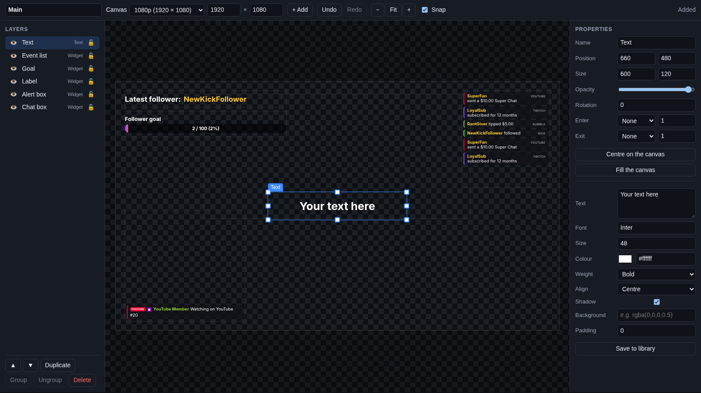

| Setting | What it does |
| --- | --- |
| **Text** | What it says. Press Enter for a new line. |
| **Font** | A font name from [Google Fonts](https://fonts.google.com), like `Poppins` or `Bebas Neue`, or a font on your computer. Starts as `Inter`. Google Fonts load from the internet. |
| **Size** | The letter size in pixels, from 6 to 400. Starts at 48. |
| **Colour** | The text colour. Click the colour square to pick one, or type a colour like `#ff4fa3`. |
| **Weight** | How thick the letters are: **Regular**, **Semibold**, **Bold** or **Black**. |
| **Align** | **Left**, **Centre** or **Right** inside the layer's box. |
| **Shadow** | Ticked: a soft dark shadow behind the letters, so they are easy to read on a bright game. |
| **Background** | A colour behind the text, for example `rgba(0,0,0,0.5)` for half-see-through black. Empty: none. |
| **Padding** | Space in pixels between the box's edge and the text, from 0 to 200. |
| **Save to library** | Keeps this text (its settings and size) as a template you can add to any overlay. |

The text sits in the middle of the layer, top to bottom. Make the layer big enough for your text, or it is cut off.

### Image layers

| Setting | What it does |
| --- | --- |
| **Image** | The picture's web address (starting with `https://`), or click **Upload…** to pick a file from your computer. |
| **Fit** | How the picture fills the layer: **Fit inside** (all of it shows, maybe with empty edges), **Fill (crop)** (fills the box, cutting off what sticks out) or **Stretch** (fills the box exactly, maybe squashed). |
| **Save to library** | Keeps this image as a template. |

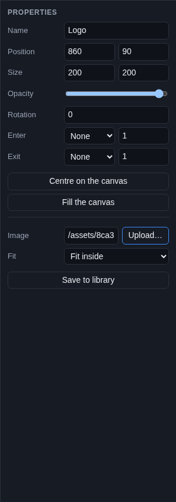

### Video layers

| Setting | What it does |
| --- | --- |
| **Video** | The video's web address, or **Upload…** an MP4, WebM or MOV file. |
| **Fit** | **Fit inside**, **Fill (crop)** or **Stretch**, as for images. |
| **Loop** | Ticked (the default): starts again when it ends. |
| **Muted** | Ticked (the default): no sound. Untick it to hear the video on stream. |
| **Volume** | How loud, from 0 to 100, when not muted. |
| **Save to library** | Keeps this video as a template. |

### Slideshow layers

| Setting | What it does |
| --- | --- |
| **Slides** | The web addresses of the pictures or videos, one per line. They show in this order, then start again. |
| **Upload a slide…** | Picks a picture or video from your computer and adds it to the end of the list. |
| **Seconds each** | How long each slide shows, from 1 to 600. Starts at 8. |
| **Fit** | **Fit inside**, **Fill (crop)** (the default) or **Stretch**. |
| **Transition** | **Fade** (slides fade into each other) or **None** (they switch at once). |
| **Save to library** | Keeps this slideshow as a template. |

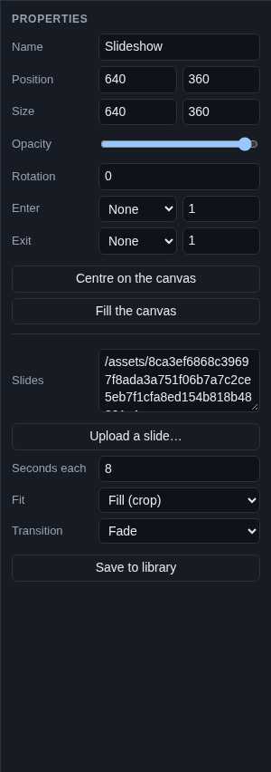

Video slides play muted and loop while they show.

### Widget layers

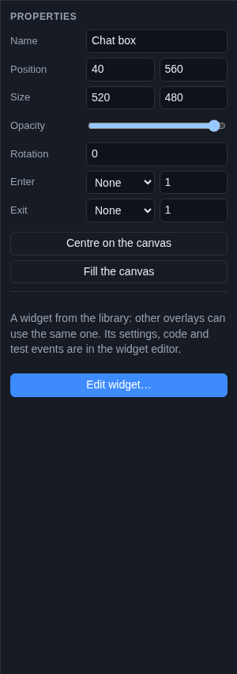

A widget's own settings (what it shows, colours, fonts, sounds) are not in this panel. Below the common properties is a
short note and the **Edit widget…** button. It opens the widget in the [widget editor](widget-editor.md) in a new
browser tab (for an alert box, the [alert designer](alerts.md)). Save there, and the designer's canvas updates too.

## Upload your own files

Image, video and slideshow layers have **Upload…** buttons. They copy a file from your computer into Cuebot, so the
overlay works without the internet and the file does not need to be anywhere else.

- Files can be up to 200 MB.
- Pictures: PNG, JPG, GIF, WebP, AVIF, SVG and APNG. Videos: MP4, WebM and MOV. (Widgets can also use sounds and font
  files.)
- The status says "Uploading …" and then "Uploaded …". If something is wrong, it says "Upload failed:" and why, for
  example a file type overlays cannot use.
- Cuebot keeps one copy of each file, even if you upload it twice, in your Cuebot data folder under
  `overlays/assets`. The address it fills in starts with `/assets/`.

Web addresses must start with `http://` or `https://`. Other addresses (like `C:\Pictures\logo.png`) do not work:
upload the file instead.

## The library

Open **+ Add > Library…** to see everything you can reuse.

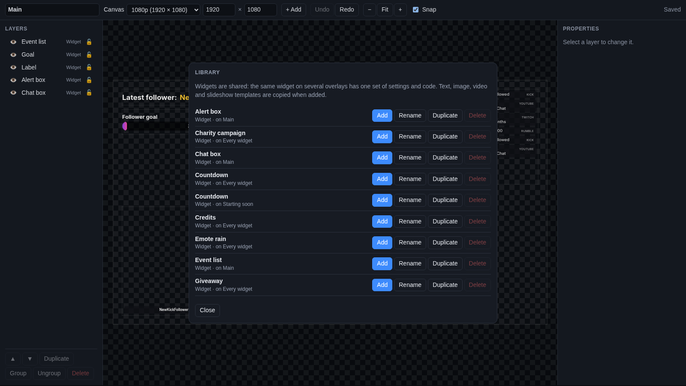

The library holds two kinds of things:

- **Widgets** ("Widget · on Main"). Every widget you ever added is kept here. A widget is **shared**: put the same
  widget on several overlays and they all use one set of settings and code. Change the chat box's colours once, and
  every overlay with that chat box changes. The line under the name says which overlays use it, or "not on any
  overlay".
- **Templates** ("Text template", "Image template" and so on). These are text, image, video and slideshow layers you
  kept with **Save to library**. A template is **copied** when you add it: changing the copy does not change the
  template or other copies.

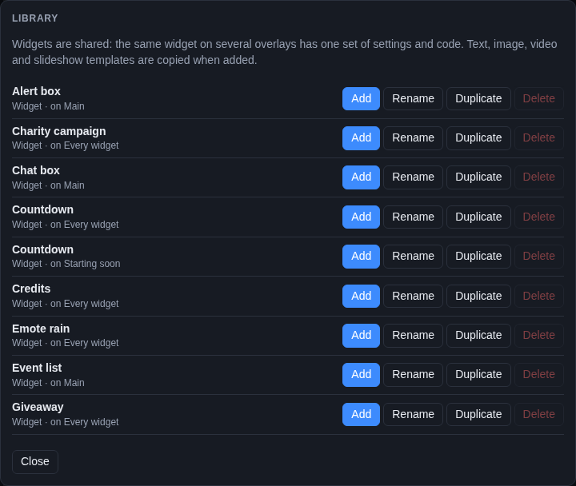

Each entry has four buttons:

| Button | What it does |
| --- | --- |
| **Add** | Puts it on this overlay and closes the library. |
| **Rename** | Gives it a new name. |
| **Duplicate** | Makes a separate copy. For a widget, the copy has its own settings and code, so you can change one without the other. |
| **Delete** | Deletes it from the library, after asking. Greyed out while an overlay still uses it: remove it from those overlays first (hover over the button to see which). |

Click **Close** to close the library. If the library is empty, it says so: widgets you add are kept there, and text,
image, video and slideshow layers can be saved to it from their properties.

## Keyboard shortcuts

Shortcuts work when you are not typing in a box. On a Mac, use **Cmd** instead of **Ctrl**.

| Keys | What they do |
| --- | --- |
| **Ctrl+Z** | Undo |
| **Ctrl+Y** or **Ctrl+Shift+Z** | Redo |
| **Ctrl+D** | Duplicate the selected layers |
| **Ctrl+G** | Group the selected layers |
| **Ctrl+Shift+G** | Ungroup |
| **Delete** or **Backspace** | Delete the selected layers |
| **Arrow keys** | Move the selected layers 1 pixel |
| **Shift + arrow keys** | Move the selected layers 10 pixels |
| **Shift** + click | Add a layer to the selection, or take it out |
| **Shift** while resizing | Keep the layer's shape |
| **Alt** while dragging | Do not snap this time |

## How saving works

You never need to click Save in the designer.

1. Half a second after a change, the status says **Saving…**, and then **Saved**.
2. Cuebot tells every copy of the overlay (in OBS and in the designer) to reload, so they show the change. Enter
   animations play again, and widgets start fresh.
3. If saving fails, the status says "Could not save:" and why, in red. Your change is still in the designer; fix the
   problem (often the overlay server stopped) and make another change to save again.

If you try to close the tab while a save is still going, your browser asks first.

**Undo** remembers your last 100 changes while the designer is open. Closing or reloading the tab starts a new
history, so you cannot undo changes from an earlier visit.

!!! tip "Rehearse before you go live"
    Every save reloads the overlay in OBS. That is fine while you set up, but during a stream a reload restarts
    widgets (an alert that is playing stops). Make big layout changes before you go live.

## Worked example: a "Starting soon" scene

Let's build a screen for the minutes before your stream starts: a countdown, a big title and your logo.

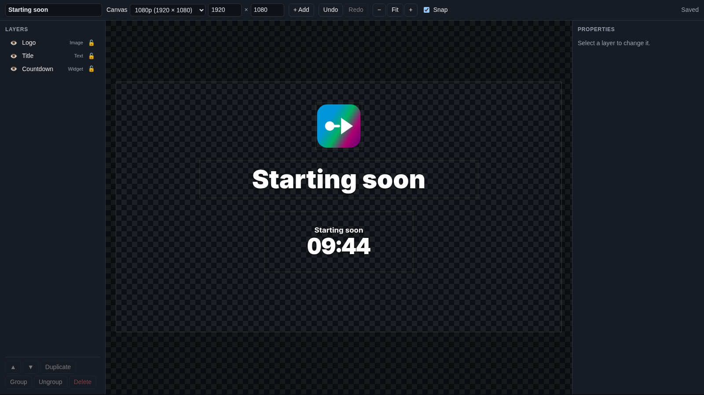

1. **Make the overlay.** On **Overlays > Overlays & Widgets**, type `Starting soon` in **New overlay name**, keep
   **1080p (1920 × 1080)** and click **+ Overlay**. Click **Copy link** and add it to an OBS scene called
   `Starting soon` as a browser source of 1920 × 1080 (see [Put it in OBS](overlays.md#put-it-in-obs)).
2. **Add the countdown.** On the new row, open **Add Cuebot widget** and pick **Countdown**. It lands in the middle of
   the canvas, 640 × 260. Set its **Y** box to `560` to move it a little lower, leaving room above it. Click **Edit…** on its row and, in the
   [widget editor](widget-editor.md), choose how long it counts (see [Countdown](widgets/countdown.md)). Click
   **Save** there.
3. **Open the designer.** Click **Design…** on the overlay's row.
4. **Add the title.** Click **+ Add > Text**. In Properties:
    - **Name**: `Title`
    - **Text**: `Starting soon`
    - **Size** (of the letters): `110`, **Weight**: **Black**, **Align**: **Centre**, **Shadow** ticked
    - **Size** (of the layer, near the top): `1200` and `160`
    - Click **Centre on the canvas**, then change the second **Position** box (Y) to `340`, so the title sits above
      the countdown.

    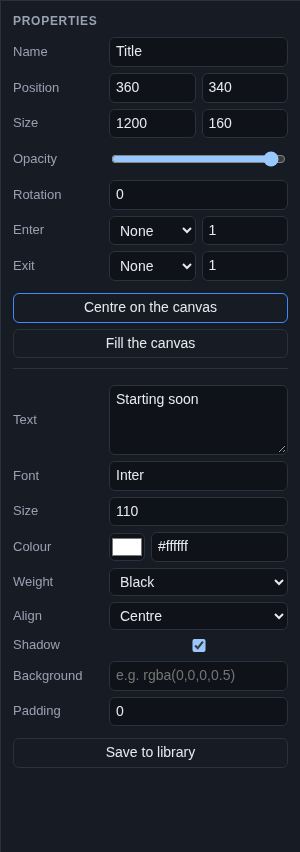

    Dragging works too: with **Snap** on, a pink guide line shows when the title is centred from left to right.
5. **Add your logo.** Click **+ Add > Image**. Set **Name** to `Logo`, click **Upload…** next to **Image** and pick your
   logo (a PNG with a see-through background works best). Keep **Fit** at **Fit inside**. Set **Size** to `200` and
   `200` and **Position** to `860` and `90`, so it sits centred above the title. (Or hold **Shift** and drag a corner
   handle to resize it without squashing it.)
6. **Tidy up.** Select the title and the logo (Shift+click them in the **Layers** list) and click **Group**, so they
   move together. Click the Countdown's padlock to lock it, so you do not move it by accident.
7. **Check it.** Look at the `Starting soon` scene in OBS: it already shows everything.

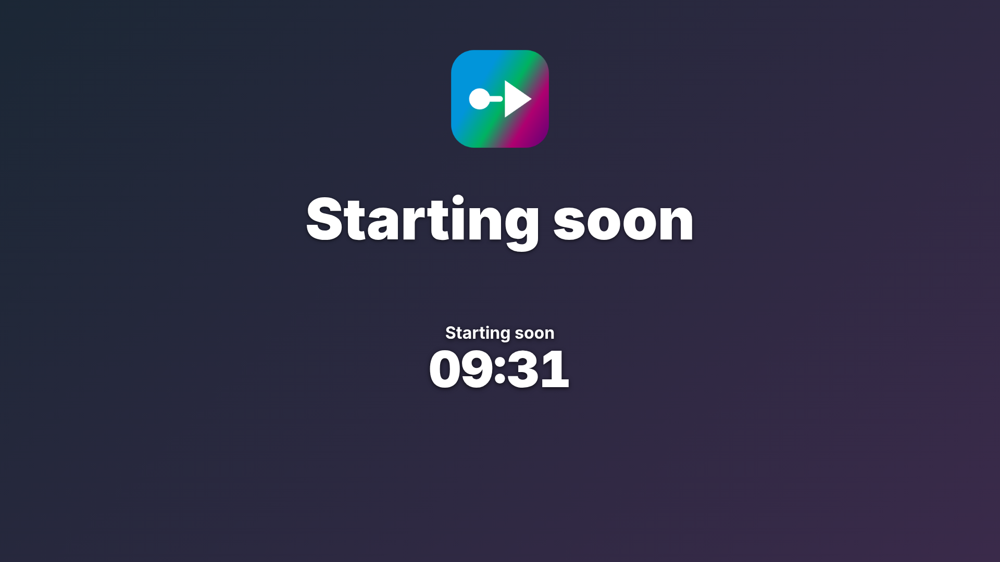

To see a layer fade in each time you switch to the scene, give it an **Enter** animation (like **fadeInDown**) and
tick **Refresh browser when scene becomes active** in the browser source's properties.

Want the same title on other overlays? Select it and click **Save to library**. On another overlay, open
**+ Add > Library…** and click **Add** next to it.

## Troubleshooting

| What you see | What to do |
| --- | --- |
| "Could not load the overlay: …" | The overlay server stopped, or the overlay was deleted. Check **Apps > Servers**, then reload the page. |
| "Could not save: …" | Same as above. Your change is kept in the page; make another change to save again once the server runs. |
| "Could not add: …" or "Could not add the widget: …" | The widget or file could not be added. For a zip, check it is a StreamElements or Streamlabs widget (see [Writing your own widgets](widget-code.md)). |
| "Upload failed: … is not a file type overlays can use" | Use one of the file types listed in [Upload your own files](#upload-your-own-files). |
| A layer will not move | It is locked (closed padlock in the list). Click the padlock to unlock it. |
| A layer is on the canvas but not in OBS | It is hidden (struck-through name in the list). Click its eye. |
| A layer is behind another one | Select it and click **▲** until it is in front. |
| The text font looks plain | The font name is not a Google Font or a font on the computer running OBS. Check the spelling on Google Fonts. |
| A picture address does not work | It must start with `https://` (or `http://`). Upload the file instead. |
