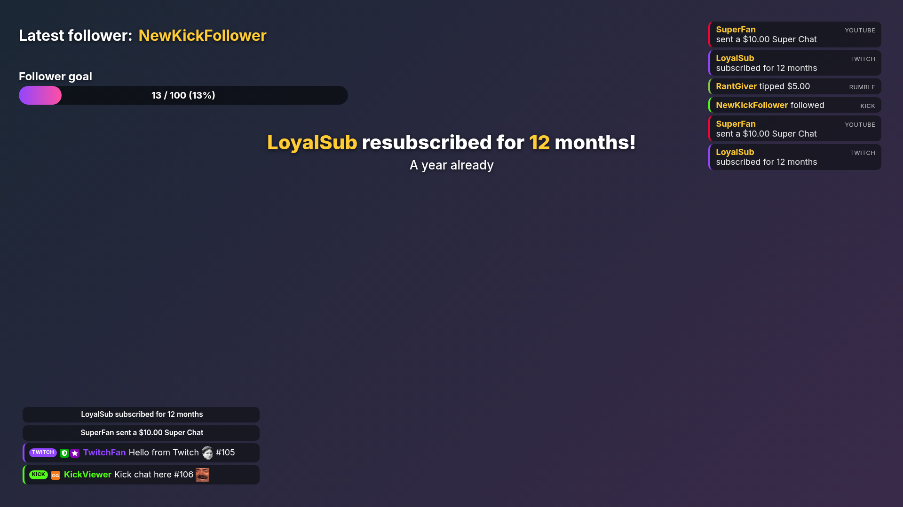
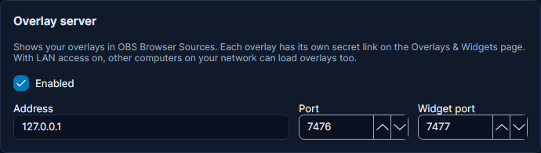
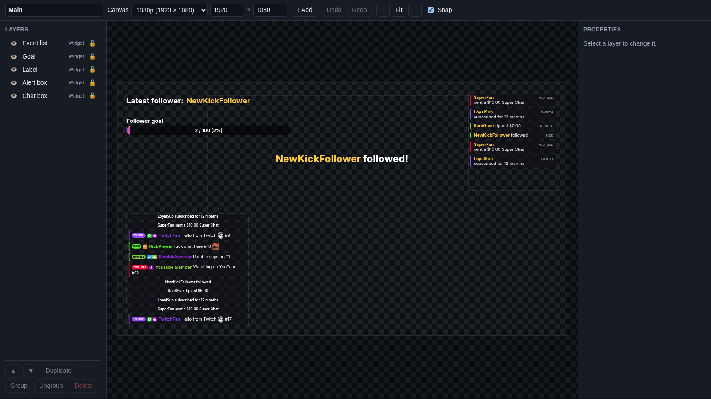

# Overlays

An **overlay** is a see-through picture on top of your stream: your chat box, a follower alert, a goal bar. Think of
it as a sheet of glass in front of your camera. You draw things on the glass, and viewers see your game or camera
through the empty parts.

In Cuebot, an overlay is a little web page that Cuebot shows on your own computer. OBS shows that page on stream with a
**browser source** (an OBS source that shows a web page). Because Cuebot makes the page, it can change it live: a new
follower appears in the alert box the moment it happens, with nothing to click.

Each overlay holds **widgets**: the separate pieces, like the chat box or the alert box. An overlay can also hold
plain **layers**: a line of text, a picture, a video or a slideshow. You arrange them all in the
[designer](overlay-designer.md).

Everything starts on **Overlays > Overlays & Widgets**.

## Make your first overlay

1. Go to **Overlays > Overlays & Widgets**.
2. Type a name in **New overlay name**, like `Main`. Leave it empty and Cuebot calls it `Overlay 1`, `Overlay 2` and
   so on.
3. Pick the canvas size (see [Canvas sizes](#canvas-sizes)). Usually **1080p (1920 × 1080)**.
4. Click **+ Overlay**.

The new overlay shows up in the list. It is empty: add widgets next, or open the designer.

### Canvas sizes

The **canvas** is the overlay's drawing area, measured in **pixels** (the tiny dots a screen is made of). Pick the same
size as your OBS canvas (in OBS: **Settings > Video > Base (Canvas) Resolution**).

| Choice | Size | When |
| --- | --- | --- |
| **1080p (1920 × 1080)** | 1920 wide, 1080 tall | Most streams |
| **1440p (2560 × 1440)** | 2560 × 1440 | A 1440p OBS canvas |
| **4K (3840 × 2160)** | 3840 × 2160 | A 4K OBS canvas |
| **Vertical (1080 × 1920)** | 1080 × 1920 | Portrait streams for phones (TikTok, Shorts) |
| **Custom size** | You type the width and height | Anything else, from 16 to 7680 pixels each way |

You can change the size later in the [designer](overlay-designer.md#the-toolbar). Widgets Cuebot adds are scaled to
the canvas, so a goal bar on a 4K overlay is twice as big as on a 1080p one.

## Put it in OBS

1. In Cuebot, on your overlay's row, click **Copy link**.
2. In OBS, pick your scene. Under **Sources**, click **+** and choose **Browser**. Name it, for example
   `Cuebot Main`, and click **OK**.
3. Paste the link into **URL**.
4. Set **Width** and **Height** to the overlay's canvas size, shown in the **CANVAS** column (for example `1920` and
   `1080`).
5. Leave **Custom CSS** as it is. The overlay's background is already see-through.
6. Click **OK**. If the source does not fill the screen, right-click it and choose **Transform > Fit to screen**.

That's it. Anything you add to the overlay in Cuebot now shows up in OBS by itself.

Some OBS settings worth knowing:

- **Refresh browser when scene becomes active**: not needed. The overlay reloads by itself every time you save a
  change in Cuebot, and it reconnects to Cuebot by itself if Cuebot restarts. Tick it only if you want layers'
  [enter animations](overlay-designer.md#common-properties) to play each time you switch to the scene.
- **Shutdown source when not visible**: leave it **off**. When OBS shuts the page down it hears nothing, so chat
  messages and alerts from that time are not shown when it comes back.
- **Control audio via OBS**: tick it if you want alert sounds and videos as their own slider in the OBS audio mixer.
  Untick it and they play through your computer's normal sound output.
- You can add the same overlay to several scenes. Each browser source is its own copy of the page.

!!! tip "One overlay or several?"
    One overlay with everything on it is the easiest start. Some streamers make one overlay per scene, like
    `Starting soon`, `Gameplay` and `BRB`. Both work. Alerts play on every overlay that has an alert box.

!!! warning "Keep the link private"
    The end of the link, after `token=`, is a secret. Anyone with the whole link can watch your overlay, including
    your chat box. The row only shows the first few letters of the secret; **Copy link** copies all of it. Do not show
    the link on stream. If it ever leaks, click **New link** and paste the new link into OBS.

### The overlay server

The page needs Cuebot's **overlay server** to be running. A **server** is a part of Cuebot that answers web pages,
here the overlay pages in OBS. If it is off, the Overlays page says so in red, for example "The overlay server is off,
so these links will not load. Turn it on on the Servers page."

To turn it on:

1. Go to **Apps > Servers**, card **Overlay server**.
2. Tick **Enabled**.
3. Click **Apply and restart servers**.

The card has three settings. You rarely need to change them.

| Setting | What it means |
| --- | --- |
| **Address** | Who can reach the overlays. `127.0.0.1` (the default) means only this computer. `0.0.0.0` lets other computers on your network reach them (also tick **Allow LAN connections**). |
| **Port** | The "door number" overlay pages use, `7476` unless you change it. Change it only if another program already uses that number. |
| **Widget port** | A second door, `7477`, just for widgets. Widgets run behind their own door so a widget cannot reach the overlay page, its secret link or Cuebot itself. |

!!! note "OBS on a second computer"
    Set **Address** to `0.0.0.0`, tick **Allow LAN connections** and apply. The copied link still starts with
    `http://127.0.0.1`: in the second computer's OBS, replace `127.0.0.1` with the streaming computer's network address
    (for example `192.168.1.20`). See [Servers](../developers/servers.md).

## The overlay row

Each overlay is one row on the page. From left to right:

| Part | What it does |
| --- | --- |
| Name box | The overlay's name. Click it, type a new name, then click somewhere else to save it. |
| **CANVAS** | The canvas size, like `1920 × 1080`. Change it in the designer. |
| **OBS BROWSER SOURCE LINK** | The link for OBS, with most of the secret hidden. |
| **Copy link** | Copies the whole link, to paste into an OBS browser source. |
| **New link** | Makes a new secret link. The old link stops working at once, so paste the new one into OBS. Use it if someone saw your link. |
| **Design…** | Opens the overlay in the [designer](overlay-designer.md) in your web browser, to drag things around. |
| **Add Cuebot widget** | A menu of the ready-made widgets that come with Cuebot (see [Add widgets](#add-widgets)). |
| **Add widget…** | Adds a widget from a file: a StreamElements or Streamlabs widget `.zip` (for example one bought on Etsy), or a Cuebot `.cuebot-overlay` file. |
| **Share** | Saves the overlay as one file to share or back up (see [Sharing overlays](#sharing-overlays)). |
| **Delete** | Deletes the overlay straight away. Its link stops working, so remove it from OBS too. |

!!! warning "Delete does not ask"
    **Delete** removes the overlay at once. Its widgets stay in your [library](overlay-designer.md#the-library), so you
    can add them to a new overlay, but the layout is gone. Cuebot's [backups](../help/backups.md) can bring it back.

### The widget rows

Under each overlay, every widget and layer has its own row:

| Part | What it does |
| --- | --- |
| Name | The widget's name. Rename it in the designer. |
| **X** | How far from the left edge of the overlay it sits, in pixels. |
| **Y** | How far from the top edge, in pixels. |
| **W** | How wide it is, in pixels. |
| **H** | How tall it is, in pixels. |
| **Edit…** | Opens the widget in the [widget editor](widget-editor.md) (or the [alert designer](alerts.md) for an alert box) in your web browser: settings, code and a preview with pretend events. |
| **Share** | Saves just this widget (for example an alert box with all its designs) as one file. |
| **Remove** | Takes the widget off this overlay. It stays in your widget library, so you can add it again. |

Changes to **X**, **Y**, **W** and **H** save as you make them, and OBS updates straight away. For text, image, video
and slideshow layers, use the [designer](overlay-designer.md): their settings live there.

## Add widgets

On your overlay's row, open **Add Cuebot widget** and pick one. Cuebot puts it in a sensible spot for its kind (the
chat box in the lower left, the alert box at the top in the middle) and you can move it afterwards.

| Widget | What it shows | Guide |
| --- | --- | --- |
| **Chat box** | Your chat, from every connected platform, with badges, emotes and pronouns | [Chat box](widgets/chat-box.md) |
| **Alert box** | Pop-up alerts for follows, subs, cheers, raids, tips and more | [Alerts](alerts.md) |
| **Label** | One line, like "Latest follower: Bob", a count or a total | [Label](widgets/label.md) |
| **Goal bar** | A bar that fills up, like "50 / 100 followers" | [Goal bar](widgets/goal-bar.md) |
| **Event list** | The latest follows, subs, tips and more | [Event list](widgets/event-list.md) |
| **Credits roll** | End-of-stream credits that scroll | [Credits roll](widgets/credits-roll.md) |
| **Top spenders** | Who spent the most this stream, today, this week, month, year or all time | [Top spenders](widgets/top-spenders.md) |
| **Subathon timer** | A countdown that subs, bits and tips add time to | [Subathon timer](widgets/subathon-timer.md) |
| **Goal ladder** | A points goal with steps, like a new emote at 10 points | [Goal ladder](widgets/goal-ladder.md) |
| **Countdown** | Counts down minutes, or to a time of day; reloading does not restart it | [Countdown](widgets/countdown.md) |
| **Emote rain** | Chat emotes fly across the screen | [Emote rain](widgets/emote-rain.md) |
| **Hype cup** | Follows, subs, bits, Kicks and tips fill a cup with balls | [Hype cup](widgets/hype-cup.md) |
| **Hype boss** | Support hits a "boss"; the final hit makes that viewer the next boss | [Hype boss](widgets/hype-boss.md) |
| **Poll and prediction** | Live results of a poll or prediction | [Poll and prediction](widgets/poll.md) |
| **Giveaway** | Your giveaway, how to enter, and a spinning winner reveal | [Giveaway](widgets/giveaway.md) |
| **Media request player** | Plays the videos viewers asked for | [Media request player](widgets/media-player.md) |
| **Charity campaign** | Progress of a charity drive | [Charity campaign](widgets/charity.md) |
| **Product showcase** | Your merch, and merch purchases | [Product showcase](widgets/product-showcase.md) |
| **Seasonal effects** | Snow, leaves, hearts, confetti and more over the whole overlay | [Seasonal effects](widgets/seasonal-effects.md) |
| **Blank custom widget (write your own code)** | Your own widget. It starts with a little example code for you to change | [Writing your own widgets](widget-code.md) |

All widget guides are listed in [Widgets](widgets/index.md).

Each pick makes a **new** widget with its own settings, even if the overlay already has one of that kind. To put the
**same** widget (with the same settings) on a second overlay, add it from the
[library](overlay-designer.md#the-library) in the designer instead.

After adding a widget, click **Edit…** on its row to choose what it shows and how it looks. The
[widget editor](widget-editor.md) explains that page.

### Widgets from files

- **Add widget…** imports a StreamElements or Streamlabs custom widget `.zip`, or a Cuebot `.cuebot-overlay` file. A
  widget from a zip covers the whole canvas at first: change its **X**, **Y**, **W** and **H** to fit. See
  [Streamlabs widgets](streamlabs-widgets.md) for what Cuebot does with Streamlabs code.
- **Import from StreamElements…** (next to **+ Overlay**) copies a whole overlay from your StreamElements account:
  custom widgets, text, images, labels and the alert box. Your StreamElements overlays stay as they are. It needs
  StreamElements connected first (your JWT token on **Apps > Donations**). Click it, then **Import** next to the
  overlay you want.

## The designer

Click **Design…** to open the overlay in your web browser, where you drag things around with the mouse, add text,
pictures, videos and slideshows, and line everything up. Changes save on their own and OBS updates as you go.

The designer has its own page: [The overlay designer](overlay-designer.md).

## Alerts and polls on this page

### The Alerts card

The **Alerts** card controls alerts on **every** overlay at once:

| Button | What it does |
| --- | --- |
| **Pause alerts** | Pressed: new alerts wait in line. The alert on screen right now finishes. Press again to let them play. |
| **Skip alert** | Ends the alert on screen right now and moves on to the next one. |
| **Mute alerts** | Pressed: alert sounds, videos and spoken alerts (text-to-speech) are silent. Press again to hear them. |

Overlays opened later (or reloaded) start paused or muted too. When Cuebot starts, alerts always play with sound.
Actions can do the same with a sub-action, see [Alerts](alerts.md#pause-skip-and-mute).

### Chat poll and prediction (every platform)

Open **Chat poll and prediction (every platform)** to run a poll in chat on every platform at once, or a prediction
where viewers bet Cuebot points. Show it on stream with the [Poll and prediction](widgets/poll.md) widget. The full
guide is [Polls and predictions](../chat/polls-and-predictions.md).

## Sharing overlays

An overlay **package** is one `.cuebot-overlay` file with the overlay's layers, widget settings and files (pictures,
sounds). Use it to give an overlay to a friend, sell your designs, or keep a copy.

- **Share > Export package…** on an overlay's row saves the overlay. Custom widgets with code that is not Cuebot's own
  are left out.
- **Share > Export with custom widget code (I own the rights to share it)…** also includes that code. Only use it for
  code you wrote or may share: widgets bought from a creator usually may not be passed on.
- **Share** on a widget row saves just that widget, for example an alert box with all its designs.
- **Import package…** (at the top) opens a `.cuebot-overlay` file. It becomes a new overlay with its own new link.
  Cuebot tells you if anything was left out.

### The community gallery

**Browse gallery…** shows overlays and widgets that other streamers shared. Every item was checked before it was
listed.

1. Pick the overlay new widgets go to in **Add widgets to**. A whole overlay always becomes a new overlay.
2. Click **Import** on an item. **View** opens its page on GitHub; **Report** tells the gallery team if it copies
   someone's work, is broken or is harmful.
3. **Share yours…** opens the steps to send in your own (export it with **Share**, add a preview picture, and send it
   in on GitHub). **Close** hides the gallery.

## Letting your mods change overlays

If you allow it, your mods can move layers, change widget settings and edit alert designs from their phone or browser,
with the [mod portal](../mods/mod-portal.md). What they save shows in OBS straight away, or after you approve it. Widget
code always stays yours: mods never see or change a widget's HTML, CSS or JavaScript.

## Troubleshooting

| What you see | What to do |
| --- | --- |
| The page says "The overlay server is off" or "not running" | Turn on the overlay server, see [The overlay server](#the-overlay-server). |
| "The designer runs on the overlay server, which is not running" after **Design…** or **Edit…** | Same: the designer and the widget editor need the overlay server too. |
| OBS shows nothing | Check the link was pasted whole (it ends in a long secret), the overlay server runs, and the source's **Width** and **Height** match the canvas. Did you click **New link**? Then paste the new link. |
| The overlay is too small or cut off in OBS | The browser source size does not match the canvas. Set **Width** and **Height** to the numbers in the **CANVAS** column. |
| No sound from alerts | Is **Mute alerts** pressed? With **Control audio via OBS** ticked, check the source's slider in the OBS mixer. |
| A widget is not there in OBS | Is it hidden in the designer (the eye in the **Layers** list)? Hidden layers are not shown on stream. |
