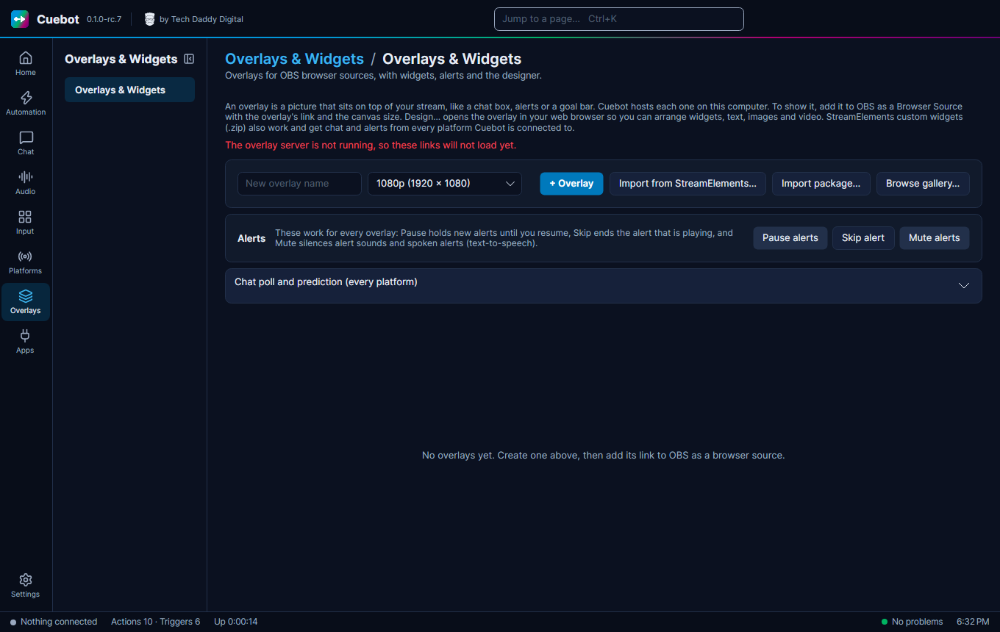

# Overlays

An **overlay** is a see-through picture on top of your stream: your chat box, a follower alert, a goal bar. In Cuebot,
an overlay is a little web page that Cuebot shows on your own computer. OBS shows that page on stream with a
**browser source** (an OBS source that shows a web page).

Each overlay holds **widgets**: the separate pieces, like the chat box or the alert box.

Everything is on **Overlays > Overlays & Widgets**.

## Make your first overlay

1. Go to **Overlays > Overlays & Widgets**.
2. Type a name in **New overlay name**, like `Main`.
3. Pick the canvas size. Choose the same size as your stream, usually **1080p (1920 × 1080)**. Streaming in
   portrait for phones? Pick **Vertical (1080 × 1920)**.
4. Click **+ Overlay**.

## Put it in OBS

1. On your overlay's row, click **Copy link**.
2. In OBS, in your scene, click **+** under **Sources** and choose **Browser**. Name it `Cuebot Main`.
3. Paste the link into **URL**.
4. Set **Width** and **Height** to the overlay's size, for example `1920` and `1080`.
5. Click **OK**.

That's it. Anything you add to the overlay in Cuebot now shows up in OBS.

!!! warning "Keep the link private"
    The link has a secret part at the end. Do not show it on stream. If it ever leaks, click **New link** and paste the
    new link into OBS.

!!! note "Nothing shows up?"
    The page needs the **Overlay server** to be running. If it is off, the Overlays page tells you. Turn it on at
    **Apps > Servers**, card **Overlay server**, then click **Apply and restart servers**.

## Add widgets

On your overlay's row, open **Add Cuebot widget** and pick one:

| Widget | What it shows |
| --- | --- |
| **Chat box** | Your chat, from every connected platform |
| **Alert box** | Pop-up alerts for follows, subs, cheers, raids, tips and more (see [Alerts](alerts.md)) |
| **Label** | A line of text, like "Latest follower: Bob" |
| **Goal bar** | A bar that fills up, like "50 / 100 followers" |
| **Event list** | The latest follows, subs, tips and more |
| **Credits roll** | End-of-stream [credits](../chat/credits.md) that scroll |
| **Top spenders** | Who spent the most this stream, today, this week, month, year or all time (see [Top spenders](../chat/top-spenders.md)) |
| **Subathon timer** | A [subathon countdown](../services/subathon-timers.md) that subs, bits and tips add time to |
| **Goal ladder** | A [points goal with steps](../services/goals.md), like a new emote at 10 points |
| **Countdown** | Counts down minutes, or to a time of day |
| **Emote rain** | Chat emotes fly across the screen |
| **Hype cup** | Follows, subs, bits and tips fill a cup with balls |
| **Hype boss** | Support hits a "boss"; the final hit makes that viewer the next boss |
| **Poll and prediction** | Live results of a [poll](../chat/polls-and-predictions.md) |
| **Giveaway** | Your [giveaway](../chat/giveaways.md) and its winner |
| **Media request player** | Videos viewers asked for (see [Media requests](../sound/media-requests.md)) |
| **Charity campaign** | Progress of a charity drive |
| **Product showcase** | Your merch, and merch purchases |
| **Seasonal effects** | Snow, leaves, hearts, confetti and more |
| **Blank custom widget (write your own code)** | Your own widget. It starts with a little example code for you to change |

Each widget appears under the overlay, with **X**, **Y**, **W** and **H** boxes (its position and size, in pixels),
plus **Edit…** to change its settings and **Remove**.

Want to write your own widget in HTML, CSS and JavaScript? Pick **Blank custom widget (write your own code)**, then see
[Writing your own overlay widgets](widget-code.md).

Already have widgets from StreamElements or Streamlabs? **Add widget…** imports their `.zip` files (see
[Streamlabs widgets](streamlabs-widgets.md) for what Cuebot does with Streamlabs code). **Import from
StreamElements…** copies an overlay from your StreamElements account (your StreamElements overlays stay as they are).

## The designer

Click **Design…** to open the overlay in your web browser, where you can drag things around with the mouse.

- **+ Add** puts in text, images, videos, a slideshow or any widget.
- The **Layers** panel lists everything; the **Properties** panel changes the selected thing.
- Undo, redo and zoom are in the toolbar. Bring forward / send backward, group and delete are in the **Layers**
  panel.
- Changes save on their own.

## Sharing overlays

- **Share > Export package…** saves an overlay as a `.cuebot-overlay` file for a friend.
- **Import package…** loads one.
- **Browse gallery…** shows overlays and widgets that other streamers shared.

## Letting your mods change overlays

If you allow it, your mods can move layers, change widget settings and edit alert designs from their phone or browser, with the
[mod portal](../mods/mod-portal.md). What they save shows in OBS straight away, or after you approve it. Widget code
always stays yours: mods never see or change a widget's HTML, CSS or JavaScript.
