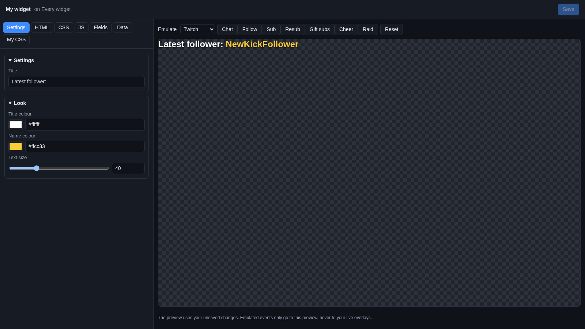
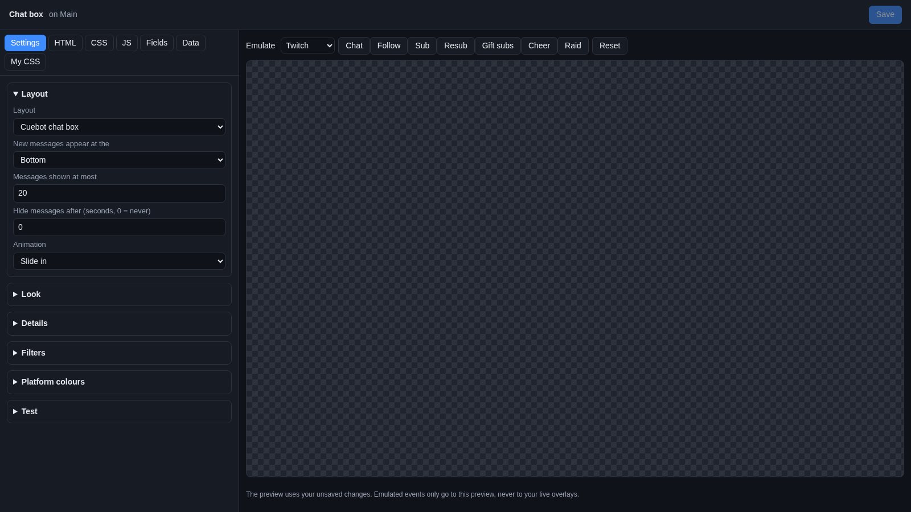
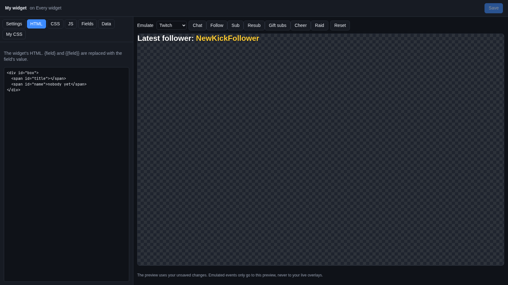
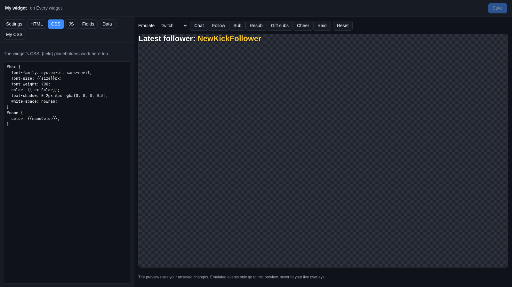
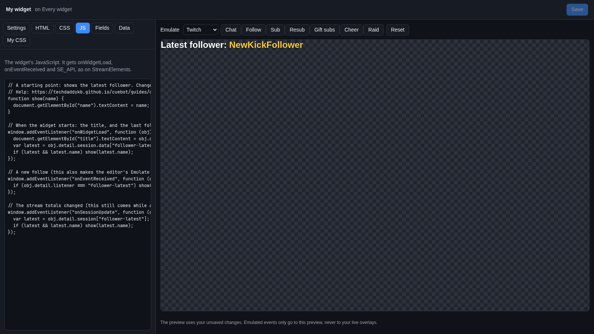
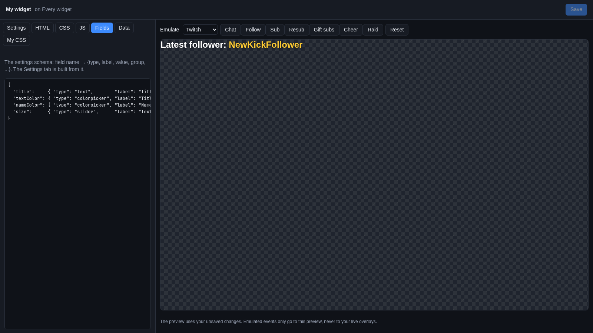
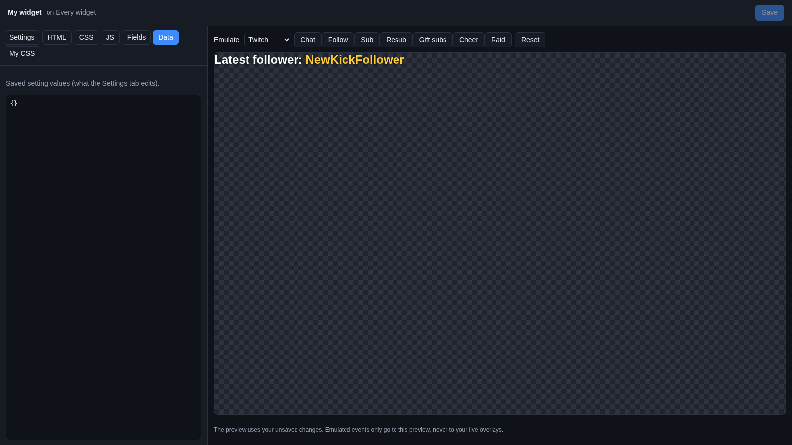
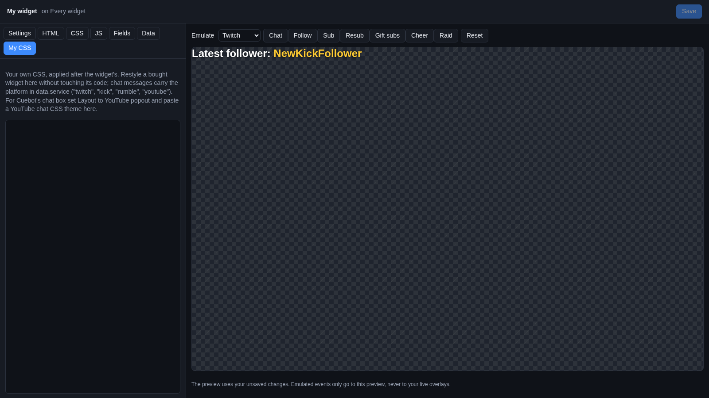
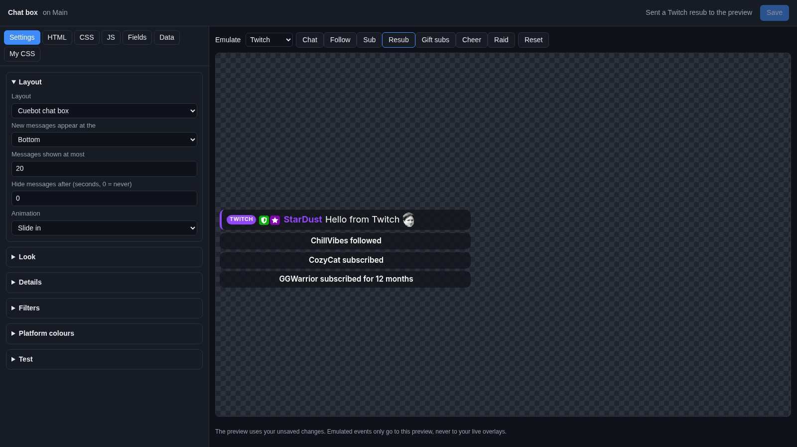
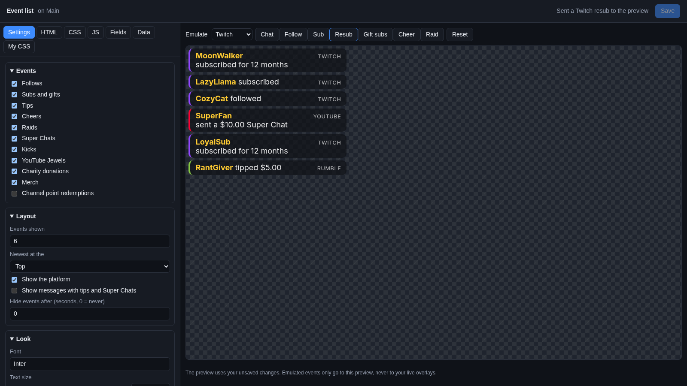

# The widget editor

Every widget on an overlay (the chat box, a goal bar, an event list, a widget you bought) has its own **widget
editor**. It is where you change what the widget shows and how it looks, and try it out with pretend events before
your viewers see it. It opens in your web browser.



The **alert box** is the one exception: its **Edit…** opens the [alert designer](alerts.md), which is made for
designing alerts. The alert designer's **Code editor** button opens this widget editor for the alert box when you need
its code.

## Open the editor

There are two ways:

- On **Overlays > Overlays & Widgets**, click **Edit…** on the widget's row (under its overlay).
- In the [designer](overlay-designer.md), select the widget and click **Edit widget…** in **Properties**.

The editor runs on the [overlay server](overlays.md#the-overlay-server), so that must be on. Like the designer, its
address has a secret part (`editor=…`): anyone with it can change your widgets, so keep it to yourself.

## The parts of the editor

| Part | Where | What it is for |
| --- | --- | --- |
| Title | Top left | The widget's name, and "on" the overlay you opened it from |
| Status | Top right | What just happened: "Unsaved changes", "Saving…", "Saved…", or an error |
| **Save** | Top right | Keeps your changes (see [Save](#save)) |
| Tabs | Left | **Settings**, **HTML**, **CSS**, **JS**, **Fields**, **Data** and **My CSS** |
| Preview | Right | The widget as it will look, with your unsaved changes |
| **Emulate** | Above the preview | Buttons that send pretend events to the preview |

### Which tab is for whom?

| Tab | What is in it | Who should touch it |
| --- | --- | --- |
| **Settings** | A simple form: words, colours, sizes, sounds, tick boxes | Everyone. This is the tab you want. |
| **My CSS** | Your own style rules, added on top of the widget's | Anyone who knows a little CSS and wants a look the settings do not offer |
| **HTML**, **CSS**, **JS** | The widget's code | People writing or fixing widget code |
| **Fields** | The list of settings the Settings tab is built from | People writing widget code |
| **Data** | The values you picked in the Settings tab, as text | Almost nobody: the Settings tab fills it in |

If you only want to change colours and words, stay on **Settings**. Nothing you do there can break the widget.

## Settings

The **Settings** tab is a form with the widget's settings. Change something and the preview updates half a second
later.

The settings are grouped in boxes, like **Layout**, **Look** or **Filters**. Click a box's heading to open or close
it. When a widget has more than three groups, only the first is open at the start.



The kinds of settings you meet:

| Looks like | How to use it |
| --- | --- |
| A text box | Type words, like a title. |
| A big text box | Type several lines. |
| A number box | Type a number. Some have a lowest and highest value. |
| A slider with a number box | Drag the slider, or type the number. |
| A tick box | Tick to turn something on. |
| A list | Pick one choice. |
| A colour square with a text box | Click the square to pick a colour, or type one like `#ff4fa3` or `rgba(0, 0, 0, 0.5)` (half-see-through black). |
| A text box with **Upload…** | A picture, video or sound. Type a web address, or click **Upload…** to pick a file from your computer. A single picture shows a small preview. Some take several files, one address per line. |
| A font box | Type a [Google Fonts](https://fonts.google.com) name, like `Poppins`. |
| A button | Sends the widget a test signal. What it does depends on the widget, for example "Spin the wheel". |

Uploaded files work like in the designer: up to 200 MB, kept once in Cuebot, and usable without the internet (see
[Upload your own files](overlay-designer.md#upload-your-own-files)).

If a widget has no settings, the tab says "This widget has no settings. Its FIELDS pane is empty."

Each Cuebot widget's settings are explained on its own page in [Widgets](widgets/index.md).

## The code tabs

The other tabs show the widget's insides as text. Each has a short line at the top saying what it is. In these boxes,
the **Tab** key adds two spaces instead of jumping to the next box.

For how to write widget code, see [Writing your own overlay widgets](widget-code.md). Here is what each tab holds.

### HTML



**HTML** is what is on the screen: boxes, text and pictures. `{title}` or `{{title}}` in it is replaced with the value
of the setting called `title`.

### CSS



**CSS** is how it looks: colours, sizes, fonts and positions. Setting placeholders like `{textColor}` work here too.

### JS



**JS** is what the widget does: the JavaScript that reacts to chat, follows and tips. It works like a StreamElements
custom widget (`onWidgetLoad`, `onEventReceived` and `SE_API`).

### Fields



**Fields** is the list of settings, written as **JSON** (a text format with `{ }`, `"quotes"` and commas). Each entry
names a setting, its kind, its label, its starting value and its group. The **Settings** tab is built from this list,
so a new entry here becomes a new setting there. See [Settings: the Fields pane](widget-code.md#settings-the-fields-pane)
for every kind.

### Data



**Data** is the values you picked in the **Settings** tab, also as JSON. The Settings tab writes it for you. A setting
missing from Data uses the starting value from Fields.

!!! warning "Fields and Data must stay correct JSON"
    If the text on the **Fields** or **Data** tab is not a correct JSON object (often a missing comma or quote), the
    status says, in red, "Fields is not a JSON object; fix it before leaving this tab." Fix it before you switch tabs
    or save.

### My CSS



**My CSS** is your own CSS, added after the widget's, so your rules win. Use it to restyle a widget (for example one
you bought) without changing its code. Your rules stay in their own box, apart from the widget's code.

```css
/* Bigger, pink text */
body { font-size: 28px; color: hotpink; }
```

Two handy facts:

- Chat messages carry their platform (`twitch`, `kick`, `rumble` or `youtube`), so a widget can colour each platform
  differently.
- For Cuebot's chat box, set its **Layout** setting to **YouTube popout (for YouTube chat CSS themes)** and paste a
  YouTube chat CSS theme here. Many free themes made for YouTube chat then work.

More in [My CSS: restyle a widget without touching its code](widget-code.md#my-css-restyle-a-widget-without-touching-its-code).

## The preview

The right side shows the widget as it will look, the same size as on the overlay. A checkered pattern marks the
see-through parts.

- It uses your **unsaved** changes, and updates half a second after you stop typing.
- It gets your real stream data: this stream's totals, recent alerts, the current poll, giveaway and media requests. So
  a label or goal bar shows real numbers.
- What happens in the preview stays in the preview. Your live overlays do not change until you click **Save**. That
  includes what a widget remembers (a hype cup's balls, a boss's health): test buttons and **Emulate** change only the
  preview's copy. A few **Controls** buttons are meant for the real widget, like **Empty the cup**, **Start over with
  the first boss** and **Start the countdown again**; their pages say so.

## Emulate

**Emulate** sends a pretend event to the preview, so you can see what the widget does with a follow, a sub or a tip
without waiting for a real one.

1. Pick a platform or service in the **Emulate** list.
2. Click a button. The status says, for example, "Sent a Twitch resub to the preview".



The buttons depend on what you pick:

| Emulate | Buttons |
| --- | --- |
| **Twitch** | **Chat**, **Follow**, **Sub**, **Resub**, **Gift subs**, **Cheer**, **Raid** |
| **Kick** | **Chat**, **Follow**, **Sub**, **Resub**, **Gift subs**, **Kicks**, **Raid** |
| **Rumble** | **Chat**, **Follow**, **Sub**, **Gift subs**, **Tip** |
| **YouTube** | **Chat**, **Follow**, **Sub**, **Resub**, **Gift subs**, **Super Chat** |
| **Donations** | **Tip** (a StreamElements tip), **Merch**, **Charity** (a Streamlabs charity donation) |
| **Ko-fi** | **Tip**, **Membership**, **Resub** (a later membership payment), **Shop order**, **Commission** |
| **Patreon** | **Follow** (a free member joining), **Membership** (a new paying pledge), **Upgrade** |
| **Fourthwall** | **Tip**, **Order**, **Stream gifts** |
| **Shopify** | **Order** |

Each pretend event has a made-up name, like PixelPanda or CozyCat, and goes through the same steps a real event does,
so the widget sees exactly what it would see live. It never reaches your real overlays, chat or actions.



**Reset** loads the preview again from scratch, clearing the pretend events.

## Save

When you change anything, the status says **Unsaved changes** and the **Save** button lights up.

1. Click **Save**, or press **Ctrl+S** (**Cmd+S** on a Mac).
2. The status says "Saved. Overlays using this widget reload now." Every overlay with this widget (in OBS and in the
   designer) reloads and shows the change.

If saving fails, the status says "Could not save:" and why, and **Save** stays lit so you can try again.

!!! note "One widget, several overlays"
    A widget can be on several overlays (added from the [library](overlay-designer.md#the-library)). It has one set of
    settings and code, so saving here changes it on every overlay that uses it. For a separate copy, use **Duplicate**
    in the library.

### Unsaved changes

Nothing is kept until you click **Save**. If you close the tab or go to another page with unsaved changes, your
browser asks whether you really want to leave. Choose to stay, then click **Save**.

## Mods and the widget editor

The [mod portal](../mods/mod-portal.md) lets mods you trust change a widget's settings from their phone or browser.
They only see the settings, never the code tabs: a widget's HTML, CSS and JavaScript always stay yours.

## Troubleshooting

| What you see | What to do |
| --- | --- |
| "Could not load the widget: …" | The overlay server stopped, or the widget was removed from the overlay. Check **Apps > Servers** and reload the page. |
| "Preview failed: …" | The preview could not be built, usually because the overlay server stopped. |
| "Emulate failed: …" | Same: the pretend event could not be made. |
| "Upload failed: …" | The file is too big (over 200 MB) or a type overlays cannot use. |
| The preview is empty | Some widgets only show something after an event: click an **Emulate** button. A label or goal shows real totals, which may be 0 at the start. |
| The preview looks right but OBS does not | Did you click **Save**? Until then, only the preview has your changes. |
