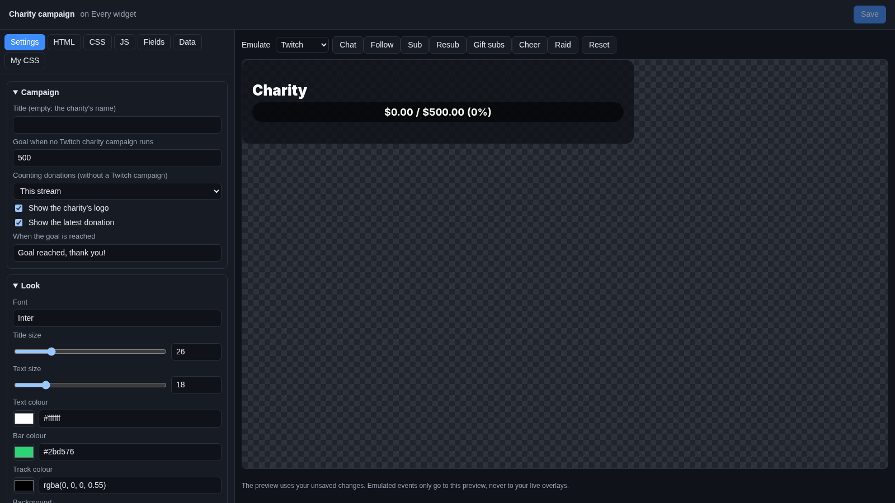
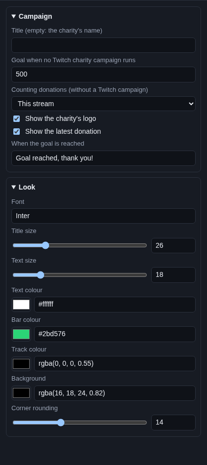

# Charity campaign

The **Charity campaign** widget shows how much you raised for a charity: the charity's name and logo, a bar, "$1,250 /
$5,000 (25%)", and the latest donation. Use it for a charity stream or a fundraiser like Extra Life.

## Where the money comes from

The widget works in two ways, and picks by itself:

1. **A Twitch charity campaign is running.** You started a charity campaign in your Twitch dashboard. The widget shows
   that campaign: the charity's name, its logo, what was raised and the campaign's target, straight from Twitch. Twitch
   must be connected in Cuebot (see [Twitch](../../platforms/twitch.md)).
2. **No Twitch campaign.** The widget adds up the charity donations Cuebot counted, against your own **Goal**. Those
   come from [Streamlabs](../../services/streamlabs.md) and [StreamElements](../../services/streamelements.md) charity
   donations, [DonorDrive](../../services/donordrive.md)
   (Extra Life and other DonorDrive charities), and Twitch charity donations.

The **Latest** line shows the newest charity donation, in both cases.

## Add it and size it

Click **Add Cuebot widget > Charity campaign** on your overlay's row (or **+ Add > Charity campaign** in the
[designer](../overlay-designer.md)). It goes at the top in the middle, 700 × 150 pixels on a 1920 × 1080 canvas.

## Settings

Click **Edit…** on the widget's row.

### Campaign

| Setting | What it does |
| --- | --- |
| **Title (empty: the charity's name)** | The heading. Empty shows the Twitch campaign's charity name, or "Charity" without a campaign. |
| **Goal when no Twitch charity campaign runs** | Your target, like `500`, in your currency. A Twitch campaign uses its own target instead. |
| **Counting donations (without a Twitch campaign)** | Which donations count: **This stream**, **This week**, **This month** or **All time**. "This stream" starts over 15 minutes after you went offline on every platform. |
| **Show the charity's logo** | The logo of the Twitch campaign's charity. |
| **Show the latest donation** | "Latest: Ann $25.00" under the bar. |
| **When the goal is reached** | The text on the bar once the target is reached, like `Goal reached, thank you!`. Empty keeps the numbers. |

### Look

| Setting | What it does |
| --- | --- |
| **Font** | A [Google Font](https://fonts.google.com) name. |
| **Title size**, **Text size** | Sizes in pixels. |
| **Text colour** | Colour of the text. |
| **Bar colour** | The filled part of the bar. |
| **Track colour** | The empty part of the bar. |
| **Background** | The box behind the widget. |
| **Corner rounding** | How round the box is. |

## Try it

Pick **Donations** next to **Emulate** and click **Charity**: a pretend charity donation shows in the **Latest** line.
It does not move the bar, because emulated events do not change your totals. The preview shows your real total.

## Ideas

- **An all-weekend charity stream:** **Counting donations** This week, **Goal** `2000`, **Title** `For the animal
  shelter`.
- **Extra Life:** connect [DonorDrive](../../services/donordrive.md), then add this widget. Donations to your Extra Life
  page fill the bar.
- **Thank each donor on stream:** the alert box has a charity design too. See [Alerts](../alerts.md).

## Troubleshooting

- **The bar stays empty.** No charity donations were counted in that period. Check that the service is connected on
  **Apps > Donations**, and that Cuebot ran when the donations came in.
- **The Twitch campaign does not show.** Twitch must be connected, and the campaign must be running. The widget
  remembers the last campaign it saw, so it shows at once after a reload.
- **The bar shows a different target.** While a Twitch campaign runs, its own target wins over **Goal**.
