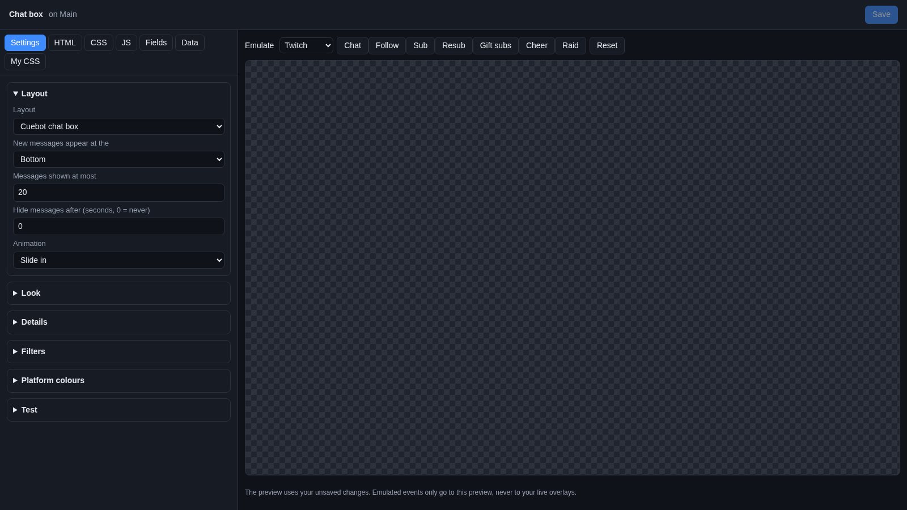
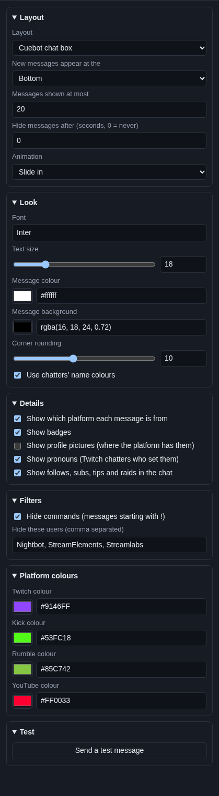
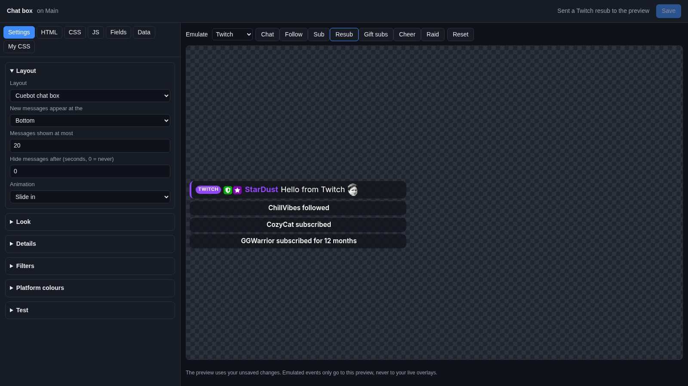

# Chat box

The **Chat box** shows your chat on stream. Messages from Twitch, YouTube, Kick and Rumble all land in one list, each
with a small tag that says where it came from. It shows emotes, badges and pronouns, and it can show follows, subs and
tips as lines in the chat.

## Where the messages come from

Every platform you connected on the **Platforms** pages sends its chat here. Nothing else to set up: if Cuebot reads a
platform's chat, the chat box shows it. When a moderator deletes a message, or times out or bans someone, those messages
disappear from the chat box too.

The follow, sub, tip, Super Chat, cheer, Kicks and raid lines come from the same events as your
[alerts](../alerts.md).

## Add it and size it

1. Go to **Overlays > Overlays & Widgets**.
2. On your overlay's row, click **Add Cuebot widget > Chat box**.

Cuebot puts it in the lower left: 480 × 600 pixels on a landscape canvas. On a vertical canvas (for phones) it takes the
whole width of the lower half. Change **X**, **Y**, **W** and **H** on its row, or drag it in the
[designer](../overlay-designer.md).

In the designer, **+ Add** also has **Chat box (YouTube popout layout)**: the same chat box with **Layout** already set
to the YouTube popout layout.

## Settings

Click **Edit…** on the chat box's row. See [Widgets](index.md#change-a-widgets-settings) for how the editor works.

### Layout

| Setting | What it does |
| --- | --- |
| **Layout** | **Cuebot chat box** is Cuebot's own look. **YouTube popout (for YouTube chat CSS themes)** builds the chat like YouTube's popout chat, so a ready-made YouTube chat theme (CSS you find online) works. Paste that CSS in the **My CSS** tab. |
| **New messages appear at the** | **Bottom** (like most chats: new lines push old ones up) or **Top**. |
| **Messages shown at most** | How many messages stay on screen (1 to 100, 20 at first). The oldest goes when a new one comes. |
| **Hide messages after (seconds, 0 = never)** | Each message fades away after this many seconds. 0 keeps them until they are pushed out. |
| **Animation** | How a new message comes in: **Slide in**, **Fade in** or **None**. |

### Look

| Setting | What it does |
| --- | --- |
| **Font** | A [Google Font](https://fonts.google.com) name, like `Poppins`. |
| **Text size** | Size of the text in pixels (10 to 48). |
| **Message colour** | Colour of the message text. |
| **Message background** | The box behind each message. The `rgba(...)` value is a colour with see-through: the last number is how solid it is, from 0 (invisible) to 1 (solid). |
| **Corner rounding** | How round the corners of each message box are (0 = square). |
| **Use chatters' name colours** | Shows each name in the colour the chatter picked on their platform. Off: names use the message colour. |

### Details

| Setting | What it does |
| --- | --- |
| **Show which platform each message is from** | A small **TWITCH**, **KICK**, **RUMBLE** or **YOUTUBE** tag before the name. |
| **Show badges** | Moderator, subscriber, VIP and other badges. |
| **Show profile pictures (where the platform has them)** | A small round picture next to the name. Off at first. |
| **Show pronouns (Twitch chatters who set them)** | Pronouns like `she/her` after the name, for Twitch chatters who set them on the pronouns website. |
| **Show follows, subs, tips and raids in the chat** | Adds lines like "Bob followed" or "Ann tipped $5.00" between messages. |

### Filters

| Setting | What it does |
| --- | --- |
| **Hide commands (messages starting with !)** | Leaves out `!commands`, so chat on stream stays readable. |
| **Hide these users (comma separated)** | Names that never show, like your bots. Starts with `Nightbot, StreamElements, Streamlabs`. Capitals do not matter. |

### Platform colours

**Twitch colour**, **Kick colour**, **Rumble colour** and **YouTube colour** colour the platform tag and the thin line
on the left of each message.

### Test

**Send a test message** puts a pretend message from "Cuebot" in the preview, so you can see your settings.

## Try it

In the editor, pick a platform next to **Emulate** and click **Chat** for a pretend message from that platform.
**Follow**, **Sub**, **Resub**, **Gift subs**, **Cheer** and **Raid** add the alert lines (when **Show follows, subs,
tips and raids in the chat** is ticked).

## Ideas

- **A chat that clears itself:** set **Hide messages after** to `30`. Old messages fade, so the chat box is empty when
  chat is quiet.
- **Chat on a vertical stream:** add the chat box to a **Vertical (1080 × 1920)** overlay. It fills the lower half.
- **A YouTube chat theme:** set **Layout** to **YouTube popout**, then paste the theme's CSS into **My CSS** and save.
  Messages from every platform get the theme. The platform is in `data-service` on each message, if you want to style
  them apart.

## Troubleshooting

- **No messages.** Check that Cuebot reads the chat: messages show on **Chat > Chat**. Check that the overlay is in
  OBS (see [Overlays](../overlays.md)), and that the chat box's row has a sensible size.
- **A message is missing.** It may start with `!` (and **Hide commands** is ticked), or come from a name in **Hide
  these users**. A Super Chat with no text has no message line; it shows only as an alert line.
- **No profile pictures.** Not every platform sends them. Tick **Show profile pictures** to show the ones that come.
- **The YouTube theme does nothing.** Check that **Layout** is **YouTube popout**, and that the CSS is in **My CSS**,
  then click **Save**.
