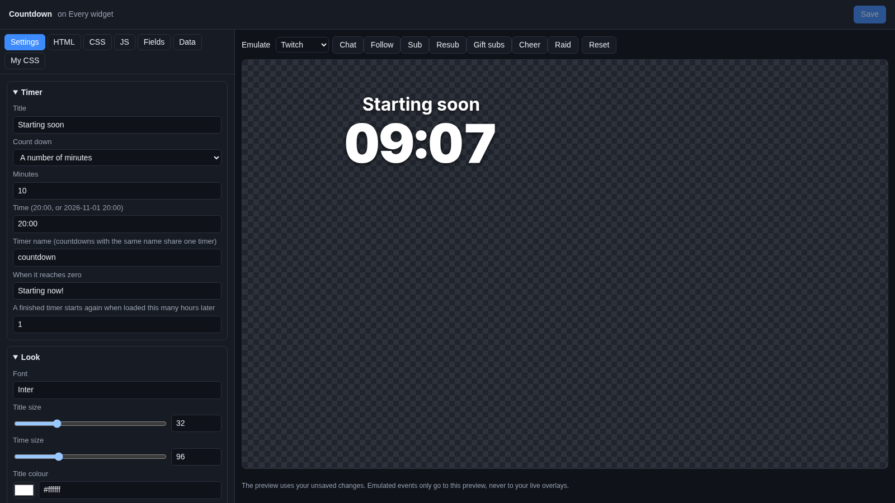
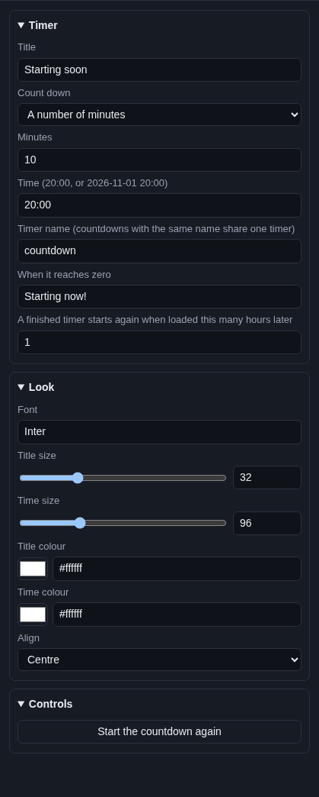

# Countdown

The **Countdown** is a clock that counts down to zero: "Starting soon 04:59". It can count down a number of minutes,
or to a time of day, like 20:00. Put it on your "Starting soon" or "Be right back" scene.

## Where the time comes from

From the widget's own settings. Nothing else to connect. The countdown remembers when it will end, so reloading OBS or
switching scenes does not start it over.

It is not the same as a [Subathon timer](subathon-timer.md), which events add time to.

## Add it and size it

Click **Add Cuebot widget > Countdown** on your overlay's row (or **+ Add > Countdown** in the
[designer](../overlay-designer.md)). It goes in the middle of the canvas, 640 × 260 pixels on a 1920 × 1080 canvas.

## Settings

Click **Edit…** on the countdown's row.

### Timer

| Setting | What it does |
| --- | --- |
| **Title** | The words above the clock, like `Starting soon`. |
| **Count down** | **A number of minutes** or **To a time**. |
| **Minutes** | For **A number of minutes**: how long, like `10` or `2.5` (two and a half minutes). |
| **Time (20:00, or 2026-11-01 20:00)** | For **To a time**: a time of day in 24-hour time, like `20:00`, or a date and time. |
| **Timer name (countdowns with the same name share one timer)** | A name for the countdown, `countdown` at first. Two countdown widgets with the same name show the same clock, even on different overlays. Give each countdown its own name to keep them apart. |
| **When it reaches zero** | What replaces the clock at zero, like `Starting now!`. Empty: it stays at `00:00`. |
| **A finished timer starts again when loaded this many hours later** | For **A number of minutes**: once the countdown has finished, it starts again from the top when the overlay loads this many hours later (1 at first). So next stream it is fresh, but a reload just after it finished does not restart it. |

How the clock knows where it is:

- **A number of minutes** starts when the overlay first loads, and Cuebot saves the end time under the **Timer name**.
  When the overlay loads again (OBS restarts, you switch scenes), it carries on from where it was. Changing **Minutes**
  starts it again.
- **To a time** always counts to that time on your computer's clock. `20:00` means today at 20:00. Once 20:00 has
  passed by more than 12 hours, it means tomorrow.

The clock shows minutes and seconds (`09:59`), and hours too when there is more than an hour left (`1:09:59`).

### Look

| Setting | What it does |
| --- | --- |
| **Font** | A [Google Font](https://fonts.google.com) name. |
| **Title size** | 0 to 120 pixels. 0 hides the title. |
| **Time size** | 16 to 300 pixels. |
| **Title colour** | Colour of the title. |
| **Time colour** | Colour of the clock. |
| **Align** | **Left**, **Centre** or **Right**. |

### Controls

**Start the countdown again** starts a minutes countdown from the top in the preview. It also saves the new end time,
so your overlay in OBS shows it the next time it loads (for example when you click **Save**).

## Try it

Set **Minutes** to `0.5`, watch the preview count down 30 seconds and show your **When it reaches zero** text. Then put
your real number back and click **Save**.

## Ideas

**Starting soon, 5 minutes:** **Title** `Starting soon`, **Count down** A number of minutes, **Minutes** `5`,
**When it reaches zero** `Here we go!`.

**A countdown to a time of day:** stream starts at 8 pm every day? **Count down** To a time, **Time** `20:00`,
**Title** `Live at 8 pm`. You can open the overlay whenever you like; it always counts to 20:00.

**A countdown to an event:** **Time** `2026-12-31 23:59` for a New Year's Eve stream. Use a date and time when it is
more than a day away.

**A "Be right back" timer:** a second countdown with **Timer name** `brb` and **Minutes** `5`, on your BRB scene. In
OBS, tick **Refresh browser when scene becomes active** on that browser source, and set **A finished timer starts again
when loaded this many hours later** to `0`. Now every time you switch to the BRB scene after the last break ended, it
starts 5 fresh minutes.

## Troubleshooting

- **It shows `--:--`.** **To a time** could not read the time. Write `20:00`, or a full date like `2026-11-01 20:00`.
- **It does not start over.** A minutes countdown carries on after a reload on purpose. Click **Start the countdown
  again** in the editor and **Save**, change **Minutes**, or set the hours setting to `0`.
- **Two countdowns show the same time.** They have the same **Timer name**. Give each its own.
- **The time of day is off.** **To a time** uses the clock of the computer running OBS.
