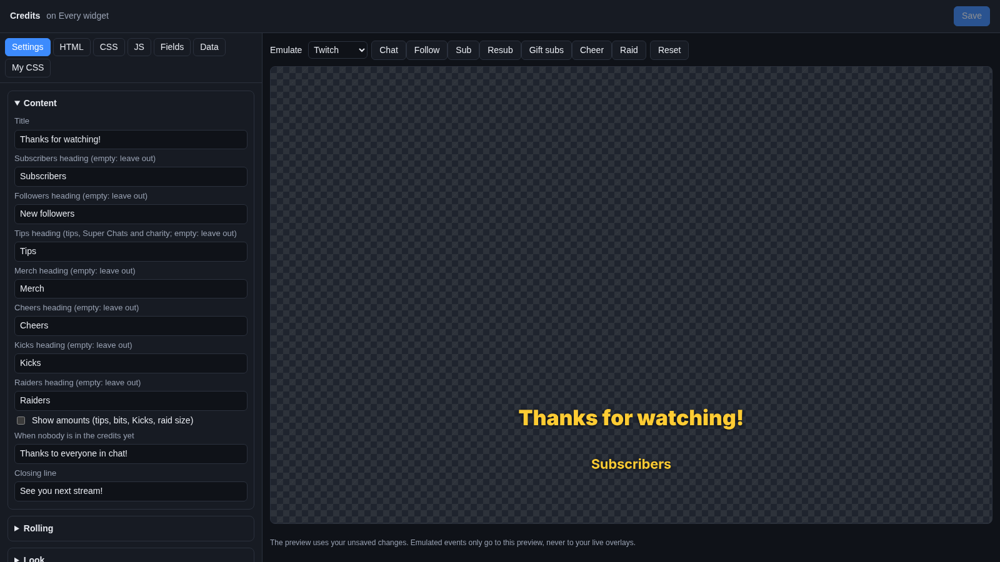
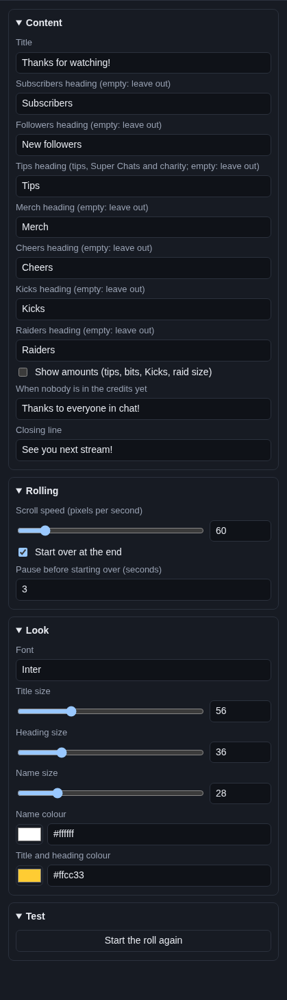

# Credits roll

The **Credits roll** is the end of a film, for your stream. A big "Thanks for watching!" scrolls up the screen,
followed by everyone who subscribed, followed, tipped, bought merch, cheered, sent Kicks or raided this stream. Put it
on your "Ending" scene.

## Where the names come from

The credits roll reads Cuebot's **stream totals**: everyone who reached your [alerts](../alerts.md) this stream, from
every platform and tip service. Names appear in the order people first showed up. If one person tipped twice, they are
listed once, with their amounts added up.

"This stream" starts over 15 minutes after you went offline on every platform.

!!! note "Not the same list as Chat > Credits"
    The widget does not use the list on [**Chat > Credits**](../../chat/credits.md). That page's settings (**Credit
    everyone who chatted**, **Never credit (bots)**, **Reset credits**, **Show test data**) and the credits
    sub-actions do not change what this widget shows. People who only chatted are not in the roll.

## Add it and size it

Click **Add Cuebot widget > Credits roll** on your overlay's row (or **+ Add > Credits roll** in the
[designer](../overlay-designer.md)). It covers the whole canvas, so the names roll from the bottom edge to the top
edge. To roll in just a part of the screen, make it narrower or shorter.

## Settings

Click **Edit…** on the credits roll's row.

### Content

| Setting | What it does |
| --- | --- |
| **Title** | The big line at the top, like `Thanks for watching!`. |
| **Subscribers heading** | The heading above subs (new subs, resubs and gift subs). Empty leaves subscribers out. |
| **Followers heading** | The heading above new followers. Empty leaves them out. |
| **Tips heading** | The heading above tips, Super Chats and charity donations together. Empty leaves them out. |
| **Merch heading** | The heading above merch buyers. Empty leaves them out. |
| **Cheers heading** | The heading above people who cheered bits. Empty leaves them out. |
| **Kicks heading** | The heading above people who sent Kicks. Empty leaves them out. |
| **Raiders heading** | The heading above raiders. Empty leaves them out. |
| **Show amounts (tips, bits, Kicks, raid size)** | Adds what each person gave, like "Ann · $15.00" or "Bob · 500 bits". |
| **When nobody is in the credits yet** | The line shown when nobody is in any section, like `Thanks to everyone in chat!`. |
| **Closing line** | The last line, like `See you next stream!`. |

A section with nobody in it is left out, heading and all.

### Rolling

| Setting | What it does |
| --- | --- |
| **Scroll speed (pixels per second)** | How fast the names move up (10 to 400). 60 is calm; 150 is quick. |
| **Start over at the end** | When everything has rolled off the top, start again. Off: it rolls once. |
| **Pause before starting over (seconds)** | The wait before the next roll. |

People who join during a roll are added at the next start, so the roll never jumps.

### Look

| Setting | What it does |
| --- | --- |
| **Font** | A [Google Font](https://fonts.google.com) name. |
| **Title size**, **Heading size**, **Name size** | Sizes in pixels. |
| **Name colour** | Colour of the names. |
| **Title and heading colour** | Colour of the title and the headings. |

### Test

**Start the roll again** starts the roll in the preview from the bottom.

## Try it

The preview shows your real names for this stream. When there are none yet, it shows a few sample names, so you can see
the look. The Emulate buttons do not add names: they do not change your stream totals.

## Ideas

- **An ending scene:** make an overlay called `Ending`, add only the credits roll, and put that overlay in your OBS
  "Ending" scene. The roll starts when the scene shows (OBS loads the page). In the OBS browser source, tick **Refresh
  browser when scene becomes active** so it starts from the top each time.
- **Just the supporters:** empty **Followers heading** to leave out followers, and tick **Show amounts**.
- **A slow, single roll:** untick **Start over at the end** and set **Scroll speed** to `40`.

## Troubleshooting

- **Only the "nobody yet" line shows.** Nobody has reached your alerts this stream, or every heading with people in it
  is empty.
- **Last stream's names are gone.** This stream's list starts over 15 minutes after you went offline on every
  platform.
- **A raid shows "1 viewers".** With **Show amounts**, raids count how many times someone raided, not how many viewers
  they brought.
