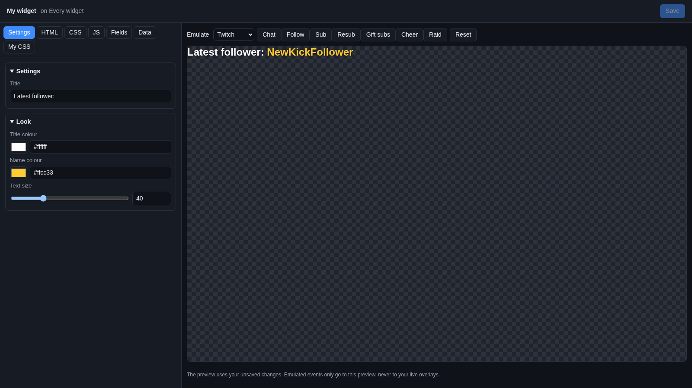
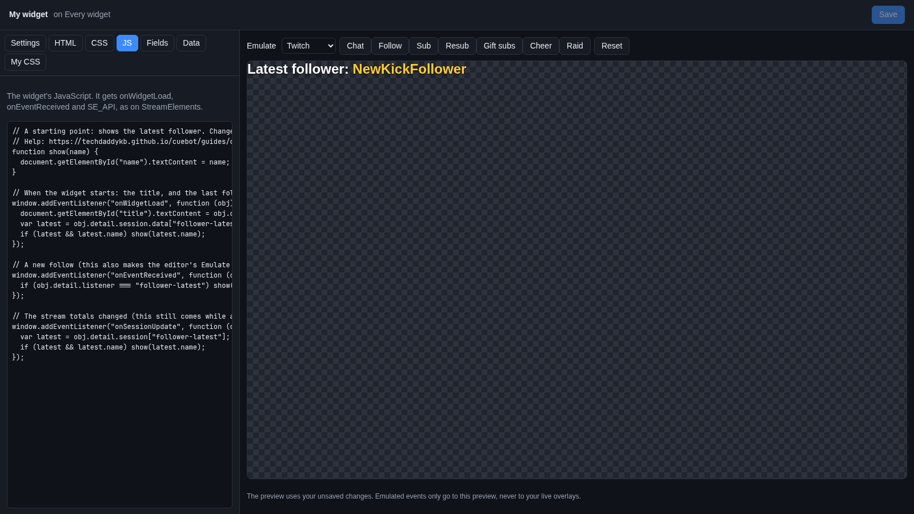

# Blank custom widget

The **Blank custom widget** is a widget you make yourself, with a little HTML (what is on the page), CSS (how it
looks) and JavaScript (what it does). It is for when none of the ready-made widgets does what you want. You do not
start from nothing: it comes with a small example that shows your latest follower, so you can change it bit by bit.

## Add it

1. Go to **Overlays > Overlays & Widgets**.
2. On your overlay's row, click **Add Cuebot widget > Blank custom widget (write your own code)**.
3. A widget called **My widget** appears in the top left, 700 × 80 pixels. Change **X**, **Y**, **W** and **H** on its
   row, or drag it in the [designer](../overlay-designer.md).
4. Click **Edit…** on its row to open it in the [widget editor](../widget-editor.md).

## What the example does

Out of the box, the widget shows "Latest follower:" and the name of your newest follower, and it changes when someone
new follows. Its **Settings** tab has:

| Group | Setting | What it does |
| --- | --- | --- |
| Settings | **Title** | The words before the name, `Latest follower:` at first. |
| Look | **Title colour** | Colour of the title. |
| Look | **Name colour** | Colour of the follower's name. |
| Look | **Text size** | Size of the text, in pixels. |

Pick a platform next to **Emulate** and click **Follow** to see it change.

## Make it your own

The editor has a tab for each part of your widget:

| Tab | What is in it |
| --- | --- |
| **HTML** | The page: the boxes and text your widget shows. |
| **CSS** | The look: colours, sizes, fonts, animations. |
| **JS** | What it does: the code that reacts to chat, follows, tips and more. |
| **Fields** | The list of settings the **Settings** tab shows. Add one here and it appears as a box, a colour picker or a slider. |
| **Data** | The values saved for those settings. |
| **My CSS** | Extra CSS that goes on top, for small changes. |

Change something, look at the preview, and click **Save**. The guide
[Writing your own overlay widgets](../widget-code.md) explains everything step by step: the events your code gets,
stream totals, settings, saving values, and a complete example.

## Good to know

- Widgets use the same code style as StreamElements custom widgets. Many StreamElements widgets work as they are; you
  can also import one as a `.zip` with **Add widget…**.
- Your code is yours. Mods using the [mod portal](../../mods/mod-portal.md) can change the settings, but never see or
  change the code.
- To share your widget, use **Share > Export with its code (I own the rights to share it)…** on its row.
