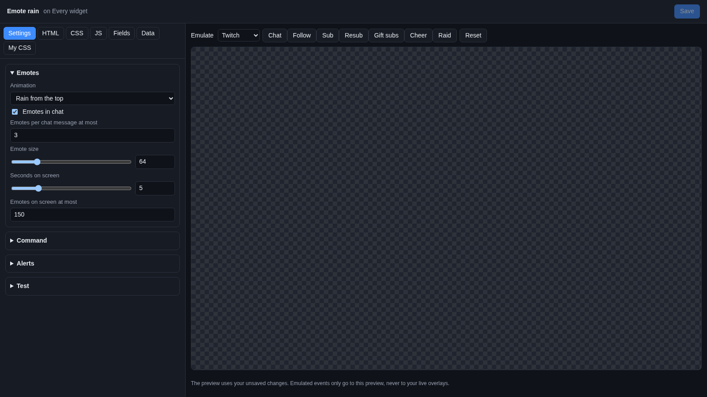
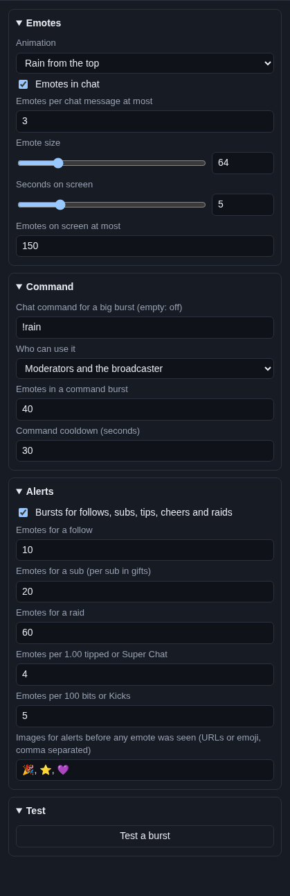

# Emote rain

**Emote rain** makes the emotes your chat uses fly across the screen. Someone types three emotes, three emotes fall from
the top. A follow, sub or raid sets off a whole shower, and a `!rain` command sends a big burst.

## Where the emotes come from

- **Chat:** the emotes in chat messages, from every platform that sends emote pictures with its messages (Twitch,
  Kick, YouTube and so on). Plain emoji typed as text are not pictures, so they do not fly.
- **Alerts:** follows, subs, tips, cheers, Kicks, raids, Super Chats, charity donations and merch (the same events as
  your [alerts](../alerts.md)) set off a burst of the emotes chat used most recently.
- **The command:** a chat command sends a big burst of the emotes in that message.

## Add it and size it

Click **Add Cuebot widget > Emote rain** on your overlay's row (or **+ Add > Emote rain** in the
[designer](../overlay-designer.md)). It covers the whole canvas, so emotes can fly anywhere. Make it smaller to keep
them in one part of the screen, like away from your face cam.

## Settings

Click **Edit…** on the widget's row.

### Emotes

| Setting | What it does |
| --- | --- |
| **Animation** | **Rain from the top**, **Fountain from the bottom** (shot up, then they fall), **Float up** (slowly rise) or **Bounce around** (bounce off the edges). |
| **Emotes in chat** | Every chat message with emotes sends them across. Untick it to show emotes only for alerts and the command. |
| **Emotes per chat message at most** | So one message full of emotes does not flood the screen (3 at first). |
| **Emote size** | In pixels (16 to 256). |
| **Seconds on screen** | How long each emote stays before it fades. |
| **Emotes on screen at most** | When there are this many, the oldest goes first. Lower it if OBS gets slow. |

### Command

| Setting | What it does |
| --- | --- |
| **Chat command for a big burst (empty: off)** | The word that starts a burst, `!rain` at first. `!rain Kappa PogChamp` sends a burst of those emotes. Without emotes in the message, it uses the emotes chat used recently. |
| **Who can use it** | **Everyone**, **Subscribers, VIPs and mods**, or **Moderators and the broadcaster** (at first). |
| **Emotes in a command burst** | How many emotes one burst sends (40 at first). |
| **Command cooldown (seconds)** | The wait before the command works again. A command used too soon is ignored. |

The command is part of the widget, not a Cuebot command: it only works while the overlay is open in OBS, and it does not
show on **Automation > Commands**.

### Alerts

| Setting | What it does |
| --- | --- |
| **Bursts for follows, subs, tips, cheers and raids** | Tick it to send a burst for each alert. |
| **Emotes for a follow** | 10 at first. |
| **Emotes for a sub (per sub in gifts)** | 20 at first. A gift of 5 subs sends 5 × 20. |
| **Emotes for a raid** | 60 at first. |
| **Emotes per 1.00 tipped or Super Chat** | A $5 tip sends 5 × 4 = 20 emotes. Charity donations and merch count the same way. |
| **Emotes per 100 bits or Kicks** | 500 bits send 5 × 5 = 25 emotes. |
| **Images for alerts before any emote was seen (URLs or emoji, comma separated)** | What an alert burst uses when chat has not used any emote yet since the overlay loaded. Emoji or picture addresses. |

One burst sends at most 300 emotes.

### Test

**Test a burst** sends 30 emotes in the preview.

## Try it

- Click **Test a burst**.
- Pick **Twitch** next to **Emulate** and click **Follow**, **Sub** or **Raid**: each one sets off an alert burst
  (with your fallback images, since the preview has not seen any emotes yet).

## Ideas

- **Only on the command:** untick **Emotes in chat** and **Bursts for follows, subs, tips, cheers and raids**. Now
  emotes fly only when a mod types `!rain`.
- **A hype moment for everyone:** set **Who can use it** to **Everyone** and **Command cooldown** to `60`.
- **Your own pictures for alerts:** put picture addresses (links that start with `https://`) in
  **Images for alerts before any emote was seen**.
- **Calm bubbles:** **Animation** Float up, **Emote size** `48`, **Seconds on screen** `8`.

## Troubleshooting

- **Nothing flies in chat.** Check **Emotes in chat** is ticked, and that the message has real emotes (pictures), not
  emoji typed as text.
- **The command does nothing.** The person may not be allowed (**Who can use it**), the cooldown may still run, or the
  command is not the first word of the message.
- **Alerts send emoji instead of emotes.** Chat has not used an emote since the overlay loaded. The burst uses your
  fallback images until it has.
- **OBS gets slow.** Lower **Emotes on screen at most** and the burst sizes.
