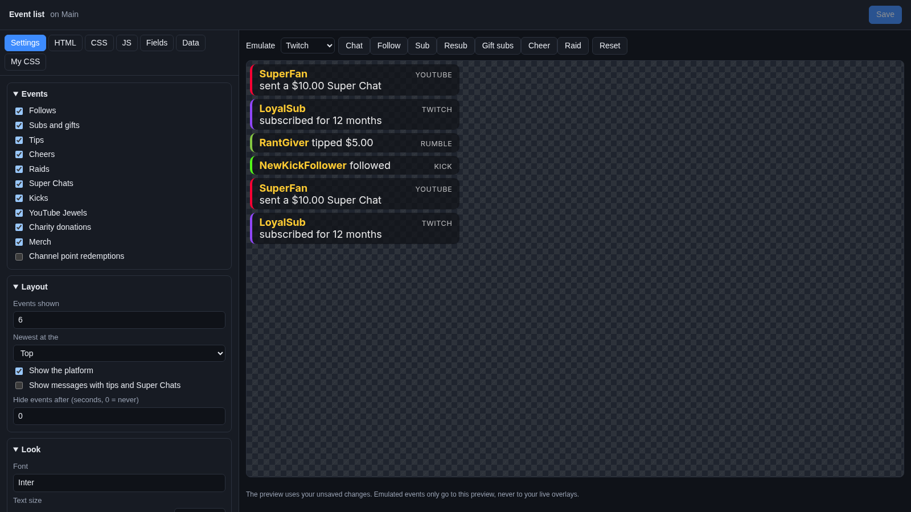
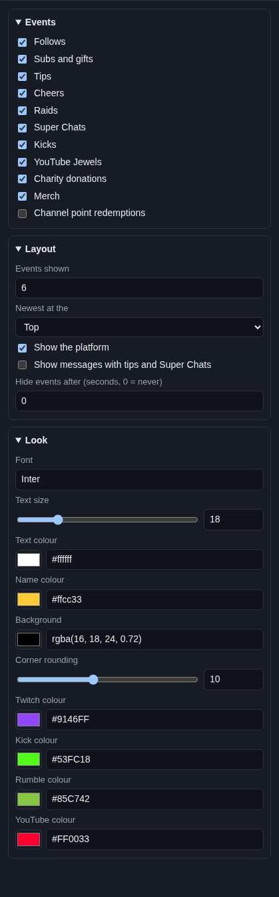
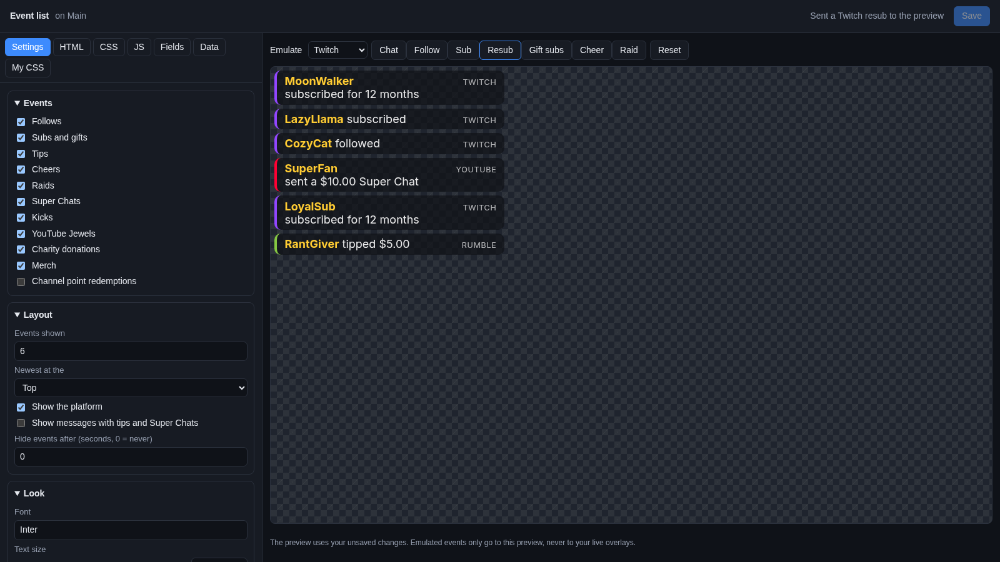

# Event list

The **Event list** shows the latest things that happened on stream: "Bob followed", "Ann subscribed for 12 months",
"Cy tipped $5.00". New ones slide in at the top. It is a running thank-you list, from every platform at once.

## Where the events come from

The same events as your [alerts](../alerts.md): follows, subs and gift subs, tips, cheers, raids, Super Chats, Kicks,
YouTube Jewels, charity donations, merch sales and channel point redemptions. They come from Twitch, YouTube, Kick and
Rumble and from every tip and shop service you connected (see [Tips and donations](../../services/tips-and-donations.md)).

When the overlay loads, the list starts with the most recent events Cuebot remembers, so it is not empty after you
restart OBS.

## Add it and size it

Click **Add Cuebot widget > Event list** on your overlay's row (or **+ Add > Event list** in the
[designer](../overlay-designer.md)). It goes in the top right, 380 × 420 pixels on a 1920 × 1080 canvas. Make it
taller for more events, or turn on **Show messages with tips and Super Chats** and give it more room.

## Settings

Click **Edit…** on the event list's row.

### Events

Tick the events you want in the list: **Follows**, **Subs and gifts**, **Tips**, **Cheers**, **Raids**, **Super Chats**,
**Kicks**, **YouTube Jewels**, **Charity donations**, **Merch** and **Channel point redemptions**. All are ticked
except **Channel point redemptions**.

### Layout

| Setting | What it does |
| --- | --- |
| **Events shown** | How many events the list holds (1 to 25, 6 at first). The oldest goes when a new one comes. |
| **Newest at the** | **Top** or **Bottom**. |
| **Show the platform** | A small **TWITCH**, **KICK**, **RUMBLE** or **YOUTUBE** word on each event. |
| **Show messages with tips and Super Chats** | Adds the message a viewer wrote with a tip, Super Chat or charity donation. |
| **Hide events after (seconds, 0 = never)** | Each event fades away after this many seconds. With a number here, the list starts empty when the overlay loads and only shows new events. |

### Look

| Setting | What it does |
| --- | --- |
| **Font** | A [Google Font](https://fonts.google.com) name. |
| **Text size** | 10 to 48 pixels. |
| **Text colour** | Colour of "followed", "tipped $5.00" and the rest. |
| **Name colour** | Colour of the viewer's name. |
| **Background** | The box behind each event. In `rgba(...)`, the last number is how solid it is (0 to 1). |
| **Corner rounding** | How round each box is. |
| **Twitch colour**, **Kick colour**, **Rumble colour**, **YouTube colour** | The thin line on the left of each event, by platform. |

## Try it

Pick a platform next to **Emulate** and click **Follow**, **Sub**, **Gift subs**, **Cheer**, **Raid** and so on.
Each one adds a line to the preview. Pick **Donations**, **Ko-fi** or **Fourthwall** for tips, merch and charity
donations.

If you have no real events yet, the preview shows three sample events so you can see the look.

## Ideas

- **Only money:** untick everything except **Tips**, **Super Chats**, **Cheers**, **Kicks** and **Charity donations**.
  Tick **Show messages with tips and Super Chats**.
- **A pop-in feed:** set **Hide events after** to `10` and **Events shown** to `3`. Events show for 10 seconds, then
  fade, so the corner of your stream is empty when nothing happens.
- **Two lists:** add the widget twice (once for follows and subs, once for money) and place them side by side. Each
  copy has its own settings: use **Add Cuebot widget** again, not the same widget from the library.

## Troubleshooting

- **The list is empty.** Nothing has happened yet, or the events you get are unticked. With **Hide events after** set,
  the list starts empty on purpose.
- **Events come late.** Overlay alerts may be paused (the **Pause, skip or mute overlay alerts** sub-action). The list
  waits with them and catches up when you resume.
- **A redemption is missing.** **Channel point redemptions** is unticked at first.
