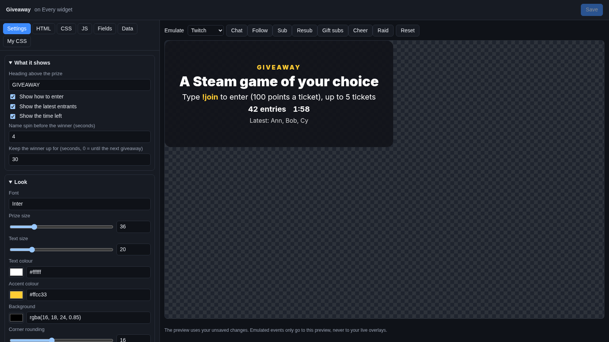
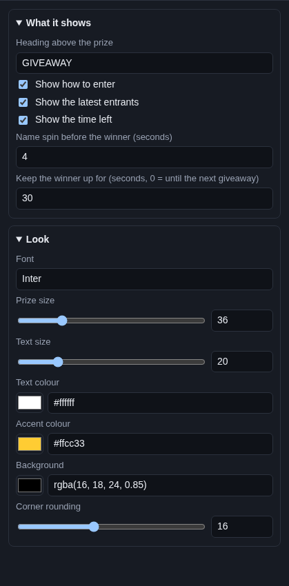

# Giveaway

The **Giveaway** widget shows your giveaway on stream: the prize, how to enter ("Type !join to enter"), how many people
entered, the newest entrants and the time left. When you draw, the names spin like a slot machine, slow down and stop
on the winner.

## Where the giveaway comes from

From Cuebot's giveaway on **Chat > Giveaways & Store**, which viewers enter in chat on every platform. You set the
prize, the join command, the ticket cost and the timer there, and you close entries and draw the winners there. See
[Giveaways](../../chat/giveaways.md).

The widget shows nothing while no giveaway runs. It appears when you click **Open giveaway**.

## Add it and size it

Click **Add Cuebot widget > Giveaway** on your overlay's row (or **+ Add > Giveaway** in the
[designer](../overlay-designer.md)). It goes at the bottom in the middle, 600 × 280 pixels on a 1920 × 1080 canvas.

## Settings

Click **Edit…** on the widget's row.

### What it shows

| Setting | What it does |
| --- | --- |
| **Heading above the prize** | A small line above the prize, `GIVEAWAY` at first. |
| **Show how to enter** | "Type **!join** to enter", with the ticket cost and how many tickets one viewer may buy. It says "Subscribers: type..." for a subscribers-only giveaway, and "Entries are closed" after you close entries. |
| **Show the latest entrants** | "Latest: Ann, Bob, Cy". |
| **Show the time left** | A clock while entries are open, if the giveaway has a time limit. |
| **Name spin before the winner (seconds)** | How long the names spin before the winner shows (4 at first). 0 shows the winner at once. |
| **Keep the winner up for (seconds, 0 = until the next giveaway)** | After the draw, the winner stays this long, then the widget hides (30 at first). |

The widget always shows how many entries there are. With several winners, it says **Winners** and lists them all.

### Look

| Setting | What it does |
| --- | --- |
| **Font** | A [Google Font](https://fonts.google.com) name. |
| **Prize size**, **Text size** | Sizes in pixels. |
| **Text colour** | Colour of the text. |
| **Accent colour** | Colour of the heading, the command and the winner. |
| **Background** | The box behind the giveaway. |
| **Corner rounding** | How round the box is. |

## Try it

With no giveaway running, the preview shows a sample giveaway ("A Steam game of your choice"), so you can set the look.
To see your real one, open a giveaway on **Chat > Giveaways & Store**, then click **Reset** in the editor. The Emulate
buttons do not enter anyone.

To see the spin, run a test giveaway with the overlay open in a browser: on the overlay's row, click **Copy link** and
paste it in your browser. Enter from chat, then **Close entries** and **Draw winners**.

## Control it from actions

| Sub-action | What it does |
| --- | --- |
| **Open giveaway** | Opens a giveaway with a prize, cost and time, for example from a Stream Deck button. The widget appears. |
| **Close, draw or cancel giveaway** | Closes entries, draws the winners (the widget spins), or cancels and refunds. |

Details are in the [giveaways sub-actions](../../../reference/sub-actions/giveaways.md).

## Ideas

- **A dramatic draw:** **Name spin before the winner** `8`.
- **Winner stays on screen:** **Keep the winner up for** `0`, so the winner shows until the next giveaway.
- **A one-button draw:** an action with **Close, draw or cancel giveaway** (**Do**: Close entries), a **Delay** of a
  few seconds, then **Close, draw or cancel giveaway** again (**Do**: Draw winners). One Stream Deck press closes
  entries and spins.

## Troubleshooting

- **The widget is empty.** No giveaway is open, or the winner was shown longer ago than **Keep the winner up for**.
- **No spin, the winner shows at once.** **Name spin before the winner** is 0, or fewer than two people entered. A
  winner drawn while the overlay was not open shows without a spin.
- **"Nobody entered".** The giveaway was drawn with no entries.
