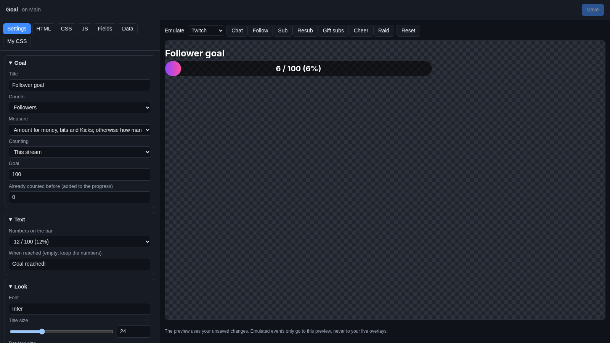
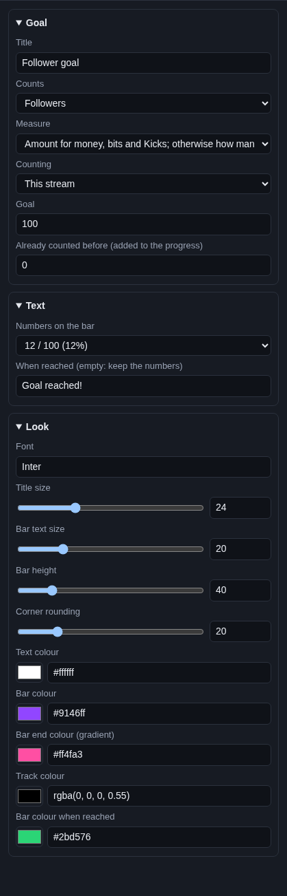

# Goal bar

A **Goal bar** is a bar that fills up as you get closer to a goal, like "50 / 100 followers" or "$120 / $500 for the
new microphone". When the goal is reached, the bar changes colour and can say "Goal reached!".

## Where the numbers come from

Most goals count Cuebot's **stream totals**: the follows, subs, tips, cheers, Super Chats, Kicks, Jewels, charity
donations and merch sales that reach your [alerts](../alerts.md), from every platform and tip service you connected.
You pick the period: this stream, this week, this month or all time. **This stream** starts over 15 minutes after you
went offline on every platform.

A few goals read a service instead:

| Counts | Where it comes from |
| --- | --- |
| **Ko-fi goal** | The Ko-fi goal Cuebot keeps for you (see [Ko-fi](../../services/ko-fi.md#the-ko-fi-goal)). Its title, target and progress come from there. |
| **Patreon paying patrons (now)** / **Patreon monthly pledges (now)** | Your patrons right now (see [Patreon](../../services/patreon.md)). You set the target in **Goal**. |
| **Fourthwall members (now)** | Your Fourthwall members right now (see [Fourthwall](../../services/fourthwall.md)). |
| **Shopify merch goal** | The merch goal you set for Shopify: this stream's items sold or revenue, with its own title and target (see [Shopify](../../services/shopify.md#merch-counter-and-goal)). |

Want a goal with steps (a new emote at 10 points, another at 20)? That is the [Goal ladder](goal-ladder.md).

## Add it and size it

Click **Add Cuebot widget > Goal bar** on your overlay's row (or **+ Add > Goal bar** in the
[designer](../overlay-designer.md)). It goes in the top left under a label's spot, 700 × 110 pixels on a 1920 × 1080
canvas. The title sits above the bar; make the widget taller if you make the title or the bar bigger.

## Settings

Click **Edit…** on the goal bar's row.

### Goal

| Setting | What it does |
| --- | --- |
| **Title** | The words above the bar, like `Follower goal`. Empty: no title (or, for the Ko-fi and Shopify goals, the title set there). |
| **Counts** | What fills the bar: **Followers**, **Subscribers**, **Tips**, **Cheers (bits)**, **Super Chats**, **Kicks**, **YouTube Jewels**, **Charity donations**, **Merch**, **Revenue** (tips, Super Chats, charity and merch added up), or one of the service goals in the table above. |
| **Measure** | **How many** (each tip counts as 1) or **Amount** (a $5 tip counts as 5). The first choice picks for you: the amount for money, bits and Kicks, otherwise how many. |
| **Counting** | **This stream**, **This week**, **This month** or **All time**. Not used by the service goals. |
| **Goal** | The target, like `100`. The Ko-fi and Shopify goals use their own target instead. |
| **Already counted before (added to the progress)** | A head start. Got 30 subs before you set this up? Put `30`. |

### Text

| Setting | What it does |
| --- | --- |
| **Numbers on the bar** | `12 / 100 (12%)`, `12 / 100`, `12%`, or **None**. |
| **When reached (empty: keep the numbers)** | The text on the bar once the goal is reached, like `Goal reached!`. Empty keeps showing the numbers. |

### Look

| Setting | What it does |
| --- | --- |
| **Font** | A [Google Font](https://fonts.google.com) name. |
| **Title size** | 0 to 80 pixels. 0 hides the title. |
| **Bar text size** | Size of the numbers on the bar. |
| **Bar height** | How thick the bar is (8 to 200 pixels). |
| **Corner rounding** | How round the bar's ends are (0 = square). |
| **Text colour** | Colour of the title and numbers. |
| **Bar colour** / **Bar end colour (gradient)** | The filled part fades from the first colour to the second. Use the same colour twice for a flat bar. |
| **Track colour** | The empty part of the bar. |
| **Bar colour when reached** | The colour of the whole bar once the goal is reached. |

The bar gives a little bump each time it grows. Money is shown with your currency's sign.

## Try it

The Emulate buttons do not change your stream totals, so the bar does not move when you click them. To see how a full
bar looks, put a big number in **Already counted before**, look at the preview, then set it back before you click
**Save**.

## Ideas

**A sub goal that starts over each stream:** **Counts** Subscribers, **Counting** This stream, **Goal** `20`, **Title**
`Sub goal`. Every new stream starts at 0.

**A monthly tip goal for a new microphone:** **Counts** Revenue, **Measure** Amount, **Counting** This month,
**Goal** `300`, **Title** `New mic`, **When reached** `Thank you!`.

**A follower goal you started on another app:** **Counts** Followers, **Counting** All time, **Goal** `1000`,
**Already counted before** the followers you had when you started using Cuebot.

**Your Ko-fi goal:** **Counts** Ko-fi goal, and empty the **Title** so the goal's own title shows.

## Troubleshooting

- **The bar stays empty.** Nothing of that type has been counted in that period yet. Check that the platform or tip
  service is connected and that Cuebot ran during the stream.
- **The bar started over.** **This stream** starts over after you were offline on every platform for 15 minutes. Use
  **This week**, **This month** or **All time** for goals that should last.
- **The title is wrong for the Ko-fi or Shopify goal.** The widget's **Title** wins. Empty it to show the goal's own
  title.
- **Amounts in different currencies.** They are added as they come, without converting.
