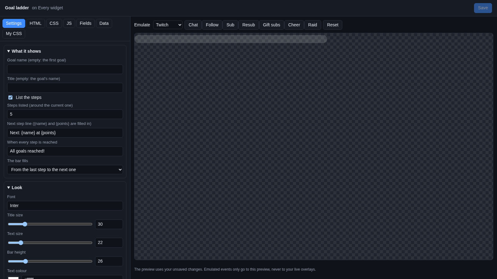
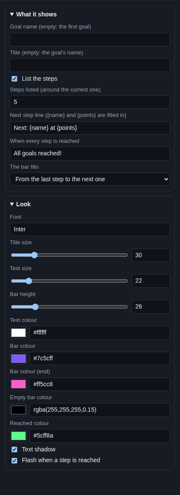

# Goal ladder

The **Goal ladder** shows a points goal with steps, like a ladder you climb: a new emote at 10 points, a second one at
20, a cosplay stream at 50. A bar fills towards the next step, and a list ticks off the steps already reached.

## Where the points come from

The widget shows a goal you made on **Chat > Subathon & Goals**, tab **Goals**. That is where you write the steps and set
how many points each sub, bit, tip, follow or raid adds. See [Goals](../../services/goals.md).

The widget only shows the goal; it does not count anything itself. So reloading OBS never loses points, and you can show
the same goal on several overlays.

This is not the same as the [Goal bar](goal-bar.md), which counts followers, subs or tips towards one number.

## Add it and size it

1. Make a goal first, on **Chat > Subathon & Goals**, tab **Goals**, with a few steps.
2. Click **Add Cuebot widget > Goal ladder** on your overlay's row (or **+ Add > Goal ladder** in the
   [designer](../overlay-designer.md)).

It goes in the bottom left, 620 × 280 pixels on a 1920 × 1080 canvas. With more than 5 steps listed, make it taller;
without the list (**List the steps** off), make it shorter.

## Settings

Click **Edit…** on the widget's row.

### What it shows

| Setting | What it does |
| --- | --- |
| **Goal name (empty: the first goal)** | Which goal to show, by its name on **Chat > Subathon & Goals**. Capitals do not matter. |
| **Title (empty: the goal's name)** | The heading. Empty shows the goal's own name. |
| **List the steps** | A list of steps under the bar, with a tick next to each step reached. |
| **Steps listed (around the current one)** | How many steps the list shows. It starts at the last step reached, so the list moves along as you climb. |
| **Next step line ({name} and {points} are filled in)** | The line under the bar. `Next: {name} at {points}` becomes `Next: New emote at 10`. |
| **When every step is reached** | The line once the last step is reached, like `All goals reached!`. |
| **The bar fills** | **From the last step to the next one** (the bar starts empty after each step) or **From 0 to the next step** (the bar shows how far you are overall). |

The numbers on the bar show the points and the next step's points, like `14 / 20`.

### Look

| Setting | What it does |
| --- | --- |
| **Font** | A [Google Font](https://fonts.google.com) name. |
| **Title size**, **Text size** | Sizes in pixels. |
| **Bar height** | How thick the bar is. |
| **Text colour** | Colour of the text. |
| **Bar colour** / **Bar colour (end)** | The filled part fades from the first colour to the second. |
| **Empty bar colour** | The part not filled yet. |
| **Reached colour** | Colour of the ticked steps, and of the bar once every step is reached. |
| **Text shadow** | A soft shadow for busy backgrounds. |
| **Flash when a step is reached** | A short flash when a new step is reached. |

## Try it

The preview shows your real goal as it was when the preview loaded. The Emulate buttons do not add points. To see a
step reached, use **Add** or **Set points** on **Chat > Subathon & Goals**, then click **Reset** in the editor to reload
the preview.

## Control it from actions

| Sub-action | What it does |
| --- | --- |
| **Add goal points** | Add points for anything, like a channel point reward or a `!hug` command. |
| **Set goal points** | Put the goal at an exact number. |
| **Reset a goal** | Back to 0, every step reachable again. |
| **Set a goal's multiplier** | Double points for a happy hour. |
| **Get a goal** | Read the points and the next step, for a `!goal` chat command. |

Details are in the [goals sub-actions](../../../reference/sub-actions/goals.md).

## Ideas

- **A ladder that starts over each stream:** on **Chat > Subathon & Goals**, open the goal's **Settings** and tick
  **Start from 0 each new stream**. The widget follows.
- **An overall bar:** set **The bar fills** to **From 0 to the next step**.
- **Only the bar:** untick **List the steps** and make the widget short.

## Troubleshooting

- **The widget is empty.** No goal has that name, or you have no goal yet. Check **Goal name**, or leave it empty.
- **No next step line.** The goal has no steps yet. Add steps on **Chat > Subathon & Goals**.
- **Events do not add points.** That is set on the goal (**What events add**), not on the widget. See
  [Goals](../../services/goals.md).
