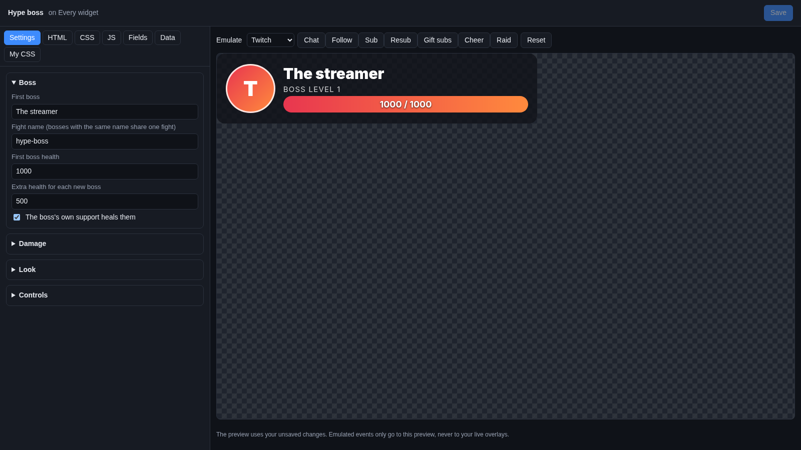
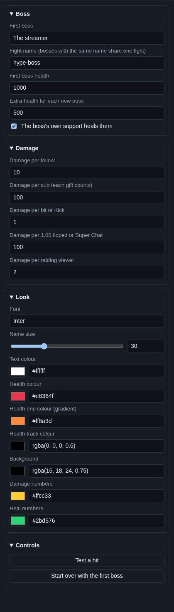

# Hype boss

The **Hype boss** turns support into a game. A "boss" sits on screen with a health bar. Every follow, sub, cheer, tip
and raid hits the boss and takes health away. Whoever lands the final hit becomes the next boss, with more health, and
everyone else now attacks them.

## Where the hits come from

The same events as your [alerts](../alerts.md), from every platform and tip service: follows, subs and gift subs,
bits, Kicks, tips, Super Chats, charity donations, merch and raids. For a gift sub, the person who gave the gift
attacks, not the one who got it.

When the boss supports the stream themselves, they heal instead (if **The boss's own support heals them** is ticked).

The fight is saved under the **Fight name**. Reloading OBS keeps the current boss and their health.

## Add it and size it

Click **Add Cuebot widget > Hype boss** on your overlay's row (or **+ Add > Hype boss** in the
[designer](../overlay-designer.md)). It goes at the top in the middle, 640 × 140 pixels on a 1920 × 1080 canvas.

## Settings

Click **Edit…** on the widget's row.

### Boss

| Setting | What it does |
| --- | --- |
| **First boss** | The name of the first boss, `The streamer` at first. Put your own name in. |
| **Fight name (bosses with the same name share one fight)** | The name the fight is saved under. Two hype boss widgets with the same name show the same fight. A new name starts a new fight. |
| **First boss health** | How much health the first boss has (1000 at first). |
| **Extra health for each new boss** | Each new boss has this much more health than the last one, so the fight gets harder (500 at first). |
| **The boss's own support heals them** | When the boss follows, subs or tips, they get health back instead of taking damage. Untick it to ignore the boss's own support. |

### Damage

| Setting | What it does |
| --- | --- |
| **Damage per follow** | 10 at first. |
| **Damage per sub (each gift counts)** | 100 at first. A gift of 5 subs does 5 × 100. |
| **Damage per bit or Kick** | 1 at first. 500 bits do 500 damage. |
| **Damage per 1.00 tipped or Super Chat** | 100 at first. A $5 tip does 500 damage. Charity donations and merch count the same way. |
| **Damage per raiding viewer** | 2 at first. A raid of 50 viewers does 100 damage. |

### Look

| Setting | What it does |
| --- | --- |
| **Font**, **Name size** | The boss's name: font (a [Google Font](https://fonts.google.com) name) and size. |
| **Text colour** | Colour of the name, level and numbers. |
| **Health colour** / **Health end colour (gradient)** | The health bar fades from the first colour to the second. |
| **Health track colour** | The empty part of the health bar. |
| **Background** | The box behind the boss. |
| **Damage numbers** / **Heal numbers** | Colour of the `-100` and `+100` that pop up. |

The boss's profile picture shows when the platform sends one with the event; otherwise the first letter of their name.
**Boss level** goes up by one with each new boss.

### Controls

| Button | What it does |
| --- | --- |
| **Test a hit** | A "Test hero" hits for a quarter of the boss's health. Four hits make Test hero the boss. |
| **Start over with the first boss** | Back to the **First boss** with full health, level 1. |

!!! note "Which buttons change the real fight"
    The fight is saved under its **Fight name**. The preview starts from that saved fight, but **Test a hit** and the
    **Emulate** buttons only hit the boss in the preview: your overlay in OBS keeps the real fight. **Start over with
    the first boss** is different: it restarts the real fight too, and your overlay in OBS shows that the next time it
    loads (for example when you click **Save**).

## Try it

Click **Test a hit** a few times, or pick a platform next to **Emulate** and click **Sub** or **Cheer**. Then click
**Start over with the first boss** only if you want the real fight to start over (see the note above).

## Ideas

- **A fresh fight each stream:** click **Start over with the first boss** before you go live, then **Save**.
- **A long fight:** **First boss health** `5000` and **Extra health for each new boss** `2500`, for a big community.
- **Tips matter most:** set **Damage per follow** to 0 and raise **Damage per 1.00 tipped or Super Chat**.

## Troubleshooting

- **The real fight is stuck on an old boss.** Click **Start over with the first boss** in the widget editor, then
  **Save**.
- **The boss does not take damage from someone.** That person is the boss: their support heals them.
- **Two bosses fight together.** They have the same **Fight name**. Give each its own.
- **Hits arrive late.** Overlay alerts may be paused; the boss waits with them.
