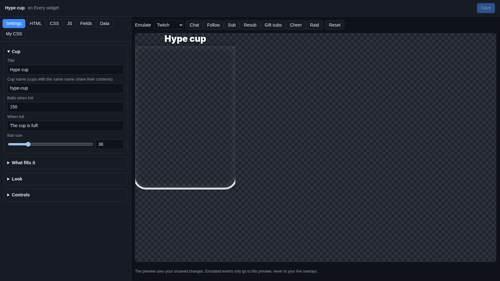
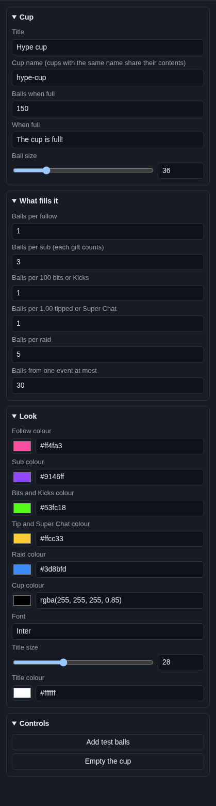

# Hype cup

The **Hype cup** is a glass that fills up with coloured balls. Every follow, sub, cheer, tip and raid drops balls into
it, each kind in its own colour. Viewers can watch the cup fill up during the stream, until it says "The cup is full!".

## Where the balls come from

The same events as your [alerts](../alerts.md), from every platform and tip service: follows, subs and gift subs,
bits, Kicks, tips, Super Chats, charity donations, merch and raids.

The cup remembers what is in it, under the **Cup name**. Reloading OBS or restarting your computer keeps the balls. It
only empties when you click **Empty the cup**.

## Add it and size it

Click **Add Cuebot widget > Hype cup** on your overlay's row (or **+ Add > Hype cup** in the
[designer](../overlay-designer.md)). It goes in the bottom right, 320 × 500 pixels on a 1920 × 1080 canvas: a tall
glass. Change the size and the cup changes shape with it.

## Settings

Click **Edit…** on the widget's row.

### Cup

| Setting | What it does |
| --- | --- |
| **Title** | The words above the cup, like `Hype cup`. |
| **Cup name (cups with the same name share their contents)** | The name the balls are saved under. Two hype cups with the same name (on two overlays) hold the same balls. A new name is a new, empty cup. |
| **Balls when full** | How many balls fill the cup (10 to 400). When it is full, no more balls go in, and the title shows the **When full** text. |
| **When full** | The title once the cup is full, like `The cup is full!`. It gently pulses. |
| **Ball size** | In pixels. Bigger balls fill the glass sooner, so match it to **Balls when full** and the widget size. |

### What fills it

| Setting | What it does |
| --- | --- |
| **Balls per follow** | 1 at first. |
| **Balls per sub (each gift counts)** | 3 at first. A gift of 5 subs drops 5 × 3 balls. |
| **Balls per 100 bits or Kicks** | 1 at first. 500 bits drop 5 balls. |
| **Balls per 1.00 tipped or Super Chat** | 1 at first. A $10 tip drops 10 balls. Charity donations and merch count the same way. |
| **Balls per raid** | 5 at first, whatever the raid size. |
| **Balls from one event at most** | So one huge tip does not fill the whole cup (30 at first). |

0 means that kind of event drops no balls.

### Look

| Setting | What it does |
| --- | --- |
| **Follow colour**, **Sub colour**, **Bits and Kicks colour**, **Tip and Super Chat colour**, **Raid colour** | The colour of each kind of ball. |
| **Cup colour** | The colour of the glass outline. |
| **Font**, **Title size**, **Title colour** | The title's font (a [Google Font](https://fonts.google.com) name), size (0 hides it) and colour. |

### Controls

| Button | What it does |
| --- | --- |
| **Add test balls** | Drops 4 balls of each kind. |
| **Empty the cup** | Takes every ball out. |

!!! warning "The test buttons change the real cup"
    The cup is saved under its **Cup name**, and the preview uses the same saved cup as your overlay. So **Add test
    balls** and the **Emulate** buttons really add balls, and **Empty the cup** really empties it. Your overlay in OBS
    shows the change the next time it loads (for example when you click **Save**). After testing, click **Empty the
    cup** if you want to start the stream with an empty cup.

## Try it

Click **Add test balls**, or pick a platform next to **Emulate** and click **Follow**, **Sub**, **Cheer** or **Raid**.
Then click **Empty the cup** (see the warning above).

## Ideas

- **A cup per stream:** click **Empty the cup** in the editor before you go live, then **Save**.
- **A subs-only cup:** set every **What fills it** number to 0 except **Balls per sub**, and **Balls when full** to the
  number of subs you want × 3.
- **A bigger celebration:** put the [Emote rain](emote-rain.md) on the same overlay, so every ball comes with a shower
  of emotes.

## Troubleshooting

- **Balls stopped coming.** The cup is full. Click **Empty the cup**.
- **The cup is full after testing.** The test buttons fill the real cup. Click **Empty the cup** and **Save**.
- **Two cups fill together.** They have the same **Cup name**. Give each its own.
- **Balls arrive late.** Overlay alerts may be paused; the cup waits with them.
