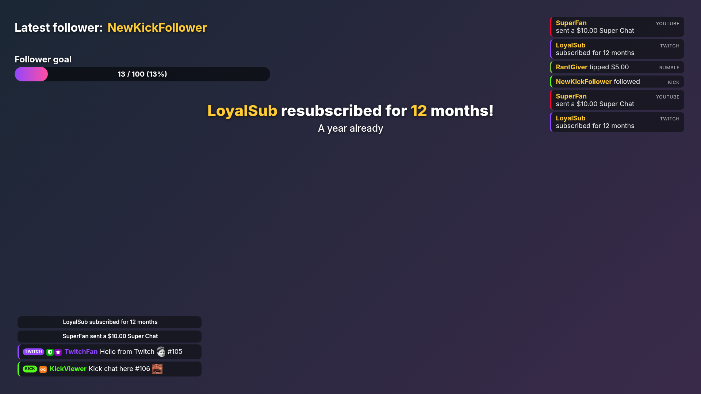
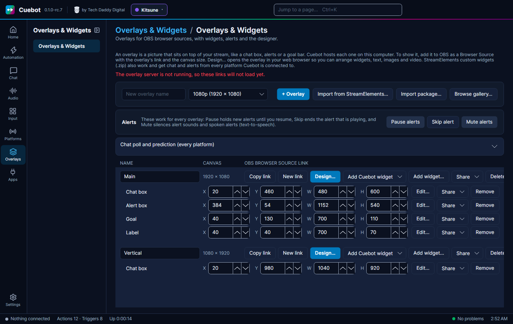

# Widgets

A **widget** is one piece of an overlay: a chat box, a goal bar, a countdown, snow falling over your stream. Think of
your [overlay](../overlays.md) as a see-through sheet on top of your stream, and widgets as the stickers you put on it.
Each widget does one job, and you can move it, resize it and change how it looks.

Cuebot comes with ready-made widgets. You do not need to write any code to use them: you pick one, place it, and change
its settings in a form. They work with every platform you connected (Twitch, YouTube, Kick, Rumble) and with your tip
and shop services.

## Add a widget

You need an overlay first. If you do not have one, see [Overlays](../overlays.md).

**From the Overlays page:**

1. Go to **Overlays > Overlays & Widgets**.
2. On your overlay's row, click **Add Cuebot widget**.
3. Pick a widget from the list. Cuebot adds it in a good spot for that kind of widget, sized to your canvas.
4. The widget now has its own row under the overlay, with **X**, **Y**, **W** and **H** boxes. **X** and **Y** are
   how far it is from the left and top edges, **W** and **H** are its width and height, all in pixels (the tiny dots
   your screen is made of).

**From the designer:**

1. On your overlay's row, click **Design…**. The overlay opens in your web browser.
2. Click **+ Add** in the toolbar and pick the widget.
3. Drag it where you want it, and drag its corners to resize it. See [The overlay designer](../overlay-designer.md).

**Remove** on a widget's row takes it off the overlay. The widget stays in your widget library, so you can put it back
later with its settings.

## Change a widget's settings

1. Click **Edit…** on the widget's row (or select it in the designer and click **Edit widget…**).
2. The **widget editor** opens in your browser. The **Settings** tab on the left has the widget's settings, in groups.
   Click a group's name to open it.
3. The preview on the right shows your changes straight away.
4. Click **Save** (or press Ctrl+S). Overlays that use the widget reload with the new settings.

The **Emulate** row above the preview sends pretend events (a chat message, a follow, a sub, a tip...) to the preview
only. Pick a platform in the list, then click a button. It is the safe way to see how a widget reacts. **Reset**
reloads the preview. More on the editor in [The widget editor](../widget-editor.md).

!!! note "The Overlay server must be running"
    **Edit…** and **Design…** open pages that Cuebot's **Overlay server** serves. If it is off, turn it on at
    **Apps > Servers**, card **Overlay server**.

## Every widget

| Widget | What it does |
| --- | --- |
| [Chat box](chat-box.md) | Your chat from every platform, with badges, emotes and pronouns |
| **Alert box** | Pop-up alerts for follows, subs, tips and more. It has its own designer: see [Alerts](../alerts.md) |
| [Label](label.md) | One line of text, like "Latest follower: Bob" or "Tips this stream: $40" |
| [Goal bar](goal-bar.md) | A bar that fills up towards a goal of followers, subs, tips, bits and more |
| [Event list](event-list.md) | The latest follows, subs, tips, cheers and raids, newest first |
| [Credits roll](credits-roll.md) | End-of-stream credits that scroll up the screen |
| [Top spenders](top-spenders.md) | Who spent the most this stream, today, this week or longer |
| [Subathon timer](subathon-timer.md) | A countdown that subs, bits and tips add time to |
| [Goal ladder](goal-ladder.md) | A points goal with steps, like a new emote at 10 points |
| [Countdown](countdown.md) | Counts down some minutes, or to a time like 20:00 |
| [Emote rain](emote-rain.md) | Emotes from chat fly across the screen |
| [Hype cup](hype-cup.md) | Follows, subs, bits and tips drop coloured balls into a cup |
| [Hype boss](hype-boss.md) | Support hits a "boss"; whoever lands the final hit becomes the next boss |
| [Poll and prediction](poll.md) | Live results of a poll or prediction |
| [Giveaway](giveaway.md) | Your giveaway: the prize, how to enter, and a spinning winner reveal |
| [Media request player](media-player.md) | Plays the YouTube videos viewers asked for in chat |
| [Charity campaign](charity.md) | Progress of a charity drive |
| [Product showcase](product-showcase.md) | Your merch, one product at a time, and who just bought something |
| [Seasonal effects](seasonal-effects.md) | Snow, leaves, hearts, confetti, blossoms, bubbles or stars |
| [Blank custom widget](custom-widget.md) | A widget you write yourself, in HTML, CSS and JavaScript |

## Good to know

- **Built-in widgets are normal widgets.** Their code is in the **HTML**, **CSS** and **JS** tabs of the editor, and
  you can change it. Want a different look without touching code? Put your own CSS in the **My CSS** tab.
- **One widget, many overlays.** A widget lives in your library. If you add the same widget to two overlays, both use
  the same settings.
- **"This stream"** in labels, goal bars and the credits roll means: since you went live. Cuebot starts a new stream
  15 minutes after you went offline on every platform.
- **Paused alerts hold widget events too.** When you pause overlay alerts (with the **Pause, skip or mute overlay
  alerts** sub-action), widgets that react to follows, subs and tips wait as well, and catch up when you resume.
- **Mods can help.** With the [mod portal](../../mods/mod-portal.md), your mods can change widget settings from their
  phone. They never see or change a widget's code.
