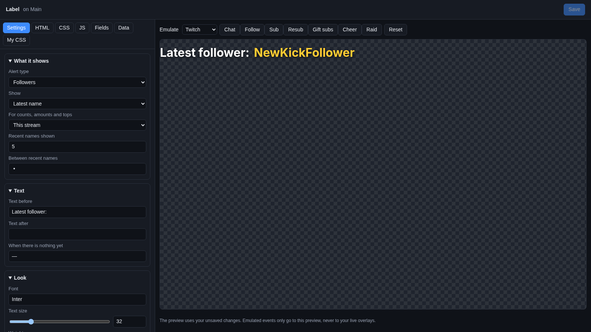
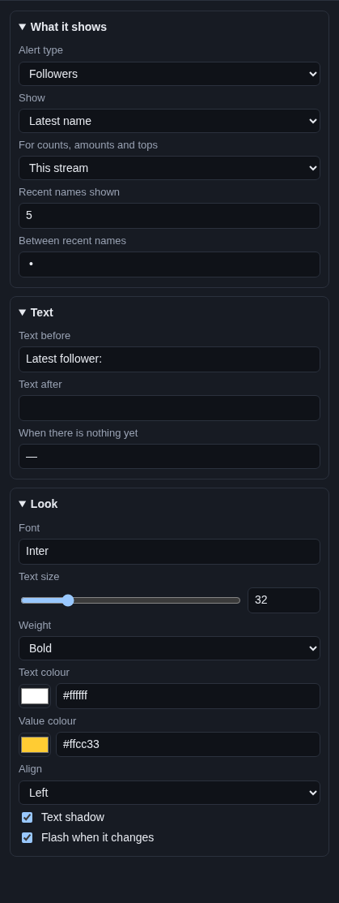

# Label

A **Label** is one line of text that keeps itself up to date. "Latest follower: Bob", "Subs this stream: 12",
"Top tipper: Ann $50.00", or the last five people who raided you. You pick what it counts, and it changes by itself as
things happen on stream.

## Where the numbers come from

Cuebot keeps **stream totals**: every follow, sub, tip, cheer, raid, Super Chat, Kicks gift, Jewel, charity donation,
merch sale and channel point redemption that reaches your [alerts](../alerts.md), from every platform and every tip
service you connected (see [Tips and donations](../../services/tips-and-donations.md)). The label reads those totals.

Totals are kept for **this stream**, **this week**, **this month** and **all time**:

- **This stream** starts over 15 minutes after you went offline on every platform.
- **This week** and **this month** start over with the calendar (weeks start on Monday).
- **All time** never starts over.

## Add it and size it

Click **Add Cuebot widget > Label** on your overlay's row (or **+ Add > Label (latest, totals, top donor)** in the
[designer](../overlay-designer.md)). It goes in the top left, 700 × 70 pixels on a 1920 × 1080 canvas. Make it wider if
your text is long: text that does not fit is cut off.

## Settings

Click **Edit…** on the label's row.

### What it shows

| Setting | What it does |
| --- | --- |
| **Alert type** | What to look at: **Followers**, **Subscribers**, **Tips**, **Cheers (bits)**, **Raids**, **Super Chats**, **Kicks**, **YouTube Jewels**, **Charity donations**, **Merch**, **Channel points**, or **Revenue** (tips, Super Chats, charity and merch added up). |
| **Show** | **Latest name** (the newest one), **Latest name and amount** ("Ann $5.00"), **Count** (how many), **Amount** (money, bits... added up), **Top single donation** (the biggest one), **Top donator (added up)** (who gave the most in total), or **Recent names** (a list). |
| **For counts, amounts and tops** | The period: **This stream**, **This week**, **This month** or **All time**. Latest name and recent names ignore it. |
| **Recent names shown** | How many names **Recent names** lists (1 to 25). |
| **Between recent names** | What goes between the names. A dot with spaces at first. |

### Text

| Setting | What it does |
| --- | --- |
| **Text before** | Words in front of the value, like `Latest follower: `. Leave a space at the end. |
| **Text after** | Words after the value, like ` subs today`. |
| **When there is nothing yet** | What to show before anything happened, like `—` or `Be the first!`. |

### Look

| Setting | What it does |
| --- | --- |
| **Font** | A [Google Font](https://fonts.google.com) name. |
| **Text size** | 10 to 120 pixels. |
| **Weight** | **Regular**, **Semi-bold**, **Bold** or **Black** (thickest). |
| **Text colour** | Colour of the text before and after. |
| **Value colour** | Colour of the value itself (the name or number). |
| **Align** | **Left**, **Centre** or **Right** in the widget's box. |
| **Text shadow** | A soft shadow, so the text is easy to read on a busy game. |
| **Flash when it changes** | A short flash each time the value changes. |

Money is shown in your currency, with the right sign. **Count** and **Amount** are the same for follows, raids and
other things that have no amount.

## Try it

The Emulate buttons send pretend events to the preview, but they do not change your stream totals. So the label does
not change when you click **Follow**. To check your settings, change **When there is nothing yet** and look at the
preview, or wait for a real follow. The preview shows your real totals.

## Ideas

| You want | Set |
| --- | --- |
| "Latest follower: Bob" | **Alert type** Followers, **Show** Latest name, **Text before** `Latest follower: ` |
| "Subs this stream: 12" | **Alert type** Subscribers, **Show** Count, period **This stream**, **Text before** `Subs this stream: ` |
| "Top tipper this month: Ann $50.00" | **Alert type** Tips, **Show** Top donator (added up), period **This month** |
| "Raided by: Ann • Bob • Cy" | **Alert type** Raids, **Show** Recent names, **Recent names shown** `3` |
| "Raised today: $120.00" | **Alert type** Revenue, **Show** Amount, period **This stream** |

Want several values? Add several labels, one per line, and line them up in the designer.

## Troubleshooting

- **It shows the "nothing yet" text.** Nothing of that type has happened in that period. Remember that **This stream**
  started over after your last stream.
- **The count is too low.** Only events that reach Cuebot count. A tip service must be connected (**Apps > Donations**),
  and Cuebot must be running during the stream.
- **Amounts in different currencies.** Cuebot adds amounts as they come, without converting. A $5 tip and a €5 tip
  make 10.
- **The Show alert sub-action does not change it.** That sub-action only plays an alert; it does not add to your
  stream totals.
