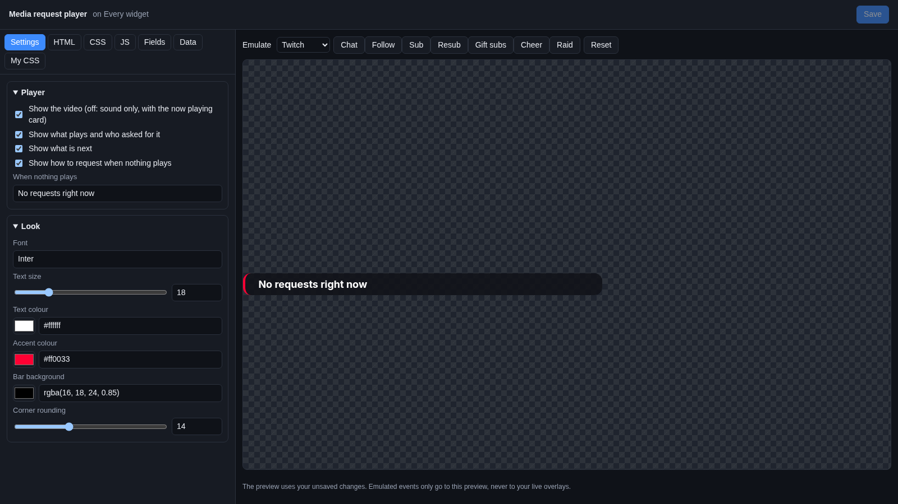
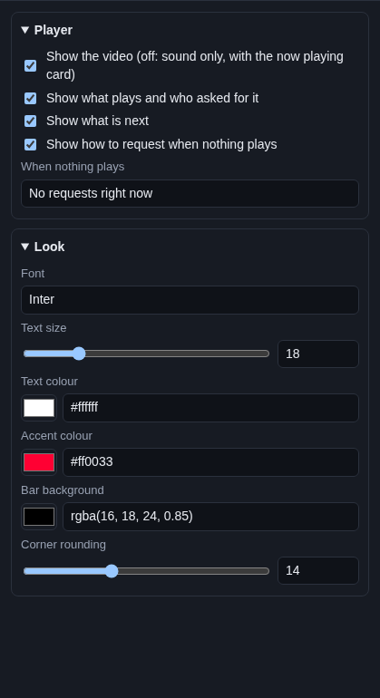

# Media request player

The **Media request player** plays the YouTube videos your viewers ask for in chat, one after another, right on your
stream. A bar under the video says what plays, who asked for it, and what is next.

## Where the videos come from

From Cuebot's media request queue on **Audio > Media Requests**. Viewers on every platform type `!sr` and a YouTube
link; the video joins the queue. You pause, skip, set the volume and turn requests on and off there. See
[Media requests](../../sound/media-requests.md).

This widget is the player: without it, nothing plays. It follows the queue (play, pause, skip, volume), and tells Cuebot
when a video ends, so the next one starts. A video that cannot play (removed, or not allowed in other sites) is
skipped, and the viewer gets their points back. Videos longer than **Longest play** on the Media Requests page stop at
that limit.

## Add it and size it

1. Click **Add Cuebot widget > Media request player** on your overlay's row (or **+ Add > Media request player** in the
   [designer](../overlay-designer.md)).
2. Make sure that overlay is in OBS as a browser source (see [Overlays](../overlays.md)).
3. Go to **Audio > Media Requests** and tick **Taking requests**.

The player goes in the bottom right, 640 × 420 pixels on a 1920 × 1080 canvas. YouTube videos are 16:9, so keep that
shape (like 640 × 360 plus room for the bar).

!!! tip "Hear it in OBS"
    The sound plays inside the OBS browser source. To hear it and send it to your stream, tick **Control audio via
    OBS** in the browser source's properties, then set its volume in the OBS audio mixer.

## Settings

Click **Edit…** on the widget's row.

### Player

| Setting | What it does |
| --- | --- |
| **Show the video (off: sound only, with the now playing card)** | Shows the video. Untick it for music requests: only the bar shows, and the sound still plays. |
| **Show what plays and who asked for it** | "Now playing", the video's title and "asked by Ann". It says "Paused" while paused. |
| **Show what is next** | "Next: (title)  (+3 more)". |
| **Show how to request when nothing plays** | "Type !sr and a YouTube link" while the queue is empty and requests are open. |
| **When nothing plays** | The text in the bar while the queue is empty, like `No requests right now`. |

### Look

| Setting | What it does |
| --- | --- |
| **Font** | A [Google Font](https://fonts.google.com) name. |
| **Text size** | 10 to 48 pixels. |
| **Text colour** | Colour of the text. |
| **Accent colour** | Colour of "Now playing" and the line on the left of the bar. |
| **Bar background** | The box behind the text. |
| **Corner rounding** | How round the video and bar corners are. |

## Try it

The preview shows your real queue. In the preview the player is always muted, and it never moves the queue on, so you
can try settings while a video plays on stream. The Emulate buttons do nothing here.

To check it for real, add a video yourself with **+ Add** on **Audio > Media Requests**, and watch the overlay in OBS.

## Control it from actions

| Sub-action | What it does |
| --- | --- |
| **Add media request** | Adds a video to the queue, for example from a channel point reward. |
| **Control media requests** | **Skip**, **Pause**, **Resume**, **Clear the queue (refunds)**, **Open requests**, **Close requests** or **Set volume**. |

Details are in the [media requests sub-actions](../../../reference/sub-actions/media-requests.md).

## Ideas

- **Music only:** untick **Show the video**. Put the widget along the bottom of the screen, short and wide.
- **A "pause for the boss fight" button:** a Stream Deck button with **Control media requests** set to **Pause**, and
  another set to **Resume**.
- **Requests only during the "Just chatting" part:** **Control media requests** with **Open requests** when you switch
  to that scene, and **Close requests** when you leave it.

## Troubleshooting

- **No sound in OBS.** Tick **Control audio via OBS** on the browser source, and check its slider in the audio mixer.
  Check the **Volume** on **Audio > Media Requests**.
- **The queue does not move on.** The player must be open: the overlay must be in OBS (or open in a browser). Only the
  player in an overlay moves the queue, not the editor preview.
- **The sound plays twice.** The player is open twice, for example in OBS and in a browser tab, or on two overlays.
  Keep one.
- **A video was skipped right away.** YouTube does not allow that video to play in other sites, or it was removed.
  Cuebot skipped it and refunded the viewer.
