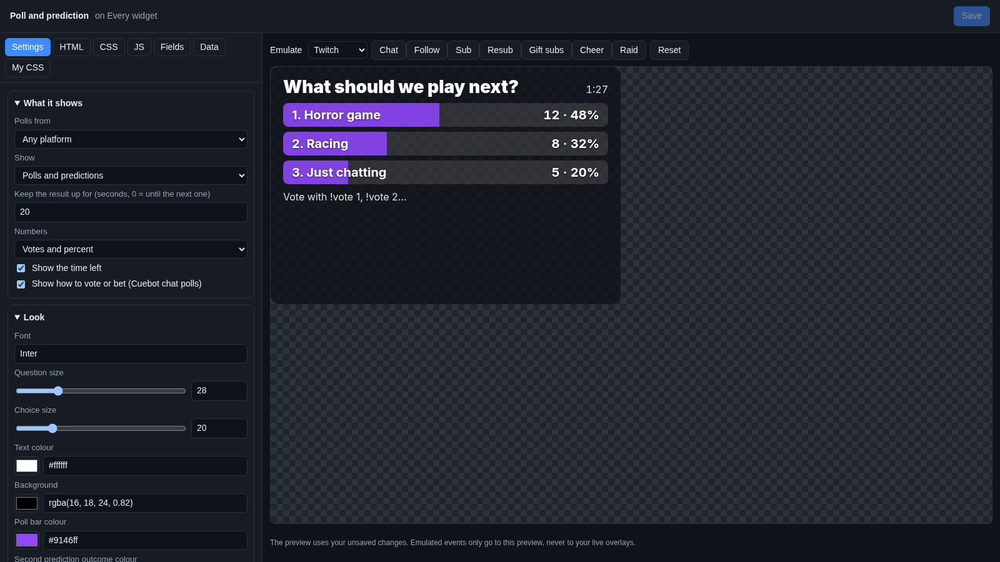
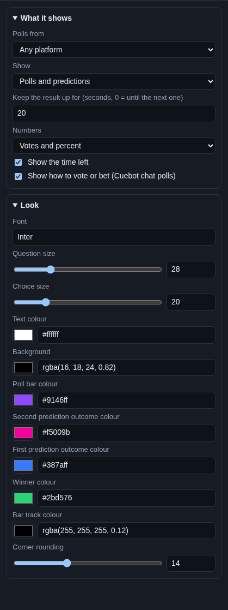

# Poll and prediction

The **Poll and prediction** widget shows a running poll on stream: the question, a bar for each choice that grows as
votes come in, and the time left. When the poll ends, the winning choice lights up. It shows predictions (bets on what
happens) the same way.

## Where the polls come from

| Source | Where you start it |
| --- | --- |
| **Cuebot chat polls and predictions** | **Overlays > Overlays & Widgets**, panel **Chat poll and prediction (every platform)**, or the poll sub-actions. Viewers vote with `!vote 1` on every platform at once, and bet [points](../../chat/points.md) with `!bet 1 500`. |
| **Twitch polls and predictions** | **Platforms > Twitch**, tab **Polls & predictions**, or Twitch itself. |
| **YouTube polls** | YouTube's own live chat polls, started on YouTube or with YouTube's **Create poll** sub-action. |

See [Polls and predictions](../../chat/polls-and-predictions.md) for how to run each one.

The widget shows nothing while no poll runs. It appears when one starts and hides again a while after it ends.

## Add it and size it

Click **Add Cuebot widget > Poll and prediction** on your overlay's row (or **+ Add > Poll and prediction** in the
[designer](../overlay-designer.md)). It goes on the left, in the middle, 560 × 380 pixels on a 1920 × 1080 canvas.
Polls with many choices need a taller widget.

## Settings

Click **Edit…** on the widget's row.

### What it shows

| Setting | What it does |
| --- | --- |
| **Polls from** | **Any platform**, or only **Cuebot chat polls (every platform)**, **Twitch** or **YouTube**. |
| **Show** | **Polls and predictions**, **Polls only** or **Predictions only**. Add the widget twice to show polls and predictions in different spots. |
| **Keep the result up for (seconds, 0 = until the next one)** | After the poll ends, the result stays this long, then the widget hides (20 seconds at first). |
| **Numbers** | Next to each choice: **Votes and percent**, **Votes** (for predictions: the points bet), **Percent**, or **None**. |
| **Show the time left** | A clock while voting is open. |
| **Show how to vote or bet (Cuebot chat polls)** | A line like "Vote with !vote 1, !vote 2…" under the question. Only for Cuebot chat polls, which number their choices. |

Under the question the widget also says **Bets locked** when a prediction is locked, **Winner:** or **Result:** with
the winning choice when it ends, and **Cancelled** when it was cancelled.

### Look

| Setting | What it does |
| --- | --- |
| **Font** | A [Google Font](https://fonts.google.com) name. |
| **Question size**, **Choice size** | Sizes in pixels. |
| **Text colour** | Colour of the text. |
| **Background** | The box behind the poll. |
| **Poll bar colour** | The bars of a poll. |
| **First prediction outcome colour** / **Second prediction outcome colour** | The bars of a prediction (blue and pink at first, like Twitch). |
| **Winner colour** | The bar of the winning choice. |
| **Bar track colour** | The empty part of each bar. |
| **Corner rounding** | How round the box is. |

## Try it

With no poll running, the preview shows a sample poll ("What should we play next?"), so you can set the look. To see
a real one, start a Cuebot chat poll, then click **Reset** in the editor: the preview loads the poll that runs now. The
Emulate buttons do not make polls.

## Control it from actions

| Sub-action | What it does |
| --- | --- |
| **Start chat poll** | Starts a Cuebot chat poll, for example from a `!poll` command or a Stream Deck button. |
| **End chat poll** | Ends it and shows the winner. |
| **Start chat prediction** | Starts a prediction with Cuebot points. |
| **Lock, resolve or cancel chat prediction** | Locks the bets, picks the winning outcome, or cancels and refunds. |

Details are in the [polls sub-actions](../../../reference/sub-actions/polls.md). Twitch's own polls and predictions
(**Create poll**, **Create prediction**, **Lock active prediction**...) are on the
[Twitch sub-actions page](../../../reference/sub-actions/twitch.md), and YouTube polls on the
[YouTube sub-actions page](../../../reference/sub-actions/youtube.md).

## Ideas

- **A poll that stays until the next one:** **Keep the result up for** `0`.
- **A quick "which game next?":** an action with a **Command triggered** trigger for `!nextgame` (mods only) and the
  **Start chat poll** sub-action with your games as choices. The widget pops up on its own.
- **Only Cuebot polls:** **Polls from** Cuebot chat polls, so a Twitch poll you run for channel points does not show.

## Troubleshooting

- **The widget is empty.** No poll runs, or the poll that runs does not fit **Polls from** and **Show**. It also hides
  once **Keep the result up for** has passed.
- **A YouTube or Twitch poll does not show.** That platform must be connected in Cuebot (**Platforms**).
- **No "how to vote" line.** It only shows for Cuebot chat polls while voting is open.
