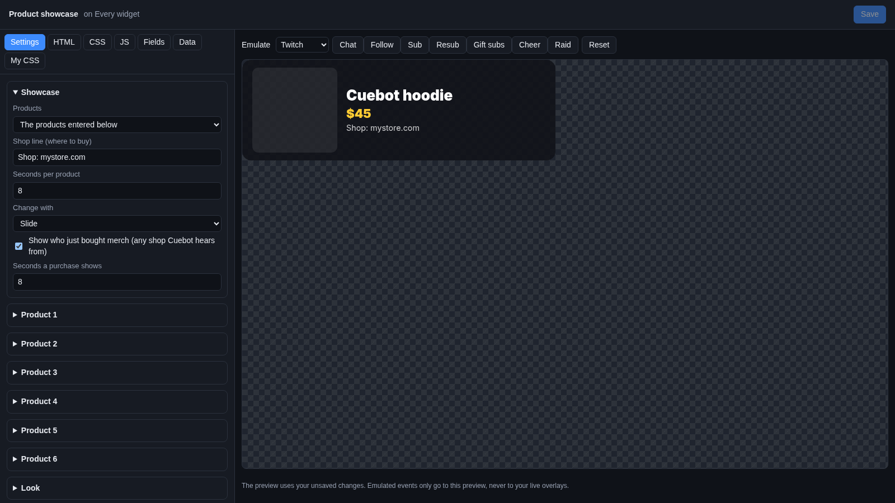
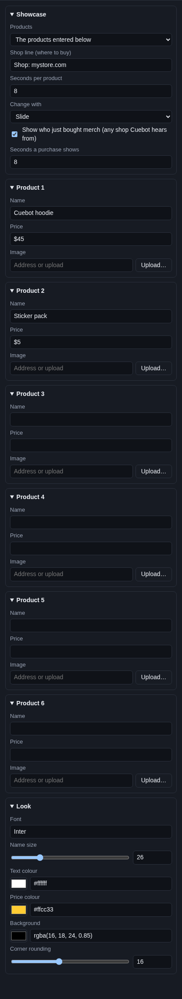

# Product showcase

The **Product showcase** is a little shop window on your stream. It shows one product at a time (a picture, the name
and the price) with a line like "Shop: mystore.com", and changes to the next product every few seconds. When someone
buys merch, a banner says "Ann just bought a hoodie!".

## Where the products come from

You pick in **Products**:

- **The products entered below**: up to 6 products you type in yourself. Works for any shop.
- **My Fourthwall shop**: the products Cuebot reads from your Fourthwall shop, with "Sold out" where they are. You need
  the Fourthwall API connected on **Apps > Webhooks** (see [Fourthwall](../../services/fourthwall.md#products-widget)).
- **My Shopify store**: the products Cuebot reads from your Shopify store, the same way (see
  [Shopify](../../services/shopify.md#products-widget)).

The purchase banner shows every merch sale Cuebot hears about: StreamElements and Streamlabs merch, Fourthwall,
Shopify and Ko-fi shop orders.

!!! warning "Experimental"
    Reading products from Fourthwall and Shopify has not been tried with a real shop yet. See
    [What's experimental](../../help/experimental.md). Typing your products in yourself works without it.

## Add it and size it

Click **Add Cuebot widget > Product showcase** on your overlay's row (or **+ Add > Product showcase** in the
[designer](../overlay-designer.md)). It goes in the bottom left, 560 × 180 pixels on a 1920 × 1080 canvas. The
picture is square and as tall as the widget, so a taller widget means a bigger picture.

## Settings

Click **Edit…** on the widget's row.

### Showcase

| Setting | What it does |
| --- | --- |
| **Products** | Where the products come from (see above). |
| **Shop line (where to buy)** | The small line under the price, like `Shop: mystore.com`. Empty: no line. |
| **Seconds per product** | How long each product shows before the next (2 to 120). |
| **Change with** | **Slide**, **Fade** or **No animation**. |
| **Show who just bought merch (any shop Cuebot hears from)** | The purchase banner. |
| **Seconds a purchase shows** | How long the banner stays. |

### Product 1 to Product 6

Only used when **Products** is **The products entered below**.

| Setting | What it does |
| --- | --- |
| **Name** | The product's name. A product with no name is left out. |
| **Price** | Any text, like `$45` or `From €20`. |
| **Image** | A picture: paste a web address, or click **Upload…** to pick a file from your computer. |

### Look

| Setting | What it does |
| --- | --- |
| **Font** | A [Google Font](https://fonts.google.com) name. |
| **Name size** | Size of the name in pixels. The price and shop line scale with it. |
| **Text colour** | Colour of the name and shop line. |
| **Price colour** | Colour of the price. |
| **Background** | The box behind the product. |
| **Corner rounding** | How round the box and picture are. |

## Try it

Fill in a product or two and watch the preview change. For the purchase banner, pick **Donations** next to **Emulate**
and click **Merch**, or pick **Shopify** and click **Order**.

## Ideas

- **Your three best sellers:** type them into Product 1 to 3, with pictures, and set **Seconds per product** to `10`.
- **Only the purchase banner:** give no product a name. Only the banner shows, when someone buys.
- **A merch goal next to it:** add a [Goal bar](goal-bar.md) with **Counts** set to **Merch** or **Shopify merch goal**.

## Troubleshooting

- **Nothing shows.** No product has a name, or the shop has no products Cuebot could read. For Fourthwall and Shopify,
  check the API is connected on **Apps > Webhooks**, and click **Refresh products** there.
- **No picture.** The image address is wrong or not public. Use **Upload…**.
- **No purchase banner.** **Show who just bought merch** is unticked, or the shop is not connected to Cuebot.
