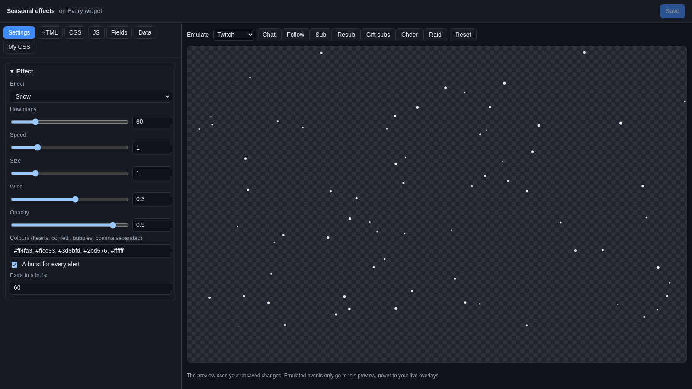
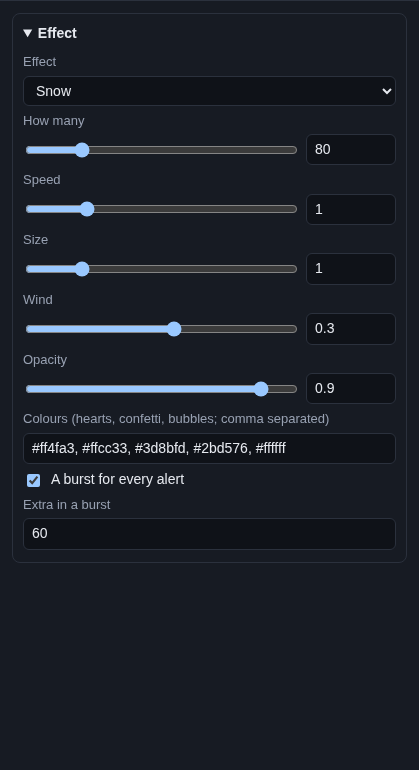

# Seasonal effects

**Seasonal effects** put weather and decorations over your stream: falling snow, autumn leaves, rising hearts,
confetti, cherry blossoms, bubbles or twinkling stars. With every alert, a burst of extra pieces joins in.

## Where it comes from

The effect runs on its own: nothing to connect. Only the bursts react to your stream: every follow, sub, tip, cheer,
raid and other alert (the same events as your [alerts](../alerts.md)) adds a burst.

## Add it and size it

Click **Add Cuebot widget > Seasonal effects** on your overlay's row (or **+ Add > Seasonal effects** in the
[designer](../overlay-designer.md)). It covers the whole canvas. Make it smaller to keep the effect in one part of the
screen, like only over your game.

## Settings

Click **Edit…** on the widget's row.

### Effect

| Setting | What it does |
| --- | --- |
| **Effect** | **Snow**, **Autumn leaves**, **Hearts** (float up), **Confetti**, **Cherry blossoms**, **Bubbles** (float up) or **Twinkling stars** (stay in place and twinkle). |
| **How many** | How many pieces are on screen at once (5 to 400, 80 at first). |
| **Speed** | How fast they move. 1 is normal, 0.5 is half speed, 2 is double. |
| **Size** | How big they are. 1 is normal. |
| **Wind** | Blows them sideways. Positive to the right, negative to the left, 0 straight down. |
| **Opacity** | How solid they are, from 0.1 (almost see-through) to 1 (solid). |
| **Colours (hearts, confetti, bubbles; comma separated)** | The colours to pick from, like `#ff4fa3, #ffcc33`. Only hearts, confetti and bubbles use them; snow is white, and leaves, blossoms and stars have their own colours. |
| **A burst for every alert** | Every alert adds extra pieces for a moment. |
| **Extra in a burst** | How many extra pieces one alert adds (60 at first). They leave again as they fall off the screen. |

## Try it

Change **Effect** and watch the preview. To see a burst, pick a platform next to **Emulate** and click **Follow** or
**Sub**.

## Ideas

| Season | Set |
| --- | --- |
| Winter | **Snow**, **How many** `150`, **Wind** `0.5` |
| Autumn | **Autumn leaves**, **How many** `40`, **Speed** `0.8` |
| Valentine's Day | **Hearts**, **Colours** `#ff4fa3, #ff0033, #ffffff` |
| Spring | **Cherry blossoms**, **How many** `60`, **Wind** `1` |
| A celebration | **Confetti**, **Extra in a burst** `150` |
| A calm night stream | **Twinkling stars**, **How many** `120`, **Opacity** `0.6`, **A burst for every alert** off |

Put the widget on the overlay of one scene only (like "Just chatting") if you do not want it over your game.

## Troubleshooting

- **The stream looks busy or OBS is slow.** Lower **How many** and **Extra in a burst**.
- **My colours do nothing.** Only hearts, confetti and bubbles use **Colours**.
- **Nothing moves with Twinkling stars.** Stars stay in place on purpose and only twinkle.
