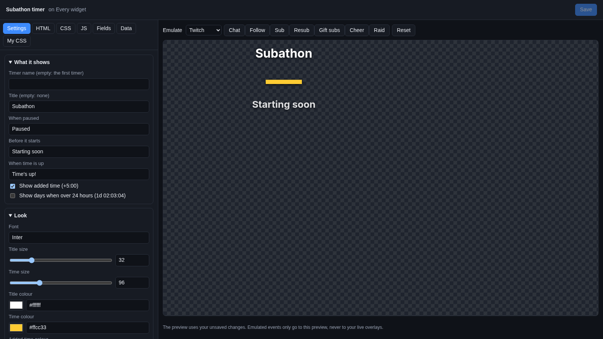
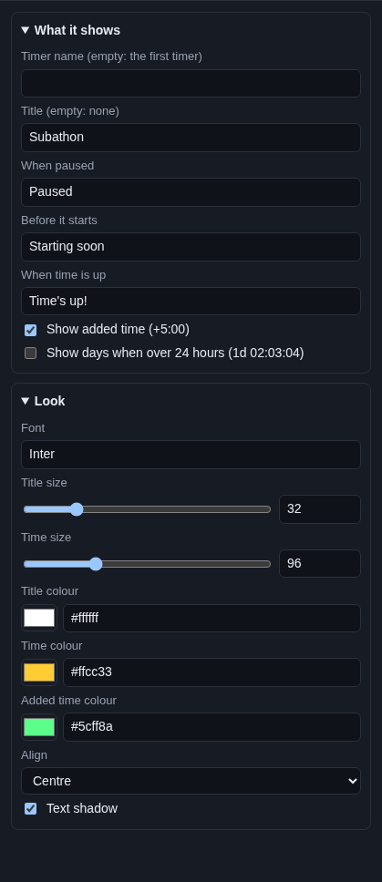

# Subathon timer

The **Subathon timer** shows a big clock that counts down. Every sub, bit, tip or other event adds time, and a little
`+5:00` floats up when it does. When the clock reaches zero, the subathon is over.

## Where the time comes from

The widget shows a timer you made on **Chat > Subathon & Goals**, tab **Timers**. That is where you set how much time
each event adds, and where you start, pause and reset it. See [Subathon timers](../../services/subathon-timers.md).

The widget only shows the timer; it does not count anything itself. So you can show the same timer on several
overlays, and reloading OBS never loses time.

## Add it and size it

1. Make a timer first, on **Chat > Subathon & Goals**, tab **Timers**.
2. Click **Add Cuebot widget > Subathon timer** on your overlay's row (or **+ Add > Subathon timer** in the
   [designer](../overlay-designer.md)).

It goes at the top in the middle, 640 × 200 pixels on a 1920 × 1080 canvas. With **Time size** above 96, make it
bigger.

## Settings

Click **Edit…** on the widget's row.

### What it shows

| Setting | What it does |
| --- | --- |
| **Timer name (empty: the first timer)** | Which timer to show, by its name on **Chat > Subathon & Goals**. Capitals do not matter. Empty: the first timer in the list. |
| **Title (empty: none)** | The words above the clock, like `Subathon`. |
| **When paused** | The line under the clock while the timer is paused, like `Paused`. |
| **Before it starts** | The line under the clock before you start it, like `Starting soon`. |
| **When time is up** | What replaces the clock when it reaches zero, like `Time's up!`. |
| **Show added time (+5:00)** | A `+5:00` that floats up each time time is added. |
| **Show days when over 24 hours (1d 02:03:04)** | Over a day left, show `1d 02:03:04` instead of `26:03:04`. |

### Look

| Setting | What it does |
| --- | --- |
| **Font** | A [Google Font](https://fonts.google.com) name. |
| **Title size** | 10 to 120 pixels. |
| **Time size** | 16 to 300 pixels. |
| **Title colour** | Colour of the title and the line under the clock. |
| **Time colour** | Colour of the clock. |
| **Added time colour** | Colour of the floating `+5:00`. |
| **Align** | **Left**, **Centre** or **Right**. |
| **Text shadow** | A soft shadow for busy backgrounds. |

## Try it

The preview shows your real timer as it was when the preview loaded. The Emulate buttons do not add time (they only go
to the preview). To check the look with a different time, change the timer on **Chat > Subathon & Goals** (**Add**,
**Set time left**, **Start**, **Pause**), then click **Reset** in the editor to reload the preview.

To see the `+5:00` pop up, open the overlay itself: on its row, click **Copy link** and paste the link in your browser.
Then click **Add** on **Chat > Subathon & Goals**.

## Control it from actions

| Sub-action | What it does |
| --- | --- |
| **Start, pause or reset a subathon timer** | Start the subathon from a Stream Deck button or a `!start` command. |
| **Add time to a subathon timer** | Add time for anything, like a channel point reward. |
| **Set a subathon timer's time left** | Put the clock at an exact time. |
| **Set a subathon timer's multiplier** | Double time for an hour, for example. |
| **Get a subathon timer** | Read the time left, for a `!timer` chat command. |

Details are in the [subathon timer sub-actions](../../../reference/sub-actions/subathon-timer.md).

## Ideas

- **Two timers:** make timers called `Main` and `Sleep` and add the widget twice, with **Timer name** `Main` and
  `Sleep`.
- **A clean ending:** set **When time is up** to `GG! Thank you all`.
- **A chat countdown:** a `!timer` command with **Get a subathon timer**, then **Send chat message** with
  `%subathonFormatted% left!`.

## Troubleshooting

- **It shows a dash (—).** No timer has that name, or you have no timer yet. Check **Timer name** against **Chat >
  Subathon & Goals**, or leave it empty.
- **It says "Starting soon" and does not move.** The timer is not started. Start it on **Chat > Subathon & Goals** or
  with the **Start, pause or reset a subathon timer** sub-action.
- **Events do not add time.** That is set on the timer, not the widget. See
  [Subathon timers](../../services/subathon-timers.md).
