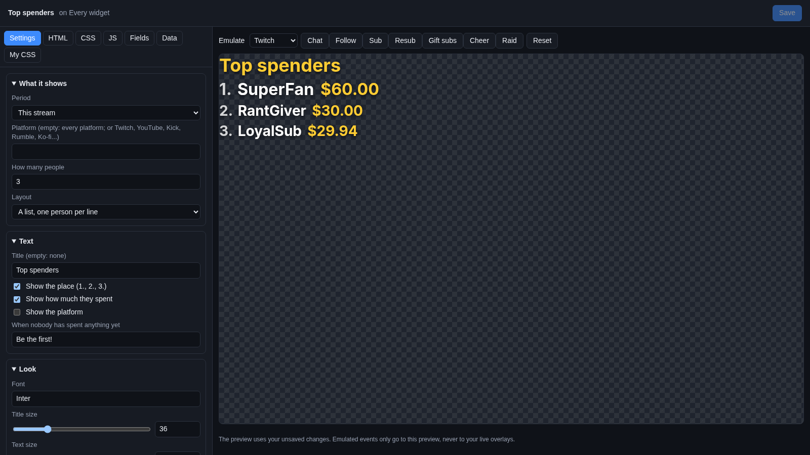
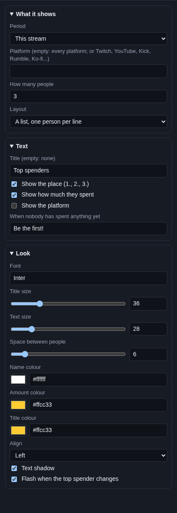

# Top spenders

The **Top spenders** widget is a little leaderboard of the viewers who supported you the most: "1. Ann $50.00,
2. Bob $25.00, 3. Cy $10.00". It is a thank-you that also makes people want to climb the list.

## Where the list comes from

The widget shows Cuebot's [Top spenders](../../chat/top-spenders.md) list (**Chat > Top Spenders**). That page adds up
bits, subs and gift subs, Super Chats, Jewels, memberships, Kicks, rants, tips and merch from every platform and tip
service, in your own currency. Everything you set there counts here too: your **Currency**, what bits and subs are
worth, the **Never list**, and whether charity donations count.

The widget changes by itself when someone spends something.

## Add it and size it

Click **Add Cuebot widget > Top spenders** on your overlay's row (or **+ Add > Top spenders** in the
[designer](../overlay-designer.md)). It goes on the left, 520 × 260 pixels on a 1920 × 1080 canvas. Make it taller if
you show more than 3 people, or wide and short if you use **Everyone on one line**.

## Settings

Click **Edit…** on the widget's row.

### What it shows

| Setting | What it does |
| --- | --- |
| **Period** | **This stream**, **Today**, **This week**, **This month**, **This year** or **All time**. When a week starts is set on **Chat > Top Spenders**. |
| **Platform** | Empty for every platform together. Or one platform's name, like `Twitch`, `YouTube`, `Kick`, `Rumble` or `Ko-fi`. Capitals do not matter. |
| **How many people** | 1 to 10 (3 at first). |
| **Layout** | **A list, one person per line**, or **Everyone on one line** (good for a bar along the bottom). |

### Text

| Setting | What it does |
| --- | --- |
| **Title (empty: none)** | The heading, like `Top spenders`. |
| **Show the place (1., 2., 3.)** | The number in front of each name. |
| **Show how much they spent** | The amount, in your currency. |
| **Show the platform** | Where each person spent it. Useful when **Platform** is empty. |
| **When nobody has spent anything yet** | The line shown before anyone spent anything in that period, like `Be the first!`. |

### Look

| Setting | What it does |
| --- | --- |
| **Font** | A [Google Font](https://fonts.google.com) name. |
| **Title size**, **Text size** | Sizes in pixels. |
| **Space between people** | The gap between lines, in pixels. |
| **Name colour**, **Amount colour**, **Title colour** | The three text colours. |
| **Align** | **Left**, **Centre** or **Right**. |
| **Text shadow** | A soft shadow for busy backgrounds. |
| **Flash when the top spender changes** | A short flash when someone new takes first place. |

## Try it

The preview shows your real list. The Emulate buttons do not add to it: test and sample events are never counted as
spending. To see a full list, pick **All time** for a moment.

## Ideas

- **This stream's heroes:** **Period** This stream, **How many people** `3`, **Title** `Today's heroes`.
- **A ticker along the bottom:** **Layout** Everyone on one line, **How many people** `5`, a wide and short widget.
- **One per platform:** add the widget three times with **Platform** `Twitch`, `YouTube` and `Kick`.
- **A chat command and an alert:** the **Get top spenders** sub-action and the **New top spender this stream** trigger
  work with the same list. See [Top spenders](../../chat/top-spenders.md) and the
  [spending sub-actions](../../../reference/sub-actions/spending.md).
- **Start a new stream by hand:** the **Start a new stream for top spenders** sub-action (or **Start a new stream now**
  on **Chat > Top Spenders**) empties **This stream**.

## Troubleshooting

- **It shows the "nobody yet" line.** Nobody spent anything in that period, or you typed a **Platform** with no
  purchases. Check the spelling, or empty it.
- **Someone is missing.** Their name may be on the **Never list**, or it was a test event. Charity donations only count
  when **Count charity donations** is ticked on **Chat > Top Spenders**.
- **The amounts look wrong.** Check your **Currency** and **What things are worth** on **Chat > Top Spenders**.
