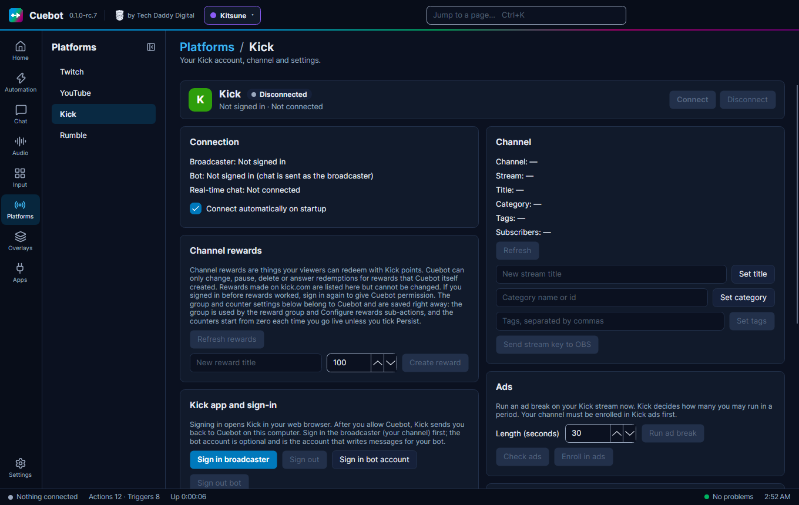
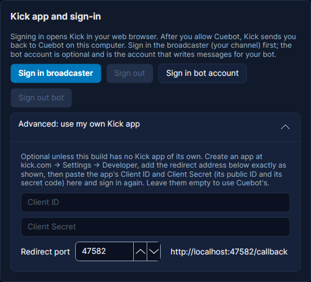
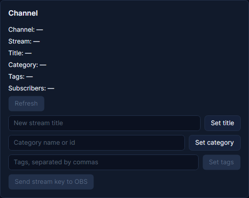
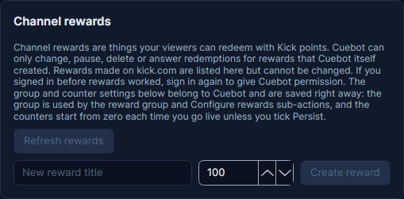
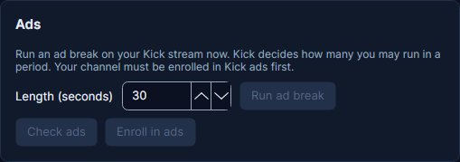

# Kick

This page shows how to sign Cuebot in to Kick, so it can read your chat, see follows and subs, and write messages.

## Signing in

1. Go to **Platforms > Kick**. In your browser, log in to Kick as your streaming account first.
2. Click **Sign in broadcaster**.
3. Approve Cuebot in the browser window that opens.

Cuebot looks up your channel by itself. If kick.com blocks that, the page shows how to copy two numbers from kick.com
into the **Channel id** and **Chatroom id** boxes.

**Bot account:** click **Sign in bot account** (see
[Broadcaster account and bot account](index.md#broadcaster-account-and-bot-account)).

Tick **Connect automatically on startup** so Cuebot connects every time it starts.

If the Kick page says **Sign in again to let Cuebot …**, Cuebot has learned something new (like running ads) that
your old sign-in did not allow. Click **Sign in broadcaster** once more and approve it.

## Your channel and rewards

On the Kick page you can also set your stream title (**Set title**), category (**Set category**) and tags (**Set
tags**, separated by commas), and see how many subscribers you have. Channel rewards: **Create reward** makes a new
one, **Refresh rewards** loads them from Kick. Like on Twitch, Cuebot can only change rewards it made itself; rewards
made on kick.com are listed but cannot be changed.

**Send stream key to OBS** sets OBS to stream to your Kick channel. Cuebot reads your stream address and key from Kick
and puts them straight into OBS's stream settings, so you never have to copy the key. OBS must be connected
(**OBS** page) and not streaming.

## Ads

In the **Ads** box, **Run ad break** starts an ad break of 7 to 90 seconds right now. **Check ads** shows how many ad
breaks you have left; Kick decides how many you may run in a period. Your channel must be enrolled in Kick ads first:
**Enroll in ads** does that once. Actions can do the same with the **Run ad break** and **Get ad status** sub-actions.

## Kick's events

Cuebot hears your Kick chat and most events through the same real-time connection the Kick website uses. Some things,
like KICKs gifts and channel reward redemptions, Kick only sends reliably as its official events. With Cuebot's own
Kick app (the normal case) tick **Receive Kick's official events through Cuebot's relay** in the **Events** box (it
is on by default): Kick sends them to Cuebot's event service, which passes yours, encrypted, only to your Cuebot.
Nothing else is needed. The line under it shows whether it works.

**Also receive chat that way** is off by default: real-time chat already covers chat, and Kick lets Cuebot's app
receive chat this way for only a limited number of channels in total.

If you use your own Kick app (**Advanced**), Kick sends its events to the address you set in that app instead; see
[Webhooks](../services/webhooks.md) for Cuebot's webhook address and tick **Register webhook events for my own
relay**.

## Kick in your actions

Besides chat, moderation and rewards, actions can look things up on Kick: **Get channel info** (any channel, with
your subscriber counts for your own), **Get subscriber count**, **Is a user live?** (handy for shout-outs), **Find live
streams** in a category (handy for picking someone to host), and **Get KICKs leaderboard** (your top gifters this
week, month or of all time). **Set channel tags** changes your tags.

What the **Connect** button, **Connect automatically on startup** and **Sign out** do is the same on every
platform: see [Your platforms](index.md).
