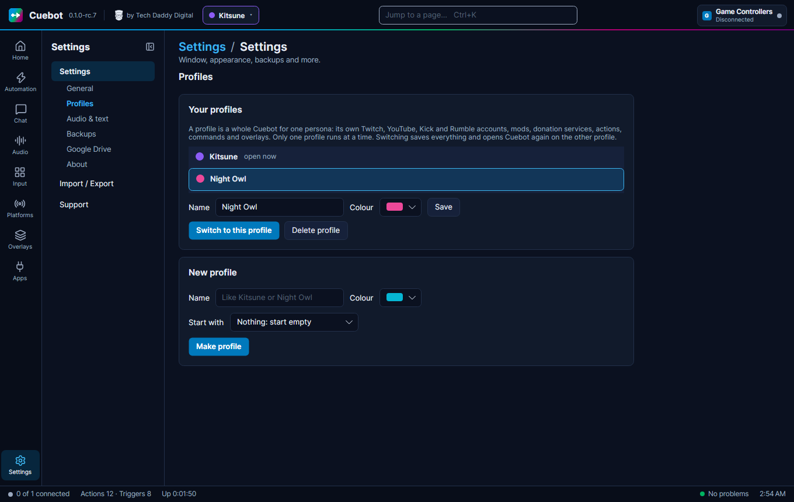
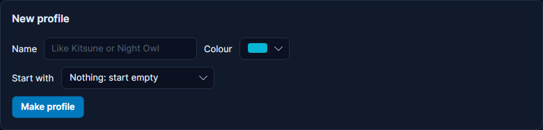
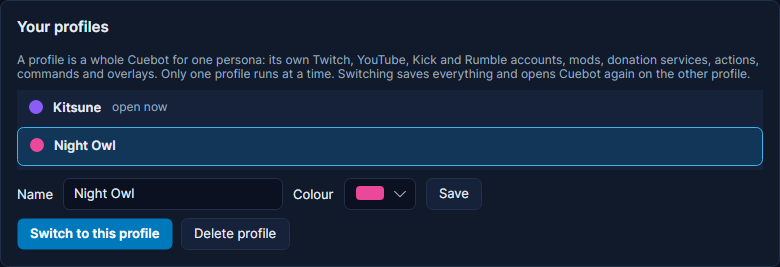

# More than one persona (profiles)

Do you stream as more than one character, each with its own Twitch, YouTube, Kick or Rumble account? Give each one a
**profile**. A profile is a whole Cuebot of its own: its own accounts, mods, donation services, actions, commands,
overlays and viewers. You switch between them in two clicks, and nothing from one persona leaks into the other.

## What a profile keeps

Each profile has its own:

- **Accounts**: Twitch, YouTube, Kick and Rumble, broadcaster and bot.
- **Mods**: the [mod portal](../mods/mod-portal.md), its mods, roles and invites.
- **Services**: [tips and donations](../services/tips-and-donations.md), [webhooks](../services/webhooks.md) like
  Ko-fi, and the [Discord bot](../services/discord-bot.md).
- **Everything you build**: actions, commands, timers, overlays, widgets, decks, hotkeys, voices and variables.
- **Your viewers**: points, quotes, users and groups, top spenders, subathon timers and goals.

All profiles share the things that belong to your computer, not to a persona: the theme and where the window is,
backups, updates, big downloads like Python and voices, and the [servers](../developers/servers.md) (their ports and
the API token). Because the servers are shared, the [phone app](../mods/phone-app.md), OBS docks and other programs
keep working after a switch, with no new pairing.

You start with one profile, called **Main**. If you used Cuebot before profiles came, everything you had is in Main.

## Make a profile

1. Go to **Settings**, tab **Profiles**. (Or click the profile name in the top bar and choose **Manage profiles…**.)
2. Under **New profile**, type a **Name**, like `Night Owl`, and pick a **Colour**. The colour shows next to the name,
   so you can tell at a glance which persona is open.
3. **Start with**: choose **Nothing: start empty**, or **A copy of** another profile. A copy lets you tick the parts
   to bring along:
    - actions, timers, queues and watchers;
    - chat commands;
    - overlays and widgets;
    - decks, hotkeys and controllers;
    - global variables;
    - stream apps and devices (OBS, lights, mixers);
    - voices and voice control.
4. Click **Make profile**.

!!! note "Sign-ins are never copied"
    A copy never takes the sign-ins of Twitch, YouTube, Kick, Rumble, the mod portal, donation services, webhooks or the
    Discord bot. So the new persona can never post as the old one by mistake. Switch to the new profile and sign in to
    its own accounts.

## Switch profiles

Any of these works:

- **The top bar**: click the profile name (with its coloured dot) and choose another profile.
- **The tray icon**: right-click it, choose **Profiles**, then the profile.
- **The jump box**: press ++ctrl+k++ and type the profile's name. It shows as `Profile: Night Owl`. Press ++enter++.
- **Settings > Profiles**: pick the profile and click **Switch to this profile**.
- **A shortcut**: start Cuebot with `--profile "Night Owl"` (see [Command-line options](../help/command-line-options.md)).
  If Cuebot is already running, it switches. Make one desktop shortcut per persona and switching is one double-click.

- **Your phone**: on the phone app's **Dashboard**, the **Profile** card shows the open persona. Tap **Switch** and
  pick another one.
- **An action**: the **Switch profile** step (see below), so a deck button or a chat command can switch.

Switching saves everything, closes Cuebot and opens it again on the other profile, in the same place on your screen. It
takes a few seconds. Cuebot doesn't make a start-up backup when it only switches.

## Not while you are live

Switching persona in the middle of a stream is almost never what you want, so Cuebot checks first. While any platform
says you are live:

- **In Cuebot** (the top bar, the tray, ++ctrl+k++, Settings): a message says you are live. Choose the same profile
  again within 10 seconds to switch anyway.
- **On your phone**: the app asks **Switch anyway?**
- **The Switch profile step** does nothing and fails, unless you tick **Switch even while live**.
- **A shortcut with `--profile`** switches anyway: you asked for that profile on purpose.

## Get each persona's stream ready by itself

Two triggers (see [How actions work](../actions/how-actions-work.md)) make a switch do the setup for you:

- **Profile started** runs every time Cuebot opens on this profile, also right after a switch. Put this persona's
  setup in it: switch the OBS scene collection, load the VTube Studio model, set the stream title. Its variables
  include `%profile%` and `%previousProfile%` (empty when Cuebot just started).
- **Profile stopping** runs just before Cuebot switches away. Cuebot waits for these actions (at most 10 seconds), so
  you can say goodbye in chat or put OBS back. Its variables include `%nextProfile%`.

Each profile has its own actions, so give each persona its own **Profile started** action.

## Switch from an action

The **Switch profile** step opens Cuebot on another profile. Type the profile's **Name** in it. Put it last in its
action: Cuebot runs the **Profile stopping** actions, then closes and opens again. Use it on a
[deck](../apps/decks.md) or [Stream Deck](../apps/stream-deck.md) button, or a hotkey, for one-press switching.

Your [mods](../mods/mod-portal.md) can't use this step: the mod portal never lets mods switch your persona.

## From other programs

Programs that use Cuebot's [REST API](../developers/rest-api.md) can read the profiles with `GET /api/v1/profiles` and
switch with `POST /api/v1/profiles/{id}/activate` (send `"force": true` to switch while live). See the
[REST API reference](../../reference/rest-api.md#profiles).

When you have more than one profile, the window title shows the open one too, like `Cuebot – Night Owl`.

## Only one persona is online at a time

Only the open profile is connected. While **Night Owl** is open:

- **Kitsune**'s chat, events and alerts don't reach Cuebot.
- **Kitsune**'s mods see the mod portal as offline.
- Webhooks for **Kitsune** (Ko-fi, Patreon…) are missed. The relay passes them on but never stores them. Ko-fi and the
  other services keep their own list, so you can look there.

**OBS**: overlay links belong to one profile. Give each persona its own OBS scene collection, with that persona's
overlay links in its browser sources.

## Rename, recolour or delete

On **Settings > Profiles**, pick a profile. Change its **Name** or **Colour** and click **Save**.

**Delete profile** removes a profile with its sign-ins, actions, overlays and everything else. Click it twice to be
sure. You can't delete the open profile: switch to another one first. A [backup](../help/backups.md) made before still
has it.

## Where profiles live

Each profile is a folder inside your [data folder](../help/your-data.md), under `profiles`, like `profiles/night-owl`.
The folder name stays the same when you rename the profile. A [backup](../help/backups.md) holds every profile.
