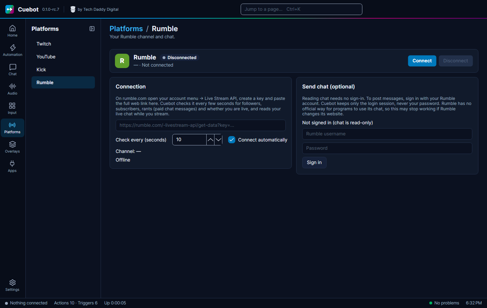

# Rumble

This page shows how to connect Cuebot to your Rumble channel, so it can see followers, subscribers and rants and read
your chat.

Rumble works a little differently. Reading works with a "key link" from Rumble. Writing in chat needs a sign-in.

## Connecting

1. On rumble.com, open your account menu, then **Live Stream API**. Make a key and copy the **whole** web link.
2. In Cuebot go to **Platforms > Rumble** and paste the link into the box. It starts with
   `https://rumble.com/-livestream-api/get-data?key=`.
3. Click **Connect**. Cuebot now sees followers, subscribers, rants (paid chat messages), whether you are live, and your
   chat.
4. **To write in chat (optional):** under **Send chat (optional)**, type your Rumble username and password and click
   **Sign in**. Cuebot keeps only the login session, never your password.

!!! warning
    Rumble has no official way for apps to write in chat. Sending messages may stop working if Rumble changes its
    website. Reading followers, live state and chat was tried with a real Rumble channel; writing in chat is not
    confirmed yet. See [What's experimental](../help/experimental.md).

Tick **Connect automatically** so Cuebot connects every time it starts. **Check every (seconds)** sets how often Cuebot
looks for new followers, subscribers and rants.

**Sign out** and the other buttons work the same as on every platform: see [Your platforms](index.md).
