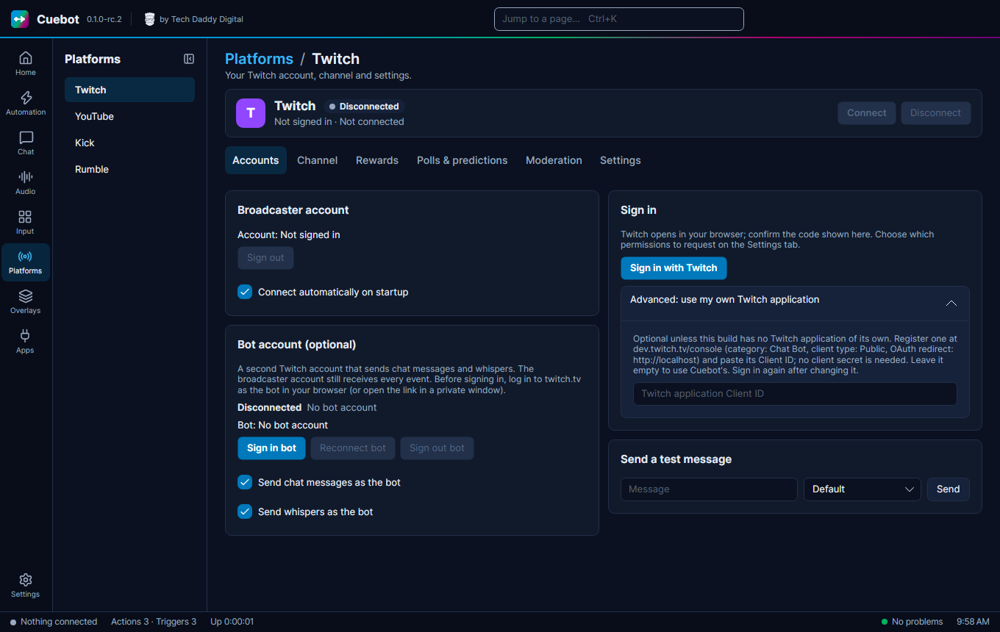
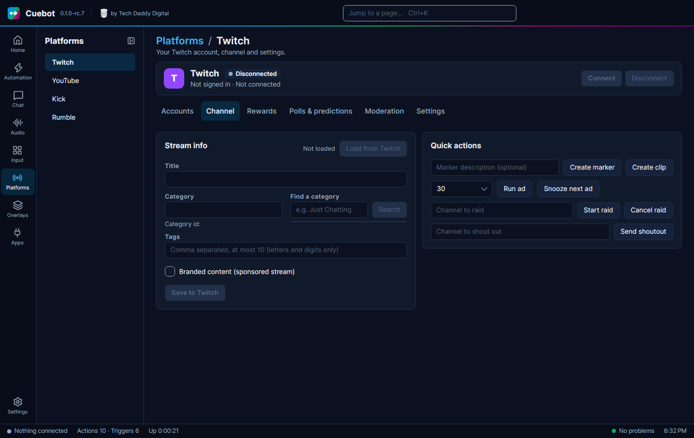
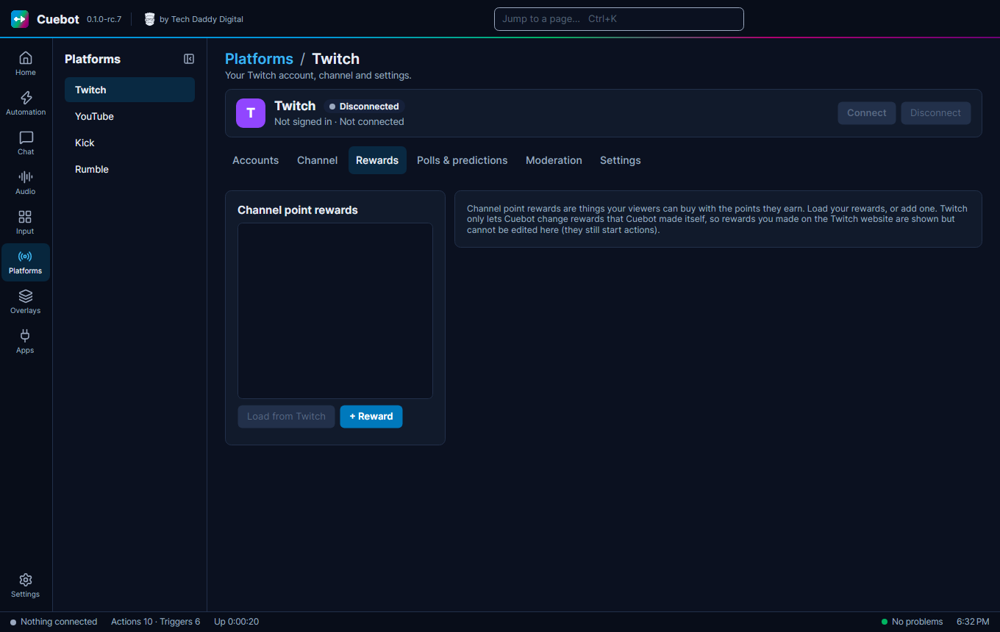
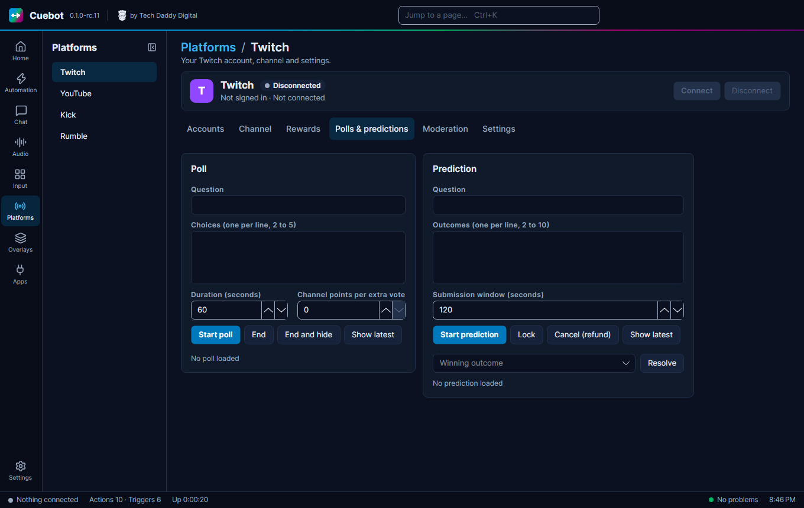
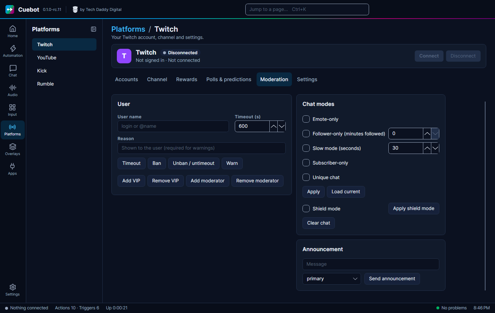
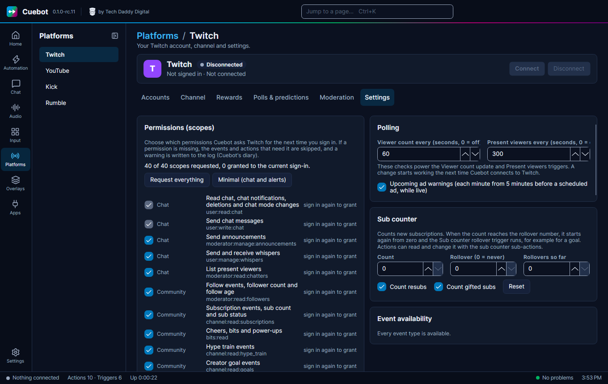

# Twitch

This page shows how to sign Cuebot in to Twitch, and what each tab of the Twitch page does. Once you are signed in,
Cuebot reads your chat, sees follows, subs and raids, and can run your channel for you.

## Signing in

1. Go to **Platforms > Twitch**, tab **Accounts**.
2. Under **Broadcaster account** click **Sign in with Twitch**.
3. Twitch opens in your browser and Cuebot shows a code. Confirm that code on Twitch.
4. Cuebot connects by itself.
5. Tick **Connect automatically on startup**, so Cuebot connects every time it starts.

**Bot account:** under **Bot account (optional)** click **Sign in bot**, then confirm the code while logged in as the
bot (see [Broadcaster account and bot account](index.md#broadcaster-account-and-bot-account)). Tick **Send chat
messages as the bot** and, if you like, **Send whispers as the bot**. Type a message under **Send a test message** and
click **Send** to check it.

**Permissions:** the **Settings** tab lists every permission Cuebot asks Twitch for, under **Permissions (scopes)**. You
can untick ones you do not want. Anything that needs a missing permission is skipped and a warning goes to the log.
Sign in again on the **Accounts** tab after you change the list. Newer Cuebot versions ask for a few more permissions
(AutoMod settings, your stream schedule, blocking users): sign in again once to use those features.

**Staying signed in:** Twitch asks apps to check every hour that a sign-in still works, even while you are not
connected. If Twitch stopped accepting it (you changed your password, or disconnected Cuebot under Twitch's
**Settings > Connections**), the status turns red and asks you to sign in again. When Twitch stops sending one kind of
event (for example because the bot is no longer a moderator), that event is listed under **Event availability** and
the log says why.

## The Twitch page, tab by tab

Once you are signed in, the other tabs let you run your channel from Cuebot, without opening Twitch.

**Channel:** your stream's info, and buttons for things you do while live.

- **Stream info**: click **Load from Twitch** to see your **Title**, **Category** and **Tags**. Change them, then click
  **Save to Twitch**. To pick another category, type part of its name under **Find a category** and click **Search**.
  Tick **Branded content (sponsored stream)** when a company pays you for this stream.
- **Quick actions**:
    - **Create marker** puts a bookmark in your video at this moment (type a note first if you like).
    - **Create clip** saves the last moments as a Twitch clip.
    - **Run ad** starts an ad break; **Snooze next ad** pushes the next planned one back a little.
    - **Start raid** sends your viewers to the channel you typed; **Cancel raid** stops it before it happens.
    - **Send shoutout** shows your viewers a card recommending another channel.

**Rewards:** your channel point rewards. **Load from Twitch** shows them; **+ Reward** makes a new one. Set its
**Title**, **Cost**, **Colour**, **Prompt**, cooldowns and limits, tick **User input required** if viewers type
something with it, or **Skip the request queue** to approve it straight away. **Enabled** and **Paused** switch it on,
off or on hold, and **Delete** removes it. Then **Save to Twitch**. Twitch only lets Cuebot change rewards Cuebot made:
rewards you made on the Twitch website show here as read-only, but they still start your actions.

Cuebot also counts how often each reward was used (**Persist counter** keeps the count after a restart, **Persist
per-user counters** does the same for each viewer's count). A reward's **Group** lets an action switch several rewards
together. These last settings stay in Cuebot and are not sent to Twitch.

**Polls & predictions:** start a Twitch poll or prediction, end it, and pick the winning outcome. See
[Polls and predictions](../chat/polls-and-predictions.md).

**Moderation:** keep your chat friendly.

- Type a **User name**, then **Timeout** (for the number of seconds in **Timeout (s)**), ban (click twice to confirm),
  **Unban / untimeout** or **Warn** them (a warning needs a **Reason**). **Add VIP**, **Remove VIP**, **Add moderator** and
  **Remove moderator** change their badges.
- **Chat modes**: tick **Emote-only**, **Follower-only (minutes followed)**, **Slow mode (seconds)**, **Subscriber-only** or
  **Unique chat** (no copy-paste spam), then press **Apply**. Nothing changes until you do. **Load current** shows what is
  on right now.
- **Shield mode** is Twitch's emergency button against hate raids: tick it and press **Apply shield mode**.
- Clear the whole chat (click twice to confirm), or post a highlighted **Announcement** with **Send announcement**.

**Settings:** the permissions above, plus:

- **Request everything** or **Minimal (chat and alerts)** ticks the permissions for you.
- **Polling**: how often Cuebot checks your viewer count and who is in chat (for the **Viewer count update** and
  **Present viewers** triggers). `0` turns a check off.
- **Upcoming ad warnings**: a trigger every minute from five minutes before a planned ad, while you are live.
- **Watched channels**: other channels whose going live (and offline) runs the **Watched channel went live** and
  **Watched channel went offline** triggers, for example to tell your chat that a friend just started. Tick **Also when
  they change their title or category** for the **Watched channel changed title or category** trigger. Twitch limits
  this to 5 channels, or 3 with title and category changes.
- **Sub counter**: counts new subs. When it reaches **Rollover**, it starts again from zero and the **Sub counter
  rollover** trigger runs, handy for a sub goal. Tick **Count resubs** and **Count gifted subs** to count those too.
- **Event availability** shows which events work with the permissions you have.

**Accounts** also has **Reconnect bot**, for when the bot account lost its connection.

## More Twitch features in actions

Besides the tabs, these work from any action (sub-actions in the **Twitch** group):

- **Clips**: **Create clip** takes a title and a length (5 to 60 seconds). **Clip a past moment** clips something that
  already happened, such as "the last two minutes", from the current or a past broadcast (Twitch needs **Store past
  broadcasts** turned on for your channel).
- **Hype train and goals**: **Get hype train status** tells you whether a train is running, how far it is and your
  record. **Get creator goals** reads your goals.
- **Bits**: **Get bits leaderboard** lists your top cheerers; **Get custom power-ups** lists your custom Power-ups (the
  **Custom power-up redemption** trigger suggests their names too).
- **Moderation**: **Get unban requests** and **Approve or deny an unban request**, **Get ban status**, **Get AutoMod
  settings** and **Set AutoMod level** (for example stricter during a raid), **Block user** and **Unblock user**. The
  **AutoMod message held** trigger now says why: AutoMod's filter, one of your blocked terms, or a link.
- **Schedule**: **Get stream schedule** answers a `!schedule` command; you can also add, cancel or remove scheduled
  streams and turn vacation on or off.
- **Other channels**: **Get videos** (a channel's latest broadcast, handy for shoutouts) and **Search channels**.
- **Shared chat**: **Get shared chat session** tells you whether your chat is shared right now.

New triggers: **Subscription ended**, **Drops gifted to chat**, **Cuebot's message held by AutoMod** and **Cuebot's held
message reviewed** (when AutoMod holds something your bot sent), **AutoMod settings changed**, and the watched channel
triggers above.

Chat messages and announcements are limited to 500 characters by Twitch; a longer one fails with a clear message
instead of being cut off.

What the **Connect** button, **Connect automatically on startup** and **Sign out** do is the same on every
platform: see [Your platforms](index.md).
