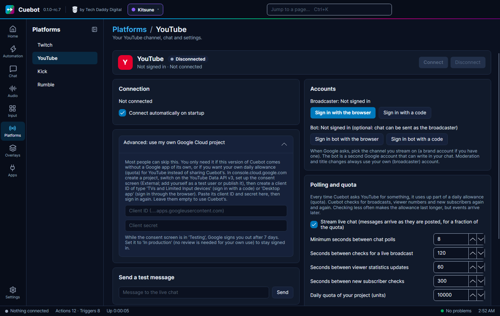
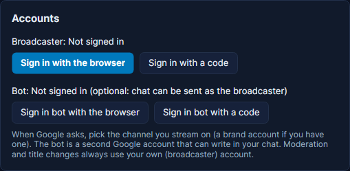
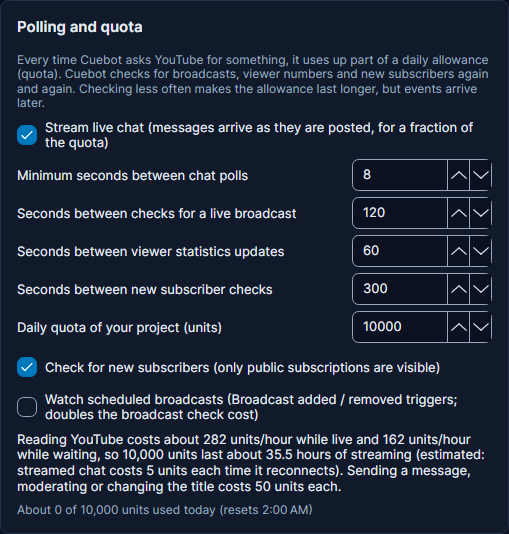

# YouTube

This page shows how to sign Cuebot in to YouTube, so it can read your live chat and see your viewers and subscribers.
It also explains YouTube's daily limit, the quota.

## Signing in

1. Go to **Platforms > YouTube** and click **Sign in with the browser**. (No browser on this computer? Use **Sign in
   with a code**.)
2. Google asks which account to use. Pick the channel you stream on.
3. Allow Cuebot to manage your YouTube account.

!!! note "\"Google hasn't verified this app\""
    While Google is still checking Cuebot, you may see this warning. Click **Advanced**, then **Go to Cuebot**.

Cuebot finds your live stream by itself and reads its chat once you go live. When Cuebot is connected to OBS, it
looks for the stream as soon as OBS starts streaming, and chat sent since the stream started still runs your commands
and alerts. If YouTube briefly stops the chat during a stream, Cuebot starts reading it again by itself. A bot account is optional, with **Sign
in bot with the browser** (or **Sign in bot with a code**). See
[Broadcaster account and bot account](index.md#broadcaster-account-and-bot-account).

Tick **Connect automatically on startup** so Cuebot connects every time it starts.

## Quota: YouTube's daily limit

YouTube gives every app a daily allowance of "units", and every request Cuebot makes uses some. The **Polling and
quota** part of the page shows how much Cuebot expects to use and how much it used today. Checking less often makes the allowance last longer, but events arrive later. A few boxes there change how
much Cuebot uses:

- **Stream live chat** gets chat messages as they are posted, for a small part of the quota.
- **Check for new subscribers** looks for new subscribers. YouTube only shows public subscriptions.
- **Watch scheduled broadcasts** runs the **Broadcast added / removed** triggers, but doubles the cost of checking for
  broadcasts.

If you stream a lot and run out, open **Advanced: use my own Google Cloud project** and follow the steps there. That
gives you your own allowance.

!!! note "Your own Google Cloud project"
    While its consent screen is set to "Testing", Google signs you out after 7 days. Set it to "In production" (no
    review is needed for your own use) to stay signed in.

What the **Connect** button, **Connect automatically on startup** and **Sign out** do is the same on every
platform: see [Your platforms](index.md).
