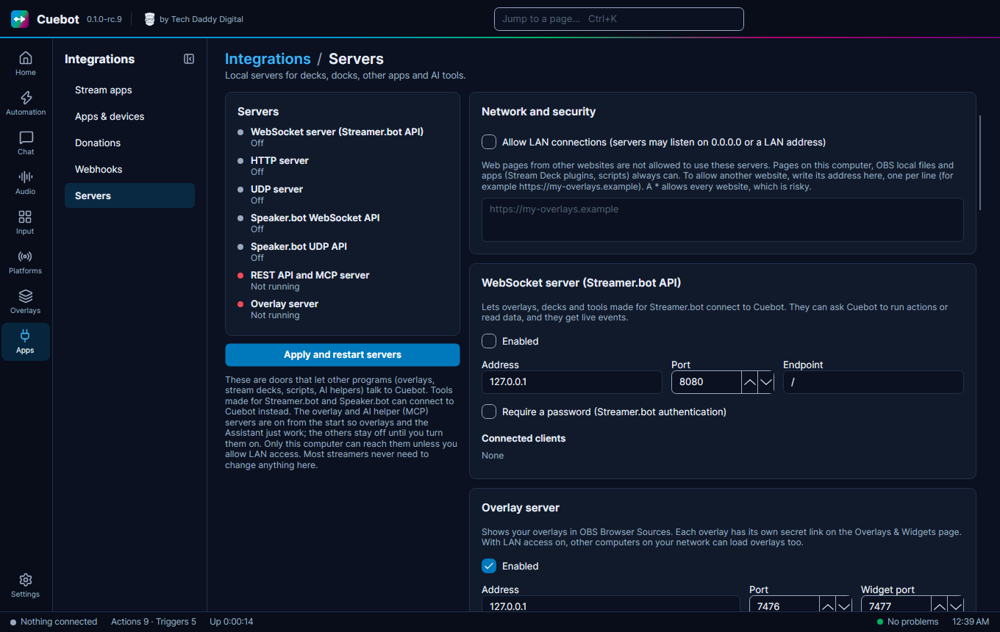
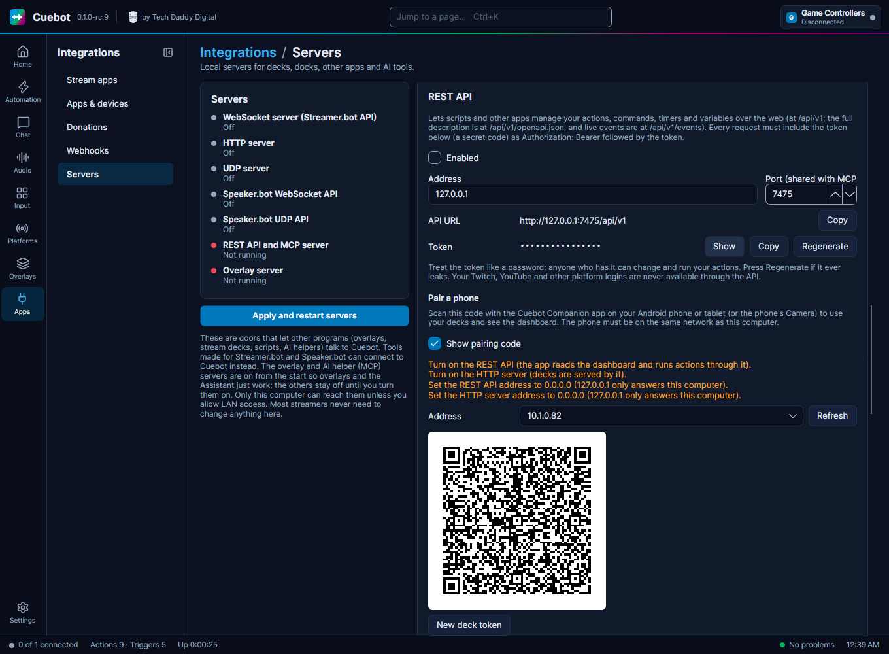

# Cuebot's servers

A **server** is a part of Cuebot that other programs can connect to. Your OBS overlays use one. The Stream Deck
plugin and AI apps use one. Tools made for Streamer.bot or Speaker.bot use one.

Most people only need the **overlay server**, and it is on from the start. Turn the others on only when a guide or a
tool asks for it. Building your own tool? [Controlling Cuebot from other programs](api.md) shows what each server
understands, with examples.

Everything is on **Apps > Servers**.

## Turning a server on

1. Go to **Apps > Servers**.
2. Find the server's card and tick **Enabled**.
3. Click **Apply and restart servers** at the top. Nothing changes until you click it.

The page says "Settings changed: press Apply to restart the servers" while you have changes that are not applied yet.

## The servers, one by one

| Server | What it is for | Door number (port) at the start | On at the start? |
| --- | --- | --- | --- |
| **Overlay server** | Your [overlays](overlays.md) in OBS. Widgets get their own second door (**Widget port**), so a widget cannot reach Cuebot itself. | 7476 (widgets 7477) | Yes |
| **HTTP server** | [Decks](stream-apps-and-devices.md#decks-buttons-on-your-phone), the OBS chat and event docks, your own files, and simple web requests that run actions | 7474 | No |
| **WebSocket server (Streamer.bot API)** | Overlays, decks and tools made for Streamer.bot | 8080 | No |
| **UDP server** | Older tools that send a short "run this action" message | 4242 | No |
| **Speaker.bot API** | Tools made for Speaker.bot, to make Cuebot speak | 7580 (WebSocket), 6669 (UDP) | No |
| **REST API** | The [Stream Deck plugin](stream-deck.md), scripts, and [other Cuebots](#linking-two-cuebots) | 7475 | No |
| **MCP server (AI assistants)** | AI apps on your computer, like Claude Desktop. See [AI tools](assistant.md#using-your-own-ai-app-with-cuebot-mcp). | 7475 (shared with the REST API) | Yes |

**Port** is the door number other programs use. Change it only when another program already uses that number. Then
change it in that other program too.

## Keeping it safe

- Every server only listens on **this computer** (the address `127.0.0.1`). Other devices cannot reach it.
- To let your phone, tablet or a second computer reach Cuebot, tick **Allow LAN connections** under **Network and
  security**. Then set the server's **Address** to `0.0.0.0` (every network) or to this computer's home-network
  address. Only do this on a home network you trust.
- Web pages from other websites are not allowed in. Pages on this computer, OBS local files and apps always are. To
  allow one website, type its address in the box under **Network and security**, one per line, like
  `https://my-overlays.example`. Leave it empty if you do not know you need it.

## HTTP server

- **OBS docks:** the card shows web links for a chat dock and an event dock. Click **Copy**, then in OBS open **Docks >
  Custom Browser Docks** and paste the link.
- **Your own files:** click **+ Folder**. Type a web address part, like `/overlays`, and pick a folder on your computer.
  The files in that folder now open at `http://127.0.0.1:7474/overlays/...`. Handy for your own overlay pages.
- [Decks](stream-apps-and-devices.md#decks-buttons-on-your-phone) need this server.
- **Deck token:** when you tick **Allow LAN connections**, Cuebot makes a secret deck token. Other devices then need
  it to open or press your decks; the deck links on the **Decks** page and the phone pairing code include it, so
  you do not have to type it. Decks opened on this computer, like OBS docks, never need it. **New deck token** (in
  **Pair a phone**) cancels the old one.

## WebSocket server (Streamer.bot API)

Tools and overlays made for Streamer.bot connect here, and work with Cuebot as they did with Streamer.bot. For example
the Warudo [Streamer.bot plugin](vtuber-apps.md#warudo-and-the-streamerbot-plugin).

- Port **8080** and **Endpoint** `/` are what Streamer.bot used, so most tools work without changes.
- **Require a password**: tick it and type a **Password**. The tool must then know the password. With **Require it
  for every request** unticked, the password is only needed for risky things, like running actions or sending chat.
- **Connected clients** shows which tools are connected right now.

## Speaker.bot API

Tick **WebSocket API**, **UDP API** or both. Tools and Streamer.bot setups that used to talk to Speaker.bot can then
make Cuebot speak. See [Text-to-speech](text-to-speech.md).

## REST API and MCP server

The **REST API** is for programs that run actions or read data, like the Stream Deck plugin. They need the **Token**:
a long secret code. **Show** shows it, **Copy** copies it, **Regenerate** makes a new one and the old one stops
working. Anyone who has the token can control your Cuebot, so keep it secret and hide it while you stream.

**Pair a phone:** the [Cuebot Companion app](companion-app.md) for Android (and later iPhone and iPad) connects by
scanning a code. Tick **Show pairing code**,
pick the **Address** of your home network (usually `192.168...`) and scan the code with the app or the phone's
Camera. If something still stops the phone, the card lists what to change first: the REST API and HTTP server on,
**Allow LAN connections** ticked, and both servers listening on `0.0.0.0`. The code holds your token, so keep it
hidden while you stream.

The **MCP server** is for AI apps. Keep **Confirm destructive tools** ticked: then the AI has to ask you before it
deletes, imports or sends a chat message. The card has ready-made setting text for Claude Code, Claude Desktop and other
apps. Click **Copy** and paste it into the AI app. See [AI tools](assistant.md#using-your-own-ai-app-with-cuebot-mcp).

## Your own WebSocket servers and clients

This is for people who build their own tools. Most streamers can skip it.

- **+ Server** adds a WebSocket server of your own. Give it a **Name** and a **Port**. Tick **Start with Cuebot** to
  start it by itself. The triggers **WebSocket › Custom server: message** (and connection opened / closed) run when a
  program talks to it. The step **Custom server: send message** answers.
- **+ Client** makes Cuebot connect to someone else's WebSocket server. Type its address, like `ws://127.0.0.1:9000/`.
  The trigger **WebSocket › Client: message** runs when that server sends something. The step **Client: send message**
  sends to it.

See the [WebSocket triggers](../reference/triggers/websocket.md) and
[WebSocket sub-actions](../reference/sub-actions/websocket.md).

## Linking two Cuebots

Two Cuebots, for example one on your gaming PC and one on your streaming PC, can send each other **signals**. A signal
is a short message with a name, like `go-live`. The other Cuebot can run an action when it arrives.

!!! warning "Experimental"
    Linking was tested with two copies of Cuebot inside Cuebot's own tests, but not yet with two real computers. See
    [What's experimental](experimental.md).

1. On **both** computers, go to **Apps > Servers**, tick **Allow LAN connections**, turn on the **REST API** with its
   **Address** set to `0.0.0.0`, and click **Apply and restart servers**.
2. On the **other** computer, copy the **Token** from the **REST API** card.
3. On **this** computer, under **Remote instances**, click **+ Instance**. Fill in:
    - **Name**: a name for the other Cuebot, like `Gaming PC`;
    - **Host or URL**: the other computer's address on your network, like `192.168.1.20`;
    - **API port**: the port from the other Cuebot's REST API card (7475 at the start);
    - **Its API token**: the token you copied.
4. Click **Connect**. Tick **Connect with Cuebot** to connect by itself next time.
5. In an action, use **Remote › Send remote signal**. On the other Cuebot, use the trigger **Remote › Remote signal
   received**, or the step **Wait for remote signal**.

**This instance's name** is the name the other Cuebots see. Leave it empty to use the computer's name.
