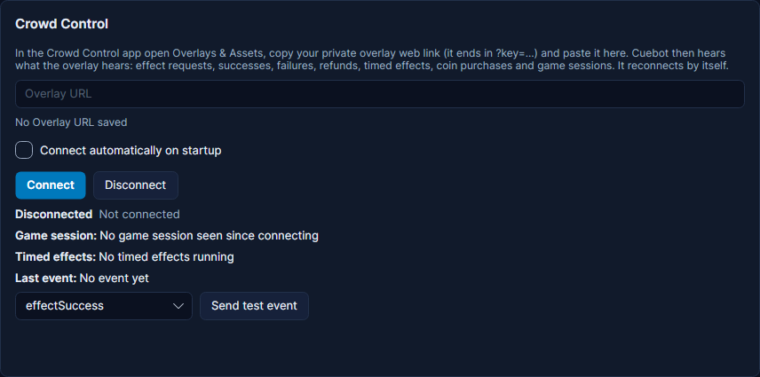

# Crowd Control

Crowd Control lets viewers change your game while you play: they spend coins to spawn an enemy, flip the screen or
give you a speed boost. Cuebot listens to your Crowd Control account, and each effect, coin purchase and game session
becomes a trigger. Example: a viewer sends "Spawn Creeper", and Cuebot plays a hiss sound and thanks them in chat.

## What you need

- The Crowd Control app, set up for your game.
- Your private **overlay URL** from the Crowd Control app. It is the same link Crowd Control's own overlay uses, and
  it ends in `?key=...`. No sign-in is needed.

## Set it up

1. In the Crowd Control app, open **Overlays & Assets** and copy your private overlay web link (it ends in `?key=...`).
2. In Cuebot, go to **Apps > Apps & devices**, tab **Apps & services**, and find the **Crowd Control** card.
3. Paste the link into **Overlay URL**. It stays hidden as dots.
4. Tick **Connect automatically on startup** if Cuebot should connect by itself every time it starts.
5. Click **Connect**. The status says "Connected to Crowd Control; waiting for effects".
6. Start a Crowd Control session in your game. **Game session:** on the card shows the game, and **Last event:** shows
   the newest effect.

**Send test event** (pick an event like **effectSuccess** or **coinExchange**) makes a pretend event inside Cuebot
only, so you can try your actions. Nothing is sent to Crowd Control.

!!! warning "Treat the link like a password"
    Anyone with your overlay URL can watch your Crowd Control activity. Do not show it on stream.

## What Cuebot can do

| Trigger (under **Crowd Control**) | When it runs |
| --- | --- |
| **Effect request** | A viewer asks for an effect, before it happens. |
| **Effect success** | The effect worked in your game. The best one for reactions. |
| **Effect failure** | The effect could not happen (`%temporary%` is True when it may work later). |
| **Effect refunded** | The viewer got their coins back. |
| **Effect retry** | The game asked Crowd Control to try again. |
| **Timed effect started** / **ended** / **update (paused / resumed)** | A lasting effect (like "slow motion for 30 seconds") starts, ends, pauses or resumes. |
| **Coin exchange** | Someone got coins, bought or free. |
| **Game session start** / **end** / **paused / resumed** | You start, stop or pause a Crowd Control session. |
| **Connected** / **Disconnected** | Cuebot connects, or the connection ends. |

The effect triggers give you `%user%` ("Anonymous" if hidden), `%effectName%`, `%effectDescription%`, `%price%` (in
coins), `%quantity%`, `%gameName%` and `%message%`. Timed effects add `%status%` and `%timeRemainingSeconds%`. Coin
exchanges give `%coinType%` (paid or free), `%amount%`, `%bonus%` and `%source%`.

The effect triggers can be narrowed down with **Effects** (names or ids, with commas, like `Spawn Creeper`), **Games**
and **Minimum price (coins)**. **Coin exchange** has **Coin type** and **Minimum coins**.

Successful effects go into the activity feed as redemptions ("Alice redeemed Spawn Creeper", "150 coins"), so they
reach the credits.

| Sub-action | What it does |
| --- | --- |
| **Crowd Control > Get session** | Saves the current session in variables: `%ccSessionActive%`, `%ccGameName%`, `%ccTimedEffects%` (running lasting effects) and more. |
| **Crowd Control > Send test event** | Makes a pretend event from an action. |

Full details: [Crowd Control triggers](../../reference/triggers/crowd-control.md),
[Crowd Control sub-actions](../../reference/sub-actions/crowd-control.md) and the script functions
[crowdcontrol.*](../../reference/script-functions/crowdcontrol.md).

Cuebot can listen, but it cannot send effects, answer them or start a session: Crowd Control has not given Cuebot the
app permission that needs.

## Examples

**Thank for every effect**

1. Make an action called "CC thanks".
2. Add the trigger **Crowd Control > Effect success**.
3. Add **Send chat message (any platform)** with `%user% sent %effectName%! Thanks for the %price% coins.`
4. Pick **effectSuccess** and click **Send test event** on the card to try it.

**A sound for one effect**

1. Make an action called "Creeper hiss".
2. Add the trigger **Crowd Control > Effect success** and type `Spawn Creeper` into **Effects**.
3. Add a sound sub-action with a hiss.

**!effects command**

1. Make an action with a [chat command](../chat/commands.md) `!effects`.
2. Add **Crowd Control > Get session**.
3. Add a chat message `Playing %ccGameName%. Running now: %ccTimedEffects%`.

## Troubleshooting

| You see | What to do |
| --- | --- |
| "Paste your Crowd Control Overlay URL first." or "No Overlay URL saved" | Paste the link, then click **Connect**. |
| "That URL has no overlay key. In the Crowd Control app open Overlays & Assets and copy your overlay URL (it ends in ?key=...)." | You copied a link without the key part. Copy the full overlay link. |
| "That does not look like a Crowd Control overlay URL or key." | Copy the link again from **Overlays & Assets**. |
| "Crowd Control refused the overlay key. Copy your Overlay URL again from the Crowd Control app (Overlays & Assets) and click Connect." | The key is wrong or was renewed. Copy it again. Cuebot does not retry a refused key by itself. |
| **Reconnecting in ...** | The connection dropped (Crowd Control also closes every connection after 2 hours). Cuebot reconnects by itself. |
| **Game session:** "No game session seen since connecting" | Cuebot only knows about sessions that start while it is connected. Start (or restart) the session in Crowd Control. |

!!! warning "Partly checked"
    Crowd Control answered Cuebot for real. But no real effect bought by a viewer has come in yet. See
    [What's experimental](../help/experimental.md).

## How it works (for the curious)

Cuebot opens a websocket (an always-open line) to Crowd Control's PubSub server and subscribes with the key from your
overlay link, just like Crowd Control's own overlay. It sends a ping every 8 minutes and reconnects when the answer is
missing. The link is stored locked in `integrations.json` in your [profile folder](../help/your-data.md).
